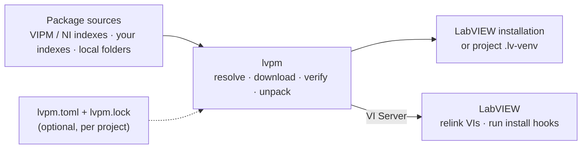

# lvpm

An open-source package manager for LabVIEW.

lvpm installs `.vip` and `.ogp` packages, the formats VIPM and OpenG use, by
name. It takes them from the public package directories, your own hosted
indexes, or local folders. It installs them either into a LabVIEW installation
or into a project's own venv, so two projects on one machine can use
different versions of the same library. Then it has LabVIEW fix the installed
VIs' links and run the packages' install hooks.

Not affiliated with JKI or NI. Working, in active development; see
[docs/roadmap.md](docs/roadmap.md) and [Known limitations](#known-limitations).

## How it works



1. lvpm resolves the package and its dependencies, downloads them and checks
   their MD5.
2. It unpacks them into the target: a LabVIEW installation, or a project venv
   that LabVIEW overlays onto its own tree.
3. Over VI Server, it has LabVIEW relink the installed VIs and run the
   packages' install hooks.

In a project, `lvpm.toml` says what you depend on. `lvpm.lock` records the
exact versions, so every machine and CI job gets the same packages, byte for
byte.

## Install

Windows 10/11 with LabVIEW 2020 or later. Linux is built and tested in NI's
LabVIEW Linux images. In PowerShell:

```powershell
cd $env:TEMP
irm https://raw.githubusercontent.com/ThatsTheEnd/lvpm/main/scripts/install.ps1 -OutFile install.ps1
.\install.ps1
```

This installs per-user and needs no elevation. Script options, the manual
download, Linux and building from source are in [docs/install.md](docs/install.md).

## Quick start

```console
$ lvpm targets                              # which LabVIEW installations lvpm sees
$ lvpm search error                         # find packages in the public indexes
$ lvpm install oglib_error --labview-version 2026
$ lvpm list                                 # what lvpm has installed there
$ lvpm uninstall oglib_error
```

`--labview-version` picks the target when more than one LabVIEW is
installed. Relinking and hooks need LabVIEW's VI Server (TCP) enabled, which
is its default setting (Tools » Options » VI Server). lvpm starts LabVIEW
itself when it is not running, and says so.

For a project, write an `lvpm.toml` ([The project manifest](docs/usage.md#the-project-manifest)), then:

```console
$ cd C:\Git\MyProject
$ lvpm venv create --labview-version 2026   # .lv-venv/ beside lvpm.toml by default
$ lvpm install                              # locks lvpm.toml into lvpm.lock, installs exactly that into .lv-venv
$ lvpm add oglib_error                      # one more dependency: lvpm.toml, lvpm.lock and .lv-venv together
$ lvpm launch MyProject.lvproj              # a LabVIEW that sees the venv
```

Commit `lvpm.toml` and `lvpm.lock` ([The lock file](docs/usage.md#the-lock-file)).

## Why

LabVIEW packaging was open before it was closed. The **OpenG Package Tools**
(2002–2005) designed and documented all of it: the zip-with-a-`spec`
package, the INI package directory, `Target Dir` tokens, file groups, replace
modes, install-time script VIs, the installed-package database, dependency
resolution, and a per-project "development system configuration" you could
export and re-import. VIPM descends from that design and is closed source;
the design, its documents and its source are still public at
<https://ogpm.sourceforge.net/>.

lvpm goes back to that model and finishes it: same formats, so today's `.vip`
and `.ogp` packages and the public `.ogpd` / `.vipr` directories work as-is,
with the LabVIEW-side work (fixing VI links, running hook VIs) done over VI
Server, a documented TCP protocol. [docs/ogpm-model.md](docs/ogpm-model.md)
is the reference and the term-by-term map from OGPT to lvpm.

## Learn more

| Document | What is in it |
| --- | --- |
| [docs/install.md](docs/install.md) | Install script options, manual and Linux install, building from source |
| [docs/usage.md](docs/usage.md) | Commands and flags, `lvpm.toml`, `lvpm.lock`, add/remove/upgrade, venvs, package sources, configuration |
| [docs/labview-integration.md](docs/labview-integration.md) | What an install does inside LabVIEW: relinking, install hooks, VI Server |
| [docs/ci-docker.md](docs/ci-docker.md) | Running lvpm headless in NI's Windows container |
| [docs/ogpm-model.md](docs/ogpm-model.md) | The OpenG package model lvpm implements, mapped term by term |
| [CONTRIBUTING.md](CONTRIBUTING.md) | Development setup, PR rules, releases, code layout |

## Known limitations

- `Replace Mode = If Newer` only writes when the file is absent; doing it
  properly means comparing archive timestamps against disk.
- Dependency conflicts are solved only when a project is locked. A named
  install outside a project still lets the first resolution of a name win, and
  a floor resolves to the newest version satisfying it.
- No mass compile; LabVIEW recompiles installed VIs on first load.
- A hook VI's own `error out` is not read back. A hook that fails internally
  but runs to completion reports as ok.
- A failure part-way through unpacking leaves files behind with no manifest,
  and one failed download aborts the rest of the plan.
- In NI's LabVIEW Linux images CI runs only the smoke flow
  ([Continuous integration](CONTRIBUTING.md#continuous-integration)); the
  `@labview` acceptance scenarios run in the Windows image only.
- In a venv, install hooks are extracted but never run (they act on the
  LabVIEW installation, not on an overlay), and file groups aimed at machine
  locations (`<OS ...>`, `<temp>`) are skipped. Both are recorded in the
  manifest and shown by `lvpm list`. No warning yet when a global copy of a
  venv package shadows it.

[docs/roadmap.md](docs/roadmap.md) has what is planned.

## License

MIT OR Apache-2.0
