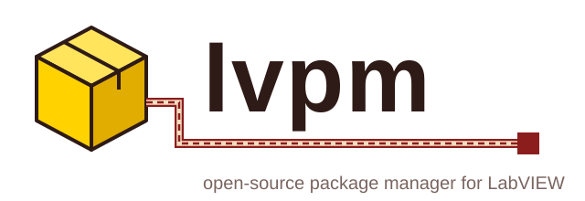

<p align="center">
  <picture>
    <source media="(prefers-color-scheme: dark)" srcset="docs/assets/lvpm-logo-dark.svg">
    
  </picture>
</p>

<p align="center">
  <a href="https://github.com/Flydroid/lvpm/actions/workflows/build.yml"></a>
  <a href="https://github.com/Flydroid/lvpm/releases"></a>
  <a href="#license"></a>
</p>

<p align="center">
  <a href="#install">Install</a> ·
  <a href="#quick-start">Quick start</a> ·
  <a href="docs/README.md">Documentation</a> ·
  <a href="docs/roadmap.md">Roadmap</a>
</p>

**lvpm** installs LabVIEW packages from the command line. It resolves `.vip`
and `.ogp` packages by name from the public package directories, your own
hosted indexes or local folders, downloads and verifies them, and unpacks
them into a LabVIEW installation or into a project's own **venv**. A project
declares what it needs in `lvpm.toml`, so every developer and every CI job
gets the same packages.

```console
$ lvpm venv create --labview-version 2026
$ lvpm install
resolved 48 packages:
  delacor_lib_qmh 7.1.2.1547
  ...
+ delacor_lib_qmh 7.1.2.1547 ... 65 files
...
done. 8766 files written.
linkfix: preparing installed files (repair links and separate compiled code; no LabVIEW needed)
$ lvpm launch MyProject.lvproj
```

## Features

- **Works with the packages that exist today.** Reads VIPM's `.vip` and
  OpenG's `.ogp` formats and the public package directories NI and JKI
  host, plus any index or folder of `.vip` files you add.
- **Per-project dependencies.** A venv keeps a project's packages beside it,
  mounted into LabVIEW as an LVAddons overlay. `C:\Program Files` never
  changes, and two projects can use two versions of the same library.
- **A manifest you commit.** `lvpm.toml` lists dependencies with exact pins,
  `>=` floors or `*`, optional dependency groups (`test`, `ci`, ...), extra
  package indexes, and per-package hook and relink settings.
- **No LabVIEW needed to install.** Linkfix repairs the installed VIs' links
  and separates compiled code by editing the files directly. LabVIEW is only started for install
  hooks and an optional load-and-save relink, driven over VI Server.
- **Built for CI.** Runs unchanged in NI's Windows and Linux LabVIEW
  containers; a headless install takes seconds and starts no LabVIEW.
- **Verified downloads, shared cache.** MD5 and SHA-256 checks, and a
  content-addressed cache so a package is downloaded once per machine.

## Install

Windows 10/11 with LabVIEW 2020 or later (venvs need LabVIEW 2024 Q1 or
later). In PowerShell:

```powershell
cd $env:TEMP
irm https://raw.githubusercontent.com/Flydroid/lvpm/main/scripts/install.ps1 -OutFile install.ps1
.\install.ps1
```

The script verifies the release's SHA-256, installs `lvpm.exe` per-user to
`%LOCALAPPDATA%\lvpm\bin` and adds it to your `PATH`; no elevation needed.

On Linux there is no release download yet: build from source
(`cargo build --release`) or take `lvpm-<version>-linux-x64.tar.gz` from a CI
run's artifacts. Manual install, building from source and Linux are covered
in [docs/installation.md](docs/installation.md) and
[docs/linux.md](docs/linux.md).

## Quick start

**One package into a LabVIEW installation:**

```console
$ lvpm targets                              # which LabVIEW installations lvpm sees
$ lvpm search error                         # find packages in the public indexes
$ lvpm install oglib_error --labview-version 2026
$ lvpm list                                 # what lvpm has installed there
$ lvpm uninstall oglib_error
```

**A project with its own venv.** Write an `lvpm.toml` at the project root:

```toml
[project]
name = "MyProject"
labview = "2026"              # the oldest LabVIEW the project supports

[dependencies]
delacor_lib_qmh = "7.1.2.1547"    # exactly this version
oglib_error = ">=6.0.1"           # the newest version satisfying the floor

[dependencies.test]               # installed only with --with test
jki_lib_caraya = "*"
```

then:

```console
$ cd C:\Git\MyProject
$ lvpm venv create                # .lv-venv/ beside lvpm.toml, bound to LabVIEW 2026
$ lvpm install --with test        # everything lvpm.toml lists, into .lv-venv
$ lvpm launch MyProject.lvproj    # a LabVIEW that sees the venv
```

Commit `lvpm.toml`; the venv ignores itself in git. Any `lvpm` command run
inside the project uses its venv, with no activation step.

## Commands

| Command | What it does |
| --- | --- |
| `lvpm install [<name>[@<version>]]` | Install a package, or everything `lvpm.toml` lists |
| `lvpm uninstall <name>` / `--all` | Remove a package, optionally with its unshared dependencies |
| `lvpm list` | What lvpm has installed into the target or venv |
| `lvpm search <query>` | Search the package indexes |
| `lvpm targets` | Detected LabVIEW installations |
| `lvpm venv create` / `status` / `remove` | Manage the project's venv |
| `lvpm launch [<lvproj>]` | Check the venv against the manifest and start LabVIEW on it |
| `lvpm linkfix` / `relink` / `run-hooks` / `refresh` | Rerun one step of an install |
| `lvpm config` / `cache add` | Settings and the package cache |

All commands and flags: [docs/commands.md](docs/commands.md).

## Documentation

| | |
| --- | --- |
| [Installation](docs/installation.md) | Install script, manual install, building from source |
| [Commands](docs/commands.md) | Every command and flag |
| [The manifest (`lvpm.toml`)](docs/manifest.md) | Dependencies, groups, sources, hooks and relink, `vipm.toml` |
| [Venvs](docs/venvs.md) | Per-project dependencies and `lvpm launch` |
| [What an install does](docs/install-process.md) | Linkfix, relinking, install hooks, VI Server |
| [Package sources and cache](docs/package-sources.md) | Public directories, own indexes, local folders |
| [Configuration](docs/configuration.md) | Settings, environment variables, logs |
| [CI in a container](docs/ci-container.md) | NI's Docker images, headless installs |
| [Linux](docs/linux.md) | What differs on Linux |
| [Known limitations](docs/limitations.md) | What does not work yet |
| [All documentation](docs/README.md) | Including design notes and internals |

## Why lvpm

LabVIEW packaging was open before it was closed. The OpenG Package Tools
(2002–2005) designed and documented the package format, the package
directories and install-time script VIs; VIPM descends from that design and
is closed source. lvpm goes back to the open model and finishes it, with the
same formats, so today's packages and directories work as they are. More in
[docs/architecture.md](docs/architecture.md).

## Status

Working and in active development. Windows is the tested platform; Linux is
verified in NI's container image. See [known limitations](docs/limitations.md)
and the [roadmap](docs/roadmap.md).

lvpm is not affiliated with JKI or NI.

## Contributing

Toolchain setup, tests and conventions are in
[CONTRIBUTING.md](CONTRIBUTING.md).

## License

Licensed under either of [MIT](LICENSE-MIT) or [Apache-2.0](LICENSE-APACHE),
at your option.
