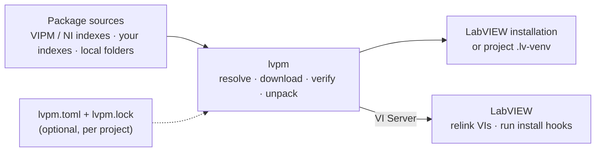

# lvpm

An open-source package manager for LabVIEW.

lvpm installs `.vip` and `.ogp` packages, the formats VIPM and OpenG use, and
its own `.lvpkg`, by name. It takes them from the public package directories, your own hosted
indexes, or local folders. It installs them either into a LabVIEW installation
or into a project's own venv, so two projects on one machine can use
different versions of the same library. Then it has LabVIEW fix the installed
VIs' links and run the packages' install hooks.

Not affiliated with JKI or NI. Working, in active development; see
[docs/roadmap.md](docs/roadmap.md) and [Known limitations](#known-limitations).

<!-- ANCHOR: how-it-works -->
## How it works



1. lvpm resolves the package and its dependencies, downloads them and checks
   their MD5.
2. It unpacks them into the target: a LabVIEW installation, or a project venv
   that LabVIEW overlays onto its own tree.
3. Over VI Server, it has LabVIEW relink the installed VIs and run the
   packages' install hooks.

In a project, `lvpm.toml` says what you depend on. `lvpm.lock` records the
exact versions, so every machine and CI job gets the same packages, byte for
byte.
<!-- ANCHOR_END: how-it-works -->

## Install

Windows 10/11 with LabVIEW 2020 or later. Linux is built and tested in NI's
LabVIEW Linux images. In PowerShell:

```powershell
cd $env:TEMP
irm https://raw.githubusercontent.com/ThatsTheEnd/lvpm/main/scripts/install.ps1 -OutFile install.ps1
.\install.ps1
```

This installs per-user and needs no elevation. If PowerShell refuses to run
the script, allow it with [Set-ExecutionPolicy](https://learn.microsoft.com/en-us/powershell/module/microsoft.powershell.security/set-executionpolicy?view=powershell-7.6).
Script options, the manual
download, Linux and building from source are in [docs/install.md](docs/install.md).

## Quick start

```console
$ lvpm targets                              # which LabVIEW installations lvpm sees
$ lvpm search error                         # find packages in the public indexes
$ lvpm install oglib_error --labview-version 2026
$ lvpm list                                 # what lvpm has installed there
$ lvpm uninstall oglib_error
```

`--labview-version` picks the target when more than one LabVIEW is
installed. Relinking and hooks need LabVIEW's VI Server (TCP) enabled, which
is its default setting (Tools » Options » VI Server). lvpm starts LabVIEW
itself when it is not running, and says so.

For a project, write an `lvpm.toml` ([The project manifest](docs/usage.md#the-project-manifest)), then:

```console
$ cd C:\Git\MyProject
$ lvpm venv create --labview-version 2026   # .lv-venv/ beside lvpm.toml by default
$ lvpm install                              # locks lvpm.toml into lvpm.lock, installs exactly that into .lv-venv
$ lvpm add oglib_error                      # one more dependency: lvpm.toml, lvpm.lock and .lv-venv together
$ lvpm launch MyProject.lvproj              # a LabVIEW that sees the venv
```

Commit `lvpm.toml` and `lvpm.lock` ([The lock file](docs/usage.md#the-lock-file)).

To package your own library, add a `[distribution]` table to `lvpm.toml`
([Building a package](docs/usage.md#building-a-package)), then:

```console
$ lvpm build                                # dist/<name>-<version>.lvpkg, no LabVIEW needed
$ lvpm publish --to D:/feeds/packages        # copy it into a folder feed, never replacing
```

## Why

LabVIEW packaging was open before it was closed. The **OpenG Package Tools**
(2002–2005) designed and documented all of it: the zip-with-a-`spec`
package, the INI package directory, `Target Dir` tokens, file groups, replace
modes, install-time script VIs, the installed-package database, dependency
resolution, and a per-project "development system configuration" you could
export and re-import. VIPM descends from that design and is closed source;
the design, its documents and its source are still public at
<https://ogpm.sourceforge.net/>.

lvpm goes back to that model and finishes it: same formats, so today's `.vip`
and `.ogp` packages and the public `.ogpd` / `.vipr` directories work as-is,
with the LabVIEW-side work (fixing VI links, running hook VIs) done over VI
Server, a documented TCP protocol. [docs/ogpm-model.md](docs/ogpm-model.md)
is the reference and the term-by-term map from OGPT to lvpm.

## JSON output and exit codes

<!-- ANCHOR: json-output -->

`--json` makes every command but the diagnostics (`app-probe`, `vi-probe`,
`vi-save`, `vi-run`) write JSON Lines to stdout. Each event is one line,
`{"event": "<name>", "data": {...}}`, for example
`{"event": "phase_started", "data": {"phase": "download"}}`; an event with no
fields has no `data`, for example `{"event": "indexes_loading"}`. The last line is
`{"result": ...}` when the command succeeds or `{"error": "<message>"}` when
it fails; no other line has either key. The query commands put their data in
the result (`search`, `info`, `list`, `targets`, `config get`, `cache add`,
`venv status`, `lock --check`); the others put `{"command": "<name>"}` there.
`venv status` gives `{"exists": false, "status": null}` when there is no venv.
A LabVIEW's `version` is its internal version (`26.3` for LabVIEW 2026), not
a package version.
Under `--json` a command never prompts: `venv remove` fails unless it gets
`--yes`.

The exit code is the same with or without `--json`:

| Code | Meaning |
| --- | --- |
| 0 | The command succeeded |
| 1 | The command failed; the message says why |
| 2 | The arguments are wrong (a usage error); nothing ran |

The event names, the result and error keys and these codes are stable: a
change to them is a breaking change and gets a major version.
<!-- ANCHOR_END: json-output -->

## Learn more

The documentation site, <https://thatstheend.github.io/lvpm/>, holds all of
the below as one book, starting with a tutorial.

| Document | What is in it |
| --- | --- |
| [docs/install.md](docs/install.md) | Install script options, manual and Linux install, building from source |
| [docs/usage.md](docs/usage.md) | Commands and flags, `lvpm.toml`, `lvpm.lock`, add/remove/upgrade, venvs, package sources, configuration |
| [docs/labview-integration.md](docs/labview-integration.md) | What an install does inside LabVIEW: relinking, install hooks, VI Server |
| [docs/ci-docker.md](docs/ci-docker.md) | Running lvpm headless in NI's Windows container |
| [docs/ogpm-model.md](docs/ogpm-model.md) | The OpenG package model lvpm implements, mapped term by term |
| [docs/adr/](docs/adr/README.md) | Architecture decisions, and why |
| [CONTRIBUTING.md](CONTRIBUTING.md) | Development setup, PR rules, releases, code layout |

## Known limitations

- `Replace Mode = If Newer` only writes when the file is absent; doing it
  properly means comparing archive timestamps against disk.
- Dependency conflicts are solved only when a project is locked. A named
  install outside a project still lets the first resolution of a name win, and
  a floor resolves to the newest version satisfying it.
- No mass compile; LabVIEW recompiles installed VIs on first load.
- A hook VI's own `error out` is not read back. A hook that fails internally
  but runs to completion reports as ok.
- A failure part-way through unpacking leaves files behind with no manifest,
  and one failed download aborts the rest of the plan.
- In NI's LabVIEW Linux images CI runs only the smoke flow
  ([Continuous integration](CONTRIBUTING.md#continuous-integration)); the
  `@labview` acceptance scenarios run in the Windows image only.
- In a venv, install hooks are extracted but never run (they act on the
  LabVIEW installation, not on an overlay), and file groups aimed at machine
  locations (`<OS ...>`, `<temp>`) are skipped. Both are recorded in the
  manifest and shown by `lvpm list`. No warning yet when a global copy of a
  venv package shadows it.

- `lvpm build` packages one library's members as a `.lvpkg`, lvpm's own
  format: no build hooks, no probes or templates from outside the library.
  VIPM cannot read it, so don't hand it to VIPM users
  ([ADR 6](docs/adr/0006-lvpkg-only-vip-read-only.md)).

[docs/roadmap.md](docs/roadmap.md) has what is planned.

## License

MIT OR Apache-2.0
