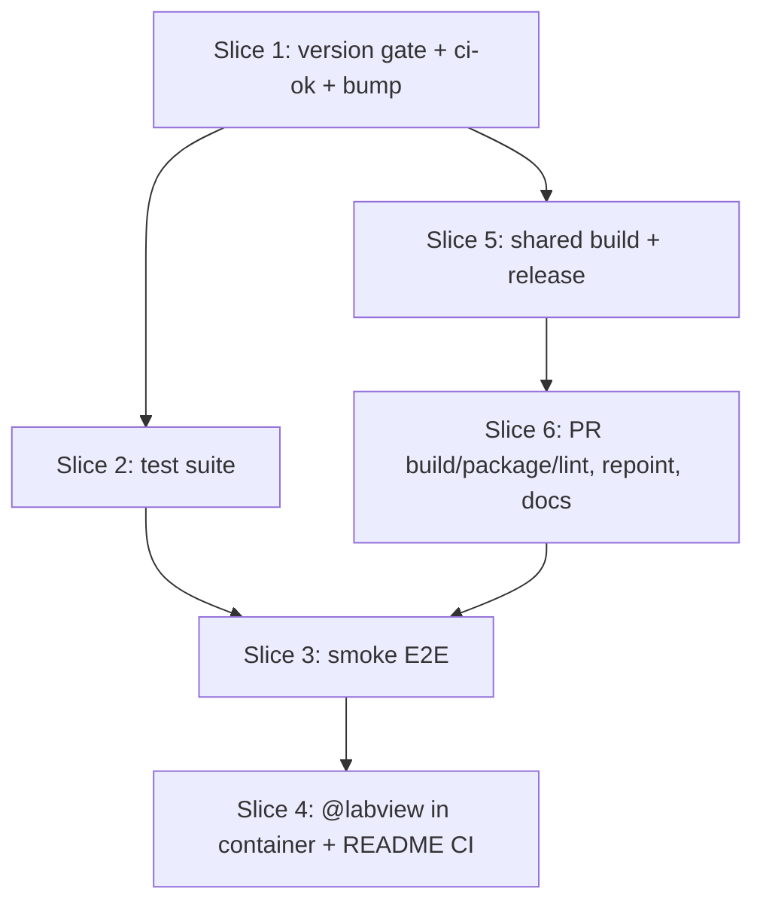

> **Superseded in part (2026-10-30):** the PR `version` job and "raise the version in every PR" are gone; release-please's release PR raises the version. See the note in `docs/specs/lvpm-ci-pipeline.md`.

# Plan: CI pipeline (PR checks, LabVIEW container E2E, release on main)

**Created**: 2026-10-25
**Branch**: claude/ci-pipeline-specs-1d7afa
**Status**: approved
**Gherkin persistence**: plan-file-only
<!-- The detected convention is tests/features, but those files are run by the
     cucumber harness's FEATURE_FILES list. These scenarios describe GitHub
     Actions behavior that the harness cannot run, so they stay in this file. -->
**Specs**: [docs/specs/lvpm-ci-pipeline.md](../docs/specs/lvpm-ci-pipeline.md)

## Goal

Add CI to `ThatsTheEnd/lvpm`. Each PR to `main` gets these checks:
- a version-bump gate;
- `cargo test` on Windows and Linux;
- release builds, plus a packaging and installer check;
- a smoke run of the real `lvpm` binary inside NI's LabVIEW Docker images (Windows 2026, Linux 2025, Linux 2026), plus the `@labview` acceptance scenarios on Windows 2026.

One aggregate job, `ci-ok`, passes only when all of them pass. It is the only required check.

A merge to `main` builds, packages, tags `v<version>` and publishes a GitHub release. The release is in the format `scripts/install.ps1` already installs.

## Approach stances (decision-defaults)

- **Scope:** only what the spec names. There are no caching, clippy, fmt or coverage gates, and no relink, MassCompile or Caraya E2E (spec A19).
- **Integration:** PRs merge through the required `ci-ok` check, with branches kept up to date. `main` builds only and does not test again (spec A8, a non-default stance the user chose). Branch protection is set by an admin, not by code.
- **Replace vs. merge:** the repository references to `Flydroid/lvpm` are replaced, not kept alongside the new ones (spec A5).
- **Format fidelity:** the release assets keep the names and the `SHA256SUMS` format of the existing v0.2.1 release. The Linux archive is added and the installer ignores it.
- **Delivery: 3 PRs, merged in order A → B → C** (user choice at approval). Each PR raises the version and passes its own `ci-ok`. See `## Delivery`.
- **One build definition:** `.github/workflows/build.yml` (`workflow_call`) builds both targets. `pr.yml` and `release.yml` both call it, so a PR builds exactly what main releases.

## Acceptance Criteria

- [ ] AC-V1–V5: the version gate fails when the version is equal or lower, not above the highest tag, malformed or suffixed, or does not match the lockfile. It passes on any patch, minor or major bump. Every failure message ends with the fix.
- [ ] AC-T1–T2: `cargo test --workspace --locked` passes on `windows-2022` and `ubuntu-latest`. No test is skipped, ignored or deleted to make this happen.
- [ ] AC-E1–E5:
  - The smoke flow passes in all three image cells.
  - On Windows 2026 the `@labview` scenarios run and pass: the log has no "@labview scenarios not run" line, the passed count equals the count measured in step 4.1, and the exit code is 0. `@unsafe` scenarios are excluded by the harness and stay excluded.
  - Images are pinned by an exact NI tag (a lint rejects `latest` and unpinned tags). Adding an image is one matrix row.
  - Fork PRs need no secrets.
- [ ] AC-R1–R7: a merge publishes `vX.Y.Z` with a Windows zip, a Linux tar.gz and `SHA256SUMS`.
  - The release is a pre-release while the major version is 0.
  - The workflow refuses a duplicate or non-increasing version before it builds.
  - It publishes only after all assets are uploaded and runs no tests. A failed run leaves at most a draft, which `install.ps1` skips and a re-run replaces.
  - `install.ps1` installs the new release.
- [ ] AC-D1–D5: no `Flydroid/lvpm` remains. CONTRIBUTING documents the bump rule, what to do when main moves, and that only PRs made with the agentic dev-team workflow are considered (spec, plan and cucumber BDD scenarios present). The README documents the matrix, the `ci-ok` required check, Linux install and a release-failure runbook. The roadmap records what is automated and what is manual.

## Slices

### Slice 1: Version gate, the `ci-ok` check and this PR's bump

**Depends-on:** none
**Files:** `ci/version-check.sh`, `ci/version-check.test.sh`, `.github/workflows/pr.yml`, `Cargo.toml`, `Cargo.lock`

**Behavior:**

```gherkin
Feature: every PR raises the version

  Background:
    Given main's version is 0.2.1
    And the highest version tag is v0.2.1

  Scenario Outline: a strictly higher plain version passes
    When a PR sets the version to <version> in Cargo.toml and Cargo.lock
    Then the version check passes
    Examples:
      | version |
      | 0.2.2   |
      | 0.3.0   |
      | 1.0.0   |

  Scenario: an unchanged version fails and says how to fix it
    When a PR leaves the version at 0.2.1
    Then the version check fails naming 0.2.1
    And the message says to raise the workspace version and update the lockfile

  Scenario: a lower version fails
    When a PR sets the version to 0.2.0
    Then the version check fails naming 0.2.0 and 0.2.1

  Scenario: a version equal to the highest tag fails
    Given main's version is 0.2.0
    And the highest version tag is v0.3.0
    When a PR sets the version to 0.3.0
    Then the version check fails naming 0.3.0 and v0.3.0

  Scenario: a version not above the highest tag fails
    Given the highest version tag is v0.4.0
    When a PR sets the version to 0.3.0
    Then the version check fails naming 0.3.0 and v0.4.0

  Scenario: main moved while the PR was open
    Given the PR set the version to 0.3.0
    And another PR has since merged version 0.3.0 to main
    When the PR's checks run again
    Then the version check fails saying main is now 0.3.0
    And the message says to rebase and raise the version above 0.3.0

  Scenario: with no tags only main's version counts
    Given the repository has no version tags
    When a PR sets the version to 0.2.2
    Then the version check passes

  Scenario: tags that are not plain versions are ignored
    Given the tags v0.2.1, v0.9.0-rc.1 and nightly exist
    When a PR sets the version to 0.3.0
    Then the version check passes

  Scenario Outline: a malformed or suffixed version fails
    When a PR sets the version to <version>
    Then the version check fails saying the version must be MAJOR.MINOR.PATCH
    Examples:
      | version    |
      | 0.3.0-rc.1 |
      | 0.3.0+ci   |
      | 0.3        |
      | 0.3.0.1    |
      | v0.3.0     |
      | 0.03.0     |

  Scenario: a missing version fails
    When a PR removes the workspace version
    Then the version check fails saying no workspace version was found

  Scenario Outline: a lockfile that disagrees fails
    When a PR sets Cargo.toml to 0.3.0 but Cargo.lock still records <crate> 0.2.1
    Then the version check fails naming <crate> and both versions
    Examples:
      | crate     |
      | lvpm      |
      | lvpm-core |

  Scenario: versions compare numerically, not as text
    Given main's version is 0.9.0
    When a PR sets the version to 0.10.0
    Then the version check passes

  Scenario Outline: the version decides the pre-release flag
    When the pre-release flag is asked for version <version>
    Then the answer is <flag>
    Examples:
      | version | flag  |
      | 0.3.0   | true  |
      | 0.99.99 | true  |
      | 1.0.0   | false |

Feature: one required check covers every PR job

  Scenario: ci-ok fails when any job fails or is skipped
    Given one PR job fails, is cancelled or is skipped
    Then the ci-ok check fails and names that job

  Scenario: ci-ok passes when every job passes
    Given every PR job passes
    Then the ci-ok check passes

  Scenario: a new matrix row does not change the required checks
    When a matrix row is added to a PR job
    Then the only required check is still ci-ok

  Scenario: a new push cancels the PR's older run
    Given a PR run is in progress
    When the PR receives a new commit
    Then the older run is cancelled and a new run starts
```

**Steps:**

#### Step 1.1: version-check script with a self-test

**Complexity**: standard
**IMPLEMENT**: `ci/version-check.sh <base-ref>` reads `[workspace.package] version` from `Cargo.toml` and from `git show <base-ref>:Cargo.toml`.
- It validates both against `^(0|[1-9][0-9]*)\.(0|[1-9][0-9]*)\.(0|[1-9][0-9]*)$`.
- It filters tags to `^v[0-9]+\.[0-9]+\.[0-9]+$` before taking the highest with `sort -V`, so rc and other tags are ignored.
- It checks the `lvpm` and `lvpm-core` entries in `Cargo.lock`.
- Each failure exits 1 through one `fail()` helper. The message names the versions and ends with the fix: "Raise `[workspace.package] version` in Cargo.toml above X, then run `cargo update -w`." When the base version at the tip differs from the base version at `git merge-base HEAD <base-ref>`, main moved, and it says "main is now X; rebase and raise above X."
- `--print-prerelease <version>` prints `true` when the major version is 0.
**TEST**: `ci/version-check.test.sh` builds throwaway git repos in a temp directory, one per scenario row above, and asserts the exit code and the message. Run it locally under Git Bash.
**REFACTOR**: one `fail()` helper; inline the rest.
**Files**: `ci/version-check.sh`, `ci/version-check.test.sh`
**Commit**: `ci: add the version-bump check`

#### Step 1.2: PR workflow with the version job and `ci-ok`

**Complexity**: standard
**IMPLEMENT**: `.github/workflows/pr.yml` runs on `pull_request` to `main`.
- `concurrency: pr-${{ github.event.pull_request.number }}` with `cancel-in-progress: true`. Every job has `timeout-minutes`.
- The `version` job checks out the PR head SHA with `fetch-depth: 0` and `fetch-tags: true`, runs the self-test, then runs `ci/version-check.sh origin/main`.
- The `ci-ok` job has `if: always()` and `needs:` every other job. It fails unless every `needs.*.result` is `success`. It names `failure` and `cancelled` jobs first, then the rest as "skipped (downstream)". Later slices add their jobs to its `needs`.
- Matrix cells get readable names, for example `e2e (linux, LabVIEW 2025)`.
- `version` and `test` need nothing, so they report first.
**TEST**: open a draft PR from this branch. `version` and `ci-ok` fail while the version is still 0.2.1 (AC-V1, observed in CI).
**REFACTOR**: none.
**Files**: `.github/workflows/pr.yml`
**Commit**: `ci: run the version check on every PR, behind one ci-ok check`

#### Step 1.3: raise this PR's version to 0.3.0

**Complexity**: trivial
**IMPLEMENT**: set `[workspace.package] version = "0.3.0"` (minor, because there is a new Linux artifact) and run `cargo update -w`. This is early, so the PR's own gate is green from here on. PR A adds no release workflow, so 0.3.0 is never published; PR B's 0.4.0 is the first release.
**TEST**: `git diff Cargo.lock` shows only the `lvpm` and `lvpm-core` version lines. `version` is green on the PR.
**REFACTOR**: none.
**Files**: `Cargo.toml`, `Cargo.lock`
**Commit**: `chore: release 0.3.0`

### Slice 2: Test suite on Windows and Linux

**Depends-on:** 1
**Files:** `.github/workflows/pr.yml`, `src/`, `crates/lvpm-core/src/`, `tests/`

**Behavior:**

```gherkin
Feature: the full test suite runs on every PR

  Scenario Outline: the suite passes on each OS
    When a PR to main is opened or updated
    Then cargo test --workspace --locked runs on <runner>
    And it passes
    Examples:
      | runner        |
      | windows-2022  |
      | ubuntu-latest |

  Scenario: a failing test fails the PR
    Given a PR that breaks a test
    When the PR checks run
    Then the test check for that OS fails and names the failing test
    And ci-ok fails

  Scenario: @labview scenarios do not run outside a container
    When the suite runs on a hosted runner
    Then the log reports the @labview scenarios as not run
    And the suite still passes

  Scenario: Linux passes without hiding tests
    When the Linux fixes are compared with main
    Then no test is newly ignored, deleted or newly gated to one OS
    And the test count on Linux equals the count on Windows, except tests of Windows-only behavior
```

**Steps:**

#### Step 2.1: test job on both OSes (spike for Linux)

**Complexity**: trivial
**IMPLEMENT**: add a `test` job with matrix `[windows-2022, ubuntu-latest]` and `dtolnay/rust-toolchain@stable` with `components: clippy`, plus a comment that `tests/steps/core_io.rs` runs clippy, so this is not a clippy gate. The job runs `cargo test --workspace --locked` with `timeout-minutes: 90` and `::group::` log folding. Add it to `ci-ok`'s `needs`.
**TEST**: push. Windows is green and its log has the "@labview scenarios not run" line. Record each Linux failure as the work list for step 2.2.
**REFACTOR**: none.
**Files**: `.github/workflows/pr.yml`
**Commit**: `ci: run cargo test on Windows and Linux`

#### Step 2.2: make the suite pass on Linux

**Complexity**: complex
**IMPLEMENT**: fix the root cause of each Linux failure in shared code. Likely sources are path separators, `.exe` suffixes, Windows-only fixtures, goldens normalised with `\`, and `tests/golden/unit-tests.txt`, which lists cfg-dependent unit tests. A test of Windows-only behavior gets `cfg(windows)` only where the behavior itself is Windows-only (AC-T2). Each fix is its own commit and says why.
**Limit:** if 2.1 shows more than 15 distinct Linux failures, stop and ask whether the fixes go in a separate PR first.
**TEST**: the `ubuntu-latest` job is green and `windows-2022` stays green. `git diff main -- tests src crates` adds no `#[ignore]`, deletes no test, and every new `cfg(windows)` names the Windows-only behavior in its commit.
**REFACTOR**: merge duplicated per-OS branches into one helper where two or more fixes need the same one.
**Files**: `src/`, `crates/lvpm-core/src/`, `tests/`
**Commit**: `fix(linux): <per failure>`

### Slice 3: Container smoke E2E

**Depends-on:** 2, 6
**Files:** `Cargo.toml`, `.github/workflows/pr.yml`, `ci/e2e/smoke.sh`, `ci/e2e/smoke.ps1`, `ci/e2e/smoke.test.sh`, `ci/e2e/fixture/lvpm.toml`, `ci/e2e/fixture/lvpm.lock`, `ci/lint/e2e-matrix.sh`, `ci/lint/e2e-matrix.test.sh`, `crates/lvpm-core/Cargo.toml`, `Cargo.lock`, `src/`, `crates/lvpm-core/src/`

**Behavior:**

```gherkin
Feature: the lvpm binary works inside NI's LabVIEW images

  Scenario Outline: the smoke flow passes in each image
    Given the release binary built from the PR
    And the image <image> with LabVIEW <year> on <os>
    And a temporary copy of the CI fixture project, which requires LabVIEW 2025 and pins one named package version
    When the smoke flow runs headless in the container
    Then lvpm targets lists LabVIEW <year>
    And lvpm search finds the fixture's package
    And lvpm lock --check succeeds
    And lvpm install succeeds and the package's files exist in the project
    And lvpm list names the package at its locked version
    And lvpm uninstall succeeds and the package's files are gone
    And no LabVIEW process ran during the flow
    And the last line says the smoke flow passed all 7 steps
    Examples:
      | os      | year | image                      |
      | windows | 2026 | 2026q3-windows             |
      | linux   | 2025 | 2025q3patch1-linux         |
      | linux   | 2026 | 2026q3-linux               |

  Scenario: a failing step stops the flow and names itself
    Given a binary whose lvpm lock --check fails
    When the smoke flow runs
    Then the cell fails at that step
    And the log and the job summary say "FAILED at step 3/7" with the command and its output

  Scenario: a LabVIEW process fails the cell
    Given a LabVIEW process starts during the flow
    When the smoke flow samples the processes
    Then the cell fails saying LabVIEW was started

  Scenario: the LabVIEW process check can see LabVIEW
    Given a process named like LabVIEW is started on purpose
    When the process check runs
    Then it reports the process

  Scenario: an unreachable registry is reported as infrastructure
    Given the package registry cannot be reached
    When the smoke flow runs
    Then the cell fails saying the registry was unreachable, not that lvpm is broken

  Scenario: an image that cannot be pulled is reported as infrastructure
    Given the image pull fails after the retries
    Then the cell fails saying the image could not be pulled

  Scenario: one failing cell fails the PR
    Given the smoke flow fails in one cell
    Then that cell's check fails and ci-ok fails
    And the other cells still report their own result

  Scenario: a new image is one matrix row
    When an image row with os, runner, image and script is added to the e2e matrix
    Then the new cell runs with no other workflow change

  Scenario Outline: a moving or unknown image tag is rejected
    When the e2e matrix names the image <image>
    Then the matrix lint fails naming <image>
    Examples:
      | image                               |
      | nationalinstruments/labview:latest  |
      | nationalinstruments/labview         |
      | someone/labview:2026q3-windows      |

  Scenario: a fork PR runs the same checks
    Given a PR from a fork, which has no repository secrets
    Then every PR job runs and none is skipped for lack of a secret
```

**Steps:**

#### Step 3.1: raise PR C's version

**Complexity**: trivial
**IMPLEMENT**: first commit of PR C. Raise `[workspace.package] version` above main's (0.4.0 → 0.4.1 if PR C changes no product behavior; 0.5.0 if step 3.3 changes `src/` behavior) and run `cargo update -w`. The `build` job already exists in `pr.yml` (step 6.1).
**TEST**: the PR's `version` job is green.
**REFACTOR**: none.
**Files**: `Cargo.toml`, `Cargo.lock`
**Commit**: `chore: release 0.4.1`

#### Step 3.2: fixture, Linux smoke script and the e2e matrix

**Complexity**: standard
**IMPLEMENT**:
- Fixture: `labview = 2025` and one small public package with no hooks and no OS restriction, chosen from `lvpm search` and pinned by name and version. Its lock is made with `lvpm lock`. The package's installed file path is written in the script, not looked up.
- `smoke.sh` takes `LVPM_BIN` and the fixture path. It copies the fixture to a temp directory, then runs steps 1–7 of the spec with `set -euo pipefail` and `LV_RTE_HEADLESS=1`.
  - One `step()` function echoes the command inside `::group::`, runs it, prints elapsed time, and on failure writes "FAILED at step N/7: <command>" to the log and `$GITHUB_STEP_SUMMARY`.
  - A background `pgrep -x -i labview` sampler runs during the flow, and the cell fails if it ever matched.
  - A failed registry request is reported as "infrastructure: registry unreachable".
- `ci/e2e/smoke.test.sh` runs `smoke.sh` with a stub `LVPM_BIN` script: once passing, once failing at step 3, and once with a dummy process named `labview` as the sampler's positive control.
- `e2e` matrix with `fail-fast: false`. Each row has `os`, `runner`, `image`, `script` and `acceptance` (false for now). Conditionals read those fields, never image names. The job needs `build`, pulls with up to 3 tries, and runs `docker run` with the binary and `ci/e2e` mounted. The smoke container is separate from any later acceptance container.
- `ci/lint/e2e-matrix.sh` checks each image matches `^nationalinstruments/labview:[0-9]{4}q[0-9][a-z0-9]*-(windows|linux)$`, and that its `-windows`/`-linux` suffix matches the row's `os`, with a self-test. The same lint checks that `pr.yml`, `build.yml` and `package.yml` set `permissions: contents: read` and reference no `secrets.` other than `GITHUB_TOKEN` (AC-E5), and that no `if:` in `pr.yml` names an image (a new image stays one row). The `lint` job from step 6.1 picks both files up through its glob. Add `e2e` to `ci-ok`'s `needs`.
**TEST**: `smoke.test.sh` and the matrix lint self-test pass locally. Both Linux cells are green. In a scratch commit, break step 3 and check the cell fails with "FAILED at step 3/7"; then drop the commit.
**REFACTOR**: keep `step()` the one place that echoes, times and checks.
**Files**: `ci/e2e/fixture/lvpm.toml`, `ci/e2e/fixture/lvpm.lock`, `ci/e2e/smoke.sh`, `ci/e2e/smoke.test.sh`, `ci/lint/e2e-matrix.sh`, `ci/lint/e2e-matrix.test.sh`, `.github/workflows/pr.yml`
**Commit**: `ci: run the CLI smoke flow in the LabVIEW Linux images`

#### Step 3.3: make the Linux binary run in NI's images (only if 3.2 shows it does not)

**Complexity**: standard
**IMPLEMENT**: if the binary fails to load in the image (OpenSSL or glibc), switch reqwest from `default-tls` to `rustls-tls` in `crates/lvpm-core/Cargo.toml`. If glibc is the cause, pin the Linux build in `build.yml` to the oldest ubuntu runner that matches the image. Any other runtime failure found here is fixed at its root in `src/` or `crates/lvpm-core/src/`.
**TEST**: the Linux cells are green, and the test jobs on both OSes are green.
**REFACTOR**: none.
**Files**: `crates/lvpm-core/Cargo.toml`, `Cargo.lock`, `src/`, `crates/lvpm-core/src/`
**Commit**: `fix(linux): make the binary run in NI's LabVIEW Linux images`

#### Step 3.4: Windows smoke cell

**Complexity**: standard
**IMPLEMENT**:
- `smoke.ps1` is the PowerShell twin of `smoke.sh`: same step list, wording and summary line. It checks `$LASTEXITCODE` after each step and samples `tasklist /FI "IMAGENAME eq LabVIEW.exe"`.
- Add the Windows row on `windows-2022`. It frees disk and fails with "infrastructure: <n> GB free, need 25" before the pull if space is short, then runs `docker run --isolation=process`. The mounts target `C:\` paths, because Windows containers have only `C:`.
**TEST**: the Windows 2026 cell is green, and the pull time and free disk are in the job log. Run `smoke.ps1` locally with a stub `LVPM_BIN`, once passing and once failing at step 3.
**REFACTOR**: keep the step list in the same order and wording as `smoke.sh`, so the two diff by eye.
**Files**: `ci/e2e/smoke.ps1`, `.github/workflows/pr.yml`
**Commit**: `ci: run the CLI smoke flow in the LabVIEW Windows image`

### Slice 4: `@labview` acceptance scenarios in the Windows 2026 container

**Depends-on:** 3
**Files:** `.github/workflows/pr.yml`, `.github/workflows/build.yml`, `ci/e2e/labview-acceptance.ps1`, `tests/acceptance.rs`, `README.md`

**Behavior:**

```gherkin
Feature: the LabVIEW-bound acceptance scenarios run against a real LabVIEW 2026

  Scenario: the @labview scenarios pass in the Windows 2026 image
    Given the acceptance test binary built from the PR
    And the image 2026q3-windows
    When only the @labview scenarios run in the container
    Then the log has no "@labview scenarios not run" line
    And the passed count equals the count measured on a LabVIEW 2026 machine
    And the run exits with success

  Scenario: @unsafe scenarios stay excluded
    When the @labview scenarios run in the container
    Then the @unsafe scenarios are reported as never run

  Scenario: a golden that no longer matches fails the cell
    Given a recording that differs from the container's output
    When the @labview scenarios run
    Then the cell fails and shows the difference

  Scenario: the README states what CI covers
    When a reader opens the README's CI section
    Then it lists the tested LabVIEW and OS cells
    And it names ci-ok as the one required check and the other branch-protection settings
    And it says Linux is built and tested in NI's LabVIEW Linux images
    And it no longer says Linux is untested
```

**Steps:**

#### Step 4.1: run the prebuilt acceptance binary in the container

**Complexity**: complex
**IMPLEMENT**:
- Harness: add `LVPM_TEST_ONLY_LABVIEW=1` to `tests/acceptance.rs`. With it set, the harness runs only `@labview` scenarios (still never `@unsafe`) and prints the passed count. This keeps CARGO-bound and non-LabVIEW scenarios out of the container.
- `build.yml` gets an `acceptance` input (default false). When true, the Windows leg copies the checkout to `C:\src\lvpm`, runs `cargo test --test acceptance --no-run --locked` there, and uploads the binary with `tests/features` and `tests/golden`. The path matters because `CARGO_MANIFEST_DIR` and `CARGO_BIN_EXE_lvpm` are fixed at compile time. This builds in `build`, as spec C1 says; `release.yml` calls `build.yml` without the input.
- `ci/e2e/labview-acceptance.ps1` mounts `C:\src\lvpm` at the same path in a container separate from the smoke one and runs the binary with `LVPM_TEST_LABVIEW=1` and `LVPM_TEST_ONLY_LABVIEW=1`. LabVIEW is not pre-started; the scenarios start it as they do locally. The script checks the log against the three AC-E3 conditions and that the "@unsafe scenarios never run" line is present.
- The e2e matrix's Windows row sets `acceptance: true`.
**TEST**:
- Measure the `@labview` passed count locally on a LabVIEW 2026 machine with both variables set, and record it in the script and in this plan. The cell's count matches it (AC-E3).
- A unit test in `tests/acceptance.rs` checks the selector keeps only `@labview` scenarios.
- In a scratch commit, change one golden and check the cell fails with the diff; then drop the commit.
**REFACTOR**: keep the container command in `labview-acceptance.ps1`, not in the YAML.
**Files**: `tests/acceptance.rs`, `.github/workflows/build.yml`, `.github/workflows/pr.yml`, `ci/e2e/labview-acceptance.ps1`
**Commit**: `ci: run the @labview acceptance scenarios in LabVIEW 2026 for Windows`

#### Step 4.2: README states what CI covers

**Complexity**: trivial
**IMPLEMENT**: README "Continuous integration": the matrix cells, `ci-ok` as the one required check plus "require branches to be up to date", and Linux support worded as "tested in NI's LabVIEW Linux images". Remove the "Linux untested" line.
**TEST**: `cargo test` is green (the docs steps read the README). Grep: README has `ci-ok` and each image's LabVIEW year, and no "untested" next to Linux.
**REFACTOR**: keep the section short and link the spec.
**Files**: `README.md`
**Commit**: `docs: describe what CI covers`

### Slice 5: Shared build and release workflow

**Depends-on:** 1
**Files:** `.github/workflows/build.yml`, `.github/workflows/package.yml`, `.github/workflows/release.yml`, `ci/package.sh`, `ci/package.test.sh`, `ci/version-check.sh`, `ci/version-check.test.sh`, `ci/lint/release.sh`, `ci/lint/release.test.sh`, `ci/lint/install-drafts.sh`, `ci/fixtures/releases-draft.json`, `scripts/install.ps1`

**Behavior:**

```gherkin
Feature: a merge to main publishes a release

  Scenario: a merge publishes the version's release
    Given main's version is 0.3.0 and no tag v0.3.0 exists
    When a PR merges to main
    Then tag v0.3.0 points at the merge commit
    And a published release v0.3.0 holds lvpm-0.3.0-windows-x64.zip, lvpm-0.3.0-linux-x64.tar.gz and SHA256SUMS
    And each archive holds the binary, README.md, LICENSE-MIT and LICENSE-APACHE
    And the Linux binary in the tar.gz is executable
    And SHA256SUMS lists the correct hash of each archive

  Scenario Outline: pre-release while the major version is 0
    Given main's version is <version>
    When the release is published
    Then it <is or is not> marked pre-release
    Examples:
      | version | is or is not |
      | 0.3.0   | is           |
      | 1.0.0   | is not       |

  Scenario: an existing tag stops the release before it builds
    Given tag v0.3.0 already exists
    When a commit with version 0.3.0 reaches main
    Then the release fails naming v0.3.0
    And the job summary says to raise the version in a new PR
    And nothing is built, tagged or published

  Scenario: a version below the highest tag stops the release
    Given tag v0.4.0 exists and no tag v0.3.0 exists
    When a commit with version 0.3.0 reaches main
    Then the release fails naming 0.3.0 and v0.4.0 before building
    And no tag or release is created

  Scenario: a failed upload leaves no published release
    Given an asset upload fails
    Then no non-draft release v0.3.0 exists
    And the job summary names v0.3.0, the failed job and says to re-run the workflow

  Scenario: the installer skips a draft release
    Given the releases list holds a draft v0.3.0 and a published v0.2.1
    When install.ps1 picks a release
    Then it picks v0.2.1

  Scenario: a re-run after a failure replaces the leftover draft
    Given a failed run left a draft release v0.3.0
    When the release workflow is re-run
    Then the old draft is removed
    And v0.3.0 is published once with all three assets

  Scenario: two merges release in order
    Given two PRs merge one shortly after the other
    Then the second release starts after the first finishes
    And both versions are released

  Scenario: the installer installs the new release
    Given release v0.3.0 is published
    When install.ps1 runs with no arguments
    Then it installs lvpm 0.3.0 and the checksum verification passes

  Scenario: the release workflow is wired safely
    When the release workflow file is checked
    Then build and publish both need guard
    And the release is created as a draft before any upload
    And it is made public only as the last step
    And no step creates a tag outside that
    And no step runs cargo test

  Scenario: a dry run publishes nothing
    When the release workflow is started by hand with dry_run
    Then it builds, packages and checks the installer
    And it creates no tag and no release
```

**Steps:**

#### Step 5.1: shared build workflow and package script

**Complexity**: standard
**IMPLEMENT**:
- `.github/workflows/build.yml` (`workflow_call`): a matrix over `windows-2022` and the Linux runner, `cargo build --release --locked`, `lvpm --version` as a check, `actions/upload-artifact`.
- `ci/package.sh <version> <windows-exe> <linux-bin> <out-dir>` writes the zip, the tar.gz (binary at mode 0755) and `SHA256SUMS` in `sha256sum` format.
- `.github/workflows/package.yml` (`workflow_call`): `package` on ubuntu runs `package.sh`; `verify-installer` on `windows-2022` runs `scripts/install.ps1 -Archive <zip> -Sha256 <hash>` into a temp prefix and checks `lvpm --version`. It uploads the package as an artifact.
**TEST**: `ci/package.test.sh` runs `package.sh` on stub binaries and checks the zip file list, the tar entry mode 0755 and `sha256sum -c SHA256SUMS`. Locally, run `install.ps1 -Archive` on the zip.
**REFACTOR**: none.
**Files**: `.github/workflows/build.yml`, `.github/workflows/package.yml`, `ci/package.sh`, `ci/package.test.sh`
**Commit**: `ci: add the shared build and packaging workflows`

#### Step 5.2: release-mode version check

**Complexity**: standard
**IMPLEMENT**: add `--release` to `version-check.sh`: it fails if tag `v<version>` exists or the version is not above the highest plain tag. The message ends with "raise the version in a new PR".
**TEST**: new self-test rows for the existing-tag and not-above-highest cases.
**REFACTOR**: reuse the parse and compare code; no second script.
**Files**: `ci/version-check.sh`, `ci/version-check.test.sh`
**Commit**: `ci: add a release mode to the version check`

#### Step 5.3: release workflow

**Complexity**: complex
**IMPLEMENT**: `release.yml` runs on `push` to `main` and on `workflow_dispatch` with a `dry_run` input. It has `concurrency: release` (no cancel) and `permissions: contents: write`. Jobs:
- `guard`: `version-check.sh --release`; prints the version and `--print-prerelease`.
- `build`: calls `build.yml` (needs guard).
- `package`: calls `package.yml`.
- `publish` (needs guard and package; skipped on dry run):
  1. delete a leftover draft for the tag if one exists (`gh release view` reports `isDraft`); a published one has already failed guard;
  2. `gh release create v<ver> --draft --generate-notes --target $GITHUB_SHA`, with `--prerelease` from guard;
  3. upload the three assets;
  4. `gh release edit v<ver> --draft=false` last.
- A final `release-report` job (`if: failure()`, `needs:` every other job) writes "Release v<ver> failed in <job>: <next action>" to `$GITHUB_STEP_SUMMARY`, naming the first non-success job. Reusable-workflow caller jobs cannot add steps, so one report job does it for all. The release lint checks that the job exists.
- `ci/lint/release.sh` checks the wiring: build and publish need guard, the first `gh release create` has `--draft`, `--draft=false` is the last `gh` call, no `git tag`/`git push --tags`, and no `cargo test`. It has a self-test. Step 6.1's `lint` job runs it on PRs.
- `ci/fixtures/releases-draft.json` is a releases list with a draft v0.3.0 and a published v0.2.1. The draft filter in `install.ps1` moves into a `Select-Release($releases, $Stable)` function with no behaviour change. `ci/lint/install-drafts.sh` runs `pwsh`, extracts that function with the PowerShell parser (no script run), feeds it the fixture and expects v0.2.1. It runs in the `lint` job (pwsh is on ubuntu runners).
**TEST**: the release lint self-test and the draft-fixture check pass locally. A `workflow_dispatch` dry run on this branch builds, packages and verifies the installer with no tag or release. The real run on PR B's merge publishes v0.4.0; check it with the post-merge checklist below.
**REFACTOR**: none.
**Files**: `.github/workflows/release.yml`, `ci/lint/release.sh`, `ci/lint/release.test.sh`, `ci/lint/install-drafts.sh`, `ci/fixtures/releases-draft.json`, `scripts/install.ps1`
**Commit**: `ci: build and publish a release on every merge to main`

### Slice 6: PR packaging check, repoint and docs

**Depends-on:** 5
**Files:** `.github/workflows/pr.yml`, `scripts/install.ps1`, `README.md`, `Cargo.toml`, `Cargo.lock`, `CONTRIBUTING.md`, `docs/roadmap.md`

**Behavior:**

```gherkin
Feature: the project points at ThatsTheEnd/lvpm and documents the CI

  Scenario: every PR builds, packages and checks the installer
    When a PR's checks run
    Then the shared build runs and the package and installer check runs on its binaries
    And the ci/lint checks and their self-tests run
    And ci-ok needs all of them

  Scenario: no reference to the old repository remains
    When scripts, README.md, Cargo.toml and CONTRIBUTING.md are searched for "flydroid", ignoring case
    Then nothing is found

  Scenario: contributors learn the bump rule
    When a contributor reads CONTRIBUTING.md
    Then it says every PR raises the version in Cargo.toml and Cargo.lock
    And it says when to raise patch, minor or major
    And it says what to do when main moved while the PR was open

  Scenario: contributors learn which PRs are considered
    When a contributor reads CONTRIBUTING.md
    Then it says only PRs that followed the agentic dev-team workflow are considered
    And it says such a PR contains a spec file under docs/specs/
    And it contains a plan file under plans/
    And it contains cucumber BDD scenarios for the changed behavior, run by cargo test
    And it says a PR without them is closed without review


  Scenario: Linux users can install a release
    When a Linux user reads the README
    Then it links the Releases list, verifies with sha256sum -c and unpacks with tar -xzf
    And it says 0.x releases are pre-releases

  Scenario: a failed release has a runbook
    When a maintainer reads the README's release section
    Then it says how to re-run a failed release, that a leftover draft is replaced, and when to bump instead

  Scenario: the roadmap records what is automated
    When a reader opens the roadmap's CI section
    Then it lists the PR checks and the release as automated
    And it lists relink, MassCompile and Caraya as manual
```

**Steps:**

#### Step 6.1: build, package, installer check and lint on every PR

**Complexity**: trivial
**IMPLEMENT**: add to `pr.yml`: a `build` job that calls `./.github/workflows/build.yml`; a `package` job that calls `package.yml` after `build`; a `lint` job that runs each `ci/lint/*.sh` that is not a `*.test.sh` against the real files, then each `*.test.sh` once. Add all three to `ci-ok`'s `needs`.
**TEST**: the two binary artifacts appear on the PR run; `package` and `lint` are green.
**REFACTOR**: none.
**Files**: `.github/workflows/pr.yml`
**Commit**: `ci: build, package, check the installer and lint on every PR`

#### Step 6.2: repoint to ThatsTheEnd/lvpm

**Complexity**: trivial
**IMPLEMENT**: replace `Flydroid/lvpm` with `ThatsTheEnd/lvpm` in `install.ps1` (the `-Repo` default), in the README links and in the `repository` field of `Cargo.toml`. Check what `install.ps1` prints when the repository has no release yet, and make it say so plainly if it does not.
**TEST**: `grep -rniE 'flydroid' scripts README.md Cargo.toml CONTRIBUTING.md` finds nothing. The README-reading acceptance steps (`tests/steps/docs.rs`) stay green.
**REFACTOR**: none.
**Files**: `scripts/install.ps1`, `README.md`, `Cargo.toml`
**Commit**: `chore: point the installer and docs at ThatsTheEnd/lvpm`

#### Step 6.3: docs for the bump rule, the release runbook and the roadmap

**Complexity**: trivial
**IMPLEMENT**:
- CONTRIBUTING: the bump rule with the exact fix command; a "main moved while my PR was open" section (rebase, raise the version above main's); the contribution rule: only PRs that followed the agentic dev-team workflow (`/specs` → `/plan` → `/build`) are considered. Each PR contains `docs/specs/<slug>.md`, `plans/<slug>.md`, and cucumber `.feature` scenarios for the changed behavior under `tests/features/<slug>/`, registered in `FEATURE_FILES` so `cargo test` runs them. A PR without them is closed without review. Docs only; CI does not enforce it.
- README Linux install: link the Releases list (not `/latest`, because 0.x are pre-releases), `sha256sum -c SHA256SUMS --ignore-missing`, `tar -xzf`.
- README "Release failed" runbook: read the job summary, re-run the workflow (a leftover draft is replaced), or bump in a new PR if the version is already published. If guard says v<ver> exists, open the Releases list first: published with 3 assets means you are done. Failed runs show as red "Release" runs on main under Actions. Note that the previous 0.2.1 release lives in the repository this one was forked from.
- Roadmap CI section: automated (PR checks, release) and manual (relink, MassCompile, Caraya).
**TEST**: `cargo test` is green (the docs steps read the README). Grep checks: CONTRIBUTING has `cargo update -w`, `docs/specs/`, `plans/` and `FEATURE_FILES`; README has `sha256sum -c` and `tar -xzf`; the roadmap names relink, MassCompile and Caraya as manual.
**REFACTOR**: keep the README sections short and link the spec.
**Files**: `CONTRIBUTING.md`, `README.md`, `docs/roadmap.md`
**Commit**: `docs: document the version-bump and contribution rules, the release runbook and the roadmap`

#### Step 6.4: raise PR B's version to 0.4.0

**Complexity**: trivial
**IMPLEMENT**: first commit of PR B in practice, so its gate is green early. Set `[workspace.package] version = "0.4.0"` (minor: first release, new Linux artifact) and run `cargo update -w`.
**TEST**: the PR's `version` job is green.
**REFACTOR**: none.
**Files**: `Cargo.toml`, `Cargo.lock`
**Commit**: `chore: release 0.4.0`

## Parallelization



| Wave | Slices (parallel) |
|------|-------------------|
| 1 | 1 |
| 2 | 2, 5 |
| 3 | 6 |
| 4 | 3 |
| 5 | 4 |

Slices 2 and 5 share no file: 2 edits `pr.yml` and the Linux fixes; 5 creates `build.yml`, `package.yml`, `release.yml` and the `ci/` scripts, and does not touch `pr.yml`. Slice 6 adds the `build`, `package` and `lint` jobs to `pr.yml`; slice 3 needs that `build` job, so it waits for 6. Slice 4 adds an input to `build.yml` that `release.yml` does not pass, so the release is unaffected.

## Delivery

Three PRs, merged in order. Each PR starts by raising the version above main's, and each has its own pre-PR gate below.

| PR | Slices | Version | What lands | After merge |
|----|--------|---------|------------|-------------|
| A | 1, 2 | 0.3.0 | version gate, `ci-ok`, `cargo test` on Windows and Linux | an admin sets `ci-ok` as the required check with "require branches to be up to date". No release (no `release.yml` yet). |
| B | 5, 6 | 0.4.0 | shared build, package, release on main, PR build/package/lint, repoint, docs | first real release v0.4.0; run the post-merge checklist |
| C | 3, 4 | 0.4.1 (0.5.0 if step 3.3 changes product behavior) | smoke E2E in the three NI images, `@labview` on Windows 2026, README CI section | release v0.4.1 (or v0.5.0) publishes as usual |

## Complexity Classification

As in the template. Steps 2.2, 4.1 and 5.3 are `complex`: cross-platform fixes with unknown scope, a compiled-path test harness in a container, and a workflow that publishes.

## Pre-PR Quality Gate

Every PR:
- [ ] `ci-ok` green on the PR itself
- [ ] the self-tests that exist at that point (`ci/version-check.test.sh`, `ci/package.test.sh`, `ci/e2e/smoke.test.sh`, `ci/lint/*.test.sh`) pass locally
- [ ] `cargo test --workspace --locked` passes locally on Windows
- [ ] `/code-review` passes

PR A (slices 1, 2):
- [ ] `ci-ok` covers `version` and `test` ×2
- [ ] Right after merge: an admin sets `ci-ok` as the required check on `main` with "require branches to be up to date" (before PR B merges, since PR B makes main publish)

PR B (slices 5, 6):
- [ ] `ci-ok` covers `version`, `test` ×2, `build`, `package` and `lint`
- [ ] A `release.yml` dry run on the branch is green and created no tag or release
- [ ] CONTRIBUTING, the README release sections and the roadmap updated

PR C (slices 3, 4):
- [ ] `ci-ok` also covers `e2e` ×3 and `@labview`
- [ ] README CI section updated

**Post-merge checklist** (PR B, the first real release):
- [ ] tag `v0.4.0` SHA equals the merge commit SHA
- [ ] the release has 3 assets and `sha256sum -c SHA256SUMS` passes on them
- [ ] the release is marked pre-release
- [ ] `install.ps1` with no arguments installs and reports 0.4.0

## Skipped (low value)

None. The spec's not-included items (A19) were not requested, so they are out of scope rather than low value.

## Risks & Open Questions

- **Release path first runs for real on PR B's merge.** The dry run covers build, package and the installer check; tag and publish are covered only by the wiring lint until merge. A failure leaves at most a draft, which a re-run replaces.
- **Windows image on hosted runners.** About 10 GB, so pull time and disk space may exceed the runner. If `--isolation=process` or disk fails on `windows-2022`, the cell is a blocker to report. It is not dropped (spec A17).
- **`@labview` in the container needs VI Server.** If LabVIEW in the NI image cannot answer on VI Server without a licence, the Windows `@labview` part of AC-E3 is blocked, and the user decides what to do.
- **LabVIEW not detected in the image layout.** If `lvpm targets` does not find LabVIEW at the image's install path, that is a product fix in `src/`/`crates/lvpm-core/src/` (step 3.3), not a test change.
- **Linux fix scope is unknown** until step 2.1 runs. Step 2.2 stops and asks above 15 failures.
- **Goldens recorded on v26.3.** If `2026q3-windows` reports another patch level, the `<LABVIEW>` normalisation must cover it. Do not re-record the goldens to hide the difference.
- **Docker Hub rate limits.** Anonymous pulls are limited per runner IP. A pull failure is reported as infrastructure after 3 tries; re-run the job.
- **Infrastructure flakes.** A cell that fails with an "infrastructure:" line is re-run once before anyone debugs lvpm.
- **Concurrent merges.** `concurrency: release` queues only one pending run; with three quick merges the middle run can be replaced, so its version gets no release. The next merge releases a higher version. Merge queue is the follow-up if this happens.
- **Rebase cost.** Every merge to main forces open PRs to rebase and raise the version again. This is the cost of the bump-every-PR rule; merge queue is the follow-up.
- **Linux glibc.** The release's Linux binary is built on the same runner the E2E used, so it is proved only on NI's images, and the README says exactly that.
- **The contribution rule is not enforced by CI.** It is a CONTRIBUTING rule that maintainers apply at review. These PRs are themselves an exception to the cucumber part: its scenarios describe GitHub Actions behavior, which the cucumber harness cannot run, so they stay in the plan file and are tested by the `ci/` self-tests.
- **Branch protection** must be applied by an admin (spec A18). Until then "build only on main" is not safe, so it is in PR A's gate, before PR B makes main publish.
- **First release on the fork.** `ThatsTheEnd/lvpm` has no tags, while `Flydroid/lvpm` holds v0.2.1. After the repoint, `install.ps1` sees only ThatsTheEnd releases, so v0.4.0 is the first one it finds there (0.3.0 from PR A is never published).
- **Failure notification is GitHub's default.** A failed release on main sends only GitHub's workflow-failure mail, if the maintainer has it enabled. The runbook says where to look. No issue is opened automatically.
- **3-PR split (decided at approval).** Between PR B and PR C, main releases binaries whose CLI is proved only by `cargo test`, not yet in NI's images, and the README still says Linux is untested until PR C. Each later PR rebases on the earlier one.

## Build Progress

### Slices (grouped by wave)

#### Wave 1 (PR A)
- [ ] Slice 1: Version gate, the `ci-ok` check and this PR's bump
  - [ ] Step 1.1: version-check script with a self-test
  - [ ] Step 1.2: PR workflow with the version job and `ci-ok`
  - [ ] Step 1.3: raise this PR's version to 0.3.0

#### Wave 2 (slice 2: PR A; slice 5: PR B)
- [ ] Slice 2: Test suite on Windows and Linux
  - [ ] Step 2.1: test job on both OSes (spike for Linux)
  - [ ] Step 2.2: make the suite pass on Linux
- [ ] Slice 5: Shared build and release workflow
  - [ ] Step 5.1: shared build workflow and package script
  - [ ] Step 5.2: release-mode version check
  - [ ] Step 5.3: release workflow

#### Wave 3 (PR B)
- [ ] Slice 6: PR packaging check, repoint and docs
  - [ ] Step 6.1: build, package, installer check and lint on every PR
  - [ ] Step 6.2: repoint to ThatsTheEnd/lvpm
  - [ ] Step 6.3: docs for the bump rule, the release runbook and the roadmap
  - [ ] Step 6.4: raise PR B's version to 0.4.0

#### Wave 4 (PR C)
- [ ] Slice 3: Container smoke E2E
  - [ ] Step 3.1: raise PR C's version
  - [ ] Step 3.2: fixture, Linux smoke script and the e2e matrix
  - [ ] Step 3.3: make the Linux binary run in NI's images
  - [ ] Step 3.4: Windows smoke cell

#### Wave 5 (PR C)
- [ ] Slice 4: `@labview` acceptance scenarios in the Windows 2026 container
  - [ ] Step 4.1: run the prebuilt acceptance binary in the container
  - [ ] Step 4.2: README states what CI covers

## Plan Review Summary

Plan tier: complex — reviewers: all 5 (Acceptance, Design, UX, Strategic, Parallelization)

- **Iterations:** 1 full round, then 2 targeted re-runs. UX and Acceptance flagged blockers in round 1; both now approve. Design, Strategic and Parallelization approved in round 1 with warnings.
- **Blockers resolved:** release recovery path and runbook; single `ci-ok` required check; measurable AC-E3; AC-E4 matrix schema and lint; AC-D4 roadmap scenario; release wiring lint and AC-R5 draft scenario; runbook wording that broke the `flydroid` grep.
- **Warnings folded in:** `release-report` job for the failure summary (reusable-workflow callers cannot add steps); main-moved detection via `git merge-base`; `ci-ok` lists root failures before downstream skips; runbook covers "tag exists but release published"; `Select-Release` extracted from `install.ps1` for the draft fixture check; `@unsafe` assertion in the acceptance script; "version below highest tag" scenario; permissions/secrets lint for `pr.yml`, `build.yml`, `package.yml`; os-suffix and no-image-`if:` lint; each lint and self-test runs once.
- **Dropped:** the "VI Server not coming up" scenario had no testable step; the VI Server risk stays in Risks.
- **Left as Risks:** failure notification is GitHub's default; the gap between PR B's first release and PR C's E2E proof.
- **Approval:** approved by the user with the strategic reviewer's 3-PR split (A: 1+2, B: 5+6, C: 3+4). Slice 6 now depends on 5 only and owns the PR `build`/`package`/`lint` jobs; the README CI section moved to step 4.2.
- **Parallelization:** `plan_waves.py` reports no collisions and no scope mismatches. Waves after the split: 1 | 2, 5 | 6 | 3 | 4.

