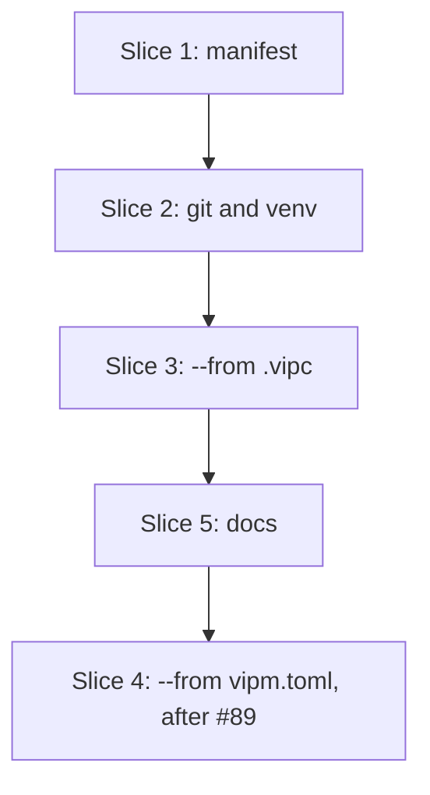

# Plan: `lvpm init` and `init --from` (S10a)

**Created**: 2026-10-30
**Branch**: 71-feats10a-lvpm-init-and-init---from
**Status**: approved
**Gherkin persistence**: custom: tests/features/build-slices/
**Spec**: [docs/specs/lvpm-init-s10a.md](../docs/specs/lvpm-init-s10a.md)

## Goal

One command, `lvpm init`, leaves a folder ready to work in. The folder gets
a git repository with a hint for adding a remote, and an `lvpm.toml` whose
`labview` is the newest LabVIEW installed. When it can, init also creates a
venv bound to that LabVIEW. `--from project.vipc` and `--from vipm.toml` add
the VIPM project's packages as dependencies. `.dragon` is refused and not
planned.

## Acceptance Criteria

- [ ] AC1–AC17 of the spec, mapped below. "Unit" means a test in the named
  module, run with fake LabVIEW installations through `OpEnv::new`. Those
  tests run in default CI.

| AC | Check | Step |
|---|---|---|
| 1 writes a manifest | S10a "init writes a manifest", "--project names the folder"; `lvpm lock` accepts it | 1.1 |
| 2 never overwrites | S10a "an existing lvpm.toml is never overwritten", "a manifest in a parent folder does not block"; unit: a refusal calls no git and makes no venv | 1.1, 2.2 |
| 3 newest LabVIEW | unit: newest chosen, flag overrides, flag year not installed; S10a "an unusable --labview-version writes nothing"; `@labview` "labview is the newest installed" | 1.2 |
| 4 says how to change it | unit + render: several years, one installation, two bitnesses of one year | 1.2 |
| 5 no LabVIEW | unit: no targets → no `labview`, warning, venv skipped, Ok | 1.2, 2.2 |
| 6 git | unit (`git.rs`, injected runner): initialized, inside a work tree, git missing, `git init` failed; S10a "init makes a git repository", "inside a git repository, git is left alone" | 2.1 |
| 7 venv ready | unit: fake 2026 → bound venv and its rendered lines; fake 2023 only → skip naming 2024 Q1; flag year not installed → skip naming it; no LabVIEW → skip; venv already there → skip, venv untouched; S10a "a venv that cannot be made is a hint"; `@labview` "add installs into the venv" | 2.2 |
| 8 adds what the user chose | S10a outline over the package flags; "init reports what it added and skipped"; "one package added, none skipped"; "a .vipc with no packages" | 3.2 |
| 9 pinned exact, rest floor | same outline | 3.2 |
| 10 embedded packages | S10a "an embedded package is imported", "an Included package missing from the zip", "a corrupt embedded package writes nothing"; checked against a real `.vipc` or recorded unverified (gate) | 3.3 |
| 11 sync installs them | S10a "lock resolves what init added" (default run); `@labview` "sync installs what init added" | 3.2, 3.3 |
| 12 `.vipc` LabVIEW reported | S10a "the .vipc's LabVIEW is reported, not used", "no report when the .vipc targets the chosen LabVIEW"; unit "reported with no labview chosen" | 3.2 |
| 13 bad input writes nothing | unit outline (`vipc.rs`); S10a outline "a bad --from file writes nothing" with exact texts | 3.1, 3.2 |
| 14 no `.dragon` | S10a "a .dragon file is refused" outline (lower and upper case, missing file) | 3.2 |
| 15 from a `vipm.toml` | S10a three "init from vipm.toml" scenarios, "a vipm.toml with only dependencies", lock scenario; `@labview` sync | 4.1 |
| 16 `vipm.toml` left alone | S10a "the vipm.toml is unchanged" (success and refusal) | 4.1 |
| 17 documented | docs scenario, in two parts: 5.1 (usage, cli, comparison), 4.1 (manifest.md line) | 5.1, 4.1 |

## Approach stances (decision-defaults)

- **Replace-vs-merge:** neither. Init never replaces or merges an
  `lvpm.toml`. It writes one with `create_new`, so an existing file is
  refused even if one appears between the check and the write. The
  `vipm.toml` and the `.vipc` are read only.
- **Format fidelity:** a `.vipc` follows the spec's table. A `Pinned`
  package gets an exact version, a `Dependency` package is skipped, and an
  `Included` package is imported into the cache. A `vipm.toml` keeps its
  exact versions, and `[nipm.dependencies]` is copied key for key. No field
  is guessed: a `.vipc` tag that is missing or malformed is an error.
- **Migrate-vs-edit-stub:** init is the migration. The VIPM files stay
  where they are.
- **Scope:** the spec's. No lock or sync inside init, no initial commit, no
  `.dragon`, no `lvpm convert`, no TUI entry.
- **Integration:** a PR against `main`, merged by the user. No auto-merge.
  If #89 is still open after slice 5, the PR holds slices 1, 2, 3 and 5,
  and slice 4 follows in a second PR.

## Design notes

- **All checks, then one write.** `ops::init::run(env, from: Option<&Path>)
  -> Result<Initialized>` works in two phases.
  - **Check, which writes nothing.** Resolve the root from `--project`
    against `env.cwd`. Refuse if `<root>/lvpm.toml` exists. Validate
    `--labview-version` with `project::labview_year`. Read the `--from`
    file into a `Seed` and parse every embedded package's bytes. Choose the
    LabVIEW. Build the whole manifest text in memory: the skeleton, then
    `manifest_edit::set` for each dependency (it is text in, text out),
    then the nipm table.
  - **Write.** Write `lvpm.toml` once with `OpenOptions::create_new`.
    Import the embedded packages, run git, then make the venv. Each of
    those three can only warn. The manifest is never rolled back.
- **`Seed`, the one input type** (`ops/init.rs`): `{ name: Option<String>,
  version: Option<String>, source_labview: Option<u32>, deps:
  Vec<(String, String)>, dev_deps: Vec<(String, String)>, skipped: usize,
  nipm: Option<toml_edit::Table>, embedded: Vec<Embedded { name, version,
  label, bytes }> }`. `vipc::Vipc::seed()` and the `vipm.toml` reader each
  produce one, and the op only consumes it. `run` stays an orchestrator.
  The mapping rules are pure functions, unit-tested without a run.
- **One manifest template.** `manifest_edit::skeleton(name, version:
  Option<&str>, labview_year: Option<u32>) -> String` builds the text with
  `toml_edit`, so a name with a quote or a backslash still gives valid
  TOML. `version: None` writes no `version` line, which is what
  `venv::create` writes today; init always passes one (`0.1.0` or the
  source's). `venv::create` calls it with `version: None`. A unit test pins
  that call to today's exact bytes, and the `venv create` tests do not
  change. A folder name is written as it is, apart from TOML escaping.
  Whether lock accepts every folder name is not checked (see Risks).
- **Choosing LabVIEW.**
  - With `--labview-version`, the year must parse with `labview_year`,
    or init fails naming the flag and writes nothing. It is then written
    even when that LabVIEW is not installed, and the venv step says so.
  - Without the flag, the newest installation is chosen (`detect` sorts
    newest first); between two bitnesses of that year, 64-bit wins. A
    `--from` file's own LabVIEW is never used. With no targets, `labview`
    is left out.
  - `retarget: Option<Retarget>` is the first installation in that
    order that is not the chosen one (the newest when the flag names an
    uninstalled year), whenever more than one is installed. `Retarget::Year(y)` when its year differs,
    `Retarget::Path(p)` when it is the other bitness of the chosen year
    (`target::select` accepts a path). It is typed data in the event, next
    to the display labels. The "to target another one" lines appear only
    when it is `Some`; the "edit `labview`" line only for `Year`.
- **`vipc.rs` (new).** `vipc::read(path) -> Result<Vipc>` reads
  `config.xml` through `.take(1 MiB)`. A larger entry is refused.
  - **Scan.** A small scan reads the single `<Target>`'s `<Version>` and
    its `<Package>` blocks: `Name`, `Included`, `Dependency` and `Pinned`.
    Each flag must be `true` or `false`, in any case.
  - **Refused, naming the file:** a file that is not a zip; a zip
    without `config.xml`; a config.xml with no `<Target>` or more than one;
    a missing flag tag; a flag that is no bool; a `<Name>` with no `-`; a
    `Version` that is not `N.N` (two-digit major, one or more minor digits,
    nothing else: `13.0` yes; `13.0.1`, `v13.0`, `2013.0` no); any comment,
    CDATA or `&` inside the `<Target>` element (the scanned region; text
    outside it is never looked at); a name part that `lvpkg::check_name`
    rejects. The reader refuses what it does not understand rather
    than guessing.
  - **Name and year.** The name is split at the last `-`, and the tail
    must parse as an lvpm version (else refused, so lock never sees a bad
    constraint). The year is `2000 + major`, so 13.0 gives 2013 and 26.3
    gives 2026.
  - **Check order.** `--project` exists, then no `lvpm.toml`, then the
    flag, then `.dragon`, then the `--from` file.
- **Embedded packages.** `index::cache_add_bytes(cache_dir, label, bytes)`
  is factored out of `index::cache_add`, which already parses, stores and
  records bytes. `cache_add` calls it, so `lvpm cache add` is unchanged.
  - **Finding the archive.** An `Included` package's archive is the zip
    entry whose file name is `<name>-<version>.vip`, at any depth; two
    such entries are refused. The entry is read through `.take(256 MiB)`.
  - **Labels and failures.** The import label is
    `<file>.vipc!/<entry>`, so there is no temp file and the provenance is
    honest. An entry that is present but does not parse fails the check:
    nothing is written. An entry that is missing is a warning, and the
    dependency is still added. An import that fails after the write (an
    I/O error) is a warning naming the package and `lvpm cache add`.
- **`git.rs` (new).** `inside_work_tree(root) -> Option<PathBuf>` walks
  up from the root looking for a `.git` entry, a directory or a file. It
  spawns nothing, so a "dubious ownership" failure can never lead to a
  nested repository. This replaces the spec's `git rev-parse
  --is-inside-work-tree` (logged in Risks): the walk also counts a broken
  `.git` and one git refuses for `safe.directory`, and both mean "leave
  git alone". It ignores `GIT_DIR`.
  - **Running git.** `init(root, run: &dyn Fn(&mut Command) ->
    io::Result<Output>)` runs `git init` with `current_dir(root)` and
    captured output, so no git text reaches the terminal or the JSON
    stream. The op passes `Command::output`; the tests pass fakes.
  - **Outcomes.** A `NotFound` spawn error is `GitMissing`. A non-zero
    exit is `Failed { why }`, from git's stderr.
- **Result and events.** `Initialized { manifest, venv: Result<Venv,
  VenvSkip> }`, where `VenvSkip` is `{ why }`. The skip hint is always a
  bare `lvpm venv create`: it reads `labview` from the manifest init just
  wrote, so a year in the hint would only repeat it. The CLI words the result after `run` returns, as `venv::created`
  does. Events carry only what happens mid-run:
  - `InitManifestWritten { path, labview, installed, retarget,
    source_labview, source_kind }`
  - `InitNoLabview`
  - `InitDependenciesAdded { from, added, skipped }`
  - `InitPackageImported`, `InitPackageNotEmbedded`, `InitPackageImportFailed`
  - `InitGit { outcome: Initialized | InsideWorkTree { top } | GitMissing |
    Failed { why } }`
- **Rendering.** It goes in a new `src/render/init.rs`, which
  `render/mod.rs` routes the `Init*` events to. The created-venv lines are
  init's own (the table below), not `render::venv::created`, which has its
  own `next:` line.
- **CLI.** `Cmd::Init { from: Option<PathBuf> }` in `src/main.rs`, with the
  global `--project`, `--labview-version` and `--json` flags. `--from` is
  resolved against `env.cwd`.

## Message texts

This table is the contract, together with the spec's console example.
Errors and warnings go to stderr, everything else to stdout, as the other
commands do. `<file>` is the `--from` argument as typed, and `<path>` is
absolute. Plurals follow the count: one is singular, any other count is
plural.

| When | Text |
|---|---|
| manifest written | `wrote <path>` / `  labview = ">=<YYYY>"` |
| several installations | `  found LabVIEW <labels, comma separated>` / `  to target another one:` / (`Year` only) `    edit labview in lvpm.toml` / `    lvpm venv remove` / `    lvpm venv create --labview-version <year, or "<path>">` |
| no LabVIEW | `warning: no LabVIEW found; lvpm.toml has no `labview`. Add labview = ">=YYYY" before `lvpm lock`` |
| source LabVIEW differs | `  the .vipc targets LabVIEW <YYYY>; lvpm.toml says >=<YYYY>` (`the vipm.toml targets` for TOML; with no `labview`, the part after `;` is left out) |
| deps added | `added <n> dependenc(y/ies) from <file>` / `  <name> <constraint>` per line / `  skipped <n> package(s) VIPM marked as a dependency of another` (only when n > 0) |
| embedded | `  imported <name> <version> from <file>` / `warning: <name> <version> is marked Included but is not inside <file>` / `warning: could not import <name> <version> into the cache: <why>; add it later with lvpm cache add <archive>` |
| existing manifest | `error: <path> already exists; lvpm init does not overwrite it` / `  this folder is already an lvpm project: lvpm add puts packages in it, lvpm venv create makes its venv` |
| bad flag | `error: --labview-version <value> is not a LabVIEW year (expected e.g. 2025); nothing was written` |
| vipm.toml unreadable | `error: <file>: <read_toml's reason>; nothing was written` |
| bad `--from` | `error: <file>: cannot be read: <io error>; nothing was written` · `error: <file>: not a zip file; nothing was written` · `error: <file>: config.xml is missing; nothing was written` · `error: <file>: config.xml: <what>; nothing was written` (what: `no <Target>`, `more than one <Target>`, `<Version> <value> is not N.N`, `package <Name>: no version (expected name-version)`, `package <Name>: <tail> is not a version`, `package <name>: <Flag> is missing`, `package <name>: <Flag> is not true or false`, `unsupported XML (<construct>)`, `larger than 1 MiB`) · `error: <file>: embedded <entry> is not a package: <why>; nothing was written` · `error: <file>: embedded <entry> is larger than 256 MiB; nothing was written` · `error: <file>: more than one <name>-<version>.vip inside; nothing was written` |
| `.dragon` | `error: <file>: .dragon files are not supported and not planned (VIPM discontinued the format); export a .vipc from VIPM instead` |
| git initialized | `initialized a git repository` / `  add a remote:  git remote add origin <url>` / `  first push:    git add -A && git commit -m "lvpm init" && git push -u origin HEAD` |
| inside a work tree | `already inside a git repository at <top>; left it as it is` |
| git missing | `warning: git not found on PATH; no repository made` |
| git failed | `warning: git init failed: <why>; no repository made` |
| venv created | `created <dir>` / `  bound to       <label>  v<version>` |
| venv skipped | `no venv: <why>` / `  later: lvpm venv create` (why: `no LabVIEW found`, `LabVIEW <YYYY> is not installed`, `<path> already has a venv`, or venv::create's own reason) |
| `--project` missing | `error: <dir> does not exist; nothing was written` |
| end | `next: lvpm sync`, or with no `labview`: `next: add labview = ">=YYYY" to lvpm.toml, then lvpm sync` |

`.lv-venv/.gitignore` (`*`, written by `venv::create`) keeps the venv out
of `git add -A` in the push hint.

## Slices

### Slice 1: `lvpm init` writes the manifest

**Depends-on:** none
**Files:** `crates/lvpm-core/src/manifest_edit.rs`, `crates/lvpm-core/src/venv.rs`, `crates/lvpm-core/src/ops/init.rs`, `crates/lvpm-core/src/ops/mod.rs`, `crates/lvpm-core/src/events.rs`, `src/main.rs`, `src/render/init.rs`, `src/render/mod.rs`, `tests/features/build-slices/s10a-lvpm-init.feature`, `tests/acceptance.rs`, `tests/steps/init.rs`, `tests/steps/mod.rs`

**Behavior:**

```gherkin
Feature: lvpm init

  Scenario: init writes a manifest
    Given an empty folder "Serializer"
    When I run "lvpm init --labview-version 2023" in it
    Then it succeeds
    And lvpm.toml has project name "Serializer", version "0.1.0" and labview ">=2023"
    And lvpm.toml has an empty [dependencies] table
    And the output has the line "wrote <path of lvpm.toml>"
    And "lvpm lock" succeeds in the folder

  Scenario: --project names the folder
    Given an empty folder "Elsewhere" and another working directory
    When I run "lvpm init --project Elsewhere --labview-version 2023" in the working directory
    Then "Elsewhere" has an lvpm.toml with project name "Elsewhere"
    And the working directory has no lvpm.toml

  Scenario: --project naming a missing folder writes nothing
    When I run "lvpm init --project Missing --labview-version 2023" in an empty working directory
    Then it fails with "Missing does not exist; nothing was written"
    And the working directory has no "Missing" folder and no lvpm.toml

  Scenario: an existing lvpm.toml is never overwritten
    Given a folder with an lvpm.toml
    When I run "lvpm init --labview-version 2023" in it
    Then it fails with "<path of lvpm.toml> already exists; lvpm init does not overwrite it"
    And the output says "lvpm add puts packages in it"
    And lvpm.toml is unchanged
    And the folder has no .git and no .lv-venv

  Scenario: a manifest in a parent folder does not block
    Given a folder with an lvpm.toml and an empty subfolder "app"
    When I run "lvpm init --labview-version 2023" in "app"
    Then it succeeds
    And "app" has its own lvpm.toml with project name "app"
    And the parent's lvpm.toml is unchanged

  Scenario Outline: an unusable --labview-version writes nothing
    Given an empty folder "App"
    When I run "lvpm init --labview-version <value>" in it
    Then it fails with "--labview-version <value>"
    And the output says "nothing was written"
    And the folder has no lvpm.toml, no .git and no .lv-venv

    Examples:
      | value |
      | abc   |
      | 26.3  |

  @labview @interactive-labview
  Scenario: labview is the newest installed
    Given the LabVIEW installations "lvpm targets" lists
    When I run "lvpm init" in an empty folder
    Then lvpm.toml says labview ">=" the newest listed year
```

Unit level (`ops/init.rs` with fake targets, `src/render/init.rs`):

```gherkin
  Scenario: the newest is chosen and another year is offered
    Given LabVIEW 2026, 2025 and 2024 are installed
    When init runs with no --labview-version
    Then labview is ">=2026" and retarget is year 2025
    And the rendered lines equal the table's, ending "lvpm venv create --labview-version 2025"

  Scenario: a --from file's LabVIEW is not used without the flag
    Given LabVIEW 2026 and 2025 are installed and a seed with source_labview 2013
    When init runs with no --labview-version
    Then labview is ">=2026"

  Scenario: --labview-version overrides the newest
    Given LabVIEW 2026 and 2025 are installed
    When init runs with --labview-version 2025
    Then labview is ">=2025"

  Scenario: a flag year that is not installed is written
    Given only LabVIEW 2026 is installed
    When init runs with --labview-version 2025
    Then labview is ">=2025"

  Scenario: one installation prints no hint
    Given only LabVIEW 2026 is installed
    When init runs
    Then retarget is none and the rendered output has no "found LabVIEW" or "to target another one" line

  Scenario: two bitnesses of one year offer the other by path
    Given LabVIEW 2026 32-bit and 2026 64-bit are installed, 32-bit listed first
    When init runs
    Then labview is ">=2026", the 64-bit one is chosen, and retarget is the 32-bit one's path
    And the rendered output names both installations, has no "edit `labview`" line
    And ends "    lvpm venv create --labview-version \"<32-bit path>\""

  Scenario: no LabVIEW, the manifest has no labview
    Given no LabVIEW is installed
    When init runs with no --labview-version
    Then the manifest has no labview key, InitNoLabview is emitted and run returns Ok
    And the rendered end line is "next: add labview = \">=YYYY\" to lvpm.toml, then lvpm sync"

  Scenario: the skeleton is the venv create skeleton
    Then skeleton("demo", None, Some(2026)) is byte for byte what venv::create wrote before this change
    And skeleton("a \"q\" name", Some("0.1.0"), None) parses as TOML with that name
```

**Steps:**

#### Step 1.1: one skeleton, `lvpm init` writes it or refuses

**Complexity**: standard
**IMPLEMENT**: Add `manifest_edit::skeleton` and switch `venv::create` to
it. Add `ops::init::run` with the check and write phases (no `--from` yet),
the validated flag, `create_new`, `Cmd::Init`, `InitManifestWritten`, and
`src/render/init.rs` with the `wrote`, existing-manifest, bad-flag and
`next:` lines.
**TEST**:
- The skeleton unit scenarios, plus one JSON shape check of
  `InitManifestWritten`.
- Write the feature file with every slice 1 acceptance scenario except the
  `@labview` one. Add it to `FEATURE_FILES` and write `tests/steps/init.rs`.
- Confirm that `lvpm lock` on an empty `[dependencies]` needs no feed and
  no LabVIEW in the sandbox. If it needs either, the first scenario says so
  in its Given.
- Full suite green.

**REFACTOR**: Move the manifest-path handling that `venv::create` and init
now share into one helper.
**Files**: `crates/lvpm-core/src/manifest_edit.rs`, `crates/lvpm-core/src/venv.rs`, `crates/lvpm-core/src/ops/init.rs`, `crates/lvpm-core/src/ops/mod.rs`, `crates/lvpm-core/src/events.rs`, `src/main.rs`, `src/render/init.rs`, `src/render/mod.rs`, `tests/features/build-slices/s10a-lvpm-init.feature`, `tests/acceptance.rs`, `tests/steps/init.rs`, `tests/steps/mod.rs`
**Commit**: `feat(init): lvpm init writes lvpm.toml and never overwrites one (#71)`

#### Step 1.2: choosing LabVIEW and saying how to change it

**Complexity**: standard
**IMPLEMENT**: Choose the LabVIEW and compute `retarget` as the
design notes describe. Emit `InitNoLabview`. Render the hint lines, the
warning and the conditional `next:` line.
**TEST**: Every slice 1 unit scenario except the skeleton ones. Add the
`@labview` scenario. Full suite green.
**REFACTOR**: Take the choice and `retarget` from one pass over the
sorted list.
**Files**: `crates/lvpm-core/src/ops/init.rs`, `crates/lvpm-core/src/events.rs`, `src/render/init.rs`, `tests/features/build-slices/s10a-lvpm-init.feature`, `tests/steps/init.rs`
**Commit**: `feat(init): labview is the newest installed, with a hint when there are several (#71)`

### Slice 2: git repository and venv

**Depends-on:** 1
**Files:** `crates/lvpm-core/src/git.rs`, `crates/lvpm-core/src/lib.rs`, `crates/lvpm-core/src/ops/init.rs`, `crates/lvpm-core/src/events.rs`, `src/main.rs`, `src/render/init.rs`, `tests/features/build-slices/s10a-lvpm-init.feature`, `tests/steps/init.rs`

**Behavior:**

```gherkin
  Scenario: init makes a git repository and says how to add a remote
    Given an empty folder with no .git in it or above it
    When I run "lvpm init --labview-version 2023" in it
    Then the folder is a git repository in which "git rev-parse HEAD" fails
    And the output has the line "  add a remote:  git remote add origin <url>"
    And the output has the line "  first push:    git add -A && git commit -m \"lvpm init\" && git push -u origin HEAD"

  Scenario: inside a git repository, git is left alone
    Given a git repository with an empty subfolder "app"
    When I run "lvpm init --labview-version 2023" in "app"
    Then it succeeds
    And "app" has no .git of its own
    And the output says "already inside a git repository at" and the repository's folder

  # --labview-version 2023 always skips the venv: either 2023 is not
  # installed, or it is before 2024 Q1. Only the reason text varies.
  Scenario: a venv that cannot be made is a hint, not a failure
    Given an empty folder
    When I run "lvpm init --labview-version 2023" in it
    Then it succeeds
    And the folder has no .lv-venv
    And the output has a line starting "no venv: " with a reason after it
    And the output has a line starting "  later: lvpm venv create"

  @labview @interactive-labview
  Scenario: the venv is bound and add installs into it
    Given a folder feed with the pilot packages
    When I run "lvpm init --labview-version 2026" in an empty folder
    Then the folder has a venv bound to LabVIEW 2026
    And "lvpm add labview_open_source_project_lib_labview_open_source_palette" installs it into that venv, read with the existing venv-content step
```

Unit level (`git.rs` with an injected runner; `ops/init.rs` with fake targets and a temp dir):

```gherkin
  Scenario: a .git directory or file above the root is found
    Given a temp tree with ".git" as a directory two levels up, and another with ".git" as a file
    Then inside_work_tree returns that folder in both cases, and none for a tree without one

  Scenario Outline: git init outcomes
    Given the runner <does>
    Then the outcome is <outcome> and the runner was called with "git init" in the root

    Examples:
      | does                                   | outcome            |
      | exits 0                                | Initialized        |
      | fails to spawn with NotFound           | GitMissing         |
      | exits 128 with "fatal: permission"     | Failed (that text) |

  Scenario: inside a work tree, git init is not run
    Given a root below a ".git" directory
    Then the outcome is InsideWorkTree with that top and the runner was never called

  Scenario: a refusal runs no git and makes no venv
    Given a root that already has lvpm.toml
    Then run fails, the runner was never called, and no .lv-venv exists

  Scenario: the venv is bound to the chosen LabVIEW
    Given LabVIEW 2026 and 2025 are installed
    When init runs
    Then the root has a venv binding naming LabVIEW 2026 and Initialized carries that venv
    And the rendered lines are "created <dir>" and "  bound to       <label>  v<version>"

  Scenario Outline: a venv that cannot be made gives a skip
    Given <installed>
    When init runs <flag>
    Then Initialized carries a skip whose reason says "<why>" and run returns Ok
    And the rendered lines are "no venv: <reason>" and "  later: lvpm venv create"

    Examples:
      | installed                   | flag                       | why                        |
      | only LabVIEW 2023 installed | with no flag               | 2024 Q1                    |
      | only LabVIEW 2026 installed | with --labview-version 2025 | LabVIEW 2025 is not installed |
      | no LabVIEW installed        | with no flag               | no LabVIEW found           |

  Scenario: a venv already there is kept
    Given LabVIEW 2026 is installed and the root already has a venv binding
    When init runs
    Then the binding is unchanged and Initialized carries a skip saying the folder already has a venv
```

**Steps:**

#### Step 2.1: git

**Complexity**: standard
**IMPLEMENT**: Write `git.rs` as the design notes describe. Call it from
`run` after the manifest, emit `InitGit`, and render its four outcomes.
**TEST**: The `git.rs` unit scenarios, "a refusal runs no git", and the two
git acceptance scenarios. In the "outside" scenario the sandbox checks
first that no `.git` exists at or above the folder, and fails the Given if
one does. Git must be installed wherever the suite runs; CI already
installs it. Full suite green.
**REFACTOR**: The op knows nothing about how git is run; only `git.rs`
builds the command.
**Files**: `crates/lvpm-core/src/git.rs`, `crates/lvpm-core/src/lib.rs`, `crates/lvpm-core/src/ops/init.rs`, `crates/lvpm-core/src/events.rs`, `src/render/init.rs`, `tests/features/build-slices/s10a-lvpm-init.feature`, `tests/steps/init.rs`
**Commit**: `feat(init): git init with a remote hint, left alone inside a repository (#71)`

#### Step 2.2: venv

**Complexity**: standard
**IMPLEMENT**: Call `venv::create` with the chosen year and put the venv or
a `VenvSkip` into `Initialized`, with the reasons in the message table.
The CLI renders the created or skipped lines.
**TEST**: The venv unit scenarios (bound, the skip outline, already
there), and the "cannot be made"
acceptance scenario, which checks the line structure and never the reason
text (that text depends on what the machine has installed). Add the
`@labview` scenario. Full suite green. The "existing lvpm.toml" scenario's
"no .git and no .lv-venv" check now has something to catch.
**REFACTOR**: `Initialized.venv` is one `Result`, so it can never hold
both a venv and a skip.
**Files**: `crates/lvpm-core/src/ops/init.rs`, `src/main.rs`, `src/render/init.rs`, `tests/features/build-slices/s10a-lvpm-init.feature`, `tests/steps/init.rs`
**Commit**: `feat(init): create the venv, or say how to later (#71)`

### Slice 3: `init --from project.vipc`

**Depends-on:** 2
**Files:** `crates/lvpm-core/src/vipc.rs`, `crates/lvpm-core/src/lib.rs`, `crates/lvpm-core/src/index.rs`, `crates/lvpm-core/src/ops/init.rs`, `crates/lvpm-core/src/events.rs`, `src/main.rs`, `src/render/init.rs`, `tests/features/build-slices/s10a-lvpm-init.feature`, `tests/steps/init.rs`

**Behavior:**

```gherkin
  Scenario Outline: each .vipc package flag decides what init writes
    Given a VIPM configuration "p.vipc" for LabVIEW "13.0" with the package "<package>" marked dependency <dependency> and pinned <pinned>
    When I run "lvpm init --from p.vipc --labview-version 2023" in its folder
    Then it succeeds
    And lvpm.toml [dependencies] <outcome>

    Examples:
      | package           | dependency | pinned | outcome                     |
      | demo_lib-1.5.0.15 | false      | true   | has demo_lib = "1.5.0.15"   |
      | demo_lib-1.5.0.15 | false      | false  | has demo_lib = ">=1.5.0.15" |
      | demo_lib-1.5.0.15 | true       | false  | is empty                    |
      | demo_lib-1.5.0.15 | true       | true   | is empty                    |

  Scenario: init reports what it added and skipped
    Given a VIPM configuration "p.vipc" with 2 chosen packages and 1 marked as a dependency
    When I run "lvpm init --from p.vipc --labview-version 2023" in its folder
    Then the output has the line "added 2 dependencies from p.vipc"
    And the output has a line "  <name> <constraint>" for each chosen package
    And the output has the line "  skipped 1 package VIPM marked as a dependency of another"

  Scenario: one package added, none skipped
    Given a VIPM configuration "p.vipc" with 1 chosen package and none marked as a dependency
    When I run "lvpm init --from p.vipc --labview-version 2023" in its folder
    Then the output has the line "added 1 dependency from p.vipc"
    And the output does not say "skipped"

  Scenario: a .vipc with no packages
    Given a VIPM configuration "p.vipc" with no packages
    When I run "lvpm init --from p.vipc --labview-version 2023" in its folder
    Then it succeeds
    And lvpm.toml [dependencies] is empty
    And the output has the line "added 0 dependencies from p.vipc"

  Scenario: the .vipc's LabVIEW is reported, not used
    Given a VIPM configuration "p.vipc" for LabVIEW "13.0"
    When I run "lvpm init --from p.vipc --labview-version 2023" in its folder
    Then lvpm.toml says labview ">=2023"
    And the output has the line "  the .vipc targets LabVIEW 2013; lvpm.toml says >=2023"

  Scenario: no report when the .vipc targets the chosen LabVIEW
    Given a VIPM configuration "p.vipc" for LabVIEW "23.0"
    When I run "lvpm init --from p.vipc --labview-version 2023" in its folder
    Then the output does not say "the .vipc targets"

  Scenario: --from is relative to the working directory, not --project
    Given a VIPM configuration "p.vipc" in the working directory and an empty folder "App"
    When I run "lvpm init --project App --from p.vipc --labview-version 2023" in the working directory
    Then it succeeds and "App" has an lvpm.toml with the .vipc's packages

  Scenario: lock resolves what init added
    Given a folder feed with the pilot packages
    And a VIPM configuration "Serializer.vipc" choosing labview_open_source_lib_serializer 1.2.1.16, not pinned
    When I run "lvpm init --from Serializer.vipc --labview-version 2023" in its folder
    And I run "lvpm lock"
    Then lvpm.lock holds labview_open_source_lib_serializer 1.2.1.16 and its two dependencies

  Scenario Outline: a bad --from file writes nothing
    Given <file>
    When I run "lvpm init --from p.vipc --labview-version 2023" in its folder
    Then it fails with "<text>"
    And the output says "nothing was written"
    And the folder has no lvpm.toml, no .git and no .lv-venv

    Examples:
      | file                                               | text                                  |
      | no file "p.vipc"                                   | p.vipc: cannot be read                |
      | a file "p.vipc" holding "hello"                    | p.vipc: not a zip file                |
      | a zip "p.vipc" with only "readme.txt"              | p.vipc: config.xml is missing         |
      | a zip "p.vipc" whose config.xml has no <Target>    | p.vipc: config.xml: no <Target>       |

  Scenario Outline: a .dragon file is refused
    Given <file>
    When I run "lvpm init --from <name>" in its folder
    Then it fails with ".dragon files are not supported and not planned"
    And the output says "export a .vipc from VIPM instead"
    And the folder has no lvpm.toml, no .git and no .lv-venv

    Examples:
      | file              | name     |
      | a file "p.dragon" | p.dragon |
      | a file "P.DRAGON" | P.DRAGON |
      | no file "p.dragon" | p.dragon |
```

Unit level (`vipc.rs`, on zips built in the test):

```gherkin
  Scenario: the Serializer sample's config.xml parses
    Given config.xml as in the spec's sample, with CRLF line ends and indentation
    Then the target year is 2013 and each package has its name, version and three flags

  Scenario Outline: what the reader accepts
    Given config.xml with <case>
    Then reading gives <result>

    Examples:
      | case                                 | result                                       |
      | Name "a_b-c_d-1.2.3.4"               | name "a_b-c_d", version "1.2.3.4"            |
      | Version "26.3"                       | year 2026                                    |
      | flag "True"                          | true                                         |

  Scenario Outline: what the reader refuses, naming the .vipc
    Given config.xml with <case>
    Then reading fails with "<what>"

    Examples:
      | case                                | what                                           |
      | no <Target>                         | no <Target>                                    |
      | two <Target> elements               | more than one <Target>                         |
      | a <Name> with no "-"                | package foo: no version (expected name-version) |
      | a <Name> "foo-bar"                  | package foo-bar: bar is not a version          |
      | no <Pinned> tag                     | package demo_lib: Pinned is missing            |
      | <Included>yes</Included>            | package demo_lib: Included is not true or false |
      | Version "thirteen"                  | <Version> thirteen is not N.N                  |
      | a comment inside <Target>           | unsupported XML (comment)                      |
      | "&amp;" in a <Name>                 | unsupported XML (entity)                       |
      | a config.xml of 2 MiB               | larger than 1 MiB                              |

  Scenario: Vipc::seed applies the rules (also: a name listed twice keeps the last and counts once; Included and Dependency is skipped and not embedded)
    Given packages chosen-pinned, chosen-floating, dependency-pinned and dependency-floating
    Then seed has two deps, exact and ">=", skipped is 2, and source_labview is the target year

  Scenario: the .vipc's LabVIEW is reported with no labview chosen (ops/init.rs, render)
    Given no LabVIEW is installed and a .vipc for LabVIEW "13.0"
    When init runs with --from and no --labview-version
    Then the rendered line is "  the .vipc targets LabVIEW 2013" with no "lvpm.toml says"
```

**Steps:**

#### Step 3.1: `vipc.rs` reads a `.vipc`

**Complexity**: standard
**IMPLEMENT**: Write `vipc::read` and `Vipc::seed` as the design notes
describe.
**TEST**: The `vipc.rs` unit scenarios. Full suite green.
**REFACTOR**: One tag-reading helper serves every field, and every error
uses the one "<file>: config.xml: <what>" form.
**Files**: `crates/lvpm-core/src/vipc.rs`, `crates/lvpm-core/src/lib.rs`
**Commit**: `feat(vipc): read a VIPM .vipc's packages and target (#71)`

#### Step 3.2: `--from .vipc` adds dependencies

**Complexity**: standard
**IMPLEMENT**: Add `--from` to `Cmd::Init`. In the check phase, one
`match` picks the reader by file name, case-insensitively: a name ending
in `.dragon` is refused before the file is opened, and any other file is
read as a `.vipc`. Build the dependencies into the in-memory manifest, and
emit `InitDependenciesAdded` and `source_labview`. Render all of it.
**TEST**: The slice 3 acceptance scenarios except the three embedded ones
in 3.3: the flag outline, "reports what it added", "one package added",
"no packages", "reported, not used", "no report when", "lock resolves",
"a bad --from file" and ".dragon". The test step builds the `.vipc` as a
zip whose `config.xml` comes from its arguments. "lock resolves" relies on
the pilot feed holding only serializer 1.2.1.16, which is what the
committed fixtures hold. Full suite green.
**REFACTOR**: The `--from` dispatch is a single `match` that yields a
`Seed`, so slice 4 adds one arm and nothing else.
**Files**: `crates/lvpm-core/src/ops/init.rs`, `crates/lvpm-core/src/events.rs`, `src/main.rs`, `src/render/init.rs`, `tests/features/build-slices/s10a-lvpm-init.feature`, `tests/steps/init.rs`
**Commit**: `feat(init): --from a .vipc adds the packages VIPM chose; .dragon is refused (#71)`

#### Step 3.3: embedded packages, and sync installs them

**Complexity**: standard
**Precondition**: obtain one real `.vipc` with an `Included = true`
package. VIPM on this machine can build one: open a configuration, tick
"include package" for one pilot, and save. Read where its `.vip` sits in
the zip, and correct the design note if it differs. If none can be made,
build this step on the guessed layout, and the PR records AC10 as
unverified.
**IMPLEMENT**: Factor `index::cache_add_bytes` out of `cache_add`. Parse
the embedded entries in the check phase. After the manifest write, import
them, emitting `InitPackageImported`, `InitPackageNotEmbedded` or
`InitPackageImportFailed`.
**TEST**: The three scenarios below. If the precondition failed, their
titles end "(synthetic layout)". Unit tests:
- `cache_add_bytes` records the label as the import path.
- An import that fails after the write (cache dir is a file): run returns
  Ok, lvpm.toml has the package, `InitPackageImportFailed` is emitted.
- Two matching entries, and an entry over the cap, are refused.
- The palette pilot has no dependencies, so "lvpm lock succeeds" with no
  feed holds; checked against its spec before the scenario is written.
- The `lvpm cache add` tests stay unchanged and green.

Add the `@labview` sync scenario. Full suite green.
**REFACTOR**: `cache_add` is a thin file reader over `cache_add_bytes`,
with no second parse path.
**Files**: `crates/lvpm-core/src/index.rs`, `crates/lvpm-core/src/ops/init.rs`, `crates/lvpm-core/src/events.rs`, `src/render/init.rs`, `tests/features/build-slices/s10a-lvpm-init.feature`, `tests/steps/init.rs`
**Commit**: `feat(init): import packages embedded in a .vipc into the cache (#71)`

Scenarios added in 3.3 (the layout `<name>-<version>.vip` at any depth is
the assumption 3.3's precondition checks):

```gherkin
  Scenario: an embedded package is imported into the cache
    Given a VIPM configuration "p.vipc" that embeds labview_open_source_project_lib_labview_open_source_palette 1.0.2.7 as "Packages/labview_open_source_project_lib_labview_open_source_palette-1.0.2.7.vip"
    And no folder feed
    When I run "lvpm init --from p.vipc --labview-version 2023" in its folder
    Then the output has the line "  imported labview_open_source_project_lib_labview_open_source_palette 1.0.2.7 from p.vipc"
    And "lvpm cache list" lists labview_open_source_project_lib_labview_open_source_palette 1.0.2.7
    And "lvpm lock" succeeds

  Scenario: an Included package missing from the zip is a warning
    Given a VIPM configuration "p.vipc" marking demo_lib 1.0.0 included but holding no archive for it
    When I run "lvpm init --from p.vipc --labview-version 2023" in its folder
    Then it succeeds
    And lvpm.toml [dependencies] has demo_lib
    And the output warns "demo_lib 1.0.0 is marked Included but is not inside p.vipc"

  Scenario: a corrupt embedded package writes nothing
    Given a VIPM configuration "p.vipc" marking demo_lib 1.0.0 included, with a "demo_lib-1.0.0.vip" inside that is not a package
    When I run "lvpm init --from p.vipc --labview-version 2023" in its folder
    Then it fails with "p.vipc: embedded demo_lib-1.0.0.vip is not a package"
    And the folder has no lvpm.toml
    And "lvpm cache list" does not list demo_lib

  @labview @interactive-labview
  Scenario: sync installs what init added
    Given a folder feed with the pilot packages
    And a VIPM configuration "Serializer.vipc" choosing labview_open_source_lib_serializer 1.2.1.16
    When I run "lvpm init --from Serializer.vipc --labview-version 2026" in its folder
    And I run "lvpm sync"
    Then the venv holds the serializer and its two dependencies, read with the existing venv-content step

  @labview @interactive-labview
  Scenario: sync installs an embedded package with no feed
    Given a VIPM configuration "p.vipc" that embeds labview_open_source_project_lib_labview_open_source_palette 1.0.2.7
    And no folder feed
    When I run "lvpm init --from p.vipc --labview-version 2026" in its folder
    And I run "lvpm sync"
    Then the venv holds labview_open_source_project_lib_labview_open_source_palette 1.0.2.7, read with the existing venv-content step
```

### Slice 5: document `init` and `init --from .vipc`

**Depends-on:** 3
**Files:** `docs/usage.md`, `docs/cli.md`, `docs/vipm-cli-comparison.md`, `docs/vision/build-slices.md`, `tests/steps/docs.rs`, `tests/features/build-slices/s10a-lvpm-init.feature`

Slice 5 comes before slice 4, so it can ship while #89 is open.

**Behavior:**

```gherkin
  Scenario: init is documented
    Then docs/usage.md lists "lvpm init" and "lvpm init --from" in its command table
    And docs/usage.md has a "## Starting a project" section containing "Dependency", "Pinned", "Included" and "lvpm venv remove"
    And docs/usage.md does not mention "init --from vipm.toml"
    And docs/cli.md does not list init as missing
    And docs/vipm-cli-comparison.md says .dragon is not planned
```

**Steps:**

#### Step 5.1: docs

**Complexity**: trivial
**IMPLEMENT**:
- Update the three docs.
- On the board (`docs/vision/build-slices.md`), mark S10a "`init` and
  `--from .vipc` done; `--from vipm.toml` waits on #89".
- Remove any usage.md text that still names `venv create` as the way to
  start a project.

**TEST**: The docs scenario, through the existing `tests/steps/docs.rs`
helpers. Full suite green.
**REFACTOR**: Write the `.vipc` rules out in one place in usage.md, and
have the rest of usage.md link there.
**Files**: `docs/usage.md`, `docs/cli.md`, `docs/vipm-cli-comparison.md`, `docs/vision/build-slices.md`, `tests/steps/docs.rs`, `tests/features/build-slices/s10a-lvpm-init.feature`
**Commit**: `docs: lvpm init and init --from .vipc (#71)`

### Slice 4: `init --from vipm.toml`

**Depends-on:** 5
**Files:** `crates/lvpm-core/src/ops/init.rs`, `src/render/init.rs`, `docs/manifest.md`, `docs/usage.md`, `docs/vision/build-slices.md`, `tests/features/build-slices/s10a-lvpm-init.feature`, `tests/steps/init.rs`, `tests/steps/docs.rs`

**Blocked until #89 merges.** If #89 is still open when slice 5 is done,
the first PR ships slices 1, 2, 3 and 5, and its AC table marks AC15 and
AC16 as deferred. This slice then follows in a second PR.

The fixture is inlined from #89's docs/manifest.md example, which the test
needs as a literal anyway:

```toml
[project]
name = "daq-tool"
version = "0.1.0"
labview-version = "2021"

[dependencies]
labview_open_source_lib_serializer = "1.2.1.16"

[dev-dependencies]
jki_vi_tester = "3.0.0.1"

[nipm.dependencies]
ni-daqmx-labview-support = "26.0"

[tool.vipm]
build = "x"
```

**Behavior:**

```gherkin
  Scenario: init from vipm.toml copies the project and its packages
    Given that vipm.toml in an empty folder
    When I run "lvpm init --from vipm.toml --labview-version 2023" in its folder
    Then it succeeds
    And lvpm.toml has project name "daq-tool" and version "0.1.0"
    And lvpm.toml [dependencies] has labview_open_source_lib_serializer = "1.2.1.16"
    And lvpm.toml [dev-dependencies] has jki_vi_tester = "3.0.0.1"

  Scenario: init from vipm.toml carries the nipm table and names what it did not use
    Given that vipm.toml in an empty folder
    When I run "lvpm init --from vipm.toml --labview-version 2023" in its folder
    Then lvpm.toml [nipm.dependencies] has the same keys and values as the vipm.toml's
    And the output names "tool.vipm" as not used

  Scenario: init from vipm.toml reports its LabVIEW
    Given that vipm.toml in an empty folder
    When I run "lvpm init --from vipm.toml --labview-version 2023" in its folder
    Then lvpm.toml says labview ">=2023"
    And the output has the line "  the vipm.toml targets LabVIEW 2021; lvpm.toml says >=2023"

  Scenario: a vipm.toml with only dependencies
    Given a vipm.toml in folder "tool" with only a [dependencies] table
    When I run "lvpm init --from vipm.toml --labview-version 2023" in its folder
    Then lvpm.toml has project name "tool" and version "0.1.0"
    And lvpm.toml has no [nipm.dependencies] table

  Scenario: the vipm.toml is unchanged
    Given that vipm.toml in an empty folder
    When I run "lvpm init --from vipm.toml --labview-version 2023" in its folder
    Then it succeeds
    And the vipm.toml is byte for byte what it was

  Scenario: a vipm.toml that does not parse writes nothing
    Given a vipm.toml holding "[project"
    When I run "lvpm init --from vipm.toml --labview-version 2023" in its folder
    Then it fails with "vipm.toml: " followed by the converter's reason
    And the output says "nothing was written"
    And the folder has no lvpm.toml, no .git and no .lv-venv
    And the vipm.toml is byte for byte what it was

  Scenario: a vipm.toml with no labview-version gives no targets line
    Given a vipm.toml with only a [dependencies] table
    When I run "lvpm init --from vipm.toml --labview-version 2023" in its folder
    Then the output does not say "the vipm.toml targets"

  # The lock and sync scenarios use a second fixture: only [project] and
  # [dependencies] labview_open_source_lib_serializer = "1.2.1.16", since the
  # pilot feed holds neither jki_vi_tester nor any NI package.
  Scenario: lock resolves what init took from the vipm.toml
    Given a folder feed with the pilot packages
    And a vipm.toml with only labview_open_source_lib_serializer = "1.2.1.16"
    When I run "lvpm init --from vipm.toml --labview-version 2023" in its folder
    And I run "lvpm lock"
    Then lvpm.lock holds labview_open_source_lib_serializer 1.2.1.16 and its two dependencies

  @labview @interactive-labview
  Scenario: sync installs what init took from the vipm.toml
    Given a folder feed with the pilot packages
    And a vipm.toml with only labview_open_source_lib_serializer = "1.2.1.16"
    When I run "lvpm init --from vipm.toml --labview-version 2026" in its folder
    And I run "lvpm sync"
    Then the venv holds the serializer and its two dependencies

  Scenario: init --from vipm.toml is documented
    Then docs/manifest.md names "lvpm init --from vipm.toml"
```

**Steps:**

#### Step 4.1: the `vipm.toml` arm

**Complexity**: standard
**IMPLEMENT**: First check that `vipm_interop::read_toml` exists on this
branch after rebasing on `main`. If it does not, stop: #89 has not landed.
Add the `is_toml` arm to the `--from` match. It calls `read_toml`, which
reports the unused fields itself, and takes the raw `nipm.dependencies`
table from the same text with `toml_edit`. Both go into a `Seed`. Add the
manifest.md and usage.md lines, replace slice 5's "does not mention \"init --from vipm.toml\"" step with a positive one, and mark S10a done on the board.
**TEST**: The slice 4 scenarios. After reading #89, replace "names
\"tool.vipm\" as not used" with the converter's exact line, and check
whether it lists `[nipm.dependencies]` as unused (init carries that table,
so it must not be named). Unit: the fixture above becomes the
expected `lvpm.toml` text, compared as a literal. Full suite green.
**REFACTOR**: Read the file once; `parse_toml` and the nipm lift both use
that one text.
**Files**: `crates/lvpm-core/src/ops/init.rs`, `src/render/init.rs`, `docs/manifest.md`, `docs/usage.md`, `docs/vision/build-slices.md`, `tests/features/build-slices/s10a-lvpm-init.feature`, `tests/steps/init.rs`, `tests/steps/docs.rs`
**Commit**: `feat(init): --from vipm.toml writes an lvpm.toml from VIPM 2026's file (#71)`

## Parallelization

The slices form a chain, because each one extends `ops/init.rs`,
`src/render/init.rs` and the one feature file. The only part that could run
alone is step 3.1 (`vipc.rs`), and that saves one step, so the plan keeps
the chain. Slice 5 comes before slice 4, so the docs can ship while #89 is
open.



| Wave | Slices |
|------|--------|
| 1 | 1 |
| 2 | 2 |
| 3 | 3 |
| 4 | 5 |
| 5 | 4 |

## Complexity Classification

Every step is `standard`, except 5.1, which is `trivial`. Two parts are
new: a reader of untrusted zips (`vipc.rs`) and a spawned process
(`git.rs`). Both are isolated behind small modules with unit tests, and
neither is a cross-cutting change.

## Pre-PR Quality Gate

- [ ] `cargo fmt --check`, `cargo clippy --workspace --all-targets -- -D warnings`, `cargo test --workspace`, green after every step
- [ ] The S10a `@labview` scenarios run once here with `LVPM_TEST_LABVIEW=1`; the PR records the result
- [ ] The #71 demo runs: `lvpm init --from C:\Projects\Serializer\Serializer.vipc`, then `lvpm sync`, with the output in the PR
- [ ] AC10 is checked against a real `.vipc` with an embedded package, or the PR records it as unverified
- [ ] The PR's AC table marks AC15, AC16 and AC17's manifest.md part deferred if slice 4 is not in it (moot now: #89 merged into main on 2026-10-30, so slice 4 ships in this PR)
- [ ] `/code-review` on the branch diff
- [ ] Docs updated (slices 5 and 4)

## Skipped (low value)

| Finding | Rationale (one line) |
|---|---|
| A unit test that `Cmd::Init` parses `--from` | clap derives it; every `--from` scenario goes through it |
| A `--json` scenario per event | the JSON sink is generic and tested; 1.1 checks one event's shape |
| Capping the printed package list | a `.vipc` holds tens of packages at most; the list is what the user asked to see, and warnings repeat on stderr |
| A warning when init runs in a non-empty folder or the home directory | init only creates three things and overwrites nothing; usage.md says how to undo it |
| A `creating venv...` line before the venv step | `venv::create` writes three small files and starts no LabVIEW; it does not take noticeable time |

## Risks & Open Questions

- **Two installation rankings (slice 1 review).** `choose_labview` ranks
  by (year, bitness); `target::select` takes the first of a year in
  `detect()` order (version only). They disagree only when a year's 32-bit
  install has a higher minor version than its 64-bit one. Decision: slice
  2's venv step binds the installation init chose by path, so init stays
  consistent; a later plain `lvpm venv create` may still pick the other.
- **`labview` is a year (`u32`) in `InitManifestWritten`/`Initialized`
  JSON** but a string elsewhere. Rename to `labview_year` before release
  if the JSON is published; left as is for now. Same for `Initialized.venv`,
  which serializes as serde's `{"Ok": ...}` / `{"Err": {"why": ...}}`.
- **Intermittent test failures.** One run of `cargo test --workspace` on
  2026-10-30 failed one lvpm-core lib test and one test in a 5-test
  binary; three reruns passed. The failing tests were not identified.
- **#89 merged into main on 2026-10-30** and is merged into this branch, so slice 4 ships here. (Was: if #89 is still open,
  the first PR ships slices 1, 2, 3 and 5, and slice 4 follows.
- **Embedded `.vipc` layout unverified.** The design looks for
  `<name>-<version>.vip` at any depth. Step 3.3's precondition checks that
  against a real `.vipc`. Until then AC10 is unverified.
- **`--labview-version` is written even when not installed.** This is an
  inference, chosen so a project can start on a machine without its
  LabVIEW and so the scenarios behave alike on every machine. The year
  still has to parse.
- **Folder name written as it is.** Only TOML escaping is applied. If lock
  refuses some folder names (spaces, dots), the user edits `name`. A
  scenario is worth adding if this shows up.
- **The duplicate-name rule is unspecified in the spec.** The plan applies
  the last one in the file, through `manifest_edit::set`; "added n" counts
  distinct names. A package both `Included` and `Dependency` is skipped
  and not imported (lock pulls it in as a dependency anyway). Both are
  inferences, unit-tested in `Vipc::seed`.
- **Git detection is a `.git` walk, not `git rev-parse`.** A deviation from
  the spec's wording, for the reasons in the design notes.
- **AC10 sync needs LabVIEW.** Installing is only checked by the
  `@labview` "embedded package with no feed" scenario; default CI stops
  at lock and `cache list`. Run once here before the PR.
- **Gherkin persistence.** The plan follows S7a's precedent: the build
  writes `tests/features/build-slices/s10a-lvpm-init.feature` directly,
  the one file the spec names. `plan_gherkin_export.py` would write
  per-slice files into a subfolder, so it is not run.
- **`scope_mismatches`.** None after the revision; every step names full paths.
- **`--from vipm.toml` before slice 4.** It reaches the `.vipc` reader and
  fails with "not a zip file". The first PR's description says so, and
  usage.md (slice 5) does not promise vipm.toml.
- **The vipm.toml scenarios follow #89 as it is today.** The converter's
  exact "not used" line is pinned when slice 4 starts.

## Build Progress

### Slices (grouped by wave)

#### Wave 1
- [x] Slice 1: `lvpm init` writes the manifest
  - [x] Step 1.1: one skeleton, `lvpm init` writes it or refuses
  - [x] Step 1.2: choosing LabVIEW and saying how to change it

#### Wave 2
- [ ] Slice 2: git repository and venv
  - [x] Step 2.1: git
  - [x] Step 2.2: venv

#### Wave 3
- [ ] Slice 3: `init --from project.vipc`
  - [ ] Step 3.1: `vipc.rs` reads a `.vipc`
  - [ ] Step 3.2: `--from .vipc` adds dependencies
  - [ ] Step 3.3: embedded packages, and sync installs them

#### Wave 4
- [ ] Slice 5: document `init` and `init --from .vipc`
  - [ ] Step 5.1: docs

#### Wave 5
- [ ] Slice 4: `init --from vipm.toml`
  - [ ] Step 4.1: the `vipm.toml` arm

## Plan Review Summary

Plan tier: complex — reviewers: Acceptance, Design, UX, Strategic, Parallelization (5 slices, 5 waves, an untrusted-zip reader, a spawned process).

| Reviewer | Iteration 1 | Iteration 2 |
|---|---|---|
| Acceptance | needs-revision (blockers: machine-dependent venv reason, missing nothing-written checks, vague vipm.toml scenarios) | needs-revision, one blocker: the vipm.toml lock/sync fixture held an unresolvable dev-dependency. Fixed after the pass with a serializer-only fixture; iteration cap reached, so not re-reviewed |
| Design | approve with warnings: one manifest template, `Seed` type, injectable git runner, `cache_add_bytes` | not re-run |
| UX | approve with warnings: exact message texts, stderr/stdout, plurals, conditional `next:` | not re-run |
| Strategic | approve with warnings: ship order around #89 (slice 5 before 4), AC10 verification | not re-run |
| Parallelization | approve: a true chain, no collisions; splitting out 3.1 would save one step | not re-run |

Applied from iteration 2's warnings: bare `lvpm venv create` hint (dropped `retry_year`; venv create reads the manifest), skip-reason outline incl. not-installed flag year and no LabVIEW, rendered created-venv lines, "reported with no labview chosen", `foo-bar` and `<Version>` refusal texts, two-match and size-cap refusals for embedded entries, post-write import failure, `--project` missing folder (refused) and `--from` relative to cwd, full path in the existing-manifest error, split vipm.toml refusal scenario, no-`labview-version` scenario, concrete docs substrings, an explicit check order.

Left as noted, not changed: the sandbox-inside-a-repo helper (the "outside" Given already guards the case that matters); pinning #89's exact "not used" line waits for slice 4.

`scope_mismatches`: none. `collisions`: none.
