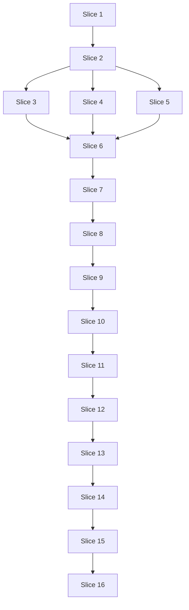

# Plan: lvpm-core extraction and the lockfile (uv model)

**Created**: 2026-10-24 · **Revised**: 2026-10-24 (after plan review round 1)
**Branch**: claude/lvpm-tui-interface-5aa5bc (specs and plan); implementation on per-slice feature branches
**Status**: approved
**Gherkin persistence**: tests/features
**Specs**: [docs/specs/lvpm-lockfile.md](../docs/specs/lvpm-lockfile.md), plus core-extraction criteria AC-K1–K6 from [docs/specs/lvpm-tui.md](../docs/specs/lvpm-tui.md)

## Goal

Two installs of the same lvpm project today can hold different transitive
versions, nothing records which bytes a project was built against, and CI
re-resolves quietly. This plan adds the uv-style `lvpm.lock`: a PubGrub
solver writes it, an exact `sync` applies it, and `add` / `remove`,
upgrades, `[dev-dependencies]` and a strict headless mode come with it.

The plan first splits lvpm into an `lvpm-core` library with no terminal I/O
and the `lvpm` CLI on top of it, with recorded output proving the CLI is
byte-identical. That separation of concerns is the stakeholder's decision.
It keeps the CLI a thin front end, gives the lockfile a testable home, and
is what the later TUI builds on. It is done independently of the TUI mock
gate, so it pays off even if the TUI is stopped.

## Approach stances (decision-defaults axes)

- **Replace vs. merge:** merge. Manifest edits change one entry through
  `toml_edit`. `lvpm.lock` is lvpm-owned and rewritten whole (spec).
- **Integration:** one PR per slice to `main`, merged on green checks; no
  direct pushes. **No release is tagged between Slice 10 and Slice 13**
  (sync changes bare `install`, but `install <pkg>` / headless strictness /
  add only land later). The lock format counts as unstable until Slice 13.
- **Scope:** what the two specs require, and nothing else. The CLI Ctrl+C
  handler from review round 1 was dropped; no AC requires it. The
  `lvpm-tui` crate, `--json`, package details and the catalog listing
  belong to the TUI plan.
- **Migrate vs. stub:** code moves into `crates/lvpm-core`. No re-export
  stubs are left behind.
- **One plan, not two:** the strategic review suggested separate plans for
  the extraction and for the lockfile. Declined: the stakeholder asked for one
  plan that starts with the extraction. The reordering below gets the
  lockfile onto the critical path right after the install seam (Slice 7).

## Acceptance Criteria

Core extraction (TUI spec): AC-K1 (partial — `lvpm-tui` member comes with the
TUI plan), AC-K2, AC-K3, AC-K4, AC-K5, AC-K6.
Lockfile spec: AC-L1–L8, AC-S1–S2, AC-U1–U3, AC-Y1–Y10, AC-H1–H2, AC-M1–M7,
AC-N1.

Every criterion is mapped to its scenarios in the traceability matrix below.

## Design decisions (from review round 1)

- **`OpEnv`** (Slice 6) carries everything an operation needs: destination
  flags, `cwd`, `headless: bool`, the loaded `Config`, `&dyn EventSink` and a
  `CancelToken` that does nothing by default. Operations read no environment
  variables and no process cwd; the front end builds `OpEnv` once. It is not
  named `Context`, which clashes with `anyhow::Context`.
- **Events** (Slice 3) are typed, structured data with no pre-formatted
  prose. Partial lines become begin/end pairs (`PackageStart` /
  `PackageDone`, `FeedCheckStart` / `FeedChecked`). Each variant maps to
  exactly one stream. The CLI renderer is stateful (it tracks an open line)
  and is split per module (`src/render/{index,install,lock,sync,…}.rs`).
  `Event: serde::Serialize`. `trait EventSink: Send + Sync`, and `emit(&self,
  Event)` may be called from a worker thread.
- **Install seams** (Slice 7). `resolve_greedy(...) -> InstallPlan`;
  `InstallSession` owns the HTTP client, the cache, the VI Server hook
  connection and the pending relink work; `apply(session, &InstallPlan,
  &InstallOptions)` takes entries from any source; `finish(session,
  applied)` runs one relink pass, the PostInstall hooks and one palette
  refresh, and also accepts removals. The relink, hook and refresh helpers
  move to `ops::relink`, `ops::hooks` and `ops::refresh` in the same slice.
  `InstallOptions` / `RelinkOptions` are plain core structs; clap's
  `RelinkArgs` stays in the CLI.
- **Plans as data.** `plan_sync(...) -> SyncPlan` (install / replace /
  remove, each with a reason) and `apply_sync(plan, …)`. `add` / `remove`
  build the new manifest text in memory, solve, plan the sync and verify
  every archive before any file is written. Rollback snapshots only cover
  failures during apply.
- **Install routing** is one pure core function, `install_mode(env, args) ->
  {Sync, Add, Additive}`, shared by the CLI and the future TUI:

  | Situation | Mode |
  |---|---|
  | named package + `--global` / `--prefix` / `--labview-version` | Additive (greedy, today's) |
  | named package, outside a project | Additive |
  | named package, in a project, no destination flag | Add (prints one line) |
  | no package, in a project (with or without `--global`, `--prefix`) | Sync |
  | no package, outside a project | today's error |

  Install flags under Add/Sync: `--dry-run`, `--allow-downgrade`,
  `--no-relink` / `--relink` / `--hooks` / relink options are honored;
  `--no-deps` and `--manifest` are rejected with "not supported with a lock
  (lvpm.lock always holds the full set)".
- **Errors.** Moved errors keep their text (AC-K3). They are recorded as
  debt, since they mention CLI flags. New errors are typed (`LockError`,
  `SyncError`, `Cancelled`, via `thiserror`) and carry data. The CLI
  renders the hint, and every message ends with the next command to run.
- **The AC-K2 guard** has two parts. `#![deny(clippy::print_stdout,
  clippy::print_stderr)]` goes in `lvpm-core/src/lib.rs`. A clippy
  `disallowed-methods` list covers `std::io::{stdin, stdout, stderr}`.
  `launch.rs`'s console-handle plumbing switches to `GetStdHandle` (via
  `windows-sys`), which does the same job without std's stream objects.
- **Solver** (Slice 5) is pure: `solve(constraints, index, prefs, lv_gate) ->
  Resolution | Conflict`. Package keys are lowercased. A requirement that no
  source lists is recorded as `unresolved` (stakeholder decision); a direct
  dependency that no source lists is a conflict. Hashing and writing are a
  separate step (`ops::lock`). The provider's `should_cancel` checks the
  `CancelToken`. PubGrub was preferred over a small bespoke backtracker
  because the spec requires a conflict explanation, which PubGrub produces.
- **Workspace version:** `[workspace.package] version` is inherited by every
  member, so `CARGO_PKG_VERSION` stays one number (needed by TUI AC-T3).

## Test architecture

- **Executable Gherkin via cucumber-rs.** After approval, the scenarios are
  exported to `tests/features/lvpm-lockfile/` and run by
  `tests/acceptance.rs` (`harness = false`, `futures::executor::block_on`).
  - **CLI features** drive the built `lvpm` binary as a child process.
  - **Core features** (tagged `@core`: cancellation, manifest editing,
    solver) call `lvpm-core` in the same process, with an injected `OpEnv`.
    Both kinds of feature are behavior specs.
- **The world** is a fresh temp directory per scenario. The child process
  gets a complete environment: `LOCALAPPDATA`, `APPDATA`,
  `XDG_CONFIG_HOME`, `XDG_CACHE_HOME`, `LVPM_CONFIG_CACHE` and
  `LVPM_CONFIG_SOURCES_LOCAL` all point into the world, and `LV_RTE_HEADLESS`
  is set or removed explicitly. Real user config is never read. Scenarios
  can run concurrently because no step changes the test process's own
  environment or cwd.
- **Fixture packages** are generated `.vip` archives built from a table. The
  zip entries use a fixed timestamp (1980-01-01) and a fixed order, so the
  bytes and SHA-256 are identical on every run and machine. A unit test
  asserts this.
- **Loopback feed:** a local HTTP server (a `std::net::TcpListener` thread)
  serves a fixture `index.vipr` with an ETag. Projects list it under
  `[sources]` with `defaults = false`, so the feed-progress lines are
  recorded without the public internet.
- **Seeded default feeds** for no-project runs. Outside a project the
  public feeds are always on. The harness seeds the world's cache with
  fixture bodies for the two default feed URLs. Without `--refresh`, lvpm
  uses cached feed bodies and sends no request (README, "Package sources").
  The seeding writes through `lvpm-core`'s cache API, not raw SQL.
- **Recordings** live in `tests/golden/`. They are always made with an explicit
  destination (`--prefix`). Under the routing table, that stays an additive
  install forever, so recordings never change meaning. Recordings made
  outside a project use the seeded default feeds and the local folder. Before
  comparison, anchored patterns (`\b\d+(\.\d+)?s\b`, the world's root path,
  ISO timestamps) are replaced. A normaliser unit test runs over synthetic
  strings. A meta-test changes one byte of a recording and asserts that the
  comparison fails.
- **`@labview`** scenarios need a real LabVIEW and run only when
  `LVPM_TEST_LABVIEW=1`. They must be run once on a LabVIEW machine before
  merging Slices 1, 3, 7, 10, 14.
- **Observing installs:** the harness reads the destination's install
  manifests (name, version, archive SHA-256). Slice 7 starts recording the
  archive SHA-256 in each install manifest. It is a new field, so existing
  output is unchanged.

## Slices

### Slice 1: Characterization harness and recorded CLI output

**Depends-on:** none
**Files:** `Cargo.toml`, `Cargo.lock`, `tests/acceptance.rs`, `tests/support/**`, `tests/features/**`, `tests/golden/**`
**Rollback point:** slice-start

**Behavior:**

```gherkin
Feature: The current CLI's output is recorded so later changes can be compared against it

  Background:
    Given fixture packages "alpha" 1.0 and 2.0, "beta" 1.0 requiring "alpha" >= 1.0, and "hooked" 1.0 declaring a PostInstall hook
    And a loopback feed listing the same packages

  Scenario Outline: a command's output matches its recording
    Given <setup>
    When I run "<command>"
    Then stdout, stderr and the exit code equal the recording "<name>"

    Examples:
      | setup                                         | command                                          | name                 |
      | a project using only the loopback feed       | lvpm search a                                    | search-a             |
      | a project using only the loopback feed       | lvpm search zzz                                  | search-none          |
      | a project using only the loopback feed       | lvpm install beta --dry-run --prefix dest        | install-dry-run      |
      | a project using only the loopback feed       | lvpm install beta --prefix dest                  | install-beta         |
      | a project using only the loopback feed       | lvpm install hooked --prefix dest                | install-hooked       |
      | beta installed in dest                       | lvpm list --prefix dest                          | list-beta            |
      | an empty dest                                | lvpm list --prefix dest                          | list-empty           |
      | beta installed in dest                       | lvpm uninstall beta --prefix dest                | uninstall-beta       |
      | an empty dest                                | lvpm uninstall beta --prefix dest                | uninstall-missing    |
      | a project using only the loopback feed       | lvpm install does_not_exist --prefix dest        | install-missing      |
      | no project                                   | lvpm list --labview-version 2026 --prefix dest   | flags-conflict       |
      | no project                                   | lvpm config set venv.dir .venv                   | config-set           |
      | venv.dir set to .venv                        | lvpm config get venv.dir                         | config-get           |
      | a folder with alpha 1.0                      | lvpm cache add folder                            | cache-add            |
      | no project                                   | lvpm targets                                     | targets              |
      | no project, seeded default feeds             | lvpm search a                                    | search-a-noproject   |
      | no project, seeded default feeds             | lvpm install beta --prefix dest                  | install-beta-noproject |
      | no project, beta installed in dest           | lvpm list --prefix dest                          | list-beta-noproject  |
      | no project, beta installed in dest           | lvpm uninstall beta --prefix dest                | uninstall-beta-noproject |

  Scenario: feed progress lines are recorded, first run and unchanged
    Given a project using only the loopback feed and an empty cache
    When I run "lvpm search a" twice, the second time with --refresh
    Then both outputs equal the recordings "feed-first-run" and "feed-unchanged"

  Scenario: a changed recording is detected
    Given the recording "search-a" with one byte altered
    When the "search-a" comparison runs
    Then the comparison fails

  @labview
  Scenario Outline: LabVIEW-bound command output matches its recording
    When I run "<command>"
    Then stdout, stderr and the exit code equal the recording "<name>"

    Examples:
      | command                                   | name              |
      | lvpm venv create --labview-version 2026   | venv-create       |
      | lvpm venv status                          | venv-status       |
      | lvpm install beta (into the venv)         | venv-install-beta |
      | lvpm relink --all                         | relink-all        |
      | lvpm run-hooks hooked                     | run-hooks         |
      | lvpm refresh                              | refresh           |
      | lvpm start                                | start             |
      | lvpm launch                               | launch            |
      | lvpm venv remove --yes                    | venv-remove-yes   |

  @labview
  Scenario Outline: the venv remove prompt is recorded
    Given a project with a venv
    When I run "lvpm venv remove" and answer "<answer>"
    Then stdout, stderr and the exit code equal the recording "<name>"

    Examples:
      | answer | name           |
      | n      | venv-remove-no |
      | y      | venv-remove-yes-prompt |
```

**Steps:**

#### Step 1.1: World, fixtures, loopback feed and cucumber-rs harness

**Complexity**: standard
**IMPLEMENT**: Write `tests/support` with the deterministic fixture builder,
the full-environment world, the loopback feed server, the anchored
normaliser and the recording comparison. Wire `tests/acceptance.rs` to
cucumber-rs. Add the dev-dependencies `cucumber`, `futures`, `tempfile` and
`regex`.
**TEST**: The fixture-determinism unit test, the normaliser unit test, the
"changed recording is detected" scenario, and the `search-a` row pass.
**REFACTOR**: Keep one `run_lvpm(world, args)` helper.
**Files**: `Cargo.toml`, `Cargo.lock`, `tests/acceptance.rs`, `tests/support/mod.rs`, `tests/support/fixtures.rs`, `tests/support/feed.rs`, `tests/support/golden.rs`, `tests/features/characterization.feature`, `tests/golden/search-a.txt`
**Commit**: `test: add cucumber-rs acceptance harness with offline fixtures and a loopback feed`

#### Step 1.2: Record every CLI output the extraction must preserve

**Complexity**: standard
**IMPLEMENT**: Capture every recording in the outlines from the pre-split
binary, the `@labview` ones on a LabVIEW machine. Save `cargo test --
--list` output as `tests/golden/unit-tests.txt`.
**TEST**: All characterization scenarios pass, and the `@labview` ones pass
with `LVPM_TEST_LABVIEW=1`.
**REFACTOR**: Data-drive the outline from a single table.
**Files**: `tests/golden/**`, `tests/features/characterization.feature`, `tests/support/steps.rs`
**Commit**: `test: record pre-split CLI output for characterization`

### Slice 2: Cargo workspace with `lvpm-core`

**Depends-on:** 1
**Files:** `Cargo.toml`, `Cargo.lock`, `clippy.toml`, `crates/lvpm-core/**`, `src/main.rs`, `tests/workspace.rs`
**Invariants:** `cargo test --workspace`
**Rollback point:** slice-start

**Behavior:**

```gherkin
Feature: lvpm is built from a core library and a CLI on top of it

  Scenario: every pre-split unit test still exists and passes
    Given the list of unit tests recorded before the split
    When the workspace's unit tests are listed and run
    Then every recorded test name is present under its new crate path
    And all of them pass

  Scenario: core does not depend on the CLI
    When the workspace dependency graph is inspected
    Then "lvpm-core" depends on no binary crate of the workspace

  Scenario: both crates report one version
    When the version of "lvpm" and "lvpm-core" is read
    Then they are equal
```

**Steps:**

#### Step 2.1: Move the domain modules into `crates/lvpm-core`

**Complexity**: complex
**IMPLEMENT**:
- Convert to a workspace with `[workspace.package] version`. The root package
  `lvpm` stays the binary.
- Move every domain module, its unit tests and `src/lv-src` into
  `crates/lvpm-core`, unchanged.
- Pre-declare empty `events`, `manifest_edit`, `solve`, `lockfile`, `cancel`
  and `ops` modules in `lib.rs`, so the wave-3 slices never edit `lib.rs`.
- Add the later dependencies there now (`toml_edit`, `pubgrub`, `serde`
  derive, `thiserror`, `windows-sys`).
**TEST**: All characterization scenarios are green, and the unit-test-list
scenario (AC-K4) passes.
**REFACTOR**: Narrow `pub` visibility to what `main.rs` uses.
**Files**: `Cargo.toml`, `Cargo.lock`, `crates/lvpm-core/Cargo.toml`, `crates/lvpm-core/src/**`, `src/main.rs`, `tests/workspace.rs`
**Commit**: `refactor: move domain modules into the lvpm-core crate`

#### Step 2.2: Dependency-direction and version checks

**Complexity**: trivial
**IMPLEMENT**: Write `cargo metadata` tests for the direction and the shared
version. Add `clippy.toml` with the `disallowed-methods` list (the lint is
active from Slice 3 on).
**TEST**: The tests pass, and they fail when a forbidden dependency is added
temporarily.
**REFACTOR**: Keep the workspace tests in one file.
**Files**: `tests/workspace.rs`, `clippy.toml`
**Commit**: `test: guard lvpm-core's dependency direction and version`

### Slice 3: Event sink replaces printing in the moved modules

**Depends-on:** 2
**Files:** `crates/lvpm-core/src/events.rs`, `crates/lvpm-core/src/index.rs`, `crates/lvpm-core/src/relink.rs`, `crates/lvpm-core/src/venv.rs`, `crates/lvpm-core/src/launch.rs`, `crates/lvpm-core/src/viserver.rs`, `src/main.rs`, `src/render/**`
**Invariants:** `cargo test --workspace`

**Behavior:**

```gherkin
Feature: Core reports progress as structured events and the CLI prints them

  Scenario: feed progress still renders byte for byte
    Given the recordings "feed-first-run" and "feed-unchanged"
    When those characterization rows run
    Then both still match

  @core
  Scenario: loading a feed emits a begin and an end event
    Given a project using only the loopback feed and an empty cache
    When core loads the index with a recording sink
    Then the sink received FeedCheckStart for the feed URL, then FeedChecked with outcome "downloaded"
    And every event serialises to JSON whose string fields are a package name, version, URL, path or an enumerated value

  @labview
  Scenario: the venv remove prompt is asked by the CLI
    Given a project with a venv
    When I run "lvpm venv remove" and answer "n"
    Then the output equals the recording "venv-remove-no"
    And the venv still exists
```

**Steps:**

#### Step 3.1: Events, sink, stateful renderer; convert `index.rs`

**Complexity**: complex
**IMPLEMENT**: Define the `Event` enum (Serialize) and `EventSink: Send + Sync`.
In `src/render/`, add the stateful line-aware renderer. Convert `index.rs`.
**TEST**: The feed recordings match, and the `@core` feed-event scenario passes.
**REFACTOR**: One render file per module.
**Files**: `crates/lvpm-core/src/events.rs`, `crates/lvpm-core/src/index.rs`, `src/render/mod.rs`, `src/render/index.rs`, `src/main.rs`
**Commit**: `refactor(core): report index progress as structured events`

#### Step 3.2: Convert relink, venv, launch and viserver

**Complexity**: standard
**IMPLEMENT**:
- Convert the remaining prints to events.
- `venv::remove(confirmed: bool)`: the `[y/N]` prompt moves to the CLI (AC-K6).
- `launch.rs` uses `GetStdHandle`.
- Turn on the clippy print lints and `disallowed-methods` for the core crate.
  `clippy.toml` applies to the whole workspace, so the CLI and test crates
  get `#![allow(clippy::disallowed_methods)]`. The core list also covers
  `std::env::{var, var_os, current_dir}` and `std::process::Stdio::inherit`.
  They are allowed only in `config.rs` and `target.rs`, the loaders that
  read the environment. `launch.rs` takes the headless flag from its caller.
**TEST**: The characterization suite is green (incl. `@labview` venv
prompts), and `cargo clippy -p lvpm-core -- -D warnings` passes.
**REFACTOR**: Group the event variants by module.
**Files**: `crates/lvpm-core/src/relink.rs`, `crates/lvpm-core/src/venv.rs`, `crates/lvpm-core/src/launch.rs`, `crates/lvpm-core/src/viserver.rs`, `crates/lvpm-core/src/events.rs`, `src/render/**`, `src/main.rs`
**Commit**: `refactor(core): emit relink, venv, launch and VI Server progress as events`

### Slice 4: Manifest editing and `[dev-dependencies]`

**Depends-on:** 2
**Files:** `crates/lvpm-core/src/project.rs`, `crates/lvpm-core/src/manifest_edit.rs`

**Behavior:**

```gherkin
@core
Feature: lvpm edits one manifest entry and keeps the rest of the file

  Background:
    Given a manifest with a header comment, [project], a [sources] table with a trailing comment, and [dependencies] "alpha" = "1.0", "beta" = ">=1.0"

  Scenario: adding an entry adds exactly one line
    When "gamma" = ">=1.0" is written to [dependencies]
    Then the file differs from before by exactly one added line in [dependencies]

  Scenario: replacing an entry changes only its value
    When "alpha" is set to "2.0"
    Then only the value of "alpha" differs from before

  Scenario: removing an entry removes only its line
    When "alpha" is removed
    Then the file differs from before by exactly the "alpha" line

  Scenario: removing the last entry keeps the table header
    Given [dependencies] holds only "alpha"
    When "alpha" is removed
    Then [dependencies] is present and empty and nothing else changed

  Scenario: writing to a missing table creates it at the end
    Given the manifest has no [dev-dependencies] table
    When "caraya" = ">=1.0" is written as a dev dependency
    Then a [dev-dependencies] table with that entry is appended and nothing else changed

  Scenario: an entry with a same-line comment keeps its comment
    Given "beta" = ">=1.0"  # pinned for DQMH
    When "beta" is set to ">=2.0"
    Then that line reads "beta" = ">=2.0"  # pinned for DQMH

  Scenario: an unchanged write does not touch the file
    When "alpha" is set to "1.0"
    Then the file's bytes and modification time are unchanged

  Scenario: CRLF line endings are kept
    Given the manifest uses CRLF line endings
    When "gamma" = ">=1.0" is written to [dependencies]
    Then every line of the file still ends in CRLF

  Scenario: invalid TOML is not edited
    Given the manifest is not valid TOML
    When "gamma" = ">=1.0" is written to [dependencies]
    Then the edit fails naming the line that cannot be parsed and the file is unchanged

  Scenario: dev dependencies are read with the same syntax
    Given [dev-dependencies] "caraya" = "*"
    When the manifest is read
    Then "caraya" is a dev dependency with any version

  Scenario: an unsupported constraint in [dev-dependencies] is rejected
    Given [dev-dependencies] "caraya" = "~1.0"
    When the manifest is read
    Then reading fails naming "caraya" and the unsupported constraint "~1.0"
```

**Steps:**

#### Step 4.1: Parse `[dev-dependencies]`

**Complexity**: standard
**IMPLEMENT**: `Project.dev_dependencies`, parsed by the same function as
`dependencies`.
**TEST**: The read scenarios.
**REFACTOR**: One table parser.
**Files**: `crates/lvpm-core/src/project.rs`
**Commit**: `feat(core): read [dev-dependencies] from lvpm.toml`

#### Step 4.2: Format-preserving edits

**Complexity**: standard
**IMPLEMENT**: `manifest_edit::{set, remove}`, as pure text-in/text-out
functions built on `toml_edit`, with a table selector. They write to disk
only when the content changed.
**TEST**: The write scenarios, compared at byte level.
**REFACTOR**: Split the pure edit from the write.
**Files**: `crates/lvpm-core/src/manifest_edit.rs`
**Commit**: `feat(core): edit lvpm.toml entries without touching the rest of the file`

### Slice 5: PubGrub solver

**Depends-on:** 2
**Files:** `crates/lvpm-core/src/solve.rs`, `crates/lvpm-core/src/cancel.rs`

**Behavior:**

```gherkin
@core
Feature: The solver finds a set that satisfies every constraint or explains why none exists

  Scenario: it finds a set where greedy picking fails
    Given the catalog has "A" 1.0 requiring "C" >= 1.0, "A" 2.0 requiring "C" >= 2.0, and "C" 1.0 and 2.0
    And the constraints are "A" "*" and "C" "1.0"
    When the solver runs for LabVIEW 2024
    Then the resolution is exactly "A" 1.0 and "C" 1.0

  Scenario: it explains a conflict in terms of the constraints
    Given the catalog has only "A" 2.0 requiring "C" >= 2.0, and "C" 1.0
    And the constraints are "A" "*" and "C" "1.0"
    When the solver runs
    Then the result is a conflict whose report contains "A", "C >= 2.0" and "C = 1.0"

  Scenario Outline: the LabVIEW gate
    Given "alpha" 2.0 needs LabVIEW <alpha2> and "alpha" 1.0 needs LabVIEW 2020
    And the constraints are "alpha" "*"
    When the solver runs for LabVIEW 2024
    Then the resolution holds "alpha" <chosen>

    Examples:
      | alpha2 | chosen |
      | 2026   | 1.0    |
      | 2024   | 2.0    |

  Scenario: the gate also applies to transitive packages
    Given "beta" 1.0 requires "alpha" >= 1.0, and "alpha" 2.0 needs LabVIEW 2026 and "alpha" 1.0 needs LabVIEW 2020
    And the constraints are "beta" "*"
    When the solver runs for LabVIEW 2024
    Then the resolution holds "alpha" 1.0

  Scenario: preferred versions are kept when they still fit
    Given the catalog has "alpha" 1.0 and 2.0
    And the constraints are "alpha" ">=1.0" and the preference is "alpha" 1.0
    When the solver runs
    Then the resolution holds "alpha" 1.0

  Scenario: a requirement no source lists is unresolved, not a failure
    Given "beta" 1.0 requires "ni_lib_missing" >= 1.0, which no source lists
    And the constraints are "beta" "*"
    When the solver runs
    Then the resolution holds "beta" 1.0
    And "ni_lib_missing" is reported unresolved, required by "beta"

  Scenario: a direct dependency no source lists is a conflict
    Given the constraints are "zeta" "*", which no source lists
    When the solver runs
    Then the result is a conflict naming "zeta" as not found

  Scenario: names match case-insensitively
    Given the catalog has "Alpha" 1.0 and "beta" 1.0 requiring "alpha" >= 1.0
    And the constraints are "beta" "*"
    When the solver runs
    Then the resolution holds one entry for "alpha" and one for "beta"

  Scenario: a cancelled token stops the solver
    Given a cancelled token
    When the solver runs
    Then the result is "cancelled"
```

**Steps:**

#### Step 5.1: Provider over `Index`, version mapping, gate, preferences

**Complexity**: complex
**IMPLEMENT**:
- A `pubgrub` dependency provider over `Index` entries.
- `Ranges<Version>`, with a unit test that `Ord` agrees with `Eq` for
  `1.0` / `1.0.0` / prerelease tails.
- Map exact / `>=` / `*`, with floors for requirements.
- The LabVIEW gate, lowercased keys and preferences.
**TEST**: The resolution scenarios.
**REFACTOR**: Keep the version mapping in its own module section.
**Files**: `crates/lvpm-core/src/solve.rs`
**Commit**: `feat(core): add a PubGrub solver for project locking`

#### Step 5.2: Conflict report, unresolved requirements, cancellation

**Complexity**: standard
**IMPLEMENT**:
- Turn PubGrub's derivation tree into a report that names manifest
  constraints.
- Collect unresolved transitive requirements.
- Implement `should_cancel` against a working `CancelToken` (atomic flag,
  `cancel() -> bool`). Slice 15 adds only `begin_unpack` and the call sites.
**TEST**: The conflict, unresolved, not-found and cancel scenarios.
**REFACTOR**: Isolate the report formatting as data, which the CLI renders.
**Files**: `crates/lvpm-core/src/solve.rs`, `crates/lvpm-core/src/cancel.rs`
**Commit**: `feat(core): explain solver conflicts and report unresolved requirements`

### Slice 6: `OpEnv` and query operations in core

**Depends-on:** 3, 4, 5
**Files:** `crates/lvpm-core/src/ops/mod.rs`, `crates/lvpm-core/src/ops/env.rs`, `crates/lvpm-core/src/ops/query.rs`, `src/main.rs`, `src/render/**`
**Invariants:** `cargo test --workspace`

**Behavior:**

```gherkin
Feature: Destination, index and queries live in core

  Scenario Outline: query output is unchanged
    When the characterization row "<name>" runs
    Then it still matches

    Examples:
      | name           |
      | targets        |
      | search-a       |
      | search-none    |
      | list-beta      |
      | list-empty     |
      | flags-conflict |
      | config-set     |
      | config-get     |
      | cache-add      |

  @core
  Scenario Outline: destination resolution is a function of the environment
    Given an OpEnv with <flags>, cwd <cwd> and headless <headless>
    When core resolves the destination
    Then the result is <result>

    Examples:
      | flags                          | cwd                         | headless | result                                   |
      | --prefix dest                  | anywhere                    | false    | scratch tree at dest                     |
      | --labview-version 2026 --prefix x | anywhere                 | false    | error "mutually exclusive"               |
      | none                           | a project with a venv       | false    | the venv                                 |
      | none                           | a project without a venv    | false    | error naming lvpm venv create            |
      | none                           | a project without a venv    | true     | the LabVIEW the manifest's labview names |
```

**Steps:**

#### Step 6.1: `OpEnv`, destination and index loading

**Complexity**: complex
**IMPLEMENT**: Move `roots_for`, `destination`, `headless`,
`headless_roots`, `manifest_for` and `load_index` into `ops` over `OpEnv`.
`OpEnv` also carries the detected LabVIEW targets, so tests can inject
them.
The CLI builds `OpEnv` once from clap and the process environment.
**TEST**: The destination outline. The characterization suite stays green.
**REFACTOR**: `Destination` becomes a public core type, and the venv banner
an event.
**Files**: `crates/lvpm-core/src/ops/mod.rs`, `crates/lvpm-core/src/ops/env.rs`, `src/main.rs`
**Commit**: `refactor(core): resolve destination and indexes from an OpEnv`

#### Step 6.2: Query commands return data

**Complexity**: standard
**IMPLEMENT**: Core returns typed results for targets, search (all hits;
the 40-row cap moves to the CLI), list, config get/set and cache add.
**TEST**: The query outline.
**REFACTOR**: Delete the emptied `cmd_*` bodies.
**Files**: `crates/lvpm-core/src/ops/query.rs`, `src/main.rs`, `src/render/**`
**Commit**: `refactor(core): return query results as data`

### Slice 7: Install and uninstall in core with reusable seams

**Depends-on:** 6
**Files:** `crates/lvpm-core/src/ops/install.rs`, `crates/lvpm-core/src/ops/uninstall.rs`, `crates/lvpm-core/src/ops/session.rs`, `crates/lvpm-core/src/ops/relink.rs`, `crates/lvpm-core/src/ops/hooks.rs`, `crates/lvpm-core/src/ops/refresh.rs`, `crates/lvpm-core/src/install.rs`, `crates/lvpm-core/src/events.rs`, `src/main.rs`, `src/render/**`
**Invariants:** `cargo test --workspace`

**Behavior:**

```gherkin
Feature: Install and uninstall run in core through plan, apply and finish

  Scenario Outline: install and uninstall output is unchanged
    When the characterization row "<name>" runs
    Then it still matches

    Examples:
      | name              |
      | install-dry-run   |
      | install-beta      |
      | install-hooked    |
      | install-missing   |
      | uninstall-beta    |
      | uninstall-missing |

  @core
  Scenario: a scratch install emits its phases in order
    Given a project using only the loopback feed
    When core installs "beta" into a scratch destination with a recording sink
    Then the phases appear in this order: resolve, download, unpack
    And relink, hooks and refresh are each reported as skipped with reason "scratch destination"

  @core
  Scenario: apply accepts entries that did not come from greedy resolution
    Given an install plan holding "alpha" 1.0 built by hand
    When core applies and finishes it into a scratch destination
    Then "alpha" 1.0 is installed and its install manifest records the archive's SHA-256

  @labview
  Scenario: venv install output is unchanged
    When the characterization row "venv-install-beta" runs
    Then it still matches
```

**Steps:**

#### Step 7.1: Pure move of install into `ops::install`

**Complexity**: complex
**IMPLEMENT**: Move `cmd_install` and its helpers (`run_relink`,
`run_post_install_hooks`, `run_hook_vi`, `hook_action_info`,
`refresh_palettes_and_menus`) into `ops::{install,relink,hooks,refresh}`
with events. Logic is unchanged. `InstallOptions` / `RelinkOptions` replace
clap types.
**TEST**: The install recordings match, including `@labview` on a LabVIEW
machine.
**REFACTOR**: Rename to the ops-module names. The function is not split in
this step.
**Files**: `crates/lvpm-core/src/ops/install.rs`, `crates/lvpm-core/src/ops/relink.rs`, `crates/lvpm-core/src/ops/hooks.rs`, `crates/lvpm-core/src/ops/refresh.rs`, `crates/lvpm-core/src/events.rs`, `src/main.rs`, `src/render/**`
**Commit**: `refactor(core): move install and its relink, hook and refresh helpers into core`

#### Step 7.2: Split into `resolve_greedy` / `InstallSession` / `apply` / `finish`

**Complexity**: complex
**IMPLEMENT**: Introduce the seams from the design decisions. Record the
archive SHA-256 in each install manifest.
**TEST**: The phase-order and hand-built-plan `@core` scenarios, with all
recordings still matching.
**REFACTOR**: Drop the local-variable threading (`&mut hook_conn`, the
relink work list).
**Files**: `crates/lvpm-core/src/ops/install.rs`, `crates/lvpm-core/src/ops/session.rs`, `crates/lvpm-core/src/install.rs`
**Commit**: `refactor(core): split install into plan, apply and finish`

#### Step 7.3: `ops::uninstall` on the same session

**Complexity**: standard
**IMPLEMENT**: Move `cmd_uninstall` / `uninstall_one`. Removals feed
`finish` (one palette refresh).
**TEST**: The uninstall recordings.
**REFACTOR**: Share the hook invocation with install.
**Files**: `crates/lvpm-core/src/ops/uninstall.rs`, `src/main.rs`, `src/render/**`
**Commit**: `refactor(core): move uninstall into core on the install session`

### Slice 8: `lvpm lock`

**Depends-on:** 7
**Files:** `crates/lvpm-core/src/lockfile.rs`, `crates/lvpm-core/src/ops/lock.rs`, `crates/lvpm-core/src/errors.rs`, `src/main.rs`, `src/render/**`, `tests/features/lock.feature`, `tests/support/steps.rs`
**Invariants:** `cargo test --workspace`

**Behavior:**

```gherkin
Feature: lvpm lock writes the complete resolved set

  Background:
    Given fixture packages "alpha" 1.0 and 2.0, "beta" 1.0 requiring "alpha" >= 1.0, "gamma" 1.0 and 1.5, "caraya" 1.0
    And a project with labview "2024" using only the fixture folder

  Scenario: lock records every package with exact version, hash and source
    Given the project depends on "beta" ">=1.0"
    When I run "lvpm lock"
    Then lvpm.lock lists exactly "alpha" 2.0 and "beta" 1.0
    And each entry's SHA-256 equals the SHA-256 of its fixture archive
    And each entry has source "local", because the fixture folder is a local source
    And the output says lvpm.lock was written and should be committed

  Scenario: lock prints what it decided
    Given the project depends on "beta" ">=1.0"
    When I run "lvpm lock"
    Then the output lists "+ alpha 2.0" and "+ beta 1.0"

  Scenario: dev-only packages are marked
    Given the project depends on "beta" ">=1.0" and has dev dependency "caraya" "*"
    When I run "lvpm lock"
    Then "caraya" is in lvpm.lock marked as needed only for development
    And "beta" and "alpha" are not marked

  Scenario: a package at exactly the project's LabVIEW is eligible
    Given "gamma" 1.5 needs LabVIEW 2024 and the project depends on "gamma" "*"
    When I run "lvpm lock"
    Then lvpm.lock holds "gamma" 1.5

  Scenario: a requirement no source lists is warned about and the lock is written
    Given "beta" 1.0 also requires "ni_lib_missing" >= 1.0, which no source lists
    And the project depends on "beta" ">=1.0"
    When I run "lvpm lock"
    Then the command succeeds
    And the output warns that "ni_lib_missing", required by "beta", is in no source
    And lvpm.lock records "ni_lib_missing" as unresolved

  Scenario: a conflict fails, names the manifest lines, and keeps the old lock
    Given the project depends on "beta" ">=1.0" and lvpm.lock is current
    When I change the manifest to depend on "A" "*" and "C" "1.0", where only "A" 2.0 requiring "C" >= 2.0 exists
    And I run "lvpm lock"
    Then the command fails with a report naming "A" "*" and "C" "1.0" from lvpm.toml
    And lvpm.lock is byte-identical to before

  Scenario: a direct dependency no source lists fails with a hint
    Given the project depends on "zeta" "*", which no source lists
    When I run "lvpm lock"
    Then the command fails saying "zeta" is in no configured source and suggesting "lvpm search zeta"

  Scenario: a manifest without labview is refused with an example
    Given a project manifest without labview
    When I run "lvpm lock"
    Then the command fails with: add labview = "<year>" under [project] in lvpm.toml
    And no lvpm.lock exists

  Scenario: unreachable archives are all reported in one error
    Given the project depends on "alpha" and "gamma", and both archives are unreachable and not cached
    When I run "lvpm lock"
    Then the command fails naming both "alpha" and "gamma"
    And no lvpm.lock is written

  Scenario: cached archives are used when the source is unreachable
    Given the archive of "alpha" 2.0 is in the cache and its source is unreachable
    And the project depends on "alpha" "*"
    When I run "lvpm lock"
    Then lvpm.lock holds "alpha" 2.0

  Scenario: locking ignores what is installed and where the world lives
    Given world one, under one temp root, has "alpha" 1.0 installed in its destination
    And world two, under a different temp root, has nothing installed
    And both depend on "beta" ">=1.0" with the same fixtures
    When I run "lvpm lock" in both worlds
    Then both lvpm.lock files are byte-identical
    And no lvpm.lock contains either temp root's path

  Scenario: a hosted package records its feed URL as the source
    Given the project lists the loopback feed under [sources] and depends on "gamma" "*" from it
    When I run "lvpm lock"
    Then the "gamma" entry has the loopback feed's index URL as its source

  Scenario: a re-lock after adding a dependency keeps the other locked versions
    Given lvpm.lock holds "alpha" 1.0 and "beta" 1.0 because "alpha" 2.0 was published after locking
    When I add "gamma" "*" to lvpm.toml and run "lvpm lock"
    Then lvpm.lock holds "alpha" 1.0, "beta" 1.0 and "gamma" 1.5
```

**Steps:**

#### Step 8.1: Lock format

**Complexity**: standard
**IMPLEMENT**: A deterministic TOML (de)serialiser with a generated header,
the format version, `labview`, the recorded inputs, and entries (name,
version, sha256, md5?, source, requires, dev, unresolved).
**TEST**: Round-trip and byte-determinism unit tests.
**REFACTOR**: Sort in one place.
**Files**: `crates/lvpm-core/src/lockfile.rs`
**Commit**: `feat(core): define the lvpm.lock format`

#### Step 8.2: `ops::lock` and `lvpm lock`

**Complexity**: standard
**IMPLEMENT**:
- `ops::lock` first requires `labview`.
- It solves, using existing locked versions as preferences.
- It hashes every chosen archive through the session's cache and collects
  all failures before reporting.
- It writes atomically, and emits a change summary and the unresolved
  warnings.
- One progress event per archive is rendered as `hashing alpha 2.0 (3/48)`.
- Typed `LockError`. CLI command, rendering and hint texts.
**TEST**: The lock scenarios.
**REFACTOR**: Reuse the session's fetch-through-cache.
**Files**: `crates/lvpm-core/src/ops/lock.rs`, `crates/lvpm-core/src/errors.rs`, `src/main.rs`, `src/render/**`, `tests/features/lock.feature`, `tests/support/steps.rs`
**Commit**: `feat: lvpm lock writes lvpm.lock from the solver`

### Slice 9: Staleness and `lvpm lock --check`

**Depends-on:** 8
**Files:** `crates/lvpm-core/src/lockfile.rs`, `crates/lvpm-core/src/ops/lock.rs`, `src/main.rs`, `tests/features/staleness.feature`, `tests/support/steps.rs`

**Behavior:**

```gherkin
Feature: lvpm knows when the lock no longer represents the manifest

  Background:
    Given a project with labview "2024", defaults = false, depending on "beta" ">=1.0", locked with "alpha" 1.0 and "beta" 1.0

  Scenario Outline: a manifest change makes the lock stale and check says why
    When I <change>
    And I run "lvpm lock --check"
    Then the exit code is non-zero
    And stderr is one line naming <reason>
    And stdout is empty
    And no file in the project changed

    Examples:
      | change                                      | reason                          |
      | add the dependency "gamma" "*"              | dependency "gamma" was added    |
      | remove the dependency "beta"                | dependency "beta" was removed   |
      | add the dev dependency "caraya" "*"         | dev dependency "caraya" was added |
      | change "beta" to "2.0"                      | "beta" "2.0" excludes locked 1.0 |
      | change labview to "2025"                    | labview changed                 |
      | add a hosted source to [sources]            | sources changed                 |
      | set defaults = true                         | sources changed                 |

  Scenario Outline: some changes keep the lock current
    When I <change>
    And I run "lvpm lock --check"
    Then the exit code is 0 and stderr is empty

    Examples:
      | change                                                 |
      | relax "beta" to "*"                                    |
      | add a comment and reorder [dependencies]               |
      | change [project] name                                  |
      | add a folder to sources.local                          |
      | publish "beta" 3.0 to the fixture folder               |

  Scenario: check without a lock fails and says so
    Given lvpm.lock is deleted
    When I run "lvpm lock --check"
    Then the exit code is non-zero and stderr says there is no lvpm.lock and to run "lvpm lock"

  Scenario: an unreadable lock is reported, not overwritten silently
    Given lvpm.lock is not valid TOML
    When I run "lvpm lock --check"
    Then the exit code is non-zero and stderr says lvpm.lock cannot be read and to run "lvpm lock" to regenerate it

  Scenario: check sends no network request
    Given the project lists the loopback feed under [sources] and the feed is stopped
    When I run "lvpm lock --check"
    Then the exit code is 0

  Scenario: a lock in an older format is stale
    Given lvpm.lock declares lock-format version 0
    When I run "lvpm lock --check"
    Then the exit code is non-zero and stderr says the lock format is outdated

  Scenario: a current lock is not rewritten
    When I run "lvpm lock"
    Then the output says lvpm.lock is up to date
    And lvpm.lock's bytes and modification time are unchanged

  Scenario: a new upstream release changes nothing
    Given "beta" 3.0 is published to the fixture folder
    When I run "lvpm lock"
    Then lvpm.lock still holds "beta" 1.0
```

**Steps:**

#### Step 9.1: Staleness rules as named predicates

**Complexity**: standard
**IMPLEMENT**: `Lock::staleness(&Project) -> Option<StaleReason>`, with one
predicate per rule. `ops::lock` writes nothing when the lock is current.
**TEST**: Unit tests for every outline row.
**REFACTOR**: The reason text is rendered by the CLI from the `StaleReason`
data.
**Files**: `crates/lvpm-core/src/lockfile.rs`, `crates/lvpm-core/src/ops/lock.rs`
**Commit**: `feat(core): detect stale locks with a reason`

#### Step 9.2: `lvpm lock --check`

**Complexity**: trivial
**IMPLEMENT**: Writes nothing. Exit code plus one stderr line.
**TEST**: The staleness scenarios.
**REFACTOR**: Mark `--check` as conflicting with `--upgrade` / `--upgrade-package` in clap.
**Files**: `src/main.rs`, `tests/features/staleness.feature`, `tests/support/steps.rs`
**Commit**: `feat: lvpm lock --check`

### Slice 10: Exact sync

**Depends-on:** 9
**Files:** `crates/lvpm-core/src/ops/sync.rs`, `crates/lvpm-core/src/ops/route.rs`, `crates/lvpm-core/src/cache.rs`, `crates/lvpm-core/src/errors.rs`, `src/main.rs`, `src/render/**`, `tests/features/sync.feature`, `tests/support/steps.rs`
**Invariants:** `cargo test --workspace`

**Behavior:**

```gherkin
Feature: lvpm sync makes the destination equal the lock

  Background:
    Given fixture packages "alpha" 1.0 and 2.0, "beta" 1.0 requiring "alpha" >= 1.0, "gamma" 1.0, "caraya" 1.0 requiring "delta" >= 1.0, "delta" 1.0
    And a project with labview "2024" depending on "beta" ">=1.0", with a scratch destination "dest"

  Scenario: sync installs exactly the locked set
    Given a current lvpm.lock with "alpha" 2.0 and "beta" 1.0
    When I run "lvpm sync --prefix dest"
    Then dest's lvpm-installed packages are exactly "alpha" 2.0 and "beta" 1.0
    And each install manifest's archive SHA-256 equals the locked one

  Scenario: an extra package is announced, then removed, without a prompt
    Given a current lvpm.lock and "gamma" 1.0 installed in dest
    When I run "lvpm sync --prefix dest" with no input available
    Then the line naming "gamma" as removed because lvpm.lock does not list it comes before the removal output
    And "gamma" is no longer installed
    And the command did not wait for input

  Scenario: a package the lock lists is never removed
    Given a current lvpm.lock with "alpha" 2.0 and "beta" 1.0, both installed in dest
    When I run "lvpm sync --prefix dest"
    Then the output says nothing to do
    And nothing is installed or removed

  Scenario: a different installed version is replaced
    Given "alpha" 1.0 installed in dest and lvpm.lock holds "alpha" 2.0
    When I run "lvpm sync --prefix dest"
    Then "alpha" 2.0 is installed and the output names "alpha 1.0 -> 2.0"

  Scenario: dry-run shows the plan and changes nothing
    Given lvpm.lock holds "alpha" 2.0 and "beta" 1.0, lvpm.toml now also depends on "gamma" "*", and "delta" 1.0 is installed in dest
    When I run "lvpm sync --dry-run --prefix dest"
    Then the output says lvpm.lock would be updated: "+ gamma 1.0"
    And it lists "install alpha 2.0", "install beta 1.0", "install gamma 1.0" and "remove delta 1.0 (not in lvpm.lock)"
    And dest, lvpm.lock and lvpm.toml are byte-identical to before

  Scenario: the first sync of a project explains the migration
    Given no lvpm.lock exists and "gamma" 1.0 installed in dest
    When I run "lvpm sync --prefix dest"
    Then the output says no lvpm.lock was found and one is being written
    And it says 1 installed package not in the lock will be removed, naming "gamma"
    And it says to commit lvpm.lock
    And dest matches the new lvpm.lock

  Scenario: a stale lock is re-locked before syncing
    Given a lvpm.lock without "gamma" and lvpm.toml now also depends on "gamma" "*"
    When I run "lvpm sync --prefix dest"
    Then lvpm.lock now holds "gamma" 1.0 and dest has "gamma" installed

  Scenario: a package whose recorded hosted source is gone comes from a local folder
    Given lvpm.lock records "alpha" 2.0 with the loopback feed as its source, and the cache is empty
    And the loopback feed is stopped and a local source folder holds the identical archive
    When I run "lvpm sync --prefix dest"
    Then "alpha" 2.0 is installed with the locked SHA-256

  Scenario: a local package found in a different local folder is accepted
    Given lvpm.lock records "alpha" 2.0 with source "local", and the cache is empty
    And the original fixture folder is removed and a second configured local folder holds the identical archive
    When I run "lvpm sync --prefix dest"
    Then "alpha" 2.0 is installed with the locked SHA-256

  Scenario: an imported archive needs no source
    Given "alpha" 2.0 was imported with "lvpm cache add" and no source holds it
    When I run "lvpm sync --prefix dest"
    Then "alpha" 2.0 is installed

  Scenario: a missing archive fails before any change
    Given a current lvpm.lock with "alpha" 2.0 and "beta" 1.0, "gamma" 1.0 installed in dest
    And no source or cache holds an archive with the locked SHA-256 of "alpha" 2.0
    When I run "lvpm sync --prefix dest"
    Then the command fails naming "alpha", "2.0" and the SHA-256
    And it suggests "lvpm cache add <file>" or a sources.local folder
    And "gamma" is still installed and "beta" is not installed

  Scenario Outline: an archive with different bytes is never installed
    Given <where> holds an "alpha" 2.0 archive whose bytes differ from the locked SHA-256, and nothing else holds it
    When I run "lvpm sync --prefix dest"
    Then the command fails saying the archive of "alpha" 2.0 does not match lvpm.lock
    And "alpha" 2.0 is not installed

    Examples:
      | where              |
      | the fixture folder |
      | the cache          |

  Scenario: --locked refuses a stale lock
    Given a stale lvpm.lock
    When I run "lvpm sync --locked --prefix dest"
    Then the command fails with the stale reason and "run lvpm lock and commit lvpm.lock"
    And dest and lvpm.lock are unchanged

  Scenario: --locked refuses a missing lock
    Given no lvpm.lock exists
    When I run "lvpm sync --locked --prefix dest"
    Then the command fails and no lvpm.lock is written

  Scenario: --frozen syncs a stale lock as it is
    Given lvpm.lock holds "alpha" 2.0 and "beta" 1.0 and lvpm.toml now also depends on "gamma" "*"
    When I run "lvpm sync --frozen --prefix dest"
    Then dest has exactly "alpha" 2.0 and "beta" 1.0
    And lvpm.lock is byte-identical to before

  Scenario: --frozen without a lock fails
    Given no lvpm.lock exists
    When I run "lvpm sync --frozen --prefix dest"
    Then the command fails saying there is no lvpm.lock

  Scenario: --locked and --frozen together are rejected
    When I run "lvpm sync --locked --frozen"
    Then the command fails saying the two flags cannot be combined

  Scenario: --no-dev skips dev-only packages, transitive ones included
    Given dev dependency "caraya" "*" and a current lock, with "caraya" and "delta" installed in dest
    When I run "lvpm sync --no-dev --prefix dest"
    Then "caraya" and "delta" are removed
    And "alpha" and "beta" are installed

  Scenario: a package needed by both normal and dev dependencies stays with --no-dev
    Given "caraya" also requires "alpha" >= 1.0 and a current lock
    When I run "lvpm sync --no-dev --prefix dest"
    Then "alpha" is installed

  Scenario Outline: bare install is sync with the same flags
    When I run "lvpm install <flags>" and, in an identical world, "lvpm sync <flags>"
    Then both destinations, locks and normalised outputs are identical

    Examples:
      | flags                     |
      | --prefix dest             |
      | --dry-run --prefix dest   |
      | --locked --prefix dest    |
      | --frozen --prefix dest    |
      | --no-dev --prefix dest    |

  Scenario: an unresolved requirement is warned about at sync
    Given lvpm.lock records "ni_lib_missing" as unresolved, required by "beta"
    When I run "lvpm sync --prefix dest"
    Then the output warns that "ni_lib_missing", required by "beta", is not installed

  Scenario: sync with an unsatisfiable manifest changes nothing
    Given lvpm.lock is stale and lvpm.toml pins "alpha" = "1.0" while "beta" 1.0 now requires "alpha" >= 2.0
    When I run "lvpm sync --prefix dest"
    Then the command fails with the conflict report
    And dest and lvpm.lock are unchanged

  Scenario: sync outside a project is refused
    Given a directory without lvpm.toml
    When I run "lvpm sync"
    Then the command fails saying no lvpm.toml was found

  Scenario: a manifest without labview is refused at sync with an example
    Given a project manifest without labview
    When I run "lvpm install --prefix dest"
    Then the command fails with: add labview = "<year>" under [project] in lvpm.toml

  @labview
  Scenario: a hook failing mid-sync tells how to finish
    Given a lock with "hooked" whose PostInstall fails, in a venv
    When I run "lvpm sync"
    Then the output lists what was done and what failed, ending with "re-run lvpm sync to finish"
    And a second "lvpm sync" reports nothing left to do except the hook

  @labview
  Scenario: sync into a venv
    Given a project with a venv and a current lock
    When I run "lvpm sync"
    Then the venv's lvpm-installed packages equal the lock

  @labview
  Scenario: sync with --global on a workstation is exact
    Given the LabVIEW installation has an lvpm-installed package the lock does not list
    When I run "lvpm sync --global"
    Then that package is uninstalled and the locked set is installed

  @labview
  Scenario: headless sync into the manifest's LabVIEW is exact
    Given LV_RTE_HEADLESS is set, no venv, a current lock
    And that LabVIEW has an lvpm-installed package the lock does not list
    When I run "lvpm sync"
    Then that package is uninstalled and the locked set is installed
```

**Steps:**

#### Step 10.1: `plan_sync` as data

**Complexity**: standard
**IMPLEMENT**: Build a `SyncPlan` (install / replace / remove with reasons)
from the lock, the destination's install manifests and `--no-dev`.
**TEST**: Unit tests over plan computation (extra, replace, nothing to do,
dev-only, shared). Also the dry-run scenario.
**REFACTOR**: Keep reasons as an enum.
**Files**: `crates/lvpm-core/src/ops/sync.rs`
**Commit**: `feat(core): plan an exact sync from lvpm.lock`

#### Step 10.2: Fetch by SHA-256, all before the first change

**Complexity**: standard
**IMPLEMENT**:
- Look in the cache by SHA-256 and verify the bytes again, since an entry
  can be corrupt.
- Then look in any source by name + version, keeping only a hash match.
- Fetch all archives before applying anything; fail with a typed
  `SyncError`.
- Each planned item is `PlannedPackage { entry, expected_sha256 }`, and its
  entry points at the verified bytes through the existing
  `cache:<sha256>` URL form. `apply` checks the SHA-256 again whenever
  `expected_sha256` is set. A `@core` unit test shows apply refusing a plan
  whose archive hash differs.
- Install manifests written before Slice 7 carry no SHA-256
  (`#[serde(default)]`). `plan_sync` treats them as matching on name and
  version.
- A small `Fetcher` (HTTP client, cache, `fetch_locked`) is split out.
  `InstallSession` composes it, and `ops::lock` uses it directly.
**TEST**: The moved-source, imported, missing and mismatch scenarios.
**REFACTOR**: One `fetch_locked(entry)` helper.
**Files**: `crates/lvpm-core/src/ops/sync.rs`, `crates/lvpm-core/src/cache.rs`, `crates/lvpm-core/src/errors.rs`
**Commit**: `feat(core): fetch locked packages by SHA-256 from any source`

#### Step 10.3: `apply_sync`, `lvpm sync`, routing for bare install

**Complexity**: standard
**IMPLEMENT**:
- `apply_sync` uses the install session's `apply` / `finish`.
- Write the first-sync migration message and the partial-failure summary.
- `lvpm sync [--locked | --frozen] [--dry-run] [--no-dev]`, with clap
  conflicts.
- `ops::route::install_mode` handles the bare case and rejects `--no-deps` / `--manifest` in lock modes from this slice on.
**TEST**: The remaining sync scenarios. The recordings stay valid because
they always use `--prefix` with a named package.
**REFACTOR**: Remove the old manifest-install path from `ops::install`.
**Files**: `crates/lvpm-core/src/ops/sync.rs`, `crates/lvpm-core/src/ops/route.rs`, `src/main.rs`, `src/render/**`, `tests/features/sync.feature`, `tests/support/steps.rs`
**Commit**: `feat: lvpm sync; bare lvpm install syncs the project to lvpm.lock`

### Slice 11: Headless implies `--locked`

**Depends-on:** 10
**Files:** `crates/lvpm-core/src/ops/sync.rs`, `src/main.rs`, `tests/features/headless.feature`, `tests/support/steps.rs`

**Behavior:**

```gherkin
Feature: On a headless machine a missing or outdated lock fails the job

  Background:
    Given LV_RTE_HEADLESS is set
    And a project with labview "2024" and a scratch destination "dest"

  Scenario Outline: sync and bare install fail on a missing or stale lock
    Given the lock is <state>
    When I run "<command> --prefix dest"
    Then the first output line says headless mode implies --locked
    And the command fails with "<hint>"
    And dest and lvpm.lock are unchanged

    Examples:
      | state   | command      | hint                                                  |
      | missing | lvpm sync    | no lvpm.lock: run lvpm lock locally and commit it, or pass --no-locked |
      | missing | lvpm install | no lvpm.lock: run lvpm lock locally and commit it, or pass --no-locked |
      | stale   | lvpm sync    | lvpm.lock is out of date                              |
      | stale   | lvpm install | lvpm.lock is out of date                              |

  Scenario: a current lock syncs and still prints the note
    Given a current lock
    When I run "lvpm sync --prefix dest"
    Then the first output line says headless mode implies --locked
    And dest matches the lock

  Scenario: --no-locked re-locks
    Given a stale lock
    When I run "lvpm sync --no-locked --prefix dest"
    Then lvpm.lock is rewritten and dest matches it

  Scenario: without LV_RTE_HEADLESS there is no note
    Given LV_RTE_HEADLESS is not set and a stale lock
    When I run "lvpm sync --prefix dest"
    Then no output line mentions headless mode
    And lvpm.lock is rewritten

  Scenario: --frozen still applies
    Given a stale lock
    When I run "lvpm sync --frozen --prefix dest"
    Then dest matches lvpm.lock as it was

  Scenario Outline: lock-editing commands are not affected
    Given a stale lock
    When I run "<command>"
    Then it succeeds and lvpm.lock is current afterwards

    Examples:
      | command                        |
      | lvpm lock                      |
      | lvpm add gamma --prefix dest   |
      | lvpm remove beta --prefix dest |
```

**Steps:**

#### Step 11.1: Strictness as a pure function, the note, `--no-locked`

**Complexity**: standard
**IMPLEMENT**: `strictness(headless, flags) -> {Relock, Locked, Frozen}`,
next to the other headless defaults, plus the note.
**TEST**: A unit test over the matrix {headless, locked, frozen,
no-locked}, plus the scenarios. The `add` / `remove` rows are enabled when
Slice 13 lands. Until then they are tagged `@pending-13`.
**REFACTOR**: Fold the existing headless notes into one renderer.
**Files**: `crates/lvpm-core/src/ops/sync.rs`, `src/main.rs`, `tests/features/headless.feature`, `tests/support/steps.rs`
**Commit**: `feat: headless lvpm sync requires a current lock`

### Slice 12: Upgrades

**Depends-on:** 11
**Files:** `crates/lvpm-core/src/ops/lock.rs`, `crates/lvpm-core/src/ops/snapshot.rs`, `src/main.rs`, `src/render/**`, `tests/features/upgrade.feature`, `tests/support/steps.rs`

**Behavior:**

```gherkin
Feature: Only an explicit upgrade moves locked versions

  Background:
    Given fixture packages "alpha" 1.0 and 2.0, "beta" 0.9, 1.0, 1.5 and 2.0 each requiring "alpha" >= 1.0, "gamma" 1.0 and 2.0
    And a project with labview "2024" depending on "beta" ">=1.0" and "gamma" "1.0"
    And lvpm.lock holds "alpha" 1.0, "beta" 1.0 and "gamma" 1.0

  Scenario: upgrade everything within the constraints
    When I run "lvpm lock --upgrade"
    Then lvpm.lock holds "alpha" 2.0, "beta" 2.0 and "gamma" 1.0
    And the output lists "alpha 1.0 -> 2.0" and "beta 1.0 -> 2.0"

  Scenario: upgrade never crosses the LabVIEW gate
    Given "alpha" 3.0 needing LabVIEW 2026 is published
    When I run "lvpm lock --upgrade"
    Then lvpm.lock holds "alpha" 2.0

  Scenario: upgrade one package and keep the rest
    When I run "lvpm lock --upgrade-package beta"
    Then "beta" is 2.0 in lvpm.lock
    And the "alpha" and "gamma" entries are byte-identical to before

  Scenario: upgrading one package moves a dependency only when it must
    Given "beta" 2.0 requires "alpha" >= 2.0 instead
    When I run "lvpm lock --upgrade-package beta"
    Then "beta" is 2.0 and "alpha" is 2.0 in lvpm.lock
    And the "gamma" entry is byte-identical to before

  Scenario: upgrade-package is repeatable
    When I run "lvpm lock --upgrade-package beta --upgrade-package alpha"
    Then "beta" is 2.0 and "alpha" is 2.0, and "gamma" is unchanged

  Scenario: a version the constraint admits leaves the manifest alone
    When I run "lvpm lock --upgrade-package beta@1.5"
    Then "beta" is 1.5 in lvpm.lock
    And lvpm.toml is byte-identical to before

  Scenario: a version the floor excludes rewrites the floor and says so
    When I run "lvpm lock --upgrade-package beta@0.9"
    Then lvpm.toml says "beta" = ">=0.9" and nothing else in it changed
    And the output says lvpm.toml was updated: beta ">=1.0" -> ">=0.9"
    And "beta" is 0.9 in lvpm.lock

  Scenario: a version an exact pin excludes rewrites the pin
    When I run "lvpm lock --upgrade-package gamma@2.0"
    Then lvpm.toml says "gamma" = "2.0"

  Scenario: a "*" constraint is never rewritten
    Given lvpm.toml says "beta" = "*"
    When I run "lvpm lock --upgrade-package beta@0.9"
    Then lvpm.toml still says "beta" = "*" and "beta" is 0.9 in lvpm.lock

  Scenario: a transitive package is never added to the manifest
    When I run "lvpm lock --upgrade-package alpha@2.0"
    Then "alpha" is 2.0 in lvpm.lock
    And lvpm.toml has no "alpha" entry

  Scenario: a version that does not exist fails and changes nothing
    When I run "lvpm lock --upgrade-package beta@9.9"
    Then the command fails saying no "beta" 9.9 is in any source
    And lvpm.toml and lvpm.lock are byte-identical to before

  Scenario: a name that is not locked fails and changes nothing
    When I run "lvpm lock --upgrade-package zeta"
    Then the command fails saying "zeta" is not in lvpm.lock
    And lvpm.toml and lvpm.lock are byte-identical to before

  Scenario Outline: an upgrade to an ineligible version fails and changes nothing
    Given <situation>
    When I run "lvpm lock --upgrade-package beta@2.0"
    Then the command fails saying <reason>
    And lvpm.toml and lvpm.lock are byte-identical to before

    Examples:
      | situation                                                          | reason                                                          |
      | "beta" 2.0 needs LabVIEW 2026                                      | beta 2.0 requires LabVIEW 2026; this project is locked for 2024 |
      | lvpm.toml pins "alpha" = "1.0" and beta 2.0 requires alpha >= 2.0  | the conflict, naming "alpha" "1.0"                              |

  Scenario: nothing newer says so
    Given lvpm.lock already holds the newest eligible versions
    When I run "lvpm lock --upgrade"
    Then the output says no changes, nothing newer
```

**Steps:**

#### Step 12.1: `--upgrade` / `--upgrade-package X` (repeatable)

**Complexity**: standard
**IMPLEMENT**: Drop the preference for all packages or for the named ones,
then re-solve. Emit the change summary.
**TEST**: The first five scenarios and the last one.
**REFACTOR**: One preference builder.
**Files**: `crates/lvpm-core/src/ops/lock.rs`, `src/main.rs`, `src/render/**`
**Commit**: `feat: lvpm lock --upgrade and --upgrade-package`

#### Step 12.2: `X@ver` with constraint rewriting and the restore guard

**Complexity**: standard
**IMPLEMENT**:
- Pin X for this solve.
- Compute the manifest rewrite in memory (kind kept; `*` never rewritten;
  a transitive X never added), solve, hash, then write both files.
- `ops::snapshot` restores both byte for byte if writing fails.
**TEST**: The remaining scenarios. A unit test injects a write failure after
the manifest write and asserts that both files are restored.
**REFACTOR**: Make the guard reusable for Slice 13.
**Files**: `crates/lvpm-core/src/ops/lock.rs`, `crates/lvpm-core/src/ops/snapshot.rs`, `tests/features/upgrade.feature`, `tests/support/steps.rs`
**Commit**: `feat: upgrade a locked package to a chosen version`

### Slice 13: `lvpm add` / `lvpm remove`; `install <pkg>` routing

**Depends-on:** 12
**Files:** `crates/lvpm-core/src/ops/add_remove.rs`, `crates/lvpm-core/src/ops/route.rs`, `src/main.rs`, `src/render/**`, `tests/features/add_remove.feature`, `tests/features/headless.feature`, `tests/support/steps.rs`

**Behavior:**

```gherkin
Feature: add and remove edit the manifest, then lock and sync

  Background:
    Given fixture packages "alpha" 1.0 and 2.0, "beta" 1.0 requiring "alpha" >= 1.0, "gamma" 0.5 and 1.0, "caraya" 1.0
    And a project with labview "2024" depending on "beta" ">=1.0", locked and synced into scratch destination "dest"

  Scenario: add without a version writes a floor of the newest eligible version
    When I run "lvpm add gamma --prefix dest"
    Then lvpm.toml says "gamma" = ">=1.0"
    And lvpm.lock and dest include "gamma" 1.0

  Scenario: add with a constraint writes it as given
    When I run "lvpm add gamma@>=0.5 --prefix dest" (argument quoted)
    Then lvpm.toml says "gamma" = ">=0.5"

  Scenario: add with an empty constraint explains quoting
    When I run "lvpm add gamma@ --prefix dest"
    Then the command fails saying a constraint is expected after "@" and to quote it, e.g. "gamma@>=0.5"
    And it says the shell may have created a file named "=0.5" that can be deleted

  Scenario: add without a lock explains the migration
    Given no lvpm.lock exists and "delta" 1.0 is installed in dest
    When I run "lvpm add gamma --prefix dest"
    Then the output says no lvpm.lock was found, names "delta" as to be removed, and says to commit lvpm.lock

  Scenario: add gated by LabVIEW says why
    Given every "omega" version needs LabVIEW 2026
    When I run "lvpm add omega --prefix dest"
    Then the command fails saying omega requires LabVIEW 2026 and this project is locked for 2024
    And nothing changed

  Scenario: remove --dry-run shows the plan and writes nothing
    Given the project also depends on "gamma" ">=1.0", locked and synced
    When I run "lvpm remove gamma --dry-run --prefix dest"
    Then the output shows the removed manifest line and "remove gamma 1.0"
    And lvpm.toml, lvpm.lock and dest are byte-identical to before
    And nothing changed

  Scenario: add of an existing entry updates its constraint and says so
    When I run "lvpm add beta@>=0.5 --prefix dest"
    Then lvpm.toml says "beta" = ">=0.5" and the output says the constraint was updated

  Scenario: add --dev writes to [dev-dependencies]
    When I run "lvpm add caraya --dev --prefix dest"
    Then [dev-dependencies] says "caraya" = ">=1.0"

  Scenario: add keeps the rest of the manifest byte for byte
    Given lvpm.toml contains comments
    When I run "lvpm add gamma --prefix dest"
    Then lvpm.toml differs from before by exactly the "gamma" line

  Scenario: add --dry-run shows the plan and writes nothing
    When I run "lvpm add gamma --dry-run --prefix dest"
    Then the output shows the manifest line, the lock changes and the sync plan
    And lvpm.toml, lvpm.lock and dest are byte-identical to before

  Scenario: a failed lock during add leaves both files untouched
    Given lvpm.toml pins "alpha" = "1.0" and the only "omega" requires "alpha" >= 2.0
    When I run "lvpm add omega --prefix dest"
    Then the command fails with a conflict naming "alpha" "1.0" and "omega"
    And lvpm.toml and lvpm.lock are byte-identical to before

  Scenario: a failed sync during add leaves both files untouched
    Given the fixture "broken_zip" 1.0 has a valid index entry and a fixed SHA-256, but its archive is not a valid zip
    When I run "lvpm add broken_zip --prefix dest"
    Then the command fails naming "broken_zip" and saying its archive could not be unpacked
    And lvpm.toml and lvpm.lock are byte-identical to before
    And dest holds no "broken_zip" files

  Scenario: remove uninstalls a package nothing else needs
    Given the project also depends on "gamma" ">=1.0", locked and synced
    When I run "lvpm remove gamma --prefix dest"
    Then "gamma" is gone from lvpm.toml, lvpm.lock and dest

  Scenario: remove keeps a package another one still requires
    Given the project also depends on "alpha" ">=1.0", locked and synced
    When I run "lvpm remove alpha --prefix dest"
    Then "alpha" is gone from lvpm.toml
    And "alpha" stays in lvpm.lock and dest
    And the output says "alpha" is still required by "beta"

  Scenario: remove --dev removes from [dev-dependencies]
    Given dev dependency "caraya" ">=1.0", locked and synced
    When I run "lvpm remove caraya --dev --prefix dest"
    Then "caraya" is gone from [dev-dependencies], lvpm.lock and dest

  Scenario: remove without --dev of a dev dependency points to --dev
    Given dev dependency "caraya" ">=1.0"
    When I run "lvpm remove caraya --prefix dest"
    Then the command fails saying "caraya" is in [dev-dependencies] and to use --dev
    And nothing changed

  Scenario: removing the last dependency empties lock and destination
    When I run "lvpm remove beta --prefix dest"
    Then [dependencies] is empty, lvpm.lock lists no packages and dest has no lvpm-installed packages

  Scenario: removing a name that is not a dependency fails
    When I run "lvpm remove zeta --prefix dest"
    Then the command fails saying "zeta" is not in lvpm.toml
    And nothing changed

  @core
  Scenario: a failed sync during remove leaves both files untouched
    Given an OpEnv whose install session fails when it uninstalls "beta"
    When core removes "beta"
    Then the result is a sync error naming "beta"
    And lvpm.toml and lvpm.lock are byte-identical to before

  @core
  Scenario Outline: install routing follows the table
    Given <project>
    When core routes "lvpm install <args>"
    Then the mode is <mode>

    Examples:
      | project    | args                         | mode                              |
      | a project  | gamma                        | Add                               |
      | a project  | gamma --prefix dest          | Additive                          |
      | a project  | gamma --global               | Additive                          |
      | a project  | gamma --labview-version 2026 | Additive                          |
      | no project | gamma                        | Additive                          |
      | a project  | (none)                       | Sync                              |
      | a project  | --prefix dest                | Sync                              |
      | a project  | --global                     | Sync                              |
      | a project  | --no-deps                    | error "not supported with a lock" |
      | no project | (none)                       | error "give a package name"       |

  @labview
  Scenario: install with a name in a project is add, and says so
    Given a project with a venv
    When I run "lvpm install gamma", and "lvpm add gamma" in an identical world
    Then the first output line says gamma is being added to lvpm.toml and the project synced to lvpm.lock
    And both manifests, locks and destinations are identical

  Scenario Outline: install with a name and an explicit destination stays additive
    When I run "lvpm install gamma <flag>" inside the project
    Then gamma is installed in that destination
    And lvpm.toml and lvpm.lock are byte-identical to before

    Examples:
      | flag          |
      | --prefix dest |

  Scenario: install flags that make no sense with a lock are rejected
    When I run "lvpm install --no-deps" inside the project
    Then the command fails saying --no-deps is not supported with a lock

  Scenario: uninstall inside a project hints at remove
    When I run "lvpm uninstall beta --prefix dest"
    Then "beta" is uninstalled
    And the output says "beta" is still in lvpm.toml and "lvpm remove beta" removes it for good

  Scenario Outline: lock-editing commands outside a project are refused
    Given a directory without lvpm.toml
    When I run "<command>"
    Then the command fails saying no lvpm.toml was found, at or above the current directory

    Examples:
      | command          |
      | lvpm add gamma   |
      | lvpm remove beta |
      | lvpm lock         |
      | lvpm lock --check |
      | lvpm sync         |
      | lvpm install      |

  Scenario: install with a name outside a project is unchanged
    Given a directory without lvpm.toml
    When I run "lvpm install beta --prefix dest"
    Then the output equals the recording "install-beta-noproject"

  @labview
  Scenario: install with a name and --global stays additive
    When I run "lvpm install gamma --global --labview-version 2026" inside the project
    Then gamma is installed into that LabVIEW and lvpm.toml and lvpm.lock are unchanged
```

**Steps:**

#### Step 13.1: `ops::add` / `ops::remove`: compute in memory, verify, then write

**Complexity**: standard
**IMPLEMENT**: Write the new manifest text in memory, solve, plan the sync
and fetch every archive. Only then write both files (with the
`ops::snapshot` guard) and apply the sync. Use typed errors, and the
`--dev` hint. `--dry-run` stops before writing.
**TEST**: The add/remove scenarios. A unit test fails apply in mid-sync and
asserts both files are restored.
**REFACTOR**: Share the compute-verify-write sequence with 12.2.
**Files**: `crates/lvpm-core/src/ops/add_remove.rs`
**Commit**: `feat(core): add and remove dependencies with lock and sync`

#### Step 13.2: CLI commands and full `install` routing

**Complexity**: standard
**IMPLEMENT**:
- `lvpm add [--dev] [--dry-run]` and `lvpm remove [--dev] [--dry-run]`.
- The full `install_mode` table.
- Reject `--no-deps` / `--manifest` with lock modes.
- The uninstall-in-project hint.
- Enable the `@pending-13` headless rows.
**TEST**: The routing scenarios and the headless rows. The
characterization suite stays green.
**REFACTOR**: One "no lvpm.toml found" message.
**Files**: `crates/lvpm-core/src/ops/route.rs`, `src/main.rs`, `src/render/**`, `tests/features/add_remove.feature`, `tests/features/headless.feature`, `tests/support/steps.rs`
**Commit**: `feat: lvpm add / lvpm remove; lvpm install <pkg> adds in a project`

### Slice 14: Remaining operations move to core

**Depends-on:** 13
**Files:** `crates/lvpm-core/src/ops/relink.rs`, `crates/lvpm-core/src/ops/hooks.rs`, `crates/lvpm-core/src/ops/refresh.rs`, `crates/lvpm-core/src/ops/start.rs`, `crates/lvpm-core/src/ops/venv_cmd.rs`, `crates/lvpm-core/src/ops/launch_cmd.rs`, `src/main.rs`, `src/render/**`

**Behavior:**

```gherkin
Feature: Every package-management operation lives in core

  @labview
  Scenario Outline: maintenance, venv and launch output is unchanged
    When the characterization row "<name>" runs
    Then it still matches

    Examples:
      | name            |
      | relink-all      |
      | run-hooks       |
      | refresh         |
      | start           |
      | launch          |
      | venv-create     |
      | venv-status     |
      | venv-remove-yes |
      | venv-remove-no  |

  Scenario: core contains no terminal I/O at all
    When clippy runs on lvpm-core with warnings as errors
    Then no print lint and no disallowed stdin, stdout or stderr call is reported
```

**Steps:**

#### Step 14.1: Move relink, run-hooks, refresh, start, venv and launch commands

**Complexity**: standard
**IMPLEMENT**: Thin core ops over the helpers moved in Slice 7. The `vi-*`
and `app-probe` diagnostics stay in the CLI on core's `viserver`.
**TEST**: The `@labview` outline on a LabVIEW machine, plus the clippy
scenario.
**REFACTOR**: `main.rs` is left with argument parsing, `OpEnv` building,
prompts and rendering only.
**Files**: `crates/lvpm-core/src/ops/relink.rs`, `crates/lvpm-core/src/ops/hooks.rs`, `crates/lvpm-core/src/ops/refresh.rs`, `crates/lvpm-core/src/ops/start.rs`, `crates/lvpm-core/src/ops/venv_cmd.rs`, `crates/lvpm-core/src/ops/launch_cmd.rs`, `src/main.rs`, `src/render/**`
**Commit**: `refactor(core): move maintenance, venv and launch commands into core`

### Slice 15: Cancellation before files are written

**Depends-on:** 14
**Files:** `crates/lvpm-core/src/cancel.rs`, `crates/lvpm-core/src/fetch.rs`, `crates/lvpm-core/src/ops/install.rs`, `crates/lvpm-core/src/ops/lock.rs`, `crates/lvpm-core/src/ops/sync.rs`, `crates/lvpm-core/src/errors.rs`

**Behavior:**

```gherkin
@core
Feature: A long operation can be cancelled until it starts writing files

  Background:
    Given a project using only the loopback feed, which can pause a download until released
    And a scratch destination

  Scenario: cancel at the first resolve event writes nothing
    When core installs "beta" and the token is cancelled when the first resolve event arrives
    Then the result is "cancelled"
    And the destination holds no package files and no install manifests

  Scenario: cancel while a download is paused writes nothing
    When core installs "beta", the feed pauses the archive download, the token is cancelled and the feed is released
    Then the result is "cancelled"
    And the destination holds no package files

  Scenario Outline: cancel after unpack has begun is refused and the install completes
    When core installs "beta" and the token is cancelled when the first <phase> event arrives
    Then cancel reports it was not accepted
    And the install succeeds and "beta" is installed

    Examples:
      | phase   |
      | unpack  |
      | relink  |
      | hooks   |
      | refresh |

  Scenario: cancel during lock leaves both files untouched
    When core locks the project and the token is cancelled while an archive is being hashed
    Then the result is "cancelled"
    And lvpm.toml and lvpm.lock are byte-identical to before

  Scenario: cancel during sync before the first change leaves the destination untouched
    When core syncs and the token is cancelled while archives are being fetched
    Then the result is "cancelled"
    And the destination is unchanged
```

**Steps:**

#### Step 15.1: Point-of-no-return token; streaming fetch

**Complexity**: standard
**IMPLEMENT**:
- `CancelToken::{cancel() -> bool, begin_unpack()}`.
- `fetch::package` becomes a streaming read loop that checks the token
  between chunks; its existing tests stay.
- Install and sync call `begin_unpack()` before their first file write;
  lock checks the token between archives.
- Typed `Cancelled`.
**TEST**: The cancellation scenarios, deterministic through the sink
triggers and the pausable loopback feed.
**REFACTOR**: Check the token only at the documented boundaries.
**Files**: `crates/lvpm-core/src/cancel.rs`, `crates/lvpm-core/src/fetch.rs`, `crates/lvpm-core/src/ops/install.rs`, `crates/lvpm-core/src/ops/lock.rs`, `crates/lvpm-core/src/ops/sync.rs`, `crates/lvpm-core/src/errors.rs`
**Commit**: `feat(core): cancel operations before they write files`

### Slice 16: Documentation and help text

**Depends-on:** 15
**Files:** `README.md`, `docs/roadmap.md`, `src/main.rs`, `tests/workspace.rs`

**Behavior:**

```gherkin
Feature: The lock workflow is documented where users look

  Scenario: every subcommand and flag has help text and a README entry
    When the CLI's command tree is enumerated
    Then every subcommand and every flag has a non-empty help text
    And every subcommand and every lock-related flag appears in the README

  Scenario: install's help says what it does in a project
    When I run "lvpm install --help"
    Then it says that in a project bare install is sync and a named install is add

  Scenario: the README shows how to quote constraints
    When the README's add section is read
    Then it shows a quoted example "lvpm add \"gamma@>=0.5\"" for PowerShell and cmd
```

**Steps:**

#### Step 16.1: README, roadmap, `--help`

**Complexity**: trivial
**IMPLEMENT**:
- Write the README sections: the lock workflow, a CI quick start, the
  headless `--locked` row, `[dev-dependencies]` and quoting.
- Mark the roadmap items done.
- Add `about` / `help` text to clap.
**TEST**: The doc test walks the clap command tree.
**REFACTOR**: Remove the README limitations this plan fixes (dependency
conflicts in projects).
**Files**: `README.md`, `docs/roadmap.md`, `src/main.rs`, `tests/workspace.rs`
**Commit**: `docs: document lvpm.lock, sync, add and remove`

## Traceability matrix

| Criterion | Scenarios (slice) |
|---|---|
| AC-K1 | 2: core does not depend on the CLI; both crates report one version |
| AC-K2 | 3.2 clippy lints; 14: core contains no terminal I/O |
| AC-K3 | 1: all recordings; 3, 6, 7, 14: unchanged-output outlines |
| AC-K4 | 2: every pre-split unit test still exists and passes |
| AC-K5 | 5: cancelled token stops the solver; 15: all scenarios |
| AC-K6 | 1, 3, 14: venv remove prompt recordings (y / n), **`@labview` only** (manual run); "core takes no input" via the clippy stdin lint on every run |
| AC-L1 | 8: records every package; dev-only marked |
| AC-L2 | 9: a current lock is not rewritten |
| AC-L3 | 8: manifest without labview |
| AC-L4 | 5: LabVIEW gate outline, transitive gate; 8: package at exactly the project's LabVIEW |
| AC-L5 | 5: greedy failure, conflict report; 8: conflict keeps old lock |
| AC-L6 | 8: locking ignores what is installed (two worlds) |
| AC-L7 | 9: a new upstream release changes nothing |
| AC-L8 | 5: unresolved requirement, direct not found; 8: unresolved warning, direct dependency fails |
| AC-S1 | 9: both staleness outlines, missing lock, older format |
| AC-S2 | 9: "no file in the project changed" in every check row |
| AC-U1 | 12: upgrade everything; never crosses the gate; nothing newer |
| AC-U2 | 12: upgrade one; dependency moves only when it must; repeatable |
| AC-U3 | 12: admitted version, floor rewrite, pin rewrite, `*`, transitive, nonexistent, not locked |
| AC-Y1 | 10: installs exactly the locked set |
| AC-Y2 | 10: extra announced then removed; lock-listed never removed |
| AC-Y3 | 10: recorded source gone; imported archive |
| AC-Y4 | 10: missing archive fails before any change |
| AC-Y5 | 10: different bytes outline (folder, cache) |
| AC-Y6 | 10: --locked stale / missing; --frozen stale / missing; flag conflict |
| AC-Y7 | 10: --no-dev transitive; shared package |
| AC-Y8 | 10: venv, --global, headless global (@labview) |
| AC-Y9 | 10: bare install is sync outline |
| AC-Y10 | 10: dry-run; 13: add --dry-run |
| AC-H1 | 11: missing/stale × sync/install outline; note on a current lock |
| AC-H2 | 11: lock-editing commands outline |
| AC-M1 | 13: add floor; add constraint; add --dev |
| AC-M2 | 4: all edit scenarios; 13: add keeps the rest |
| AC-M3 | 13: failed lock / failed sync during add; failed sync during remove |
| AC-M4 | 13: remove keeps a still-required package |
| AC-M5 | 13: routing table (`@core`, every run); install-is-add (`@labview`) |
| AC-M6 | 13: lock-editing commands outside a project outline |
| AC-M7 | 13: routing table incl. `--labview-version` / `--global`; explicit-destination outline; `--global` (`@labview`) |
| AC-N1 | 1: `*-noproject` recordings; 13: named install outside a project equals `install-beta-noproject` |

## Parallelization



| Wave | Slices (parallel) |
|------|-------------------|
| 1 | 1 |
| 2 | 2 |
| 3 | 3, 4, 5 |
| 4 | 6 |
| 5 | 7 |
| 6 | 8 |
| 7 | 9 |
| 8 | 10 |
| 9 | 11 |
| 10 | 12 |
| 11 | 13 |
| 12 | 14 |
| 13 | 15 |
| 14 | 16 |

Wave 3 runs Slices 3, 4 and 5 at once. Their files are disjoint, and Slice 2 pre-declares their modules in `lib.rs`. Every later slice touches `src/main.rs`, so those slices are serialized by design.

## Complexity Classification

| Rating | Criteria | Review depth |
|--------|----------|--------------|
| `trivial` | Single-file rename, config change, typo fix, documentation-only | Skip inline review; covered by final `/code-review` |
| `standard` | New function, test, module, or behavioral change within existing patterns | Spec-compliance + relevant quality agents |
| `complex` | Architectural change, security-sensitive, cross-cutting concern, new abstraction | Full agent suite including opus-tier agents |

## Pre-PR Quality Gate

- [ ] `cargo test --workspace` passes, including the cucumber features
- [ ] `@labview` scenarios run on a LabVIEW machine for Slices 1, 3, 7, 10, 13, 14
- [ ] `cargo clippy --workspace -- -D warnings` passes (incl. core's print / stdio lints)
- [ ] `cargo fmt --check` passes
- [ ] `/code-review` passes
- [ ] README and `--help` updated (Slice 16)

## Risks & Open Questions

- **Recording fidelity.** Recordings from the pre-split binary are the only
  proof of AC-K3, so Slice 1 merges before anything moves. Recordings
  always use an explicit destination, so the routing changes in Slices 10
  and 13 never invalidate them.
- **`@labview` coverage is manual.** There is no CI with LabVIEW. The
  slices that need a manual run are named in the gate.
- **Behavior changes in projects** (Slices 10 and 13): bare `install`
  syncs exactly and needs `labview`. The migration message and the
  `labview` example text address this. There is no release between Slices
  10 and 13.
- **Inference: sync honors `--prefix`.** The spec lists venv, headless
  global and `--global`. `--prefix` applies to every command, and the tests
  rely on it.
- **Moved error texts mention CLI flags** (e.g. "pass --allow-downgrade").
  They are kept for AC-K3 and recorded as debt for the TUI plan.
- **Locking downloads every archive** (SHA-256 always). The first lock of a
  large project costs about one install's download; later locks are cached.
- **`--json` for the new commands** is in the TUI plan, not here. CLI output
  is plain text, with the meaning in words, and respects `NO_COLOR`.
- **AC-K1 is partial** until the TUI plan adds `lvpm-tui`.
- **No CLI Ctrl+C wiring.** Lock and add cannot be cancelled gracefully from
  the CLI. Ctrl+C has the default behavior, and writes are atomic. The
  wiring is deferred to the TUI plan or a later change.
- **Review round limit reached.** The acceptance critic's four round-2
  blockers were fixed after round 2 without a third review run: no-project
  recordings, `source = local`, the routing table test plus `@labview`
  install-is-add, and deterministic apply-time failures. Its warnings were
  folded in. See the Plan Review Summary.

## Plan Review Summary

**Plan tier: complex.** There are 16 slices in 14 waves, `complex` steps,
and an architectural change. All 5 reviewers ran: Acceptance, Design, UX,
Strategic and Parallelization.

| Reviewer | Round 1 | Round 2 | Notes |
|---|---|---|---|
| Parallelization | approve | — | The `lib.rs` conflict in wave 3 is fixed by pre-declaring the modules in Slice 2 |
| Strategic | needs-revision (7 warnings, 0 blockers) | not re-run (no blockers) | Reordered so lock and sync come right after the install seam. Ctrl+C dropped. Characterization gaps closed. Release boundary set. Goal states the problem. The suggestion to split the plan in two was declined (see Approach stances) |
| Design | needs-revision (1 blocker) | **approve** | The install seams, OpEnv, typed events and errors, plan-as-data and the routing function are all in place. The round-2 warnings (verified-archive handoff, workspace-wide clippy list) are folded into 10.2 and 3.2 |
| UX | needs-revision (3 blockers) | **approve** | dry-run, the migration notice, the routing table and quoting were added. The round-2 warnings (stray `=0.5` file, migration through `add`, lock progress, `remove --dry-run`, gate wording) are folded in |
| Acceptance | needs-revision (8 blockers) | needs-revision (4 blockers) | **Fixed after round 2 without a third run (round limit):** no-project recordings for AC-N1; `source = local` and a two-root lock comparison; a `@core` routing table test plus `@labview` install-is-add; deterministic apply-time failures. Most round-2 warnings are folded in. Still open as accepted warnings: AC-K6 is only checked by the manual `@labview` run, and there are a few lock edge cases (cycle, empty manifest) |

Remaining warnings accepted for build time: AC-K6 has manual-only coverage;
Ctrl+C in the CLI is deferred; legacy install manifests are matched by name
and version.

## Build Progress

### Slices (grouped by wave)

#### Wave 1
- [x] Slice 1: Characterization harness and recorded CLI output
  - Commits 7f42afe, 8502d8c, 855c3e5, ac92074, 734ee06. Accepted deviations: the cargo fmt and legacy clippy fixes in `src/` landed as their own commit (ac92074, no behaviour change); one @labview scenario writes to the real LabVIEW 2026 installation, limited to `vi.lib/_lvpm_test_fixture` and a temp marker file, with a pre-check and cleanup (approved at the Slice 1 review).
  - [x] Step 1.1: World, fixtures, loopback feed and cucumber-rs harness
  - [x] Step 1.2: Record every CLI output the extraction must preserve

#### Wave 2
- [ ] Slice 2: Cargo workspace with `lvpm-core`
  - [ ] Step 2.1: Move the domain modules into `crates/lvpm-core`
  - [ ] Step 2.2: Dependency-direction and version checks

#### Wave 3
- [ ] Slice 3: Event sink replaces printing in the moved modules
  - [ ] Step 3.1: Events, sink, stateful renderer; convert `index.rs`
  - [ ] Step 3.2: Convert relink, venv, launch and viserver
- [ ] Slice 4: Manifest editing and `[dev-dependencies]`
  - [ ] Step 4.1: Parse `[dev-dependencies]`
  - [ ] Step 4.2: Format-preserving edits
- [ ] Slice 5: PubGrub solver
  - [ ] Step 5.1: Provider over `Index`, version mapping, gate, preferences
  - [ ] Step 5.2: Conflict report, unresolved requirements, cancellation

#### Wave 4
- [ ] Slice 6: `OpEnv` and query operations in core
  - [ ] Step 6.1: `OpEnv`, destination and index loading
  - [ ] Step 6.2: Query commands return data

#### Wave 5
- [ ] Slice 7: Install and uninstall in core with reusable seams
  - [ ] Step 7.1: Pure move of install into `ops::install`
  - [ ] Step 7.2: Split into `resolve_greedy` / `InstallSession` / `apply` / `finish`
  - [ ] Step 7.3: `ops::uninstall` on the same session

#### Wave 6
- [ ] Slice 8: `lvpm lock`
  - [ ] Step 8.1: Lock format
  - [ ] Step 8.2: `ops::lock` and `lvpm lock`

#### Wave 7
- [ ] Slice 9: Staleness and `lvpm lock --check`
  - [ ] Step 9.1: Staleness rules as named predicates
  - [ ] Step 9.2: `lvpm lock --check`

#### Wave 8
- [ ] Slice 10: Exact sync
  - [ ] Step 10.1: `plan_sync` as data
  - [ ] Step 10.2: Fetch by SHA-256, all before the first change
  - [ ] Step 10.3: `apply_sync`, `lvpm sync`, routing for bare install

#### Wave 9
- [ ] Slice 11: Headless implies `--locked`
  - [ ] Step 11.1: Strictness as a pure function, the note, `--no-locked`

#### Wave 10
- [ ] Slice 12: Upgrades
  - [ ] Step 12.1: `--upgrade` / `--upgrade-package X` (repeatable)
  - [ ] Step 12.2: `X@ver` with constraint rewriting and the restore guard

#### Wave 11
- [ ] Slice 13: `lvpm add` / `lvpm remove`; `install <pkg>` routing
  - [ ] Step 13.1: `ops::add` / `ops::remove`: compute in memory, verify, then write
  - [ ] Step 13.2: CLI commands and full `install` routing

#### Wave 12
- [ ] Slice 14: Remaining operations move to core
  - [ ] Step 14.1: Move relink, run-hooks, refresh, start, venv and launch commands

#### Wave 13
- [ ] Slice 15: Cancellation before files are written
  - [ ] Step 15.1: Point-of-no-return token; streaming fetch

#### Wave 14
- [ ] Slice 16: Documentation and help text
  - [ ] Step 16.1: README, roadmap, `--help`

