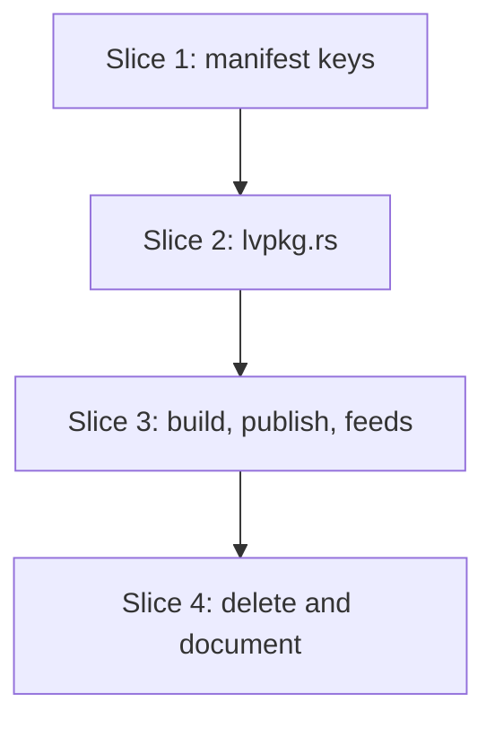

# Plan: the `.lvpkg` format (S7a)

**Created**: 2026-10-29
**Branch**: claude/s7a-lvpkg, off `main` at f3cbed8
**Status**: implemented
**Gherkin persistence**: custom: tests/features/build-slices/
**Spec**: [docs/specs/lvpm-lvpkg-s7a.md](../docs/specs/lvpm-lvpkg-s7a.md)

## Goal

`lvpm build` writes `dist/<name>-<version>.lvpkg`: a deterministic zip of
`RECORD`, `package.toml` and the library's members below `install-dir`.
lvpm installs it from a folder feed, the cache or a hosted index after
checking `RECORD`, and `lvpm publish` copies it. `.vip` and `.ogp` keep
installing. The `.vip` writer and the VIPM probe are deleted (ADR 6).

## Acceptance Criteria

- [ ] AC1–AC13 of the spec, mapped below.

| AC | Check | Step |
|---|---|---|
| 1 only `.lvpkg` | S1 "the package is written" (a `.lvpkg`, and no `.vip`) | 3.1 |
| 2 deterministic | unit test (lvpkg.rs); S1 "building twice gives the same bytes" | 2.1, 3.1 |
| 3 contents | unit tests: `package.toml` round trip, `RECORD` lines; S1 "the built package reads back", "dependencies are written as lvpm.toml has them" | 2.1, 3.1 |
| 4 membership | S1 stray / nested class / auto-populating scenarios; S0 "pilot A's package holds its library's members" | 3.1 |
| 5 install path | S1 "default install path", "install-dir places the members" | 1.1, 3.1 |
| 6 removed keys | S7a outline "a key ADR 6 removed fails"; unit tests (distribution.rs) | 1.1 |
| 7 key errors | S1 outline "a manifest problem fails naming the key" (rows moved) | 1.1 |
| 8 `RECORD` checked | unit outlines (lvpkg.rs); S7a "a tampered .lvpkg from a hosted feed is refused", "cache add refuses a tampered .lvpkg", "a tampered .lvpkg in a package folder is ignored" | 2.2, 3.2 |
| 9 feeds | S7a folder, cache, hosted and mixed-folder scenarios; S0's `.vip` scenarios unchanged | 3.2 |
| 10 publish | S2 feature on `.lvpkg` | 3.1 |
| 11 installs and compiles | S0 `@labview @pilot-source` build and publish scenarios on `.lvpkg` | 3.1 |
| 12 writer gone | files deleted; a check that no references remain; `cargo test --workspace`, `cargo clippy --all-targets -- -D warnings` | 1.1, 4.1 |
| 13 documented | the docs scenario (usage.md, README, ADR 1) | 4.2 |

## Approach stances (decision-defaults)

- **Replace-vs-merge:** replace. The `.vip` writer is deleted, not kept
  behind a flag (ADR 6, human decision in the spec).
  `dist/<name>-<version>.lvpkg` is replaced; nothing else in `dist/` is
  touched.
- **Format fidelity:** `.vip` reading is unchanged. The `.lvpkg` reader
  produces a `Spec` like the `.vip` reader does, so the install plan,
  relink, `lvaddoninfo.json` and the lock stay as they are.
- **Migrate-vs-edit:** no migration tool. Old manifest keys fail with a
  message that says where each one went; usage.md has a before/after note.
  lvpm never edits `lvpm.toml`.
- **Scope:** the spec's. No SBOM (S9), no GitHub releases (S4), no scoped
  project names, no `lvpm convert`, no signing.
- **Integration:** one PR against `main`; the user merges, no auto-merge.

## Design notes

- **One read seam.** `install::read_spec` is what both `index.rs`
  (`entry_from_bytes`) and install (ops/install.rs:485) call. It dispatches
  by content: a root `package.toml` goes to `lvpkg::read`, a root `spec` to
  `spec::parse` as today. An archive holding both is refused as ambiguous;
  one holding neither fails naming both (the existing "no `spec` member"
  message and its test change accordingly).
- **Where entries live.** `FileGroup` gains `entry_prefix: String`:
  `"File Group N/"` for a `.vip`, `""` for a `.lvpkg`. `FileGroup::entry`
  uses it, so `install::plan` finds `.lvpkg` payload at the archive root.
  The `FileGroup` construction sites (spec.rs, distribution.rs, relink.rs,
  src/render/query.rs; the compiler finds any other) get the field. The
  interim `.vip` writer's group (`Distribution::spec`) sets `"File Group 0/"`.
- **No cycle.** `lvpkg::read<R: Read + Seek>(&mut ZipArchive<R>)`. lvpkg
  depends on `spec` and `zip` only; install depends on lvpkg.
- **Untrusted input.** `lvpkg.rs` owns the path rules: `check_install_dir`
  (relative, no `..`, no drive or root, no backslash) and `check_name`
  (S1's package-name rule). `lvpkg::read` applies both to `package.toml`
  and checks that every payload entry sits below `install-dir`, is not a
  directory and is not a duplicate in any letter case. `Distribution::validate`
  calls the same functions from slice 3 on, so the rule lives once.
- **Bounded reads.** Each entry is streamed through SHA-256 with a cap on
  its decompressed size; `RECORD` and `package.toml` are capped at 1 MiB,
  like `spec` today.
- **When `RECORD` is checked.** Inside `lvpkg::read`, so on every read:
  - **cache add** fails, naming the file and the entry; the cache is
    unchanged.
  - **hosted feed** (an `index.vipr` URL naming a `.lvpkg`): install
    fetches the bytes, `read_spec` fails before `plan`, nothing is written.
  - **package folder** (`sources.local`): the scan already ignores an
    archive it cannot read and warns
    `! ignoring <path>: <error>` (index.rs:259), then goes on. A tampered
    `.lvpkg` is treated the same way. The warning names the entry; the
    install then fails because the package is not found. This is the
    existing rule for broken `.vip` files, kept.
  - The scan caches by path, size and mtime (`local_files`), so a file is
    hashed once until it changes.
- **Dependencies.** `Distribution` keeps the dependencies as written in
  `lvpm.toml`, in file order (`Vec<(name, constraint)>`), and drops
  `requires`. `Meta` is serialized with serde (`toml` has
  `preserve_order`), never formatted by hand. The reader maps each back to
  a `Requires` item: `"v"` and `">=v"` → `name>=v`, `"*"` → `name`.
  Scoped names pass through.

## Message texts

These are asserted word for word in the scenarios.

| Case | Message |
|---|---|
| `formats` | `distribution.formats was removed (ADR 6, docs/adr/0006-lvpkg-only-vip-read-only.md): lvpm build always writes a .lvpkg. Delete the line.` |
| `[distribution.vip]` | `[distribution.vip] was removed (ADR 6, docs/adr/0006-lvpkg-only-vip-read-only.md). Move vendor, display-name and install-dir into [distribution]; the package name is [project] name; icon and dependency-names are gone. Found: <keys>` where `<keys>` is every key of the table, comma-separated in file order (a `dependency-names` subtable is listed as `dependency-names`), or `(empty table)` |
| scoped `[project] name` | `project.name = "@scope/lib": scoped package names are not supported yet; use an unscoped name` |
| entry changed | `<file>: entry "<path>" differs from RECORD (the package was altered or is corrupt); rebuild or download it again` |
| entry not in `RECORD` | `<file>: entry "<path>" is not listed in RECORD (the package was altered or is corrupt); rebuild or download it again` |
| `RECORD` names a missing entry | `<file>: RECORD lists "<path>", which the archive lacks (the package was altered or is corrupt); rebuild or download it again` |
| no `RECORD` | `<file>: no RECORD; this is not a valid .lvpkg` |
| `format` > 1 | `<file>: package.toml format = <value> was written by a newer lvpm; update lvpm` |
| `format` missing, < 1 or not an integer | `<file>: package.toml format must be 1; this is not a valid .lvpkg` |

Entry order (AC3): `RECORD`, then `package.toml`, then the payload sorted
by path, byte-wise. The reader does not depend on order.

AC12's reference check: `git grep -nE 'spec::write|vipm_probe|s1b-vip-in-vipm'`
outside `docs/specs/`, `plans/` and `docs/adr/` returns nothing.

Untrusted-input rules (path traversal, case duplicates, 1 MiB caps, bad
`RECORD` lines) have no spec AC of their own; they are AC8's and are
covered by slice 2's structural-refusal outline.

`<file>` is added by the caller with `.context`. In user-facing text the
folder feed is called a "package folder (`sources.local`)", and the install
path is always `install-dir`.

## Slices

### Slice 1: `[distribution]` takes vendor, display-name and install-dir

**Depends-on:** none
**Files:** `crates/lvpm-core/src/distribution.rs`, `tests/support/pilots.rs`, `tests/steps/build.rs`, `tests/steps/pilots.rs`, `tests/features/build-slices/s1-lvpm-build.feature`, `tests/features/build-slices/s2-lvpm-publish.feature`, `tests/features/build-slices/s7a-lvpkg.feature`, `tests/acceptance.rs`, `tests/vipm_probe.rs`, `tests/vipm_probe/`, `tests/features/build-slices/s1b-vip-in-vipm.feature`, `tests/support/mod.rs`, `Cargo.toml`

The VIPM probe builds with `[distribution.vip]`, so it goes in this slice
rather than in slice 4. Until slice 3 the `.vip` writer still runs, fed from
the new keys; a scoped dependency goes into `Requires` as it is.

```gherkin
Feature: the .lvpkg format (S7a)

  Background:
    Given a project "demo_lib" version "1.2.3" with labview ">=2016"
    And [distribution] top-level-library "Lib.lvlib", vendor "Vendor", display-name "Demo Lib"
    And library "Lib.lvlib" holding "A.vi"

  Scenario Outline: a key ADR 6 removed fails, says what to do, and writes nothing
    Given the manifest <change>
    When lvpm build runs
    Then it fails with the "<case>" message, and dist is empty

    Examples:
      | change                                            | case                 |
      | sets formats = ["vip"]                            | formats              |
      | sets formats = ["lvpkg"]                          | formats              |
      | has [distribution.vip] vendor = "Vendor"          | [distribution.vip]   |
      | has an empty [distribution.vip] table             | [distribution.vip]   |
      | has [distribution.vip.dependency-names] a = "b"   | [distribution.vip]   |

  Scenario: every key in [distribution.vip] is reported at once
    Given the manifest has [distribution.vip] with vendor, display-name, name and icon
    When lvpm build runs
    Then the message's "Found:" lists vendor, display-name, name and icon
```

Edits to S1, `a manifest problem fails naming the key`: these rows become

```gherkin
      | has no vendor                  | distribution.vendor       |
      | has no display-name            | distribution.display-name |
      | sets install-dir = "../x"      | distribution.install-dir  |
      | sets install-dir = "a/../x"    | distribution.install-dir  |
      | sets install-dir = "C:/x"      | distribution.install-dir  |
      | sets install-dir = "/x"        | distribution.install-dir  |
      | sets install-dir = "a\b"      | distribution.install-dir  |
```

The rows for `formats = ["lvpkg"]`, `[distribution.vip] icon`, the vip
name and `dependency-names` are dropped (the S7a outline covers them).
`install-dir places the members` sets `[distribution] install-dir`. A new
scenario: `names the project "@scope/lib"` fails with the scoped-name
message. In S2, `an invalid manifest fails naming the key`, the
`has no vendor` row expects `distribution.vendor`.

#### Step 1.1: move the keys, refuse the old ones, drop the probe

**Complexity**: standard
**IMPLEMENT**: `DISTRIBUTION_KEYS` becomes `top-level-library`, `kinds`,
`vendor`, `display-name`, `install-dir`. `formats` and `vip` are caught, in
that order, before the unknown-key check, with the message texts above.
The name is always `[project] name`; a scoped one fails. The
`dependency-names` handling goes. Pilot A's manifest in
`tests/support/pilots.rs` moves to the new keys. Delete `tests/vipm_probe.rs`,
`tests/vipm_probe/`, the S1b feature, its `FEATURE_FILES` line, any
`[[test]]` entry, and the probe comment in `tests/support/mod.rs`.
**TEST**: the unit tests in `distribution.rs` on the new keys, plus one per
removed key and the scoped name; the S1 and S2 rows; the S7a outline (feature
added to `FEATURE_FILES`); `cargo test --workspace` green.
**REFACTOR**: drop `VIP_KEYS` and the unused helpers; update the module doc
comment's example.
**Files**: as the slice
**Commit**: `feat(distribution)!: vendor, display-name and install-dir move to [distribution] (S7a)`

### Slice 2: `lvpkg.rs` writes and reads the archive

**Depends-on:** 1
**Files:** `crates/lvpm-core/src/lvpkg.rs`, `crates/lvpm-core/src/lib.rs`, `crates/lvpm-core/src/spec.rs`, `crates/lvpm-core/src/distribution.rs`, `crates/lvpm-core/src/relink.rs`, `src/render/query.rs`

These are unit-test specifications: `lvpkg::write(&Meta, files) -> Vec<u8>`
and `lvpkg::read(&mut ZipArchive<R>) -> Result<Spec>`, with no filesystem.

```gherkin
Feature: a .lvpkg archive

  Background:
    Given package metadata for "demo_lib" 1.2.3, labview ">=2016", vendor "V", display-name "D", install-dir "vi.lib/V/D"

  Scenario: entries are sorted with RECORD and package.toml first
    Given the files "b.vi" and "a.vi"
    When it is written
    Then the entries are "RECORD", "package.toml", "vi.lib/V/D/a.vi", "vi.lib/V/D/b.vi"

  Scenario: writing is deterministic
    When the same metadata and files are written twice
    Then the bytes are identical, and every entry's time is 1980-01-01 00:00:00

  Scenario: package.toml reads back
    Given dependencies a = "1.0", b = "*", "@o/c" = ">=2.0"
    When it is written and read
    Then it reads as demo_lib 1.2.3 for LabVIEW>=16.0, display name "D", Requires "a>=1.0,b,@o/c>=2.0", and one "<application>" group of the files below "vi.lib/V/D"

  Scenario: the install plan finds every payload file
    When it is written, read, and planned into an empty LabVIEW folder
    Then every file is written and none is missing from the archive

  Scenario: RECORD lists every entry but itself
    When it is written
    Then RECORD has one "<sha256>  <path>" line per entry except RECORD, in entry order, each hash correct in lower-case hex

  Scenario Outline: an archive that disagrees with its RECORD is refused
    Given a written archive where <change>
    When it is read
    Then it fails with the "<case>" message naming "<entry>"

    Examples:
      | change                                | case                  | entry           |
      | "vi.lib/V/D/a.vi" has other bytes     | entry changed         | vi.lib/V/D/a.vi |
      | package.toml has other bytes          | entry changed         | package.toml    |
      | an entry "vi.lib/V/D/x.vi" is added   | entry not in RECORD   | vi.lib/V/D/x.vi |
      | "vi.lib/V/D/b.vi" is removed          | RECORD names missing  | vi.lib/V/D/b.vi |
      | RECORD is removed                     | no RECORD             | RECORD          |

  Scenario Outline: a structurally bad archive is refused
    Given a written archive where <change>, with a matching RECORD
    When it is read
    Then it fails naming "<what>"

    Examples:
      | change                                          | what            |
      | package.toml sets install-dir = "../x"          | install-dir     |
      | package.toml sets install-dir = "C:/x"          | install-dir     |
      | package.toml sets name = "a/b"                  | project.name    |
      | package.toml has no [project] version           | project.version |
      | package.toml is not valid TOML                  | package.toml    |
      | package.toml sets format = 2                    | format          |
      | an entry "other/x.vi" sits outside install-dir  | other/x.vi      |
      | an entry "vi.lib/V/D/../x.vi" exists            | vi.lib/V/D/../x.vi |
      | entries "vi.lib/V/D/a.vi" and "vi.lib/V/D/A.vi" | vi.lib/V/D/A.vi |
      | RECORD has a line without a hash                | RECORD          |
      | RECORD lists "vi.lib/V/D/a.vi" twice            | vi.lib/V/D/a.vi |
      | package.toml is larger than 1 MiB               | package.toml    |

  Scenario: an archive with both package.toml and spec is refused
    Given a written archive with a "spec" entry added and listed in RECORD
    When read_spec reads it
    Then it fails saying the archive holds both package.toml and spec

  Scenario: an archive with neither is refused
    Given a zip holding only "a.vi"
    When read_spec reads it
    Then it fails naming package.toml and spec
```

#### Step 2.1: write

**Complexity**: standard
**IMPLEMENT**: `Meta` (serde, fixed field order), `write`: payload at
`<install-dir>/<rel>`, sorted; `package.toml` from `Meta`; `RECORD` from the
SHA-256 of each entry; its own zip options (fixed time, one Deflate level),
copied from `ops/build.rs`, which is left alone.
**TEST**: the order, determinism and `RECORD` scenarios.
**REFACTOR**: none expected; check the names against the spec's glossary.
**Files**: `lvpkg.rs`, `lib.rs`
**Commit**: `feat(lvpkg): write a .lvpkg archive (S7a)`

#### Step 2.2: read and check

**Complexity**: complex
**IMPLEMENT**: `FileGroup.entry_prefix` at every construction site (`Distribution::spec` sets `"File Group 0/"`). `read`:
require `RECORD`, compare it both ways against the entries, stream-hash
each one under a size cap, then parse `package.toml` (`format = 1` only),
apply `check_install_dir` and `check_name`, check entry placement and
duplicates, and build the `Spec`. `read_spec` dispatches by content.
**TEST**: the round trip, install-plan, refusal and dispatch scenarios;
the existing `.vip` tests in install.rs (the "no spec" message updated).
**REFACTOR**: the shared tail ("(the package was altered or is corrupt); rebuild or download it again") is one constant, and one test asserts a full message.
**Files**: `lvpkg.rs`, `spec.rs`, `install.rs`, `distribution.rs`, `relink.rs`, `src/render/query.rs`
**Commit**: `feat(lvpkg): read a .lvpkg and check its RECORD (S7a)`

### Slice 3: build, publish and the feeds use `.lvpkg`

**Depends-on:** 2
**Files:** `crates/lvpm-core/src/ops/build.rs`, `crates/lvpm-core/src/distribution.rs`, `crates/lvpm-core/src/index.rs`, `src/main.rs`, `tests/features/build-slices/s0-pilot-loop.feature`, `tests/features/build-slices/s1-lvpm-build.feature`, `tests/features/build-slices/s2-lvpm-publish.feature`, `tests/features/build-slices/s7a-lvpkg.feature`, `tests/steps/build.rs`, `tests/steps/publish.rs`, `tests/steps/pilots.rs`, `tests/steps/sources.rs`, `tests/support/pilots.rs`

Step 3.1 switches the writer and moves every scenario that builds in the
same commit, so the suite is green after each step.

Edits to S1, renamed "lvpm build writes a .lvpkg of a library's members":
`demo_lib-1.2.3.0.vip` becomes `demo_lib-1.2.3.lvpkg` everywhere; every
"dist holds no .vip" becomes "dist holds no .lvpkg"; "the built spec parses
back", "version is written as four parts" and "dependencies become
Requires" are replaced as below. In S2, every package name becomes
`demo_lib-1.2.3.lvpkg` (including "only an older version's package was
built" and "dist holds only …"), and "a project locks from the published
folder" expects version `1.2.3`. In S0, the membership scenario reads the
archive's entries minus `RECORD` and `package.toml`, below `install-dir`,
and the two `@labview` scenarios name `.lvpkg`.

```gherkin
  # S1 feature
  Scenario: the package is written
    When lvpm build runs
    Then it succeeds, prints the path of "dist/demo_lib-1.2.3.lvpkg", and dist holds no .vip

  Scenario: the built package reads back
    When lvpm build runs
    Then the package's package.toml reads as demo_lib 1.2.3, labview ">=2016", kind "source", vendor "Vendor", display-name "Demo Lib", install-dir "vi.lib/Vendor/Demo Lib"

  Scenario Outline: the version is written as lvpm.toml has it
    Given the project version "<v>"
    When lvpm build runs
    Then dist holds "demo_lib-<v>.lvpkg" and its package.toml version is "<v>"

    Examples:
      | v       |
      | 2.1.0   |
      | 2.1.0.5 |

  Scenario: dependencies are written as lvpm.toml has them
    Given dependencies a = "1.0", b = ">=2.0", c = "*" and "@hexagon/lib-a" = "3.0"
    When lvpm build runs
    Then package.toml's [dependencies] holds those four, as written, in that order

  Scenario: an old .vip in dist stays
    Given dist holds "demo_lib-1.2.3.0.vip"
    When lvpm build runs
    Then "demo_lib-1.2.3.0.vip" is unchanged

  # S0 feature, @labview @interactive-labview @pilot-source
  Scenario: lvpm build turns pilot A's library into a .lvpkg project B installs and mass compiles
  Scenario: lvpm publish puts pilot A's .lvpkg in a folder feed project B installs from

  # S7a feature
  Scenario: a .lvpkg in a package folder installs
    Given a project depending on demo_lib, whose package folder (sources.local) holds the built "demo_lib-1.2.3.lvpkg"
    When lvpm install runs
    Then it succeeds, the lock records demo_lib 1.2.3 with the archive's SHA-256, and the venv holds the members below "vi.lib/Vendor/Demo Lib"

  Scenario: an imported .lvpkg installs
    Given "demo_lib-1.2.3.lvpkg" imported with lvpm cache add
    When a project depending on demo_lib runs lvpm install
    Then it succeeds and the venv holds the members

  Scenario: a .lvpkg from a hosted feed installs
    Given a hosted feed whose index.vipr names "demo_lib-1.2.3.lvpkg"
    When a project depending on demo_lib runs lvpm install
    Then it succeeds and the venv holds the members

  Scenario: a .vip and a .lvpkg in one package folder both resolve
    Given a package folder holding the built "demo_lib-1.2.3.lvpkg" and "other_lib-1.0.0.1.vip"
    When a project depending on both runs lvpm install
    Then it succeeds and the venv holds both packages' files

  Scenario: a .lvpkg renamed to .vip still installs
    Given a package folder holding the built package renamed "demo_lib-1.2.3.vip"
    When lvpm install runs
    Then it succeeds and the venv holds the members

  Scenario: a tampered .lvpkg from a hosted feed is refused before the venv is touched
    Given a hosted feed whose "demo_lib-1.2.3.lvpkg" has "vi.lib/Vendor/Demo Lib/A.vi" changed after build
    When a project depending on demo_lib runs lvpm install
    Then it fails with the "entry changed" message naming "vi.lib/Vendor/Demo Lib/A.vi" and "install demo_lib 1.2.3", and the venv is unchanged

  Scenario: cache add refuses a tampered .lvpkg
    Given "demo_lib-1.2.3.lvpkg" with "vi.lib/Vendor/Demo Lib/A.vi" changed after build
    When lvpm cache add runs on it
    Then it fails with the "entry changed" message naming "demo_lib-1.2.3.lvpkg" and the entry, and the cache is unchanged

  Scenario: a tampered .lvpkg in a package folder is ignored with a warning
    Given a package folder holding a good "other_lib-1.0.0.lvpkg" and a tampered "demo_lib-1.2.3.lvpkg"
    When a project depending on demo_lib and other_lib runs lvpm install
    Then stderr warns "! ignoring" the tampered file, naming "vi.lib/Vendor/Demo Lib/A.vi", the install fails because demo_lib is not found, and the venv is unchanged

  Scenario: cache add names the formats it takes
    When lvpm cache add runs on "x.zip"
    Then it fails, and the message names .vip, .ogp and .lvpkg
```

#### Step 3.1: build writes `.lvpkg`, every built-package scenario moves

**Complexity**: complex
**IMPLEMENT**: `Distribution` keeps raw dependencies and calls
`lvpkg::check_install_dir`/`check_name`; `Distribution::meta(files)`
replaces `spec()`; `file_name` returns `<name>-<version>.lvpkg`, unpadded;
`ops/build.rs` calls `lvpkg::write` and keeps `write_atomically`; the help
texts in `src/main.rs` name `.lvpkg`. `scan_local_repo` and `cache_add`
accept `*.lvpkg` (needed now because S2 and S0 install what was built).
**TEST**: the S1, S2 and S0 edits above; the two S0 `@labview` scenarios run
on this machine; `cargo test --workspace` green.
**REFACTOR**: drop the version padding if nothing else uses it; rename
`entry_from_vip` to `entry_from_file`.
**Files**: as the slice (including `index.rs` for the extension filters), without `s7a-lvpkg.feature` and `tests/steps/sources.rs`
**Commit**: `feat(build)!: lvpm build writes a .lvpkg, and lvpm installs it (S7a)`

#### Step 3.2: the feed scenarios

**Complexity**: standard
**IMPLEMENT**: the `cache add` message names `.lvpkg`; step definitions for
the hosted feed (the loopback feed S13's scenarios use), cache and
package-folder cases.
**TEST**: the S7a feature's install scenarios.
**Files**: `index.rs`, `s7a-lvpkg.feature`, `tests/steps/sources.rs`
**Commit**: `test(s7a): .lvpkg installs from every feed, and a tampered one is refused`

### Slice 4: delete the writer, document

**Depends-on:** 3
**Files:** `crates/lvpm-core/src/spec.rs`, `docs/usage.md`, `README.md`, `docs/adr/0001-manifest-project-and-distribution.md`, `docs/adr/0002-vip-first-lvpkg-later.md`, `docs/adr/0006-lvpkg-only-vip-read-only.md`, `docs/vision/build-slices.md`, `tests/features/build-slices/README.md`, `tests/features/build-slices/s1-lvpm-build.feature`, `tests/steps/docs.rs`

```gherkin
  Scenario: the docs name lvpm build
    Then docs/usage.md has a command-table line for lvpm build, names the .lvpkg output, and documents vendor, display-name and install-dir under [distribution]
    And docs/usage.md mentions [distribution.vip] only in its upgrade note
    And README.md shows lvpm build writing a .lvpkg
    And ADR 1's example has no formats and no [distribution.vip]

  Scenario: nothing refers to the deleted writer
    Then no file outside docs/specs, plans and docs/adr history sections names spec::write, vipm_probe or s1b-vip-in-vipm
```

#### Step 4.1: delete

**Complexity**: trivial
**IMPLEMENT**: remove `spec::write` and its tests, and the S1b line in the
build-slices README.
**TEST**: the reference check; `cargo test --workspace`;
`cargo clippy --all-targets -- -D warnings`.
**Files**: `spec.rs`, `tests/features/build-slices/README.md`
**Commit**: `refactor!: delete the .vip writer (ADR 6)`

#### Step 4.2: document

**Complexity**: trivial
**IMPLEMENT**: usage.md `lvpm build` and `[distribution]` sections, plus an
"Upgrading from [distribution.vip]" before/after snippet; README Quick
start; ADR 1's example. ADR 6's Consequences ("until S7a merges…"), ADR 2's
status line and build-slices.md's S7a/S4/S9 notes say S7a has landed. The
repo has no CHANGELOG; the PR body carries the breaking change.
Keep the GitHub project tidy (`gh -R ThatsTheEnd/lvpm`, board
[lvpm mission](https://github.com/users/ThatsTheEnd/projects/2)): the PR
says `Closes #66`; #66 gets the `deviation` label and a comment naming how
the build differs from build-slices.md (a tampered `.lvpkg` in a package
folder warns, it does not fail; `install-dir` now refuses `/x`, `a\b` and
dot-only segments); the S1b issue is closed as superseded by ADR 6 if still
open; the "blocked by" links of S4 and S9 still name #66; #66 sits in the
board's in-review column. Anything outward (labels, comments, closing) is
listed in the PR handoff and done only after the user's go-ahead.
**TEST**: the docs scenario.
**Files**: as the slice, without `spec.rs`
**Commit**: `docs(s7a): lvpm build writes a .lvpkg`

## Parallelization

Derived by hand: `plan_waves.py` needs Python, which this machine does not
have on PATH. The slices are a chain: slice 2's `FileGroup` change touches
`distribution.rs`, which slice 1 rewrites.



| Wave | Slices |
|------|--------|
| 1 | 1 |
| 2 | 2 |
| 3 | 3 |
| 4 | 4 |

## Pre-PR gate

- `cargo fmt --check`, `cargo clippy --all-targets -- -D warnings`,
  `cargo test --workspace`, green after every step.
- The S0 `@labview @pilot-source` scenarios run once on this machine; the
  PR records the result.
- `/code-review` on the branch diff.

## Skipped (low value)

- **A note when `dist/` holds an old `.vip`** (UX review). `lvpm publish`
  copies `file_name()` exactly, so a stale `.vip` is never published by
  lvpm; the note would be a new event for a file the user made earlier.

## Risks & Open Questions

- **Breaking manifest change.** Every `lvpm.toml` with `[distribution.vip]`
  stops building. Known users: the test fixtures and pilot A's manifest in
  `tests/support/pilots.rs`. The message says what to move.
- **`RECORD` is integrity, not authenticity.** Whoever rewrites the archive
  can rewrite `RECORD`. The lock's archive SHA-256 pins a package; signing
  is S6's. The scenarios say "tampered" for a changed file, not an attack.
- **A tampered file in a package folder is a warning, not an error.** This
  keeps the scan's existing rule. The spec's AC8 says install "fails, names
  the entry"; in a package folder the warning names it and the install
  fails as not found. Hosted feeds and `cache add` fail hard.
- **Same package and version as `.vip` and `.lvpkg` in one folder.** Not
  covered: the scan's existing rule for two archives with one name and
  version applies. Worth a scenario if it shows up in practice.
- **Python missing.** `plan_waves.py` and `plan_gherkin_export.py` were not
  run; the build steps edit the feature files directly, as S1's did.

## Build Progress

### Wave 1
- [x] Slice 1: `[distribution]` takes vendor, display-name and install-dir
  - [x] Step 1.1: move the keys, refuse the old ones, drop the probe

### Wave 2
- [x] Slice 2: `lvpkg.rs` writes and reads the archive
  - [x] Step 2.1: write
  - [x] Step 2.2: read and check

### Wave 3
- [x] Slice 3: build, publish and the feeds use `.lvpkg`
  - [x] Step 3.1: build writes `.lvpkg`, every built-package scenario moves
  - [x] Step 3.2: the feed scenarios
  - Note (build): the hosted-tamper scenario names the entry and "install demo_lib 1.2.3", not the file, because a sync reads the archive from the cache by hash. It drops "the lockfile is unchanged", because `lvpm install` locks before it opens an archive (as for any broken `.vip`). AC8 holds: the entry is named and nothing is written to the venv. Verifying before locking is a follow-up, not S7a.

### Wave 4
- [x] Slice 4: delete the writer, document
  - [x] Step 4.1: delete
  - [x] Step 4.2: document
  - Note (build): the reference check also skips `metrics/` and `.claude/`; `metrics/verify-log.jsonl` is an append-only history log whose S1b entry names the probe. The GitHub-tidy items wait for the user at the PR.

## Plan Review Summary

Plan tier: complex (4 slices in a chain, a breaking manifest change, an
untrusted-input reader). Reviewers: Acceptance, Design, UX, Strategic,
Parallelization. Two rounds. All five approve.

Round 1 blockers, all fixed:
- **Design.** `FileGroup::entry` hard-coded `File Group N/`, so `plan()`
  would have missed every `.lvpkg` file. Fixed with `entry_prefix`.
- **UX and Acceptance.** The folder-feed tamper scenario contradicted how the
  scan behaves. It is now specified per feed, and the spec's AC8 is aligned.
- **Acceptance and Strategic.** Step 3.1 could not be green on its own. It
  now moves the writer and every built-package scenario together.
- **Acceptance.** Stale and vacuous S1/S2 assertions are now listed.
- **Acceptance.** There were no tests for hostile archives. A
  structural-refusal outline is added.

Warnings taken:
- Exact message texts.
- One report for all `[distribution.vip]` keys.
- A generic `lvpkg::read`, with no module cycle.
- A shared path-rule check.
- Streamed, capped hashing.
- Raw dependencies serialized with serde.
- Probe deleted in slice 1.
- Stale ADR and vision docs in 4.2.
- An upgrade note in usage.md.

Observations left open:
- **Not-found hint.** After a folder-tamper warning, the not-found error
  could say "N package files ignored". Not done; the warning is printed
  directly above it.
- **Same package as `.vip` and `.lvpkg`.** One folder holding both, at the
  same version, is not covered.
- **Check that 3.2 can fail.** Step 3.2's scenarios pass on first run.
  During build, temporarily disable the `RECORD` check and watch the tamper
  scenarios fail.
