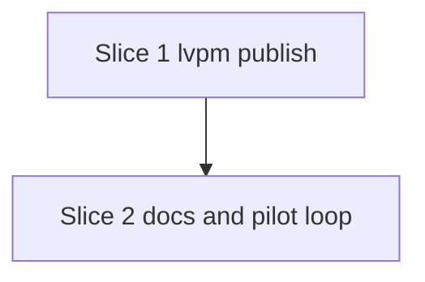

# Plan: S2 — `lvpm publish --to <folder>`

**Created**: 2026-10-27
**Branch**: claude/s2-lvpm-publish, off `claude/s1-lvpm-build` (PR #52)
**Status**: draft (awaiting approval)
**Gherkin persistence**: custom: tests/features/build-slices/
**Spec**: [docs/specs/lvpm-publish-s2.md](../docs/specs/lvpm-publish-s2.md)

## Goal

`lvpm publish --to <dir>` copies the package `lvpm build` wrote for the
current manifest into a folder feed. It refuses if a file of that name is
already there. A second project with that folder in `sources.local` then
locks and installs the package. This closes build → publish → install for
the Friday demo.

The user confirmed the spec's three stakeholder answers on 2026-10-27:
`--to` is required, only the current version's package is published, and a
missing target folder is an error.

## Acceptance Criteria

- [ ] AC1 publishes
- [ ] AC2 immutable
- [ ] AC3 no partial files
- [ ] AC4 preconditions
- [ ] AC5 only the current version
- [ ] AC6 consumed. The headless lock scenario is the gate. The `@labview`
      loop scenario is run by hand once HSE Logger is gone from the global
      LabVIEW, and its result goes in the PR.
- [ ] AC7 documented
- [ ] Arguments (spec): `--to` is required, and a relative `--to` resolves
      from the cwd, not from the project.

### AC → scenario → step

| AC | What asserts it | Step |
|---|---|---|
| AC1 | "the package is published", "publish copies what was built, not what is on disk now" | 1.1 |
| AC2 | outline "an existing file is never replaced", "publishing twice fails the second time" | 1.1 |
| AC3 | unit tests `a_link_that_finds_the_target_taken_leaves_no_staged_file` and `a_failed_copy_leaves_no_staged_file`. The success scenario also checks that no `.tmp` is left. | 1.1 |
| AC4 | "publish does not build", outline "the target is not a folder", "no lvpm.toml", outline "an invalid manifest fails naming the key" | 1.1 |
| AC5 | "an older version's package stays behind" | 1.1 |
| AC6 | "a project locks from the published folder" (the gate); the S0 loop scenario (manual, `@labview`) | 1.2, 2.2 |
| AC7 | "the docs name lvpm publish"; the existing docs scenarios fail on a subcommand or flag with no help text | 2.1 |
| Arguments | "--to is required", "--to resolves from where the command ran" | 1.1 |

## Approach stances (decision-defaults)

- Scope: the spec's S2, with no default for `--to`, no unpublish and no
  index file.
- Replace-vs-merge: publish never replaces. An existing file of that name
  fails the command and is left unchanged.
- Format fidelity: a byte copy of the file in `dist/`, with no re-packing.
- Integration: a PR stacked on #52 (base `claude/s1-lvpm-build`), with no
  auto-merge. The user merges.

## Slices

### Slice 1: `lvpm publish`

**Depends-on:** none
**Files:** `crates/lvpm-core/src/paths.rs`, `crates/lvpm-core/src/ops/lock.rs`, `crates/lvpm-core/src/ops/build.rs`, `crates/lvpm-core/src/ops/mod.rs`, `crates/lvpm-core/src/ops/publish.rs`, `src/main.rs`, `src/render/publish.rs`, `src/render/mod.rs`, `tests/features/build-slices/s2-lvpm-publish.feature`, `tests/steps/publish.rs`, `tests/steps/mod.rs`, `tests/acceptance.rs`

The path assertions in these scenarios compare paths, not strings. "Names
X" means the message holds a path that names the same file as X: the step
canonicalises the expected path and compares it with the canonicalised
path in the message, so 8.3 short names and `\\?\` prefixes do not matter.

```gherkin
Feature: lvpm publish copies the current package into a folder feed
  `lvpm publish --to <dir>` copies dist/<name>-<version>.vip, as lvpm build
  named it, into <dir>. It never replaces a file there.

  Background:
    Given a project "demo_lib" version "1.2.3" with labview ">=2016"
    And [distribution] top-level-library "Lib.lvlib", vendor "Vendor", display-name "Demo Lib"
    And library "Lib.lvlib" holding "A.vi" and class "C/C.lvclass", which holds "C/M.vi"
    And an empty folder "feed"

  Scenario: the package is published
    Given lvpm build has run
    When lvpm publish --to "feed" runs
    Then it succeeds and prints the path of "feed/demo_lib-1.2.3.0.vip"
    And "feed" holds exactly "demo_lib-1.2.3.0.vip", byte-identical to "dist/demo_lib-1.2.3.0.vip"

  Scenario: publish copies what was built, not what is on disk now
    Given lvpm build has run
    And "A.vi" is changed after the build
    When lvpm publish --to "feed" runs
    Then "feed" holds exactly "demo_lib-1.2.3.0.vip", byte-identical to "dist/demo_lib-1.2.3.0.vip"

  Scenario Outline: an existing file is never replaced
    Given lvpm build has run
    And "feed" already holds "demo_lib-1.2.3.0.vip" with <content>
    When lvpm publish --to "feed" runs
    Then it fails naming "feed/demo_lib-1.2.3.0.vip"
    And "feed" holds exactly "demo_lib-1.2.3.0.vip", with its earlier bytes

    Examples:
      | content                     |
      | the same bytes as the build |
      | the text "older package"    |

  Scenario: publishing twice fails the second time
    Given lvpm build has run
    And lvpm publish --to "feed" has run
    When lvpm publish --to "feed" runs
    Then it fails naming "feed/demo_lib-1.2.3.0.vip"
    And "feed" holds exactly "demo_lib-1.2.3.0.vip", with its earlier bytes

  Scenario: publish does not build
    When lvpm publish --to "feed" runs
    Then it fails naming "dist/demo_lib-1.2.3.0.vip" and saying to run lvpm build
    And dist holds no .vip
    And "feed" is empty

  Scenario Outline: the target is not a folder
    Given lvpm build has run
    And <target>
    When lvpm publish --to "<path>" runs
    Then it fails naming "<path>"
    And "<path>" is as it was, and dist holds only "demo_lib-1.2.3.0.vip"

    Examples:
      | target                             | path    |
      | nothing named "missing" exists     | missing |
      | a file "plain" holding "not a dir" | plain   |

  Scenario: no lvpm.toml
    Given the work directory has no lvpm.toml
    When lvpm publish --to "feed" runs
    Then it fails naming "lvpm.toml"
    And "feed" is empty

  # The manifest is checked before the package is looked for, so these fail
  # on the manifest even though a package was built.
  Scenario Outline: an invalid manifest fails naming the key
    Given lvpm build has run
    And the manifest <change>
    When lvpm publish --to "feed" runs
    Then it fails, the message names the key "<key>" exactly, and "feed" is empty

    Examples:
      | change                      | key                     |
      | has no [distribution] table | distribution            |
      | has no vendor               | distribution.vip.vendor |

  Scenario: an older version's package stays behind
    Given lvpm build has run for version "1.2.2"
    And lvpm build has run for version "1.2.3"
    And dist holds "demo_lib-1.2.2.0.vip" and "demo_lib-1.2.3.0.vip"
    When lvpm publish --to "feed" runs
    Then "feed" holds exactly "demo_lib-1.2.3.0.vip", byte-identical to "dist/demo_lib-1.2.3.0.vip"

  Scenario: --to is required
    Given lvpm build has run
    When lvpm publish runs with no --to
    Then it fails and the usage names --to
    And "feed" is empty

  Scenario: --to resolves from where the command ran
    Given lvpm build has run
    And an empty folder "elsewhere/feed"
    When lvpm publish --project <the project> --to "feed" runs from "elsewhere"
    Then "elsewhere/feed" holds exactly "demo_lib-1.2.3.0.vip", byte-identical to "dist/demo_lib-1.2.3.0.vip"
    And "feed" is empty

  Scenario: a project locks from the published folder
    Given lvpm build has run
    And lvpm publish --to "feed" has run
    And a second project depending on "demo_lib" ">=1.2", with "feed" as its only local source
    When lvpm lock runs in the second project
    Then it succeeds and lvpm.lock holds "demo_lib" version "1.2.3.0" from a local source
```

Steps:

- **1.0 a shared staging name** (trivial, no behaviour change, its own
  commit). Move `staging_path` from `lock.rs` (pid, nanos and a counter) to
  `paths::staging_path`. Use it in `lock.rs` and in the atomic write in
  `build.rs`. Rename `build::publish` to `write_atomically`, which frees the
  name. The copies in `venv.rs` and `cache.rs` are left alone.
  TEST: `cargo test` is green, and S1's scenarios are unchanged.
  REFACTOR: none.
- **1.1 the publish operation and the command** (standard).
  IMPLEMENT, core (`ops/publish.rs`):
  - `ops::packaged(env, command) -> Result<(PathBuf /*root*/, Distribution)>`
    goes in `ops/mod.rs` as `pub(super)`, extracted from `build`. It is the
    manifest lookup plus `distribution::validate`. The "no lvpm.toml" message
    names the command it was given. The validate messages stay as they are,
    because the spec says they match `lvpm build`.
  - `publish(env, to) -> Result<Published { path }>` resolves `to` with
    `paths::resolve(&env.cwd, to)`. It then checks, in this order:
    1. the manifest (`packaged`);
    2. `dist/<file name>` exists (else "run `lvpm build`");
    3. `to` is a directory;
    4. `symlink_metadata(target)` finds nothing (else "already published",
       naming the target).

    Then it calls `stage_and_link`.
  - `stage_and_link(src, dir, name) -> Result<PathBuf>` makes no pre-check.
    1. It opens `paths::staging_path(dir/name)` with `create_new`.
    2. It `io::copy`s the source into it and calls `sync_all` on that handle.
    3. It calls `no_replace_move(temp, dest)`, a small fn that is `hard_link`
       today.

    Once `create_new` has succeeded, any failure up to and including the
    link removes the temp file. A failed `create_new` removes nothing.
    An `AlreadyExists` from the link gets the pre-check's "already
    published" message. Any other link error reads "could not place <dest>
    in <dir> (its file system may not support hard links): <os error>".
  - Once the link succeeds, the publish has succeeded. A failed temp removal
    after that point is ignored, with a `shortcut:` comment. It leaves a
    `.tmp` that feeds skip, on shares that allow creating files but not
    deleting them.

  IMPLEMENT, CLI: `Cmd::Publish { #[arg(long)] to: PathBuf }`, required. It
  is passed to the op unchanged and rendered as `published <absolute path>`.

  IMPLEMENT, tests: `tests/steps/publish.rs` with a `PublishState` that holds
  the last `Output` and a feed's earlier bytes. `lvpm_publish(args, from)`
  writes the manifest the way `lvpm_build()` does, unless the "no lvpm.toml"
  step set a flag. New steps:
  - "lvpm build has run [for version X]";
  - "an empty folder X";
  - "X already holds Y with …";
  - "lvpm publish … runs/has run [from X]";
  - "X holds exactly Y, byte-identical to …" and "… with its earlier bytes";
  - "X is empty";
  - "it fails naming X";
  - the key-exactly step, with a feed;
  - "X is as it was".

  "A.vi is changed after the build" and the manifest edits reuse the
  manifest table in `build.rs`.

  TEST: every scenario above except the lock one. Unit tests:
  - `a_link_that_finds_the_target_taken_leaves_no_staged_file` creates the
    target, then calls `stage_and_link`. It asserts that the error names the
    target, the target's bytes are unchanged and the folder holds no `.tmp`.
  - `a_failed_copy_leaves_no_staged_file` gives `stage_and_link` a source
    that is a folder, so the copy fails after `create_new`.
  - `a_link_error_names_the_folder` calls `no_replace_move` directly with a
    destination whose folder is missing, which is an error that is not
    `AlreadyExists`.
  - A render test.

  REFACTOR: `build` uses `ops::packaged`.
- **1.2 consumed by lock** (standard).
  IMPLEMENT: "a second project …" makes a project directory under the
  sandbox root with labview ">=2016" and adds `feed` with
  `sandbox.add_local_source_folder`. "lvpm lock runs in the second project"
  uses `sandbox.run_lvpm_in`. The Then reuses the lockfile reader of the
  lock steps (`tests/steps/sync.rs`) and checks that the entry's source is
  local. TEST: "a project locks from the published folder". REFACTOR: none
  expected.

### Slice 2: the docs and the pilot loop

**Depends-on:** 1
**Files:** `tests/features/build-slices/s2-lvpm-publish.feature`, `tests/steps/docs.rs`, `docs/usage.md`, `README.md`, `tests/features/build-slices/s0-pilot-loop.feature`, `tests/steps/pilots.rs`

```gherkin
  # in s2-lvpm-publish.feature
  Scenario: the docs name lvpm publish
    Then docs/usage.md has a command-table line for lvpm publish
    And docs/usage.md's section "Publishing a package" follows "Building a package" and holds "--to" and "never replaced"
    And README.md shows lvpm publish

  # in s0-pilot-loop.feature: @pending-s2 is dropped, and @interactive-labview
  # and @pilot-source are added, as the S1 loop scenario has them.
  @labview @interactive-labview @pilot-source
  Scenario: lvpm publish puts pilot A's .vip in a folder feed project B installs from
    Given a LabVIEW 2026 installation without the pilots
    And pilot A built with lvpm build
    And lvpm publish has put it in an empty folder feed
    And project B depending on both pilots, with that feed and the other pilot archives as its sources
    And a venv for project B
    When project B is installed
    Then the venv holds both pilots and the packages OpenSerializer needs
    And mass compiling the venv's packages in a LabVIEW on the venv succeeds
```

Steps:

- **2.1 the docs** (trivial). IMPLEMENT: add a command-table line in
  docs/usage.md and a "Publishing a package" section after "Building a
  package". The section states the never-replaced rule, `--to` and the
  hard-link limit. Add a README Quick start line. The steps follow S1's docs
  steps. TEST: "the docs name lvpm publish", run headless, plus the existing
  help-text and usage-guide scenarios. REFACTOR: none.
- **2.2 the loop scenario** (standard). IMPLEMENT: "lvpm publish has put it
  in an empty folder feed" runs `lvpm publish --to <sandbox feed>` in pilot
  A's checkout. The project-B step lists that feed plus the pilot archives
  without `hse_lib_hse_logger-2.2.2.114.vip`, so pilot A can only come from
  the published file. It shares that setup with the S1 loop step instead of
  copying it.
  TEST: the scenario compiles headless but is not run. It is run by hand with
  `LVPM_TEST_LABVIEW=1` and `LVPM_TEST_PILOT_A` once the global LabVIEW is
  free and holds no HSE Logger. The result goes in the PR.
  REFACTOR: the shared project-B setup.

## Parallelization



| Wave | Slices |
|------|--------|
| 1 | 1 |
| 2 | 2 |

Built in one session, in order. Both slices edit `s2-lvpm-publish.feature`.
The wave order makes that safe.

## Pre-PR gate

- `cargo fmt --all -- --check`
- `cargo clippy --all-targets -- -D warnings`
- `cargo test`
- `LVPM_TEST_LABVIEW=1 cargo test --test acceptance`, where the
  global-LabVIEW claim allows it
- `/code-review --since origin/claude/s1-lvpm-build`

## Skipped (low value)

None.

## Not covered by a test

- A read-only target folder (access denied). Windows ACLs in the sandbox
  are not reliable to set up and undo. The message comes from the same path
  as any other link error that is not `AlreadyExists`, and
  `a_link_error_names_the_folder` covers that path.
- A file system without hard links. No such volume is on this machine.

## Risks & Open Questions

- The loop scenario, AC6's `@labview` half, has the same blocker as S1's
  AC9. HSE Logger is installed in the global LabVIEW 2026, so the scenario
  fails by design until HSE Logger is uninstalled with VIPM. The headless
  lock scenario is AC6's gate.
- `hard_link` fails on file systems without hard links (FAT, WebDAV, some
  NAS volumes). Publish then fails with the OS error and names the folder.
  `no_replace_move` is the one place to put `MoveFileExW` without
  `MOVEFILE_REPLACE_EXISTING` instead. `windows-sys` is already a dependency
  of lvpm-core, so that change needs only a feature flag. It is not built
  unless the demo share needs it. The demo uses a local NTFS folder.
- The temp file is in the target folder. The folder feed's filter matches
  the `.vip` extension only (`crates/lvpm-core/src/index.rs:211`), so it
  skips the temp file. The staging name holds the pid, the time and a
  counter, and it is opened with `create_new`. Two machines that publish at
  the same time therefore cannot write into one temp file.
- This branch is stacked on #52, which is stacked on #49. A change to either
  one is merged into this branch before its PR.

## Plan Review Summary

Plan tier: standard (2 sequential slices, no complex step). Reviewers:
Acceptance, Design and Parallelization. The UX critic was skipped, because
the only user-facing surface is one CLI line and its error messages, which
the acceptance scenarios pin.

- Parallelization: approved. Each wave holds one slice.
- Design: needs-revision, then approved. The blockers it raised and how they
  were fixed:
  - The race test had no seam. The op is now split into `publish`,
    `stage_and_link` and `no_replace_move`.
  - The rule for cleanup after the link was undefined. Once the link
    succeeds, the publish has succeeded.
  - The temp name could collide across machines. It now uses the shared
    `staging_path`, opened with `create_new`.

  The warnings were also taken: sync on the write handle, `ops::packaged`
  in `ops/mod.rs`, `--to` resolved in the op, `symlink_metadata`, and the
  OS error in the link message.
- Acceptance: needs-revision, then approved. The blockers were Windows path
  assertions, the AC3 seam and mapping, and manifest setup when no build
  ran. It also asked for these scenarios, which were added:
  - publishing twice;
  - `--to` is required;
  - `--to` resolves from the cwd;
  - an invalid manifest;
  - publish copies what was built.

  The docs assertions are now literal, step 2 is split into 2.1 and 2.2,
  and AC6's gate is the headless lock scenario.
- Applied afterwards from the re-review warnings:
  - cleanup runs only after `create_new` succeeds;
  - a copy-failure unit test;
  - the link-error test calls `no_replace_move` directly;
  - path assertions canonicalise both sides;
  - the spec no longer fixes the temp name's pattern.

## Build Progress

- [ ] Wave 1
  - [ ] Slice 1: lvpm publish
    - [ ] 1.0 a shared staging name
    - [ ] 1.1 the publish operation and the command
    - [ ] 1.2 consumed by lock
- [ ] Wave 2
  - [ ] Slice 2: the docs and the pilot loop
    - [ ] 2.1 the docs
    - [ ] 2.2 the loop scenario
