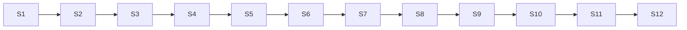

# Plan: lvpm-tui: new core capabilities, then the TUI

**Created**: 2026-10-26
**Branch**: claude/lvpm-tui-plan (plan); implementation on one feature branch per slice
**Status**: approved
**Gherkin persistence**: tests/features
**Spec**: [docs/specs/lvpm-tui.md](../docs/specs/lvpm-tui.md), delivery steps 4 and 5. Slices 1–3
also meet slices S10b and S10c of `docs/vision/build-slices.md` (branch
`claude/build-slices-placeholder-e83e66`).
**Layout reference**: the approved mock, `prototype/tui-mock` on branch `claude/tui-mock`.

## Goal

The mock gate passed: the stakeholder gave go on 2026-10-26 (AC-P3). This
plan delivers what comes after it. First, three core capabilities that both
front ends use: an uncapped catalog listing, package details (`lvpm info`),
and `--json` output from the CLI. Then `lvpm-tui`, a ratatui front end on
`lvpm-core` that follows the mock's layout, built in small slices from the
browse list up to project mode, maintenance and configuration. The release
zip ships `lvpm-tui.exe` next to `lvpm.exe` from the slice where the TUI can
first install a package.

## Approach stances (decision-defaults axes)

- **Scope:** the TUI spec, plus S10b and S10c. Where the two differ, the
  wider one wins: `--json` covers every command except the `vi-*` and
  `app-probe` diagnostics (TUI spec), and it also comes with an exit-code
  table (S10c). `lvpm info` shows spec fields (TUI spec) and files (S10b).
  Nothing else: no `init`, no `update`, no mouse, no Linux TUI.
- **Format fidelity:** without `--json`, every command's output stays
  byte-identical. The existing golden recordings prove it, and no recording
  is re-recorded; new commands get new recordings.
- **Integration:** one PR per slice to `main`, merged on a green `ci-ok`,
  squash only. Each PR raises the workspace version as its last commit, after
  rebasing onto `main`. No auto-merge unless the stakeholder asks.
- **Order:** the slices form one chain. Core capabilities (1–3) land first,
  then the crate (4–12), as the stakeholder asked. No two slices build at the
  same time, so no two PRs conflict.
- **Migrate vs. copy:** the mock is a reference. Its layout and widgets are
  re-created in `crates/lvpm-tui`, with real data in place of `data.rs` and
  `sim.rs`. The mock branch is deleted in Slice 12, once every screen it
  shows exists for real.
- **Exit codes:** keep today's codes: 0 success, 1 failure, 2 usage error
  (clap). Matching VIPM's codes is not done; S10c left that open, and it is
  recorded under Risks for the stakeholder to overrule.

## Design decisions

### Core and CLI

- **Catalog entries carry their source.** `index::Entry` gains `source`: the
  feed URL, or the local folder, it came from, or `cache` for a package
  imported with `lvpm cache add`. `ops::query::catalog(env,
  query)` returns every entry of every source, every version, sorted by name
  then version (newest first). The filter is the one `Index::search` uses: a
  case-insensitive substring of the name or the display name. A cached feed
  is read from the cache, with no request, unless a refresh is asked for. A
  feed that cannot be fetched, or a folder that cannot be read, is reported
  in `Catalog::failed`, and the other sources are still listed. A failed
  feed is not replaced by its cache. When every source fails and nothing is imported, `catalog`
  returns an error naming them.
- **Package details go through the cache, without a destination.**
  `ops::query::info(env, name, version)` fetches the archive through
  `ops::session::Downloads` (cache hit, else download into the cache), which
  needs no destination and so no LabVIEW. It parses the spec and returns
  `PackageInfo { versions, requires, spec fields, file groups, source }`.
  `spec::parse` learns the `[Description]` fields: Description, Summary,
  Vendor, Packager, License, URL and Release Notes. They are optional.
- **`--json` is a sink and a result printer, both in the CLI.** A `JsonSink`
  writes each event as one JSON line (`Event` is already `Serialize`, tagged
  `event`, snake_case). Each command arm returns a `Report`; one function
  writes `{"result": …}` or `{"error": {"message": …}}` last, then exits 0 or
  1. Results:
  - query commands return their data: `search` and `search --all` a list of
    entries, `info` a `PackageInfo`, `list` the manifests, `targets` the
    targets, `config get` `{key, value}`, `lock --check` `{"up_to_date": true}`;
  - `venv status` returns the status object it prints today;
  - every other command returns `{"command": "<name>"}`, with `<name>` the
    top-level subcommand (`config`, `cache`, `venv`, …): its details are the
    events before it.
  The result and event shapes are documented as stable in the README and
  pinned by golden JSON recordings. A skipped phase is written as
  `{"event":"phase_skipped","phase":"relink","reason":"scratch_destination","skipped":0}`.
  Under `--json`, a command that would prompt fails with an error that names
  `--yes`; without `--json`, every prompt stays as it is (AC-K6).
- **Compatibility and venv eligibility are core queries.** The TUI asks core
  rather than re-deriving rules: `solve::gated` (exists, `pub(crate)`) is
  exposed as `ops::query::compatible(entry, target)`, and
  `ops::query::venv_choices(targets, project)` returns the installations a
  venv may use: LabVIEW `venv::MIN_LV` (2024) or newer, and not older than
  the project's `labview` requirement, the rule `target::select_for_project`
  already applies. Tests use a project that asks for 2025, so 2024 is
  excluded by the project, not by the venv floor.
- **The dependents check is a pure core function.** `ops::query::dependents
  (installed, catalog, name) -> Dependents { by: Vec<String>, unknown:
  Vec<String> }`. The CLI's own `uninstall` does not use it; the divergence is
  recorded under Risks.
- **Global uninstall gets a dry run.** The public `ops::uninstall::uninstall`
  gains `dry_run`, as install has, so every TUI preview is a dry run (AC-T9).
  A dry run emits one new `Event::WouldRemove { package, files }` per package
  and runs no hooks; `uninstall_one`, shared with install and sync, is not
  changed.
- **Lock upgrades get a plan step.** A new `ops::lock::plan_upgrade` returns
  the new lock and the manifest rewrite and writes neither; `upgrade` calls it
  and then writes, so its signature and callers do not change. A project-mode
  upgrade preview is `plan_upgrade` plus `sync::plan_sync(new_lock,
  installed)`, which is pure.
- **Project dependency roles are a core query.** `ops::query::project_role
  (project, lock, name) -> { direct: bool, required_by: Vec<String> }` tells
  the TUI whether `x` removes from the manifest, is refused as transitive, or
  leaves the package in the lock as still required.

### TUI

- **The TUI drives core on one worker thread.** The UI thread owns the
  terminal and the state. A worker runs one job at a time with a
  `ChannelSink` (events into an `mpsc` channel) and the job's `CancelToken`.
  The UI polls the channel every tick. A batch is a list of jobs; the batch
  runner gives each job its own token, and a cancel ends the batch (spec).
- **`OpEnv` comes from one builder.** `destination.rs` has `EnvBuilder::new
  (config, targets, cwd)`, and `builder.env(&sink, token)` yields a per-job
  `OpEnv` the way `src/main.rs`'s `op_env` does, from the same core calls.
  Targets are passed in, so tests inject fake ones; the launcher is injected
  the same way, so launch is testable without LabVIEW.
- **Screens own their state.** Each screen module (`browse`, `detail`,
  `plan`, `progress`, `log`, `destination`, `maintenance`, `config_view`,
  `help`) has its state, `handle_key(key) -> Action` and `draw(frame, area)`.
  `app.rs` routes keys and actions; `ui.rs` draws the chrome (header, footer,
  too-small message). One key table, `keys.rs`, from Slice 4 on, is the source
  for the footer, the help screen and the key dispatch.
- **Key rules.** Only key presses count (crossterm `KeyEventKind::Press`), so
  Windows does not see each key twice. Enter confirms; a destructive or second
  confirmation needs `y`, as the CLI's `[y/N]`. Esc goes back. `q` quits,
  except while an operation runs, when it is refused with a footer note; it
  does quit while the catalog loads. During resolve and download, `c`, Esc
  and Ctrl-C cancel; after that they are refused with a note.
- **More keys.** `v` opens the venv menu (create, remove), `l` launches
  LabVIEW, `t` picks the destination, `m` maintenance, `C` config, `L` log,
  `?` help. Idle Ctrl-C quits as `q` does; the too-small screen still takes
  `q` and Ctrl-C. A result is dismissed with Enter or Esc, not any key; its
  error stays in `L`. Marks clear on a destination switch or reload. A footer
  note lasts until the next key.
- **Words.** "Reload feeds" (`R`) fetches the feeds again. "Refresh" is only
  the LabVIEW palette refresh, a maintenance action. `u` upgrades the
  selected or marked packages and `U` upgrades all, in both modes. The footer
  shows the keys of the current screen.
- **Status rule.** The available version is the one core would resolve (so ADR 4's "first source wins", slice S13, changes it in one place). `update` only when that version is newer and compatible;
  otherwise `installed`. An incompatible package shows `needs LV <year>`.
  Each status has a text label; colour only repeats it. Glyphs are ASCII.
  `NO_COLOR` turns colour off.
- **Shared test support.** The bin-free parts of `tests/support` (the fixture
  package builder, the loopback feed with its pause latch, the recording sink)
  move to a dev-only crate, `crates/lvpm-testkit` (`publish = false`), used by
  the root harness and the TUI harness. Nothing is copied.
- **TUI tests drive the real app headless.** `crates/lvpm-tui/tests/
  acceptance.rs` runs the TUI's scenarios with cucumber-rs from
  `tests/features/lvpm-tui/`. Its World holds the `App` on a ratatui
  `TestBackend` at 80×24, a scratch `--prefix` destination, injected targets,
  a sandboxed config and environment, and a local folder or the loopback feed
  as the only source. Steps press keys and read the rendered buffer.
  LabVIEW-dependent phases are skipped in a scratch destination, as in the
  CLI. Scenarios that are not about the TUI's screens (dependency graph,
  version, release zip) run in the root harness.
- **Timing in tests is a latch, never a sleep.** "When paused at download"
  uses the feed's pause (it holds the archive request until released).
  "When paused at <phase>" for other phases uses a test sink that parks the
  worker on `PhaseStarted(<phase>)` until the step releases it. "Paused at
  download" means the first package's download; "paused at the download of
  zeta" parks on that package's start. A key step is always: park, press,
  release, wait for the result. No scenario depends on how long anything
  takes.

## Acceptance Criteria

Spec AC-C1–C4, AC-K1 (the `lvpm-tui` member), AC-K6 (prompts unchanged),
AC-P3, AC-T1–T21, and S10b/S10c's criteria. Each one is mapped to its slices
in the traceability matrix.

## Slices

### Slice 1: Catalog listing, uncapped

**Depends-on:** none
**Files:** `src/main.rs`, `crates/lvpm-core/src/index.rs`, `crates/lvpm-core/src/ops/env.rs`, `crates/lvpm-core/src/ops/query.rs`, `src/render/query.rs`, `tests/steps/query.rs`, `tests/steps/recording.rs`, `tests/steps/sync.rs`, `tests/support/feed.rs`, `tests/steps/mod.rs`, `tests/acceptance.rs`, `tests/golden/search-all/`, `README.md`; and the `source` field added to each `Entry` built in `crates/lvpm-core/src/{fetch.rs,solve.rs,ops/install.rs,ops/lock.rs,ops/sync.rs}`, `tests/steps/install.rs`, `tests/steps/solver.rs`
**Feature files:** `tests/features/lvpm-tui/slice-1-catalog-listing-uncapped.feature`

**Behavior:**

```gherkin
Feature: Every version of every package, uncapped

  Scenario: the catalog lists every version from every source
    Given a feed with "alpha" 1.0 and 2.0
    And a local folder with "beta" 0.1
    When "lvpm search --all" runs
    Then it lists "alpha" 2.0, "alpha" 1.0 and "beta" 0.1, in that order
    And each row shows its display name, requirements, minimum LabVIEW and source
    And the output matches the "search-all" recording

  Scenario: no cap on the number of rows
    Given a feed with 60 packages of 2 versions each
    When "lvpm search --all" runs
    Then it lists 120 rows and no "more" line

  Scenario Outline: a query narrows the catalog by name or display name, ignoring case
    Given a feed with "alpha" 1.0, shown as "Alpha Tools", and "beta" 0.1
    When "lvpm search --all <query>" runs
    Then it lists only "alpha" 1.0

    Examples:
      | query |
      | alp   |
      | ALP   |
      | tools |

  Scenario: an empty catalog says so and names the sources
    Given a feed and a local folder with no package
    When "lvpm search --all" runs
    Then it says that no package was found in that feed and that folder
    And it exits 0

  Scenario: one source cannot be read
    Given a feed with "alpha" 1.0 that does not answer and has never been cached
    And a local folder with "beta" 0.1
    When "lvpm search --all" runs
    Then it lists "beta" 0.1
    And stderr names the feed that could not be read
    And it exits 0

  Scenario: every source fails
    Given the only feed does not answer and has never been cached
    When "lvpm search --all" runs
    Then it fails with exit code 1 and stderr names the feed

  Scenario: a query that matches nothing
    Given a feed with "alpha" 1.0
    When "lvpm search --all zzz" runs
    Then it says no package matches "zzz"
    And it exits 0

  Scenario: search needs a query or --all
    When "lvpm search" runs
    Then it fails as a usage error with exit code 2

  Scenario: plain search is unchanged
    When the characterization rows "search-a" and "search-none" run
    Then they still match
```

**Steps:**

#### Step 1.1: `source` on every entry, `ops::query::catalog`

**Complexity**: standard
**IMPLEMENT**: Add `Entry::source`, filled where feed and local entries are made. Add `ops::query::catalog(env, query: Option<&str>) -> Result<Catalog>` with `entries` and `failed` sources.
**TEST**: Unit tests in `query.rs`: two sources, two versions, the order, the filter on name and display name in any case, one failed source; the existing `index.rs` tests pass.
**REFACTOR**: The filter is the one `Index::search` uses, called from both.
**Files**: `crates/lvpm-core/src/index.rs`, `crates/lvpm-core/src/ops/query.rs`
**Commit**: `feat(core): list every catalog entry with its source`

#### Step 1.2: `lvpm search --all [QUERY]`

**Complexity**: standard
**IMPLEMENT**: `query` becomes optional when `--all` is given (clap `required_unless_present`); `--all` prints one row per entry with no cap; failed sources go to stderr. The renderer gets `render::query::catalog`.
**TEST**: The slice's scenarios; a renderer unit test for the row layout; the new `search-all` recording.
**REFACTOR**: Share column widths with `render::query::search`.
**Files**: `src/main.rs`, `src/render/query.rs`, `tests/steps/query.rs`, `tests/steps/mod.rs`, `tests/acceptance.rs`, `tests/golden/search-all/`
**Commit**: `feat(cli): lvpm search --all lists the whole catalog`

### Slice 2: Package details: `lvpm info`

**Depends-on:** 1
**Files:** `crates/lvpm-core/src/spec.rs`, `crates/lvpm-core/src/ops/query.rs`, `crates/lvpm-core/src/ops/session.rs`, `src/main.rs`, `src/render/query.rs`, `tests/steps/query.rs`, `tests/support/fixtures.rs`, `tests/golden/info-*/`; as built also `crates/lvpm-core/src/{events.rs,fetch.rs,index.rs,install.rs,ops/install.rs,relink.rs}` (the `ArchiveFetching` event, `fetch::on_hand`, and `read_spec` moved into `install` with a 1 MiB cap that `install` and local imports now share), `src/render/mod.rs` (`printable`), `tests/acceptance.rs`, `tests/support/feed.rs`, `README.md`, `Cargo.toml`, `Cargo.lock`
**Feature files:** `tests/features/lvpm-tui/slice-2-package-details-lvpm-info.feature`

**Behavior:**

```gherkin
Feature: Package details

  Background:
    Given a feed with "alpha" 1.0 and 2.0
    And the 2.0 spec has a description, summary, vendor, packager, license, URL and release notes
    And "alpha" 2.0 requires "beta" 0.1

  Scenario: info shows the spec fields, the versions, the requirements and the files
    When "lvpm info alpha" runs
    Then it shows versions 2.0 and 1.0, each with its source
    And it shows the description, summary, vendor, packager, license, URL and release notes of 2.0
    And it shows that 2.0 requires "beta" >= 0.1
    And it lists the file groups of 2.0 with their target directories and files
    And the output matches the "info-alpha" recording

  # The binary would find this machine's LabVIEW; core is handed none.
  @core
  Scenario: info needs no LabVIEW
    When core reads the details of "alpha" with no LabVIEW installed
    Then the details are those of 2.0

  Scenario: a chosen version
    When "lvpm info alpha@1.0" runs
    Then the spec fields and files shown are those of 1.0

  Scenario: fields the spec does not have are left out
    Given "alpha" 1.0 has no [Description] section
    When "lvpm info alpha@1.0" runs
    Then no description, summary, vendor, packager, license, URL or release-notes line is shown

  Scenario: a fetch says so on stderr
    When "lvpm info alpha" runs with an empty cache
    Then stderr says it is fetching "alpha" 2.0
    And stdout holds only the details

  Scenario: the second request does not download again
    Given "lvpm info alpha" has run once
    When "lvpm info alpha" runs again
    Then the feed serves no archive request

  Scenario: another version is downloaded once
    Given "lvpm info alpha" has run once
    When "lvpm info alpha@1.0" runs
    Then the feed serves one archive request, for 1.0

  Scenario: info and install share the cache
    Given "lvpm info alpha" has run once
    When "lvpm install alpha --prefix dest" runs
    Then the feed serves no archive request for "alpha" 2.0

  Scenario: an unknown package fails and names the sources searched
    When "lvpm info nothing" runs
    Then it fails with exit code 1
    And the error names every configured feed and local folder

  Scenario: an unknown version fails and lists the known ones
    When "lvpm info alpha@9.9" runs
    Then it fails with exit code 1 and lists the versions 2.0 and 1.0

  Scenario: an archive that cannot be fetched fails and names the package and the feed
    Given the archive request of "alpha" 2.0 fails
    When "lvpm info alpha" runs with an empty cache
    Then it fails with exit code 1 and the error names "alpha" 2.0 and the feed

  Scenario: a corrupt archive fails and names the package
    Given the archive of "alpha" 2.0 is corrupt
    When "lvpm info alpha" runs
    Then it fails with exit code 1 and the error names "alpha" 2.0
```

**Steps:**

#### Step 2.1: Description fields in `spec::parse`

**Complexity**: trivial
**IMPLEMENT**: `Spec` gains optional `description`, `summary`, `vendor`, `packager`, `license`, `url`, `release_notes`, read from `[Description]`.
**TEST**: Unit tests on a spec with all fields, with none, and with an empty value (read as absent).
**REFACTOR**: Keep the field reads in one helper.
**Files**: `crates/lvpm-core/src/spec.rs`
**Commit**: `feat(core): read a package spec's description fields`

#### Step 2.2: `ops::query::info` through the cache

**Complexity**: standard
**IMPLEMENT**: `info(env, package) -> Result<PackageInfo>`, `package` read by `PackageArg::parse`: catalog versions of the name, the chosen (or newest) entry, its archive through `Downloads::fetch` (no destination), the parsed spec. An `ArchiveFetching` event before a download. Unknown name: an error listing the sources; unknown version: an error listing the versions.
**TEST**: Unit test with a local folder source; the loopback-feed scenarios for the cache rules; the fixture builder learns the description fields.
**REFACTOR**: Reuse `install`'s name matching (`same_name`).
**Files**: `crates/lvpm-core/src/ops/query.rs`, `crates/lvpm-core/src/ops/session.rs`, `tests/support/fixtures.rs`
**Commit**: `feat(core): package details from the cached archive`

#### Step 2.3: `lvpm info <PACKAGE>[@VERSION]`

**Complexity**: standard
**IMPLEMENT**: The `Info` subcommand and `render::query::info`; the fetch line on stderr.
**TEST**: The slice's scenarios; the `info-*` recordings.
**REFACTOR**: Wording shared with `search` rows.
**Files**: `src/main.rs`, `src/render/query.rs`, `tests/steps/query.rs`, `tests/golden/info-*/`
**Commit**: `feat(cli): lvpm info shows a package's details`

### Slice 3: `--json` and the exit-code table

**Depends-on:** 2
**Files:** `Cargo.toml`, `Cargo.lock`, `src/main.rs`, `src/render/mod.rs`, `src/render/json.rs`, `crates/lvpm-core/src/index.rs`, `crates/lvpm-core/src/install.rs`, `crates/lvpm-core/src/target.rs`, `crates/lvpm-core/src/venv.rs`, `crates/lvpm-core/src/lockfile.rs`, `crates/lvpm-core/src/ops/query.rs`, `crates/lvpm-core/src/ops/venv_cmd.rs`, `README.md`, `tests/steps/json.rs`, `tests/steps/mod.rs`, `tests/acceptance.rs`, `tests/golden/json-*/`
**Feature files:** `tests/features/lvpm-tui/slice-3-json.feature`

**Behavior:**

```gherkin
Feature: Machine-readable output

  Background:
    Given a feed with "alpha" 1.0 and "beta" 0.1
    And a sandboxed user config
    And a fresh scratch folder "dest" in which "beta" 0.1 is installed
    And a fresh project whose lvpm.toml lists "alpha" = ">=1.0", with an up-to-date lock, synced into "dest"

  Scenario Outline: every covered command writes JSON Lines ending in one result
    When "lvpm --json <command>" runs in <place>
    Then every stdout line is a JSON object
    And the last line is the only one with a "result" key
    And the JSON result is <result>
    And the exit code is 0
    And the output matches the "json-<recording>" recording

    Examples:
      | command                               | place      | result                                  | recording     |
      | search alpha                          | any folder | a list with one entry, "alpha" 1.0      | search        |
      | search zzz                            | any folder | an empty list                           | search-none   |
      | search --all                          | any folder | an object whose "entries" are "alpha" 1.0 and "beta" 0.1 | search-all |
      | info alpha                            | any folder | an object whose "entry" is "alpha" 1.0  | info          |
      | list --prefix dest                    | any folder | a list with one manifest, "beta" 0.1    | list          |
      | config get venv.dir                   | any folder | {"key": "venv.dir", "values": [".lv-venv"]} | config-get |
      | config set venv.dir venvs             | any folder | {"command": "config"}                   | config-set    |
      | cache add pkgs                        | any folder | a list                                  | cache-add     |
      | install alpha --prefix dest --dry-run | any folder | {"command": "install"}                  | install       |
      | uninstall beta --prefix dest          | any folder | {"command": "uninstall"}                | uninstall     |
      | lock --check                          | the project | {"up_to_date": true}                   | lock-check    |
      | lock                                  | the project | {"command": "lock"}                    | lock          |
      | sync --prefix dest                    | the project | {"command": "sync"}                    | sync          |
      | add beta --prefix dest                | the project | {"command": "add"}                     | add           |
      | remove alpha --prefix dest            | the project | {"command": "remove"}                  | remove        |
      | venv status                           | any folder | an object with "exists" false           | venv-status   |

  # start, refresh and run-hooks have no row: they never use a venv, and the
  # harness refuses to run them on the user's LabVIEW installation. They end
  # in the same result line as the rows below.
  @labview
  Scenario Outline: the commands that need a LabVIEW
    Given <setup>
    When "lvpm --json <command>" runs in the project
    Then the last line is the only one with a "result" key and it is {"command": "<name>"}
    And the exit code is 0

    Examples:
      | setup                                          | command                        | name    |
      | the project has a venv on the detected LabVIEW | launch                         | launch  |
      | a venv with beta installed                     | relink --all                   | relink  |

  @labview
  Scenario: venv create on a project with no venv
    Given the project needs the detected LabVIEW and has no venv
    When "lvpm --json venv create" runs in the project
    Then the last line is the only one with a "result" key and it is {"command": "venv"}
    And the exit code is 0

  Scenario: targets is a list, with no recording since it names this machine's LabVIEWs
    When "lvpm --json targets" runs in any folder
    Then every stdout line is a JSON object
    And the JSON result is a list
    And the exit code is 0

  Scenario: a failure ends in one error object and exit code 1
    When "lvpm --json info nothing" runs in any folder
    Then the last stdout line is the only one with an "error" key
    And its message names the sources searched
    And the exit code is 1

  Scenario: events followed by a failure
    Given the archive of "alpha" 1.0 is corrupt
    When "lvpm --json install alpha --prefix dest" runs in any folder
    Then stdout has a "phase_started" event for download before the last line
    And the last line is the only one with an "error" key
    And the exit code is 1

  Scenario: a stale lock fails the check
    Given lvpm.toml instead lists "alpha" = ">=1.0" and "beta" = ">=0.1"
    When "lvpm --json lock --check" runs in the project
    Then the last line is an error saying the lock is out of date
    And the exit code is 1

  Scenario: malformed arguments under --json
    When "lvpm --json install --no-such-flag" runs
    Then stdout is empty
    And the exit code is 2

  Scenario: install progress reports its phases in order, skipped ones too
    When "lvpm --json install alpha --prefix dest" runs in any folder
    Then the "phase" values of its phase events are, in order, resolve, download, unpack, relink, hooks, refresh
    And relink, hooks and refresh are "phase_skipped" events with reason "scratch_destination"

  @labview
  Scenario: a command that would prompt fails instead under --json
    Given the project has a venv on the detected LabVIEW
    When "lvpm --json venv remove" runs in the project
    Then the last line is an error that names --yes
    And the exit code is 1
    And the venv still exists

  @labview
  Scenario: without --json the prompt stays
    Given the project has a venv on the detected LabVIEW
    When "lvpm venv remove" runs in the project and "n" is typed
    Then it asked "[y/N]"
    And the venv still exists

  Scenario: the diagnostics do not take --json
    When "lvpm --json vi-probe x.vi" runs
    Then it fails as a usage error with exit code 2

  Scenario: without --json nothing changes
    When every characterization row runs
    Then each still matches

  Scenario: the exit codes are documented
    When the README's exit-code table is read
    Then it lists 0, 1 and 2, and each has a scenario in this feature
```

**Steps:**

#### Step 3.1: `--json`, the JSON sink and the result line

**Complexity**: complex
**IMPLEMENT**: A global `--json` flag. `render::json::JsonSink` writes events; `render::json::finish(report)` writes the result or error line and sets the exit code. The query commands return `Serialize` data (`Entry`, `PackageInfo`, `Manifest`, `LvTarget`, config values). `serde_json` moves from dev-dependency to dependency.
**TEST**: The outline rows search, search-none, search-all, info, list, config-get and lock-check; the targets scenario; the failure, stale-lock and malformed-argument scenarios; their `json-*` recordings.
**REFACTOR**: Each `main` arm returns a `Report`; text and JSON printing happen in one place.
**Files**: `Cargo.toml`, `Cargo.lock`, `src/main.rs`, `src/render/mod.rs`, `src/render/json.rs`, `crates/lvpm-core/src/index.rs`, `crates/lvpm-core/src/install.rs`, `crates/lvpm-core/src/target.rs`, `crates/lvpm-core/src/lockfile.rs`, `crates/lvpm-core/src/ops/query.rs`, `tests/steps/json.rs`, `tests/steps/mod.rs`, `tests/acceptance.rs`, `tests/golden/json-*/`
**Commit**: `feat(cli): --json for the query commands`

#### Step 3.2: `--json` on the remaining commands

**Complexity**: standard
**IMPLEMENT**: `{"command": …}` results for install, add, remove, sync, lock, uninstall, relink, run-hooks, refresh, venv, cache, launch and start. The `venv remove` prompt becomes an error under `--json` only. `--json` on `vi-*` / `app-probe` is a usage error.
**TEST**: The outline rows config-set, cache-add, install, uninstall, lock, sync, add, remove and venv-status with their recordings; the `@labview` outlines and prompt scenarios (run in the LabVIEW image in CI); the events-then-failure, phase-order and diagnostics scenarios; every characterization row still matches.
**REFACTOR**: Additive only: no public core type is renamed or removed.
**Files**: `src/main.rs`, `crates/lvpm-core/src/venv.rs`, `crates/lvpm-core/src/ops/venv_cmd.rs`, `tests/steps/json.rs`, `tests/golden/json-*/`
**Commit**: `feat(cli): --json on every command but the diagnostics`

#### Step 3.3: The exit codes and the JSON format in the README

**Complexity**: trivial
**IMPLEMENT**: A README section with the codes 0, 1 and 2, the event and result shapes, and the note that they are stable.
**TEST**: The exit-code scenario reads the table.
**REFACTOR**: Link the section from the command table.
**Files**: `README.md`, `tests/steps/json.rs`
**Commit**: `docs: document --json and the exit codes`

### Slice 4: The `lvpm-tui` crate starts and quits

**Depends-on:** 3
**Files:** `Cargo.toml`, `Cargo.lock`, `crates/lvpm-testkit/Cargo.toml`, `crates/lvpm-testkit/src/lib.rs`, `tests/support/mod.rs`, `tests/support/feed.rs`, `tests/support/events.rs`, `tests/support/fixtures.rs`, `crates/lvpm-tui/Cargo.toml`, `crates/lvpm-tui/src/main.rs`, `crates/lvpm-tui/src/app.rs`, `crates/lvpm-tui/src/ui.rs`, `crates/lvpm-tui/src/keys.rs`, `crates/lvpm-tui/tests/acceptance.rs`, `crates/lvpm-tui/tests/steps.rs`, `tests/workspace.rs`, `tests/steps/workspace.rs`, `docs/manual/tui-terminals.md`
**Feature files:** `tests/features/lvpm-tui/slice-4-crate.feature`

**Behavior:**

```gherkin
Feature: lvpm-tui is a workspace binary on lvpm-core

  Scenario: the crate depends on core only
    When the workspace's dependency graph is read
    Then "lvpm-tui" depends on "lvpm-core" and not on "lvpm"
    And "lvpm-core" depends on neither binary crate

  Scenario: both binaries report one version
    When "lvpm --version" and "lvpm-tui --version" run
    Then both print the workspace version

  Scenario: the TUI starts and quits
    Given the TUI runs at 80x24
    Then the header bar and the key footer are drawn with their borders
    When "q" is pressed
    Then the TUI's event loop ends without an error

  Scenario: a key release is not a second press
    Given the TUI runs at 80x24
    When "q" is released without a press
    Then the TUI is still running

  Scenario Outline: a terminal smaller than 80x24
    Given the TUI runs at <size>
    Then it shows only a message asking for at least 80x24
    When the terminal is resized to 80x24
    Then the header bar and the key footer are drawn

    Examples:
      | size  |
      | 79x24 |
      | 80x23 |
      | 70x20 |
```

**Steps:**

#### Step 4.1: The dev-only test kit

**Complexity**: standard
**IMPLEMENT**: Move the fixture package builder, the loopback feed and the recording sink from `tests/support` to `crates/lvpm-testkit`; `tests/support` re-exports them. The parts that need the `lvpm` binary stay.
**TEST**: Every existing scenario passes unchanged.
**REFACTOR**: None beyond the move.
**Files**: `Cargo.toml`, `Cargo.lock`, `crates/lvpm-testkit/Cargo.toml`, `crates/lvpm-testkit/src/lib.rs`, `tests/support/mod.rs`, `tests/support/feed.rs`, `tests/support/events.rs`, `tests/support/fixtures.rs`
**Commit**: `test: share the fixture builder and the feed in a dev-only crate`

#### Step 4.2: Crate, terminal setup and the empty frame

**Complexity**: standard
**IMPLEMENT**: `crates/lvpm-tui` (ratatui + crossterm), `--version`, raw mode and alternate screen with restore on exit and on panic, the header bar and key footer from the mock, the too-small message, press-only key events, `keys.rs` with the quit key.
**TEST**: The cucumber runner with a `TestBackend` World; the start/quit, key-release and too-small scenarios; the dependency and version scenarios in the root harness (`tests/workspace.rs`).
**REFACTOR**: Terminal setup in one guard type, with unit tests that it restores on drop and on a panic; real-terminal restore is on the manual checklist.
**Files**: `Cargo.toml`, `Cargo.lock`, `crates/lvpm-tui/Cargo.toml`, `crates/lvpm-tui/src/main.rs`, `crates/lvpm-tui/src/app.rs`, `crates/lvpm-tui/src/ui.rs`, `crates/lvpm-tui/src/keys.rs`, `crates/lvpm-tui/tests/acceptance.rs`, `crates/lvpm-tui/tests/steps.rs`, `tests/workspace.rs`, `tests/steps/workspace.rs`
**Commit**: `feat(tui): add the lvpm-tui crate`

#### Step 4.3: The manual terminal checklist

**Complexity**: trivial
**IMPLEMENT**: `docs/manual/tui-terminals.md`: start, resize below and back to 80×24, and quit, in Windows Terminal and in conhost, with a result table. Run it once for this slice and record the result in the PR.
**TEST**: Manual; the PR records the table.
**REFACTOR**: None.
**Files**: `docs/manual/tui-terminals.md`
**Commit**: `docs: manual terminal checklist for lvpm-tui`

### Slice 5: Browse the catalog

**Depends-on:** 4
**Files:** `crates/lvpm-core/src/ops/query.rs`, `crates/lvpm-core/src/solve.rs`, `crates/lvpm-tui/src/app.rs`, `crates/lvpm-tui/src/ui.rs`, `crates/lvpm-tui/src/keys.rs`, `crates/lvpm-tui/src/browse.rs`, `crates/lvpm-tui/src/worker.rs`, `crates/lvpm-tui/src/destination.rs`, `crates/lvpm-tui/tests/steps.rs`, `docs/manual/tui-terminals.md`
**Feature files:** `tests/features/lvpm-tui/slice-5-browse.feature`

**Behavior:**

```gherkin
Feature: Browse the catalog

  Background:
    Given the TUI runs at 80x24
    And a source with "alpha" 1.0 and 2.0, "beta" 1.0, and "gamma" 1.0 that needs LabVIEW 2099
    And one detected LabVIEW, 2025 64-bit, at a scratch folder

  Scenario: inside a project with a venv the venv is the destination
    Given a project with a venv on LabVIEW 2025
    When the TUI starts in the project
    Then the header reads "venv: <project>/.venv · LabVIEW 2025 64-bit"

  Scenario: outside a project the detected LabVIEW is the destination
    When the TUI starts outside any project
    Then the header reads "LabVIEW 2025 64-bit"

  Scenario: outside a project with no LabVIEW and no prefix
    Given no LabVIEW is detected
    When the TUI starts outside any project
    Then the header says no destination is selected
    And the footer says install needs a LabVIEW or --prefix

  Scenario: every package has a status relative to the destination
    Given "alpha" 1.0 and "beta" 1.0 are installed in the destination
    When the list has loaded
    Then "alpha" is "update" with installed 1.0 and available 2.0
    And "beta" is "installed"
    And "gamma" is "needs LV 2099"
    And every other package is "not installed"

  Scenario: no update is offered when the newer version is incompatible
    Given "delta" 1.0 is installed and "delta" 2.0 needs LabVIEW 2099
    When the list has loaded
    Then "delta" is "installed"

  Scenario: the list moves with the keys
    Given a source with 60 packages
    When the list has loaded and Down is pressed 30 times
    Then the 31st package is selected and visible
    When End is pressed
    Then the last package is selected and visible
    When Home is pressed
    Then the first package is selected

  Scenario Outline: search narrows by name or display name
    When "/" is pressed and "<typed>" is typed
    Then only "alpha" is listed
    When Esc is pressed
    Then every package is listed again

    Examples:
      | typed |
      | alp   |
      | ALP   |

  Scenario: the filter shows only updates
    Given "alpha" 1.0 is installed
    When "f" is pressed until the filter reads "updates"
    Then only "alpha" is listed

  Scenario: a search that matches nothing
    When "/" is pressed and "zzz" is typed
    Then the list says that no package matches "zzz"

  Scenario: install is refused for an incompatible package
    When "gamma" is selected and "i" is pressed
    Then no plan preview opens
    And the footer says "gamma" needs LabVIEW 2099

  Scenario: the list is usable while the catalog loads
    Given the feed is paused
    When the TUI starts
    Then a loading line is shown
    And "q" quits

  Scenario: no source has any package
    Given no source has a package
    When the list has loaded
    Then the list says the catalog is empty and names the configured sources

  Scenario: every source fails
    Given the only feed does not answer and has never been cached
    When the TUI starts
    Then the screen shows core's error naming the feed
    And the footer offers "R reload feeds" and "q quit"
    When the feed answers again and "R" is pressed
    Then the list shows "alpha", "beta" and "gamma"

  Scenario: one source fails
    Given a second feed that does not answer and has never been cached
    When the list has loaded
    Then a banner names the second feed as not read
    And the packages of the first feed are listed
```

**Steps:**

#### Step 5.1: Destination at start, the worker and the loading state

**Complexity**: complex
**IMPLEMENT**: `EnvBuilder` builds each job's `OpEnv` as the CLI does; `worker.rs` runs one job on a thread with a `ChannelSink` and returns its result; the catalog and the installed list load as one job; the total and partial failure states.
**TEST**: The destination, loading and failure scenarios, with the feed's pause as the latch.
**REFACTOR**: A `Job` enum names every job the worker can run.
**Files**: `crates/lvpm-tui/src/app.rs`, `crates/lvpm-tui/src/worker.rs`, `crates/lvpm-tui/src/destination.rs`, `crates/lvpm-tui/src/ui.rs`, `crates/lvpm-tui/tests/steps.rs`
**Commit**: `feat(tui): resolve the destination and load the catalog off the UI thread`

#### Step 5.2: Rows, statuses, navigation, search and filter

**Complexity**: standard
**IMPLEMENT**: `ops::query::compatible` in core; the mock's package table with the four statuses, Up/Down/PgUp/PgDn/Home/End, `/` search, `f` filter, the count line, the incompatible footer; the keys in `keys.rs`. Run the manual checklist with the list on screen.
**TEST**: The remaining scenarios; status unit tests.
**REFACTOR**: The status rule is one pure function in `browse.rs` over core's `compatible`.
**Files**: `crates/lvpm-core/src/ops/query.rs`, `crates/lvpm-core/src/solve.rs`, `crates/lvpm-tui/src/browse.rs`, `crates/lvpm-tui/src/keys.rs`, `crates/lvpm-tui/src/ui.rs`, `crates/lvpm-tui/tests/steps.rs`, `docs/manual/tui-terminals.md`
**Commit**: `feat(tui): browse, search and filter the catalog`

### Slice 6: Package details and reloading the feeds

**Depends-on:** 5
**Files:** `crates/lvpm-tui/src/app.rs`, `crates/lvpm-tui/src/ui.rs`, `crates/lvpm-tui/src/keys.rs`, `crates/lvpm-tui/src/detail.rs`, `crates/lvpm-tui/src/browse.rs`, `crates/lvpm-tui/src/worker.rs`, `crates/lvpm-tui/tests/steps.rs`
**Feature files:** `tests/features/lvpm-tui/slice-6-details.feature`

**Behavior:**

```gherkin
Feature: Package details and reloading the feeds

  Background:
    Given the TUI runs at 80x24 with a feed holding "alpha" 1.0 and 2.0
    And the 2.0 spec has a description, vendor and license

  Scenario: details show the versions, requirements and spec fields
    When "alpha" is selected and Enter is pressed
    Then the detail view lists 2.0 and 1.0
    And, once loaded, it shows the description, vendor and license of 2.0 and its requirements

  Scenario: the detail view accepts input while it loads
    Given the feed is paused
    When the detail view of "alpha" opens
    Then it shows a loading state
    And Down selects 1.0

  Scenario: picking a version shows that version's fields
    When the detail view is open and 1.0 is picked
    Then the fields shown are those of 1.0

  Scenario: long fields scroll
    Given the release notes of 2.0 are 100 lines long
    When the detail view is open and Tab moves the focus to the fields
    Then PgDn scrolls the fields and the version list keeps its selection

  Scenario: typing "q" in a search does not quit
    When "/" is pressed and "qix" is typed
    Then the search reads "qix" and the TUI is still running

  Scenario: a details failure is shown
    Given the archive of "alpha" 2.0 cannot be fetched
    When the detail view opens
    Then it shows the error core reported
    And Esc returns to the list with "alpha" selected

  Scenario: reload feeds updates the catalog and every status
    Given "alpha" is selected and the feed gains "alpha" 3.0
    When "R" is pressed
    Then "alpha" shows available 3.0
    And "alpha" is still selected

  Scenario: reload feeds fetches past the cache
    When "R" is pressed
    Then the feed serves an index request

  Scenario: reload feeds while the feed is down keeps the list
    Given the feed stops answering
    When "R" is pressed
    Then the list still shows "alpha"
    And a banner says the list is from the cache and names the feed
```

**Steps:**

#### Step 6.1: The detail view on `ops::query::info`

**Complexity**: standard
**IMPLEMENT**: The mock's detail layout (versions left, fields right), a details job per selected version, the loading and error states, Tab focus and scrolling.
**TEST**: The detail scenarios and the "qix" scenario.
**REFACTOR**: Cache loaded details per name and version for the session.
**Files**: `crates/lvpm-tui/src/detail.rs`, `crates/lvpm-tui/src/app.rs`, `crates/lvpm-tui/src/ui.rs`, `crates/lvpm-tui/src/keys.rs`, `crates/lvpm-tui/src/worker.rs`, `crates/lvpm-tui/tests/steps.rs`
**Commit**: `feat(tui): package details`

#### Step 6.2: Reload feeds

**Complexity**: standard
**IMPLEMENT**: `R` reloads the catalog with `env.refresh = true`; the selection is kept by name; a failed reload keeps the old list and marks it stale.
**TEST**: The reload scenarios.
**REFACTOR**: Reuse the start job.
**Files**: `crates/lvpm-tui/src/app.rs`, `crates/lvpm-tui/src/browse.rs`, `crates/lvpm-tui/tests/steps.rs`
**Commit**: `feat(tui): reload the feeds`

### Slice 7: Install in global mode: preview, progress, cancel, log; ship it

**Depends-on:** 6
**Files:** `crates/lvpm-tui/src/app.rs`, `crates/lvpm-tui/src/ui.rs`, `crates/lvpm-tui/src/keys.rs`, `crates/lvpm-tui/src/plan.rs`, `crates/lvpm-tui/src/progress.rs`, `crates/lvpm-tui/src/log.rs`, `crates/lvpm-tui/src/worker.rs`, `crates/lvpm-tui/tests/steps.rs`, `.github/workflows/build.yml`, `.github/workflows/package.yml`, `ci/package.sh`, `ci/package.test.sh`, `scripts/install.ps1`, `README.md`, `tests/steps/workspace.rs`, `docs/manual/tui-terminals.md`
**Feature files:** `tests/features/lvpm-tui/slice-7-install.feature`

**Behavior:**

```gherkin
Feature: Install with a preview, progress and a log

  Background:
    Given the TUI runs at 80x24 on a scratch destination
    And a source with "alpha" 1.0 and 2.0, where "alpha" requires "beta" 1.0

  Scenario: install shows the dry-run plan and runs only after confirmation
    When "alpha" is selected and "i" is pressed
    Then the preview lists "alpha" 2.0 and "beta" 1.0 as new
    And nothing is installed yet
    When Enter is pressed
    Then the progress view shows the phases resolve, download, unpack, relink, hooks, refresh in order
    And relink, hooks and refresh are shown as skipped for a scratch destination
    And the result says done and "alpha" is installed
    When Enter is pressed
    Then the list shows "alpha" as "installed" and "alpha" is selected

  Scenario: the preview is computed with a cancel
    Given the feed is paused
    When "alpha" is selected and "i" is pressed
    Then the screen says the plan is being computed
    When Esc is pressed
    Then the list is shown with "alpha" selected and nothing is installed

  Scenario: a plan that cannot be made is shown
    Given "alpha" 2.0 instead requires "omega" 1.0, which no source has
    When "alpha" is selected and "i" is pressed
    Then the screen shows core's error naming "omega"
    And Esc returns to the list with "alpha" selected

  Scenario: Esc on the preview changes nothing
    When "alpha" is selected, "i" is pressed and Esc is pressed
    Then nothing is installed

  Scenario: a downgrade asks twice and runs with allow-downgrade
    Given "alpha" 2.0 is installed
    When version 1.0 of "alpha" is picked in the details and "i" is pressed
    Then the preview marks "alpha" as a downgrade
    When Enter is pressed
    Then a second confirmation asks for "y"
    When "y" is pressed
    Then "alpha" 1.0 is installed

  Scenario: Esc at the second downgrade confirmation changes nothing
    Given "alpha" 2.0 is installed
    When version 1.0 of "alpha" is picked, "i" is pressed, Enter is pressed and Esc is pressed
    Then "alpha" 2.0 is still installed

  Scenario Outline: cancel during resolve or download stops before any file is written
    When an install of "alpha" is confirmed and paused at <phase>
    And "<key>" is pressed
    Then the result says cancelled
    And no file of "alpha" or "beta" is in the destination

    Examples:
      | phase    | key    |
      | resolve  | c      |
      | download | c      |
      | download | Esc    |
      | download | Ctrl-C |

  Scenario: cancel is refused once unpack has started
    When an install is confirmed and paused at unpack
    And "c" is pressed
    Then the progress view says cancel is no longer possible
    When the install is released
    Then the install finishes and "alpha" is installed

  Scenario Outline: other input is refused while an operation runs
    When an install is confirmed and paused at download
    And "<key>" is pressed
    Then the progress view stays
    And the footer says the key waits until the operation ends

    Examples:
      | key |
      | /   |
      | q   |
      | i   |

  Scenario: a resize keeps the progress
    When an install is confirmed and paused at download
    And the terminal is resized to 100x30
    Then the progress view shows resolve done and download running

  Scenario: a failed install shows the error and the destination as it is
    Given "beta" 1.0 installs and then the archive of "alpha" 2.0 is corrupt
    When an install of "alpha" is confirmed
    Then the result shows core's error naming "alpha" 2.0
    When Enter is pressed
    Then the list shows "beta" as "installed" and "alpha" as "not installed"
    And "L" shows the operation's log, ending in the error

  Scenario: every operation is appended to tui.log
    When an install runs to the end
    Then tui.log ends with an entry whose first line has an RFC 3339 UTC timestamp and names the install of "alpha"
    And the entry's lines equal the in-session log of that operation

  Scenario Outline: a failed or cancelled operation is logged too
    When an install of "alpha" <ends>
    Then tui.log ends with an entry naming the install of "alpha" and saying <outcome>

    Examples:
      | ends                          | outcome   |
      | fails on a corrupt archive    | failed    |
      | is cancelled during download  | cancelled |

  Scenario: tui.log rotates at 10 MiB
    Given tui.log is 10 MiB and tui.log.1 holds an older backup
    When an operation is logged
    Then tui.log.1 holds the 10 MiB file
    And tui.log holds only the new entry

  Scenario: tui.log under 10 MiB is appended to
    Given tui.log is 1 byte under 10 MiB
    When an operation is logged
    Then tui.log.1 does not exist and tui.log ends with the new entry

  Scenario: an unwritable log folder does not stop the TUI
    Given the log folder cannot be written
    When an install runs to the end
    Then the install succeeds
    And the footer says tui.log could not be written

  Scenario: the release zip holds both binaries
    When the Windows release zip is built
    Then it contains lvpm.exe and lvpm-tui.exe with the same version string
    And install.ps1 installs both and its output names lvpm-tui
```

**Steps:**

#### Step 7.1: Preview from a dry run, confirm, run

**Complexity**: complex
**IMPLEMENT**: `i` runs `ops::install::install` with `dry_run` on the worker, with a "computing plan" state that Esc cancels; `plan.rs` builds the mock's preview (new / upgrade / downgrade / already installed) from its events; a preview error screen; Enter runs it for real; a downgrade needs `y` at a second confirmation and sets `allow_downgrade`; Enter or Esc dismisses the result and the list keeps the selection by name.
**TEST**: The preview, plan-error and downgrade scenarios.
**REFACTOR**: One preview model for every later action.
**Files**: `crates/lvpm-tui/src/plan.rs`, `crates/lvpm-tui/src/app.rs`, `crates/lvpm-tui/src/ui.rs`, `crates/lvpm-tui/src/keys.rs`, `crates/lvpm-tui/src/worker.rs`, `crates/lvpm-tui/tests/steps.rs`
**Commit**: `feat(tui): install with a plan preview`

#### Step 7.2: Busy mode, progress and cancel

**Complexity**: complex
**IMPLEMENT**: The mock's progress view driven by `PhaseStarted` / `PhaseSkipped`; the busy key rules; `c`, Esc and Ctrl-C trigger the `CancelToken` during resolve and download and are refused after; the result screen; the test sink that parks on `PhaseStarted`.
**TEST**: The cancel, refused-input, resize and failure scenarios.
**REFACTOR**: Phase state is a pure fold over events.
**Files**: `crates/lvpm-tui/src/progress.rs`, `crates/lvpm-tui/src/app.rs`, `crates/lvpm-tui/src/ui.rs`, `crates/lvpm-tui/src/keys.rs`, `crates/lvpm-tui/tests/steps.rs`
**Commit**: `feat(tui): progress view with cancel`

#### Step 7.3: In-session log and `tui.log`

**Complexity**: standard
**IMPLEMENT**: Events rendered as short text lines into a scrollable log (`L`), appended per operation to `%LOCALAPPDATA%\lvpm\logs\tui.log` with an RFC 3339 UTC header line and the outcome; before an append, a file of 10 MiB or more becomes `tui.log.1`, replacing any older one; a write failure is a footer note.
**TEST**: The log scenarios; rotation unit tests on a temp dir at 10 MiB − 1 and 10 MiB.
**REFACTOR**: The log path comes from one function, overridable in tests.
**Files**: `crates/lvpm-tui/src/log.rs`, `crates/lvpm-tui/src/app.rs`, `crates/lvpm-tui/tests/steps.rs`
**Commit**: `feat(tui): operation log and tui.log`

#### Step 7.4: Build and ship `lvpm-tui.exe`

**Complexity**: standard
**IMPLEMENT**: `build.yml` builds the workspace and uploads both binaries; `package.sh` puts `lvpm-tui.exe` in the Windows zip; `install.ps1` installs it and names it in its output; the packaging job checks both versions; the README says how to start it. Run the manual checklist with an install on screen.
**TEST**: `ci/package.test.sh` asserts both binaries and one version are in the zip; the zip scenario in the root harness.
**REFACTOR**: One list of shipped binaries in `package.sh`.
**Files**: `.github/workflows/build.yml`, `.github/workflows/package.yml`, `ci/package.sh`, `ci/package.test.sh`, `scripts/install.ps1`, `README.md`, `tests/steps/workspace.rs`, `docs/manual/tui-terminals.md`
**Commit**: `ci: ship lvpm-tui.exe in the release zip`

### Slice 8: Uninstall, multi-select and upgrade all in global mode

**Depends-on:** 7
**Files:** `crates/lvpm-core/src/ops/query.rs`, `crates/lvpm-core/src/ops/uninstall.rs`, `crates/lvpm-core/src/events.rs`, `src/render/uninstall.rs`, `src/main.rs`, `crates/lvpm-tui/src/app.rs`, `crates/lvpm-tui/src/ui.rs`, `crates/lvpm-tui/src/keys.rs`, `crates/lvpm-tui/src/browse.rs`, `crates/lvpm-tui/src/plan.rs`, `crates/lvpm-tui/src/batch.rs`, `crates/lvpm-tui/tests/steps.rs`
**Feature files:** `tests/features/lvpm-tui/slice-8-uninstall-batches.feature`

**Behavior:**

```gherkin
Feature: Uninstall and batches in global mode

  Background:
    Given the TUI runs at 80x24 on a scratch destination
    And "alpha" 1.0, which requires "beta" 1.0, and "beta" 1.0 are installed

  Scenario: uninstall is refused while another package requires it
    When "beta" is selected and "x" is pressed
    Then the screen says "beta" is required by "alpha"
    And no uninstall runs

  Scenario: an installed package no catalog knows makes the check incomplete
    Given "delta" 1.0 is installed and no source has it
    When "alpha" is selected and "x" is pressed
    Then the preview says the dependents check is incomplete because of "delta"
    When "y" is pressed
    Then "alpha" is no longer installed

  Scenario: a known dependent still refuses when another package is unknown
    Given "delta" 1.0 is installed and no source has it
    When "beta" is selected and "x" is pressed
    Then the screen says "beta" is required by "alpha"
    And no uninstall runs

  Scenario: uninstall of a package nothing requires
    When "alpha" is selected and "x" is pressed
    Then the preview lists the files of "alpha" to remove, from a dry run
    And nothing is removed yet
    When "y" is pressed
    Then "alpha" is no longer installed

  Scenario: Esc on the uninstall preview changes nothing
    When "alpha" is selected, "x" is pressed and Esc is pressed
    Then "alpha" is still installed

  Scenario: a failed uninstall is shown
    Given a file of "alpha" in the destination cannot be removed
    When "alpha" is selected, "x" is pressed and "y" is pressed
    Then the result shows core's error naming that file
    And the list shows "alpha" as core reports it after the failure

  Scenario: a multi-select runs one operation per package after one preview
    Given "epsilon" 1.0 and "zeta" 1.0 are in the catalog
    When "epsilon" and "zeta" are marked with Space
    Then both rows show "*" and the count line says 2 marked
    When "i" is pressed
    Then one preview lists both
    When Enter is pressed
    Then the result reports "epsilon" and "zeta" separately, in that order
    And no row is marked

  Scenario: an incompatible marked package is refused in the preview
    Given "gamma" 1.0 needs LabVIEW 2099
    When "epsilon" and "gamma" are marked and "i" is pressed
    Then the preview lists "epsilon" and says "gamma" is left out because it needs LabVIEW 2099

  Scenario: upgrade all upgrades every package with an update
    Given the catalog has "alpha" 2.0 and "beta" 2.0
    When "U" is pressed and Enter is pressed
    Then "alpha" 2.0 and "beta" 2.0 are installed

  Scenario: cancel ends the batch
    Given "epsilon", "zeta" and "eta" 1.0 are in the catalog
    When a batch installing all three is paused at the download of "zeta"
    And "c" is pressed
    Then "epsilon" is done, "zeta" is cancelled and "eta" is skipped

  Scenario: a failure ends the batch
    Given "epsilon", "zeta" and "eta" 1.0 are in the catalog and the archive of "zeta" is corrupt
    When a batch installing all three runs
    Then "epsilon" is done, "zeta" failed with core's error and "eta" is skipped

  Scenario: upgrade all with nothing to upgrade
    Given no installed package has an update
    When "U" is pressed
    Then the footer says everything is up to date
```

**Steps:**

#### Step 8.1: Dependents, uninstall dry run, uninstall

**Complexity**: standard
**IMPLEMENT**: The pure `dependents` function in core; `dry_run` on `ops::uninstall` emitting `WouldRemove` (the CLI passes `false` and renders the event for completeness); `x` in global mode: refusal, incomplete-check warning, dry-run preview, confirmation with `y`, `ops::uninstall`.
**TEST**: Unit tests for `dependents` and for a dry run that removes nothing and runs no hooks; the uninstall scenarios; the CLI's uninstall scenarios still pass.
**REFACTOR**: Requirement matching shared with the solver's `same_name`.
**Files**: `crates/lvpm-core/src/ops/query.rs`, `crates/lvpm-core/src/ops/uninstall.rs`, `crates/lvpm-core/src/events.rs`, `src/render/uninstall.rs`, `src/main.rs`, `crates/lvpm-tui/src/app.rs`, `crates/lvpm-tui/src/plan.rs`, `crates/lvpm-tui/src/keys.rs`, `crates/lvpm-tui/tests/steps.rs`
**Commit**: `feat(tui): uninstall with the dependents check`

#### Step 8.2: Marks, batches and upgrade all

**Complexity**: standard
**IMPLEMENT**: Space marks rows (`*` and a count); `batch.rs` runs one job per package in order, each with its own token, and ends the batch on a cancel or a failure; marks clear after a batch; `U` builds the batch of every update; incompatible marks are left out in the preview.
**TEST**: The batch scenarios.
**REFACTOR**: A single action is a batch of one.
**Files**: `crates/lvpm-tui/src/batch.rs`, `crates/lvpm-tui/src/app.rs`, `crates/lvpm-tui/src/browse.rs`, `crates/lvpm-tui/src/ui.rs`, `crates/lvpm-tui/src/keys.rs`, `crates/lvpm-tui/tests/steps.rs`
**Commit**: `feat(tui): multi-select and upgrade all`

### Slice 9: Project mode

**Depends-on:** 8
**Files:** `crates/lvpm-core/src/ops/lock.rs`, `crates/lvpm-core/src/ops/query.rs`, `crates/lvpm-tui/src/app.rs`, `crates/lvpm-tui/src/plan.rs`, `crates/lvpm-tui/src/batch.rs`, `crates/lvpm-tui/src/project.rs`, `crates/lvpm-tui/tests/steps.rs`
**Feature files:** `tests/features/lvpm-tui/slice-9-project.feature`

**Behavior:**

```gherkin
Feature: Project mode follows the lock

  Background:
    Given the TUI runs at 80x24 in a project with a venv
    And lvpm.toml has a comment and lists "alpha" = ">=1.0"
    And the lock holds "alpha" 1.0 and "beta" 1.0, which "alpha" requires, both installed in the venv
    And a source with "alpha" 1.0, "beta" 1.0 and "gamma" 1.2; "the catalog has X" adds X to it

  Scenario: install from the list adds a floor, locks and syncs
    When "gamma" 1.2 is selected and "i" is pressed
    Then the preview is titled for the project and lists "gamma" 1.2 as new
    And it says lvpm.toml gains "gamma" = ">=1.2" and lvpm.lock changes
    And nothing is written yet
    When Enter is pressed
    Then lvpm.toml lists "gamma" = ">=1.2" and keeps its comment
    And lvpm.lock holds "gamma" 1.2
    And "gamma" 1.2 is installed in the venv

  Scenario: an add that cannot be resolved changes nothing
    Given "gamma" 1.2 instead requires "omega" 1.0, which no source has
    When "gamma" is selected and "i" is pressed
    Then the screen shows core's error naming "omega"
    And lvpm.toml and lvpm.lock are byte-identical

  Scenario: uninstall of a direct dependency removes it from the manifest
    When "alpha" is selected and "x" is pressed
    Then the preview says lvpm.toml loses "alpha" and lists "alpha" and "beta" to remove from the venv
    When "y" is pressed
    Then lvpm.toml no longer lists "alpha"
    And "alpha" and "beta" are no longer installed in the venv

  Scenario: a removed direct dependency still required stays as transitive
    Given lvpm.toml instead lists "alpha" = ">=1.0" and "beta" = ">=1.0"
    When "beta" is selected and "x" is pressed
    Then the preview says "beta" stays, required by "alpha"
    When "y" is pressed
    Then lvpm.toml no longer lists "beta"
    And lvpm.lock and the venv still hold "beta" 1.0

  Scenario: uninstall is refused for a transitive dependency
    When "beta" is selected and "x" is pressed
    Then the screen says "beta" is required by "alpha" and nothing runs

  Scenario: an upgrade inside the constraint changes only the lock
    Given the catalog has "alpha" 2.0
    When "alpha" is selected, "u" is pressed and Enter is pressed
    Then lvpm.lock holds "alpha" 2.0 and lvpm.toml is byte-identical
    And "alpha" 2.0 is installed in the venv

  Scenario: an exact pin the new version breaks is rewritten as an exact pin
    Given lvpm.toml instead lists "alpha" = "1.0"
    And the catalog has "alpha" 2.0
    When "alpha" is selected, "u" is pressed and Enter is pressed
    Then lvpm.toml lists "alpha" = "2.0"
    And "alpha" 2.0 is installed in the venv

  Scenario: a downgrade below the floor lowers the floor
    Given the catalog has "alpha" 0.9
    When version 0.9 of "alpha" is picked in the details, "i" is pressed, Enter is pressed and "y" is pressed
    Then lvpm.toml lists "alpha" = ">=0.9"
    And "alpha" 0.9 is installed in the venv

  Scenario: a "*" constraint is never rewritten
    Given lvpm.toml instead lists "alpha" = "*"
    And the catalog has "alpha" 2.0
    When "alpha" is selected, "u" is pressed and Enter is pressed
    Then lvpm.toml is byte-identical and "alpha" 2.0 is installed in the venv

  Scenario: an upgrade of a transitive dependency never adds it to the manifest
    Given the catalog has "beta" 2.0
    When "beta" is selected, "u" is pressed and Enter is pressed
    Then lvpm.toml does not list "beta"
    And "beta" 2.0 is installed in the venv

  Scenario: upgrade all leaves a floor-only manifest byte-identical
    Given the catalog has "alpha" 2.0 and "beta" 2.0
    When "U" is pressed and Enter is pressed
    Then lvpm.lock holds both at 2.0 and lvpm.toml is byte-identical
    And both are installed at 2.0 in the venv

  Scenario: upgrade all keeps an exact pin
    Given lvpm.toml instead lists "alpha" = "1.0"
    And the catalog has "alpha" 2.0 and "beta" 2.0
    When "U" is pressed and Enter is pressed
    Then lvpm.lock holds "alpha" 1.0 and "beta" 2.0
    And lvpm.toml is byte-identical

  Scenario: a multi-select upgrade is one lock upgrade and one sync
    Given the catalog has "alpha" 2.0 and "beta" 2.0
    When "alpha" and "beta" are marked and "u" is pressed
    Then one preview lists both
    When Enter is pressed
    Then the result lists one sync with both packages
    And both are installed at 2.0 in the venv

  Scenario: a sync that fails after the lock is written
    Given the catalog has "alpha" 2.0 whose archive is corrupt
    When "alpha" is selected, "u" is pressed and Enter is pressed
    Then the result shows core's error naming "alpha" 2.0
    And it says lvpm.lock was updated but the venv was not synced
    And the list shows "alpha" 1.0 installed in the venv
```

**Steps:**

#### Step 9.1: Lock upgrade plan and project roles in core

**Complexity**: standard
**IMPLEMENT**: `ops::lock::plan_upgrade` returns the new lock and the manifest rewrite without writing; `upgrade` calls it, then writes. `ops::query::project_role`.
**TEST**: Unit tests: `plan_upgrade` writes neither file and returns what `upgrade` writes; `project_role` for a direct, a transitive and a still-required package.
**REFACTOR**: None beyond the split; the existing `upgrade` tests pass unchanged.
**Files**: `crates/lvpm-core/src/ops/lock.rs`, `crates/lvpm-core/src/ops/query.rs`
**Commit**: `feat(core): plan lock upgrades and report project roles`

#### Step 9.2: Add and remove from the list

**Complexity**: standard
**IMPLEMENT**: In project mode `i` is `ops::add_remove::add`, `x` on a direct dependency is `remove`, `x` on a transitive one is refused with the requiring packages named; previews from their dry runs; the rule comes from `project_role`.
**TEST**: The add and remove scenarios.
**REFACTOR**: Mode decides the job in one place, `project.rs`.
**Files**: `crates/lvpm-tui/src/project.rs`, `crates/lvpm-tui/src/app.rs`, `crates/lvpm-tui/src/plan.rs`, `crates/lvpm-tui/tests/steps.rs`
**Commit**: `feat(tui): add and remove in a project`

#### Step 9.3: Upgrades in project mode

**Complexity**: standard
**IMPLEMENT**: Preview = lock-upgrade dry run + `plan_sync`; run = lock upgrade then sync. A multi-select is one upgrade of all of them; `U` is `Upgrade::Everything` then a sync; a sync failure after the lock is written has its own result text.
**TEST**: The upgrade and failure scenarios.
**REFACTOR**: Batch planning branches on mode once.
**Files**: `crates/lvpm-tui/src/project.rs`, `crates/lvpm-tui/src/batch.rs`, `crates/lvpm-tui/src/plan.rs`, `crates/lvpm-tui/tests/steps.rs`
**Commit**: `feat(tui): upgrades follow the lock in a project`

### Slice 10: Destinations, venv and launch

**Depends-on:** 9
**Files:** `crates/lvpm-core/src/ops/query.rs`, `crates/lvpm-tui/src/app.rs`, `crates/lvpm-tui/src/ui.rs`, `crates/lvpm-tui/src/keys.rs`, `crates/lvpm-tui/src/destination.rs`, `crates/lvpm-tui/tests/steps.rs`
**Feature files:** `tests/features/lvpm-tui/slice-10-destinations.feature`

**Behavior:**

```gherkin
Feature: Destinations, venvs and launching LabVIEW

  Background:
    Given detected LabVIEW installations 2024, 2025 and 2026, 64-bit, at scratch folders

  Scenario: switch between the venv and a LabVIEW target
    Given the TUI runs in a project with a venv
    When "t" is pressed and LabVIEW 2026 is chosen
    Then the header reads "LabVIEW 2026 64-bit" and the statuses are relative to it
    When "t" is pressed and the venv is chosen
    Then the header names the venv again

  Scenario: a project without a venv offers to create one
    Given a project whose lvpm.toml asks for LabVIEW 2025 and has no venv
    When the TUI starts in it
    Then it shows the project and the footer offers "v create venv"
    And the LabVIEW choices are 2025 and 2026

  Scenario: create a venv
    Given a project whose lvpm.toml asks for LabVIEW 2025 and has no venv
    When "create venv" is chosen with LabVIEW 2025
    Then the venv exists and the header names it

  Scenario: remove the venv after a confirmation
    Given the destination is a project venv
    When "remove venv" is chosen
    Then a confirmation asks for "y"
    When Esc is pressed
    Then the venv still exists
    When "remove venv" is chosen and "y" is pressed
    Then the venv no longer exists and the TUI offers "create venv"

  Scenario: no eligible LabVIEW
    Given a project whose lvpm.toml asks for LabVIEW 2027 and has no venv
    When the TUI starts in it
    Then "create venv" is shown disabled, saying no LabVIEW 2027 or newer is installed

  Scenario: launch without a project file
    Given the destination is a project venv and the project has no .lvproj
    When "l" is pressed
    Then a launch of LabVIEW 2025 on the venv with no project file is requested
    And the footer says LabVIEW is launching

  Scenario: launch with a project file
    Given the destination is a project venv and the project has "app.lvproj"
    When "l" is pressed and "app.lvproj" is chosen
    Then a launch of LabVIEW 2025 on the venv opening app.lvproj is requested

  @labview
  Scenario: launch LabVIEW on the venv with a project file
    Given the destination is a project venv and the project has "app.lvproj"
    When "launch" is chosen with "app.lvproj"
    Then LabVIEW starts on the venv and opens app.lvproj
```

**Steps:**

#### Step 10.1: Destination picker and switching

**Complexity**: standard
**IMPLEMENT**: The mock's `t` picker over detected targets and the project venv; switching reloads the installed list.
**TEST**: The switch scenario.
**REFACTOR**: Destination state in `destination.rs` only.
**Files**: `crates/lvpm-tui/src/destination.rs`, `crates/lvpm-tui/src/app.rs`, `crates/lvpm-tui/src/ui.rs`, `crates/lvpm-tui/src/keys.rs`, `crates/lvpm-tui/tests/steps.rs`
**Commit**: `feat(tui): switch destinations`

#### Step 10.2: Create, remove and launch

**Complexity**: standard
**IMPLEMENT**: `ops::query::venv_choices` in core; create venv on a choice from it; remove with a `y` confirmation (`venv_cmd::remove(confirmed: true)` only after `y`); launch with an optional `.lvproj` from the project folder.
**TEST**: The remaining scenarios; `venv_choices` unit tests at 2023, 2024 and the project's year; launch runs only with `@labview`.
**REFACTOR**: None beyond keeping eligibility in core.
**Files**: `crates/lvpm-core/src/ops/query.rs`, `crates/lvpm-tui/src/destination.rs`, `crates/lvpm-tui/src/app.rs`, `crates/lvpm-tui/tests/steps.rs`
**Commit**: `feat(tui): create and remove venvs, launch LabVIEW`

### Slice 11: Maintenance and configuration

**Depends-on:** 10
**Files:** `crates/lvpm-core/src/config.rs`, `crates/lvpm-core/src/ops/query.rs`, `crates/lvpm-tui/src/app.rs`, `crates/lvpm-tui/src/ui.rs`, `crates/lvpm-tui/src/keys.rs`, `crates/lvpm-tui/src/maintenance.rs`, `crates/lvpm-tui/src/config_view.rs`, `crates/lvpm-tui/tests/steps.rs`
**Feature files:** `tests/features/lvpm-tui/slice-11-maintenance-config.feature`

**Behavior:**

```gherkin
Feature: Maintenance and configuration

  Scenario Outline: maintenance for one package or for all
    Given the TUI runs on a scratch destination with "alpha" installed
    When "m" is pressed and "<action>" is chosen for <scope>
    Then a preview names <scope>
    When Enter is pressed
    Then the progress view shows the <action> phase as skipped for a scratch destination
    And the result says done

    Examples:
      | action    | scope           |
      | relink    | "alpha"         |
      | run-hooks | all packages    |
      | refresh   | the destination |

  @labview
  Scenario: relink runs on a real LabVIEW
    Given the TUI runs on a LabVIEW target with "alpha" installed
    When "m" is pressed, "relink" is chosen for "alpha" and Enter is pressed
    Then the progress view shows relink done

  Scenario: the config view shows each value and where it comes from
    Given a sandboxed user config with "venv.dir" set
    And the environment sets LVPM_CONFIG_CACHE
    When "C" is pressed
    Then "venv.dir" shows its value with origin "file"
    And "cache" shows its value with origin "environment"
    And "sources.local" shows origin "default"

  Scenario: editing a setting writes the user config file
    When in the config view "sources.local" is selected, Enter is pressed, "C:\pkgs" is typed and Enter is pressed
    Then the user config file has sources.local = ["C:\pkgs"]
    And the view shows origin "file"

  Scenario: Esc cancels an edit
    When in the config view "venv.dir" is selected, Enter is pressed, "x" is typed and Esc is pressed
    Then the user config file is unchanged

  Scenario: an empty value clears the setting
    Given the user config sets "venv.dir"
    When "venv.dir" is edited to an empty value
    Then the user config file no longer sets "venv.dir" and the view shows origin "default"

  Scenario: an invalid value is refused and the edit stays open
    When in the config view "cache" is selected, Enter is pressed, "a;b" is typed and Enter is pressed
    Then the view shows core's error that cache expects one value
    And the edit field still holds "a;b"
    And the user config file is unchanged

  Scenario: a list setting takes several values
    When "sources.local" is edited to "C:\pkgs;D:\more"
    Then the user config file has sources.local = ["C:\pkgs", "D:\more"]

  Scenario: editing a setting the environment overrides warns
    Given the environment sets LVPM_CONFIG_CACHE
    When "cache" is edited in the config view
    Then a warning says the edit has no effect while LVPM_CONFIG_CACHE is set
```

**Steps:**

#### Step 11.1: Maintenance actions

**Complexity**: standard
**IMPLEMENT**: `m` menu: relink, run-hooks, refresh, for the selected package or all, through preview, progress and result.
**TEST**: The outline in a scratch destination; the `@labview` scenario.
**REFACTOR**: Reuse the batch runner.
**Files**: `crates/lvpm-tui/src/maintenance.rs`, `crates/lvpm-tui/src/app.rs`, `crates/lvpm-tui/src/keys.rs`, `crates/lvpm-tui/tests/steps.rs`
**Commit**: `feat(tui): relink, run-hooks and refresh`

#### Step 11.2: Config values with their origin; the config view

**Complexity**: standard
**IMPLEMENT**: Core `config::origins()` (environment, file or default per key) exposed as `ops::query::config_values`; the view edits through `config_set` and `config_unset`, with core's validation. A list value is entered separated by `;` (the hint says so); a rejected value keeps the edit open with the error.
**TEST**: Unit tests for origins with an injected environment; the config scenarios with a sandboxed config file.
**REFACTOR**: `resolve` and `origins` share the lookup order.
**Files**: `crates/lvpm-core/src/config.rs`, `crates/lvpm-core/src/ops/query.rs`, `crates/lvpm-tui/src/config_view.rs`, `crates/lvpm-tui/src/ui.rs`, `crates/lvpm-tui/src/keys.rs`, `crates/lvpm-tui/tests/steps.rs`
**Commit**: `feat(tui): configuration view`

### Slice 12: Help, every screen at 80x24, documentation

**Depends-on:** 11
**Files:** `crates/lvpm-tui/src/ui.rs`, `crates/lvpm-tui/src/help.rs`, `crates/lvpm-tui/src/keys.rs`, `crates/lvpm-tui/tests/steps.rs`, `README.md`, `docs/roadmap.md`, `docs/manual/tui-terminals.md`
**Feature files:** `tests/features/lvpm-tui/slice-12-help-sweep.feature`

**Behavior:**

```gherkin
Feature: Every screen fits and every action has a key

  Scenario Outline: every screen renders whole at 80x24
    Given the TUI runs at 80x24
    When the <screen> screen is opened with its key
    Then no line is wider than 80 columns
    And every key hint of the footer is shown whole
    And the screen's borders are closed
    When the screen's leave key is pressed
    Then the previous screen is shown

    Examples:
      | screen      |
      | details     |
      | preview     |
      | progress    |
      | result      |
      | log         |
      | destination |
      | maintenance |
      | config      |
      | help        |

  Scenario: help lists every key
    When "?" is pressed
    Then the help lists every key of the key table, grouped by screen
    And no entry is marked "planned"

  Scenario: the README documents lvpm-tui
    When the README is read
    Then it says how to start lvpm-tui and lists its keys

  Scenario: colour is never the only signal
    Given NO_COLOR is set
    When the list shows an installed, an update and an incompatible package
    Then each row's status is readable as text
```

**Steps:**

#### Step 12.1: Help and the 80x24 sweep

**Complexity**: standard
**IMPLEMENT**: The help screen from `keys.rs`; the sweep that opens every screen at 80×24 and checks widths, footer hints, borders and the leave key; `NO_COLOR`. Run the manual checklist on every screen and record it.
**TEST**: The sweep, help and colour scenarios; the manual checklist (AC-T2 is partly manual).
**REFACTOR**: None beyond the key table.
**Files**: `crates/lvpm-tui/src/help.rs`, `crates/lvpm-tui/src/ui.rs`, `crates/lvpm-tui/src/keys.rs`, `crates/lvpm-tui/tests/steps.rs`, `docs/manual/tui-terminals.md`
**Commit**: `feat(tui): help screen and the 80x24 check`

#### Step 12.2: README, roadmap; delete the mock branch

**Complexity**: trivial
**IMPLEMENT**: README key list for `lvpm-tui`; roadmap ticks; after merge, delete `claude/tui-mock` on the remote (AC-P3).
**TEST**: The README scenario; `git ls-remote origin claude/tui-mock` prints nothing.
**REFACTOR**: None beyond wording.
**Files**: `README.md`, `docs/roadmap.md`
**Commit**: `docs: document lvpm-tui`

## Traceability matrix

| Criterion | Slices |
|---|---|
| AC-C1 `--json` JSON Lines, one result/error, exit code | 3 |
| AC-C2 uncapped catalog, core and CLI | 1 |
| AC-C3 details fields, no second download | 2 |
| AC-C4 phases in order, skipped reported, core and `--json` | 3 (core events already exist; the scenario proves them), 7 |
| AC-K1 `lvpm-tui` member, dependency direction | 4 |
| AC-K6 CLI prompts unchanged | 3 |
| AC-P3 mock branch deleted after go | 12 |
| S10b info: versions per feed, dependencies, files; unknown names feeds | 2 |
| S10c `--json` for list, search, lock --check, sync; exit-code table | 3 |
| AC-T1 start destination | 5, 10 |
| AC-T2 80×24, keyboard only | 4, 5, 12 — partly manual: the terminal checklist |
| AC-T3 zip with both binaries, one version | 7 |
| AC-T4 statuses | 5 |
| AC-T5 search, updates filter | 5 |
| AC-T6 incompatible disabled with reason | 5, 8 |
| AC-T7 details, loading, input, error | 6 |
| AC-T8 reload feeds | 5, 6 |
| AC-T9 preview from dry run, confirm | 7, 8, 9 |
| AC-T10 downgrade double confirm | 7, 9 |
| AC-T11 global dependents block, unknown warning | 8 |
| AC-T12 batches, upgrade all, both modes | 8, 9 |
| AC-T13 busy, cancel window, batch end | 7, 8 |
| AC-T14 failure shown, log kept, list current | 7, 8, 9 |
| AC-T15 add floor, remove, still-required note | 9 |
| AC-T16 transitive uninstall refused | 9 |
| AC-T17 lock-only upgrades, kind kept, upgrade all | 9 |
| AC-T18 switch, create, remove, launch | 10 |
| AC-T19 maintenance | 11 |
| AC-T20 config origins, edit, override warning | 11 |
| AC-T21 tui.log, rotation | 7 |

## Parallelization



| Wave | Slices |
|---|---|
| 1 | 1 |
| 2 | 2 |
| 3 | 3 |
| 4 | 4 |
| 5 | 5 |
| 6 | 6 |
| 7 | 7 |
| 8 | 8 |
| 9 | 9 |
| 10 | 10 |
| 11 | 11 |
| 12 | 12 |

Derived by `scripts/plan_waves.py`. One slice per wave: the stakeholder asked
for core first, then the crate, and the earlier wave-2/3 pairs shared
`Cargo.toml` and test support.

## Complexity Classification

| Rating | Criteria | Review depth |
|--------|----------|--------------|
| `trivial` | Single-file rename, config change, typo fix, documentation-only | Skip inline review; covered by final `/code-review` |
| `standard` | New function, test, module, or behavioral change within existing patterns | Spec-compliance + relevant quality agents |
| `complex` | Architectural change, security-sensitive, cross-cutting concern, new abstraction | Full agent suite including opus-tier agents |

## Pre-PR Quality Gate

- [ ] `cargo fmt --check`, `cargo clippy --workspace --all-targets -- -D warnings`
- [ ] `cargo test --workspace --locked`
- [ ] The workspace version is raised
- [ ] `/code-review` passes
- [ ] Documentation updated where the slice changes a command
- [ ] TUI slices 4, 5, 7 and 12: the manual terminal checklist is recorded in the PR

## Skipped (low value)

None.

## Risks & Open Questions

- **Overlap with the build-slices plan.** Slices 1–3 deliver S10b and S10c.
  Its owner should mark them done there; this plan does not edit
  `docs/vision/build-slices.md`. Its other wave-1 slices (S5, S10a, S12) also
  touch `src/main.rs`, `events.rs` and `src/render/mod.rs`: whichever merges
  second rebases. `src/main.rs` is not split for that reason; splitting it is
  its own PR if it gets in the way.
- **Units.** The spec's "10 MB" log limit is read as 10 MiB (10 485 760 bytes).
- **Exit codes.** Today's 0/1/2 are kept and documented. If the stakeholder
  wants VIPM's codes, Slice 3 changes before it merges.
- **Dependents check differs from the CLI.** The TUI refuses to uninstall a
  package another installed package requires; `lvpm uninstall` does not
  check. Making the CLI check too is out of scope.
- **conhost rendering.** The 80×24 checks run on a `TestBackend`. Real
  Windows Terminal and conhost checks are manual, at Slices 4, 5, 7 and 12.
- **Test kit move.** Step 4.1 moves test support files that other branches
  may edit; a branch that edits them rebases onto the move.
- **Long plan.** 12 slices, 12 PRs. Slices 1–3 are useful on their own
  (CLI users get `info`, `--all` and `--json`) even if the TUI stops.

## Build Progress

### Wave 1
- [x] Slice 1: Catalog listing, uncapped
  - [x] Step 1.1: `source` on every entry, `ops::query::catalog`
  - [x] Step 1.2: `lvpm search --all [QUERY]`

### Wave 2
- [x] Slice 2: Package details: `lvpm info`
  - [x] Step 2.1: Description fields in `spec::parse`
  - [x] Step 2.2: `ops::query::info` through the cache
  - [x] Step 2.3: `lvpm info <PACKAGE>[@VERSION]`

### Wave 3
- [x] Slice 3: `--json` and the exit-code table
  - [x] Step 3.1: `--json`, the JSON sink and the result line
  - [x] Step 3.2: `--json` on the remaining commands
  - [x] Step 3.3: The exit codes and the JSON format in the README

### Wave 4
- [ ] Slice 4: The `lvpm-tui` crate starts and quits
  - [ ] Step 4.1: The dev-only test kit
  - [ ] Step 4.2: Crate, terminal setup and the empty frame
  - [ ] Step 4.3: The manual terminal checklist

### Wave 5
- [ ] Slice 5: Browse the catalog
  - [ ] Step 5.1: Destination at start, the worker and the loading state
  - [ ] Step 5.2: Rows, statuses, navigation, search and filter

### Wave 6
- [ ] Slice 6: Package details and reloading the feeds
  - [ ] Step 6.1: The detail view on `ops::query::info`
  - [ ] Step 6.2: Reload feeds

### Wave 7
- [ ] Slice 7: Install in global mode: preview, progress, cancel, log; ship it
  - [ ] Step 7.1: Preview from a dry run, confirm, run
  - [ ] Step 7.2: Busy mode, progress and cancel
  - [ ] Step 7.3: In-session log and `tui.log`
  - [ ] Step 7.4: Build and ship `lvpm-tui.exe`

### Wave 8
- [ ] Slice 8: Uninstall, multi-select and upgrade all in global mode
  - [ ] Step 8.1: Dependents, uninstall dry run, uninstall
  - [ ] Step 8.2: Marks, batches and upgrade all

### Wave 9
- [ ] Slice 9: Project mode
  - [ ] Step 9.1: Lock upgrade plan and project roles in core
  - [ ] Step 9.2: Add and remove from the list
  - [ ] Step 9.3: Upgrades in project mode

### Wave 10
- [ ] Slice 10: Destinations, venv and launch
  - [ ] Step 10.1: Destination picker and switching
  - [ ] Step 10.2: Create, remove and launch

### Wave 11
- [ ] Slice 11: Maintenance and configuration
  - [ ] Step 11.1: Maintenance actions
  - [ ] Step 11.2: Config values with their origin; the config view

### Wave 12
- [ ] Slice 12: Help, every screen at 80x24, documentation
  - [ ] Step 12.1: Help and the 80x24 sweep
  - [ ] Step 12.2: README, roadmap; delete the mock branch

## Plan Review Summary

Plan tier: complex (12 slices, 12 waves, complex steps). Reviewers: Acceptance,
Design, UX, Strategic, Parallelization (all five), two iterations.

- **Strategic, Parallelization:** approved in iteration 1; the parallel waves
  were later replaced by a strict chain, which removes every collision.
- **UX:** approved in iteration 2. Folded in: result dismissed with Enter/Esc,
  idle Ctrl-C, too-small screen keys, footer-note lifetime, marks cleared on
  switch/reload, named venv and launch keys, config edit recovery and list
  separator, a project-mode preview that names the manifest and lock changes.
  Left to the slice that builds the screen: scrolling with an "N more" marker
  for long previews and results; a liveness signal (spinner, package name)
  and an up-front "cancel unavailable" note during progress; truncating long
  names and paths with a fixed status column.
- **Design:** no blockers in iteration 2. Folded in: `WouldRemove` event and
  its files for the uninstall dry run, outside `uninstall_one`;
  `project_role` core query; `plan_upgrade` instead of a `dry_run` flag;
  `EnvBuilder` yielding a per-job `OpEnv`; an injectable launcher. Accepted:
  `ops/query.rs` stays one file until it is hard to work in; `--json`
  serialises core types, so a core rename changes the public contract (the
  goldens catch it); previews read the dry-run event stream. The Slice 5 fake
  project/venv/target builders go into `lvpm-testkit` when Slice 5 needs them.
- **Acceptance:** both iteration-2 blockers fixed (every `--json` command has
  an outline row and a recording, LabVIEW-only ones tagged `@labview`; the
  invalid config value uses a real key and core's real error). Also added:
  every-source-fails and no-match catalog scenarios, an unfetchable info
  archive, the uninstall Esc and failure paths, a failed project add, the
  Slice 9 catalog in the Background, latch order, an observable "one sync",
  and launch without LabVIEW. Not re-reviewed after these fixes (two
  iterations is the limit).
- **Stakeholder-level change:** the `src/main.rs` split (old Step 1.1) was
  dropped: it would conflict with other branches that edit `main.rs`.
