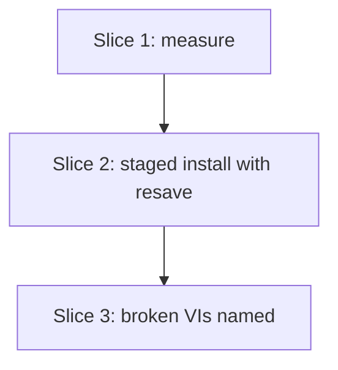

# Plan: venv install resaves packages before they land in the add-on folder

**Created**: 2026-10-27
**Branch**: claude/venv-resave-spec, off `main` at 8a5586b
**Status**: approved
**Gherkin persistence**: plan-file-only
**Spec**: [docs/specs/lvpm-venv-resave.md](../docs/specs/lvpm-venv-resave.md)

## Goal

`lvpm install` and `lvpm sync` into a venv unpack each package into a
staging folder, have the venv's LabVIEW load and save it there, and only
then move it into `<venv>/<package>/1/`. A package last saved in an older
LabVIEW (measured: `TypeDescriptor_SetName.vi`, LabVIEW 2013) then compiles
in the add-on folder without a manual mass compile. A failed resave is a
warning that names the package and what to do. The install still exits 0.

The user gave the spec's four stakeholder answers on 2026-10-27: venv only,
every package, `--no-relink`/`--headless` do not skip the resave, and a
failure installs anyway with a warning.

The cause of the breakage is not understood. This is a workaround for the
measured case, not a fix of the cause.

**Re-planned after Slice 1 (2026-10-27, with the human).** Slice 1 measured
three things (spec, `Measurements`):
- every folder under `<venv>` loads as add-on context;
- the relink VI does not save the version-only VI;
- a forced save of every VI outside the venv, then the move, fixes it.

So the resave is a forced save through lvpm's own VI Server client: open
every `.vi`/`.ctl`/`.vit` of the staged package and Save Instrument it in
place, in one LabVIEW for the whole run. Staging is the sibling folder
`<project>/.lv-venv.staging/`. The human chose this over LabVIEWCLI.

## Acceptance Criteria

- [ ] AC1 resave works (`@labview`): the S0 scenario "both pilots install
      into a fresh venv and mass compile there" passes: a LabVIEWCLI mass
      compile of `<venv>` in a freshly started venv LabVIEW exits 0 and its
      log has no "Bad VI" or "Failed to load" line. Today it fails on
      `TypeDescriptor_SetName.vi` and its callers. Runs only with
      `LVPM_TEST_LABVIEW=1` on a LabVIEW 2026 host.
- [ ] AC2 files land in place: every installed file is under
      `<venv>/<package>/1/`; the PostInstall VI stays in the venv's hooks
      folder, as today. Every path in the install record (its files, its
      relink folders and its PostInstall VI) starts with
      `<venv>/<package>/1/` or the hooks folder, and none names the staging
      folder. No staging folder is left. A failed staging step leaves the
      old version installed.
- [ ] AC3 venv only: a `--prefix` or global install writes no staging
      folder and reports no resave.
- [ ] AC4 flags: `--no-relink` skips the relink pass but not the resave;
      `--headless` resaves too.
- [ ] AC5 failure is a warning: the package is still installed, the warning
      is the fixed `warning: resave of <pkg> failed ...` line (see "Output
      wording"), the run ends with the `resave: N of M packages failed: ...`
      recap, JSON output carries the failure, an error mid-run still closes
      the LabVIEW, and the exit code is 0 (unless the relink pass fails, as
      today).
- [ ] AC6 broken VIs are named (Slice 3, its own PR): the relink report's
      `not_executable` list, relative to the package folder, at most 6 lines
      then "... and N more"; a path outside the staging folder is shown in
      full.
- [ ] AC7 leftover staging (`<project>/.lv-venv.staging/`, beside the venv)
      is removed at the start of the next venv install.
      A staging folder that cannot be removed fails the install and names it.
- [ ] AC8 dry run lists the planned resaves in one block and creates no
      staging folder.
- [ ] AC9 order: dependencies are installed and resaved before their
      dependents (chain, diamond, and top → [b, c] with b → c).

### AC → scenario → test

Most behaviour needs a venv, and a venv needs a real LabVIEW 2026 install.
The headless proofs are therefore core unit tests, using
`ops::testing::venv_in`. That venv is bound to a LabVIEW that is not there,
so starting it fails at once. The resave module also takes its LabVIEW
launcher as a parameter (step 2.3), so tests fake a LabVIEW that saves or
fails. The `@labview` scenarios go into
`tests/features/lvpm-venv-resave.feature`.

| AC | Scenario | Asserted by | Step |
|---|---|---|---|
| AC1 | S0 "both pilots install into a fresh venv and mass compile there" | cucumber `@labview` (exists) | 2.7 |
| AC2 | "installed files are only in the add-on folder", "the install record points the relink pass at the final folder", "an upgrade lands through staging too", "a package installed through staging uninstalls completely" | unit | 2.1 |
| AC2 | "the VI fixture lands through staging" | cucumber `@labview` | 2.3 |
| AC3 | "a --prefix install uses no staging folder", "a global install uses no staging folder" | unit | 2.1, 2.3 |
| AC4 | "flags that skip the relink pass do not skip the resave" | unit | 2.4 |
| AC2 | "a failed staging step leaves the old version installed" | unit | 2.1 |
| AC5 | "JSON output carries the resave failure", "an error after a resave started still closes the LabVIEW", "a resave failure is a warning", "one package failing does not stop the next", "a LabVIEW that cannot start is reported once", "a failed resave with the relink pass on", "the warning wording" | unit, render unit | 2.3 |
| AC6 | Slice 3 scenarios | unit; cucumber `@labview` | 3.1, 3.2 |
| AC7 | "an undeletable leftover staging folder fails the install", "a staging folder left by an interrupted install is removed", "a dry run leaves a leftover staging folder alone" | unit | 2.2, 2.5 |
| AC8 | "a dry run lists the resaves" and its negatives | unit | 2.5 |
| AC9 | "dependencies are resaved before dependents" (chain and diamond), "sync resaves too" | unit | 2.0, 2.3 |
| Error | "a folder with no install record is replaced" | unit | 2.2 |

## Approach stances (decision-defaults)

- **Scope:** the spec only. Global `vi.lib`, `--prefix` and already broken
  venvs are out. The docs tell users to recreate a broken venv. AC6 (naming
  broken VIs) is Slice 3 and ships as its own PR after Slices 1–2, so the
  binary VI edit does not hold up the fix.
- **Replace-vs-merge:** the move never merges. A `<venv>/<package>/1/` that
  no install record names is an lvpm-owned leftover (`roots_for_pkg`
  validates the name). It is removed before the move, with a note in the
  output. An upgrade stages and resaves the new version first, then removes
  the old version, then moves. A failed staging step leaves the old version
  installed.
- **Format fidelity:** the relink VI's report grows from a JSON array to an
  object (Slice 3). `summarize_log` keeps reading the array, so an older
  embedded VI or `lvpm relink` output reads as before.
- **Migrate-vs-edit:** existing venvs are not migrated. Reinstalling runs the
  new path.
- **Integration:** PRs to `main` without auto-merge. The user merges.
- **Gherkin persistence:** plan-file-only. Most scenarios are core unit
  tests, and the cucumber harness fails on scenarios it has no steps for.
  Step 2.3 writes the `@labview` scenarios into
  `tests/features/lvpm-venv-resave.feature` and lists that file in
  `tests/acceptance.rs`.

## Slices

### Slice 1: measure in LabVIEW before building

**Depends-on:** none
**Files:** `docs/specs/lvpm-venv-resave.md`

**Behavior:** none. This slice is a measurement gate. It changes no product
code. Each measurement has a binary result and says what it changes.

**Result (done, 2026-10-27):** M0 failed, so staging is needed. M1 failed
for both locations under `<venv>`, and a folder outside `<venv>` passed. M2
hit its stop condition. With the human, the forced VI Server save
replaced the relink VI (M2b). M3 passed in one session, with a fresh
LabVIEW per package, and for the upgrade order. Rows and logs: spec,
`Measurements`. Commits e3fb8ef, 010afce and 39b0d0a.

**Steps:**

#### Step 1.1: measurements in a scratch venv

**Complexity**: standard
**IMPLEMENT**: In a scratch venv on LabVIEW 2026, use a LabVIEW started on
the venv's own port. Never use the global LabVIEW on the default port, and
close every PID afterwards. Use `data_manipulation` 1.6.0.16 and
OpenSerializer from the pilot archives.
- **M0, in-place resave.** Install as today (`--no-relink`). Run the
  embedded `Relink Package.vi` on `<venv>/<package>/1/` in place. Restart
  the venv LabVIEW and mass compile. If `TypeDescriptor_SetName.vi`
  compiles: stop and return to the human with a smaller plan (an always-on
  in-place resave pass, no staging). If it stays broken: that is the
  evidence for staging, and the plan goes on.
- **M1, staging is not add-on context.** Load the shipped tree from both
  candidate locations: `<venv>/.lvpm/staging/<package>/1/` and the
  same-depth sibling `<venv>/.staging-<package>/1/`, each with no
  `lvaddoninfo.json`. Record per location whether `TypeDescriptor_SetName.vi`
  compiles there.
- **M2, the relink VI saves a version-only change.** Run the embedded
  `Relink Package.vi` on the staged folder. Its `report log out` must list
  `TypeDescriptor_SetName.vi`. If it does not, stop and return to the human.
- **M3, links hold after the move.** For each location that passed M1:
  resave and move data_manipulation, then stage, resave and move
  OpenSerializer, with no relink pass. Do it twice: once in one LabVIEW
  session, once with a fresh LabVIEW per package. A CLI mass compile of
  `<venv>` in a freshly started venv LabVIEW must report no bad VI. Add an
  upgrade row: stage and resave a second version of OpenSerializer while the
  first is still installed, then remove the old one, move, and mass compile.
- **Startup time.** Record the cold start of the venv LabVIEW.

**TEST**: A `Measurements` section in the spec is the test: one row per
measurement with the exact command, the log path, the observed result and
the decision. The decisions are: the staging location (the one that passes
M1 and M3; the same-depth sibling wins a tie, because it keeps
cross-package relative paths); one LabVIEW per package, or one per run if
the shared-session row of M3 passed. If the chosen location is not
`<venv>/.lvpm/staging/`, update the spec's AC7 and glossary in the same
commit. If no location passes both M1 and M3, or neither LabVIEW mode passes
M3, stop and return to the human.
**REFACTOR**: Remove the scratch venv. Check that no LabVIEW from this step
is still running.
**Files**: `docs/specs/lvpm-venv-resave.md`
**Commit**: `docs(spec): venv resave measurements (in place, staging location, links after move)`

### Slice 2: staged install with resave

**Depends-on:** 1
**Files:** `crates/lvpm-core/src/venv.rs`, `crates/lvpm-core/src/install.rs`, `crates/lvpm-core/src/ops/install.rs`, `crates/lvpm-core/src/ops/staging.rs`, `crates/lvpm-core/src/ops/resave.rs`, `crates/lvpm-core/src/ops/session.rs`, `crates/lvpm-core/src/ops/mod.rs`, `crates/lvpm-core/src/ops/sync.rs`, `crates/lvpm-core/src/events.rs`, `src/render/install.rs`, `src/render/relink.rs`, `src/render/json.rs`, `tests/features/lvpm-venv-resave.feature`, `tests/acceptance.rs`, `tests/steps/venv.rs`, `docs/usage.md`

Staging and landing go into a new `ops/staging.rs`, and the LabVIEW lifecycle and the forced save into a new `ops/resave.rs`.
"A package with LabVIEW files" means one whose installed files include a
`.vi`, `.ctl` or `.vit`. Only those are resaved.
`ops/install.rs` is already about 960 lines, so it only chooses the
placement and calls the new module.

**Behavior:**

```gherkin
Feature: A venv install resaves each package in a staging folder, then moves it into place

  Scenario: installed files are only in the add-on folder
    Given a venv for LabVIEW 2026
    When package "alpha" is installed into the venv with --no-relink
    Then every file of alpha is under the venv's "alpha/1" folder
    And alpha's install record names only files under "alpha/1"
    And the venv has no staging folder

  Scenario: the install record points the relink pass at the final folder
    Given a venv for LabVIEW 2026
    When package "alpha", which has a PostInstall VI, is installed into the venv with --no-relink
    Then every relink folder in alpha's install record is under "alpha/1"
    And alpha's PostInstall VI path in its install record is in the venv's hooks folder
    And no field of alpha's install record names the staging folder

  Scenario: an upgrade lands through staging too
    Given a venv with alpha 2.0 installed
    When alpha 3.0 is installed into the venv with --no-relink
    Then alpha's install record says 3.0 and names only files under "alpha/1"
    And the venv has no staging folder

  Scenario: a package installed through staging uninstalls completely
    Given alpha installed into a venv
    When alpha is uninstalled
    Then "alpha/1" holds no files and the venv has no staging folder

  Scenario: a --prefix install uses no staging folder
    Given an empty scratch destination
    When package "alpha" is installed with --prefix
    Then alpha is installed in the scratch destination
    And no staging folder exists anywhere under the scratch destination
    And no resave is reported

  Scenario: a staging folder left by an interrupted install is removed
    Given a venv whose staging folder holds a partial package "beta"
    When package "alpha" is installed into the venv with --no-relink
    Then the staging folder is gone
    And beta is not installed

  Scenario: a folder with no install record is replaced
    Given a venv whose "alpha/1" folder holds a file but no install record names alpha
    When package "alpha" is installed into the venv with --no-relink
    Then the output notes that the unrecorded "alpha/1" folder was replaced
    And the stray file is gone from "alpha/1"
    And alpha's install record names only files of alpha

  Scenario: an undeletable leftover staging folder fails the install
    Given a venv whose staging folder cannot be removed
    When package "alpha" is installed into the venv with --no-relink
    Then the exit code is non-zero and the error names the staging folder
    And alpha is not installed

  Scenario: a failed staging step leaves the old version installed
    Given a venv with alpha 2.0 installed
    And alpha 3.0's archive cannot be unpacked
    When alpha 3.0 is installed into the venv with --no-relink
    Then the install fails and names alpha
    And alpha's install record still says 2.0 and its files are under "alpha/1"
    And the venv has no staging folder

  Scenario: a global install uses no staging folder and reports no resave
    Given a global LabVIEW 2026 destination
    When package "alpha" is installed with --global
    Then no resave is reported
    And no staging folder exists

  Scenario: a resave saves and reports per package
    Given a venv whose LabVIEW saves 3 VIs of alpha
    When package "alpha" is installed into the venv with --no-relink
    Then the output has one resave line for alpha that says 3 saved
    And the exit code is 0

  Scenario: a resave failure is a warning
    Given a venv whose LabVIEW starts but fails the resave of alpha
    When package "alpha" is installed into the venv with --no-relink
    Then the exit code is 0
    And a warning starts with "warning: resave of alpha failed (" and says "Reinstall alpha first"
    And the last lines before "done." are "resave: 1 of 1 packages failed: alpha (see the warnings above)"
    And every file of alpha is under the venv's "alpha/1" folder
    And the venv has no staging folder

  Scenario: JSON output carries the resave failure
    Given a venv whose LabVIEW starts but fails the resave of alpha
    When package "alpha" is installed into the venv with --no-relink and --json
    Then the output has a resave_failed event for alpha with an error
    And the final summary's resave_failed list is ["alpha"]

  Scenario: an error after a resave started still closes the LabVIEW
    Given a venv whose LabVIEW saves every package
    And package "beta", which depends on "alpha", fails to unpack
    When package "beta" is installed into the venv with --no-relink
    Then the install fails
    And every LabVIEW the resave started is closed

  Scenario: one package failing does not stop the next
    Given a venv whose LabVIEW fails the resave of alpha but saves beta
    And package "beta" depends on package "alpha"
    When package "beta" is installed into the venv with --no-relink
    Then the exit code is 0
    And a warning names alpha, and beta's resave line says it saved
    And both are in their add-on folders
    And every LabVIEW the resave started is closed
    And the venv has no staging folder

  Scenario: a LabVIEW that cannot start is reported once
    Given a venv whose LabVIEW cannot be started
    And package "beta" depends on package "alpha"
    When package "beta" is installed into the venv with --no-relink
    Then the exit code is 0
    And LabVIEW was started once
    And one warning says the venv's LabVIEW could not start and names alpha and beta
    And the recap is "resave: 2 of 2 packages failed: alpha, beta (see the warnings above)"
    And both are in their add-on folders
    And the venv has no staging folder

  Scenario: a failed resave with the relink pass on
    Given a venv whose LabVIEW cannot be started
    When package "alpha" is installed into the venv
    Then the resave warning names alpha
    And the exit code is non-zero and the error names the relink pass's failed LabVIEW start
    And every file of alpha is under the venv's "alpha/1" folder

  Scenario Outline: dependencies are resaved before dependents
    Given a venv whose LabVIEW saves every package
    And the packages <graph>
    When package "top" is installed into the venv with --no-relink
    Then every package is resaved after all of its dependencies
    And when each resave starts, all of that package's dependencies are in their add-on folders

    Examples:
      | graph                                                  |
      | top requires mid, mid requires base                    |
      | top requires left and right, left and right require base |
      | top requires b and c, b requires c                      |

  Scenario: a package with no LabVIEW files is moved without a resave
    Given a venv
    When a package holding only documentation is installed into the venv with --no-relink
    Then no resave is reported for it
    And LabVIEW was not started
    And its files are in its add-on folder

  Scenario: a package already saved in the venv's LabVIEW is not resaved
    Given a venv for LabVIEW 2026 whose LabVIEW saves every package
    And package "alpha" whose VIs are all saved in LabVIEW 2026
    And package "beta" whose VIs are saved in LabVIEW 2013
    When packages "alpha" and "beta" are installed into the venv with --no-relink
    Then alpha's resave line says it is already saved in LabVIEW 2026 and was skipped
    And only beta was resaved
    And both are in their add-on folders

  Scenario: a venv where every package is current starts no LabVIEW
    Given a venv for LabVIEW 2026
    And package "alpha" whose VIs are all saved in LabVIEW 2026
    When package "alpha" is installed into the venv with --no-relink
    Then LabVIEW was not started
    And no resave failed

  Scenario: a file whose version cannot be read is resaved
    Given a venv for LabVIEW 2026 whose LabVIEW saves every package
    And package "alpha" with one LabVIEW 2026 VI and one ".vi" file that is not a VI
    When package "alpha" is installed into the venv with --no-relink
    Then alpha was resaved

  Scenario: --no-relink does not skip the resave
    Given a venv whose LabVIEW saves every package
    When package "alpha" is installed into the venv with --no-relink
    Then alpha's resave line is in the output
    And the output has "relink: skipped (--no-relink). The resave still ran."

  Scenario: a headless install resaves, with a headless LabVIEW
    Given a venv whose LabVIEW saves every package
    When package "alpha" is installed into the venv headless
    Then alpha's resave line is in the output
    And the resave's LabVIEW was started headless
    And the output has "relink: skipped (headless). The resave still ran."

  Scenario: a dry run lists the resaves
    Given a venv
    And package "beta" depends on package "alpha"
    When package "beta" is installed into the venv with --dry-run
    Then one resave block lists alpha and beta, before the relink block
    And every planned write is under "alpha/1" or "beta/1", none under staging
    And the venv's file listing is identical before and after

  Scenario: a dry run leaves a leftover staging folder alone
    Given a venv whose staging folder holds a partial package "beta"
    When package "alpha" is installed into the venv with --dry-run
    Then the staging folder is unchanged

  Scenario Outline: a dry run plans no resave where there is nothing to resave
    Given <destination>
    When <package> is installed there with --dry-run
    Then the output lists no planned resave

    Examples:
      | destination                  | package                                  |
      | an empty --prefix destination | package "alpha", which has LabVIEW files |
      | a venv                       | a package holding only documentation     |

  Scenario: sync resaves too
    Given a project whose lock lists beta, which depends on alpha
    And a venv whose LabVIEW saves every package
    When lvpm sync runs with --no-relink
    Then alpha is resaved before beta
    And both are in their add-on folders

  @labview
  Scenario: the VI fixture lands through staging
    Given a venv for LabVIEW 2026 and the VI fixture package
    And LV_RTE_HEADLESS is set
    When I run "lvpm install lvpm_vi_fixture --no-relink --labview-version 2026"
    Then the exit code is 0
    And the output has a resave line for lvpm_vi_fixture
    And the venv holds lvpm_vi_fixture in its add-on folder and no staging folder

  @labview @interactive-labview
  Scenario: both pilots install into a fresh venv and mass compile there
    # the existing S0 scenario, unchanged; it is AC1's gate
```

**Output wording** (fixed here, tested in render unit tests; plain text
markers only, no colour or glyph):
- One-time, before the first start:
  `starting the venv's LabVIEW for the resave (about a minute per package)`
  (measured: 40–85 s per package, mostly cold loads; one LabVIEW per run).
- Per package with LabVIEW files, one begin/end line in the style of
  `RelinkFolderStarted/Done`, with a counter: `resave (2/5) alpha ... 3 saved (14s)` or
  `resave (2/5) alpha ... nothing to save (9s)`. A failure ends the line with
  `FAILED`.
- A package whose files are all current (step 2.6):
  `resave (2/5) alpha ... already saved in LabVIEW 2026, skipped`.
- The failure warning, on the stream the existing `warning:` lines use
  (paths shown with the platform's separator):
  `warning: resave of alpha failed (<reason, one line>). alpha is installed, but VIs saved in an older LabVIEW may load broken. Reinstall alpha first; if it fails again, run lvpm launch and mass compile <venv>/alpha.`
- A start failure is one warning for the run, and counts in the recap:
  `warning: the venv's LabVIEW could not start (<reason>). 2 packages were installed without a resave: alpha, beta. Fix the start problem, then reinstall them.`
  No further start is tried in that run.
- The recap, before `done.`, only when a resave failed:
  `resave: 2 of 40 packages failed: alpha, beta (see the warnings above)`.
- With `--no-relink` the skip line says
  `relink: skipped (--no-relink). The resave still ran.`; headless says
  `relink: skipped (headless). The resave still ran.`
- Leftover staging removed: `removed the staging folder an interrupted install left: <folder>`.
  If removal fails: `cannot remove the staging folder <folder>. Close the venv's LabVIEW and delete it, then retry.`
- Unrecorded folder: `replaced <venv>/alpha/1, which no install record named; files added there by hand are gone`.
- docs/usage.md says the exit code stays 0 on a failed resave and that
  scripts read the JSON `resave_failed` list.
- Dry run: one block before the relink block,
  `resave: 2 packages in the venv's LabVIEW:` then the names, capped with
  `PREVIEW_LIMIT` and `... and N more`.
- JSON: `resave_started`, `resave_done {package, saved}`,
  `resave_skipped {package, labview}`,
  `resave_failed {package, error}`, `resave_planned {packages}`, and a
  `resave_failed` list of package names in the final summary.

**Steps:**

#### Step 2.0: dependencies first on every install path

**Complexity**: standard
**IMPLEMENT**: `resolve_greedy` reverses a DFS pre-order, which is not a
topological order. For top → [b, c] and b → c it yields b before c. Extract
one helper, `order_dependencies_first(items, key, requires)`, from
`ops::sync`'s `dependencies_first`/`visit` post-order. Use it in sync and
run it over `resolve_greedy`'s entries after the worklist loop. The loop
itself is unchanged.
**TEST**: A unit test in `ops/install.rs` for the three graphs of the order
outline (chain, diamond, top → [b, c] with b → c). Sync's existing order
test stays green.
**REFACTOR**: One ordering helper, no second post-order.
**Files**: `crates/lvpm-core/src/ops/sync.rs`, `crates/lvpm-core/src/ops/install.rs`
**Commit**: `fix(install): order installs dependencies first, so a dependent resaves against its resaved dependency`

#### Step 2.1: stage the files, move into place, write the manifest after the move

**Complexity**: complex
**IMPLEMENT**:
- Add `Venv::staging_dir()`: the venv folder's sibling with `.staging`
  appended (`<project>/.lv-venv.staging/`). It is on the venv's volume and
  outside the add-on root (M1). Creating it writes a `.gitignore` of `*`,
  as `venv create` does for the venv.
- In `install_one`, choose a `Placement { InPlace, Staged(staging) }` once,
  the way `HookPolicy::new` is chosen. Venv destinations are `Staged`;
  `--prefix` and global are `InPlace` and take today's path unchanged.
- Keep the final `Roots` and the final plan. One value,
  `Staging { final_root, stage_root }` with `to_stage(&Path)` and
  `to_final(&Path)`, is the only staged-to-final mapping. The unpack, the
  resave's folder list and Slice 3's warning all use it.
- Split `install::apply` into `unpack_to(roots, stage: Option<&Staging>, ..)
  -> Manifest`, which writes the files and `lvaddoninfo.json` (through
  `to_stage` when staged) but no manifest, and `apply = unpack_to +
  write_manifest` for `InPlace`. In-place callers keep calling `apply`.
- For a staged package, the unrecorded-folder check (2.2) runs before
  `install::plan`, so `plan()`'s overwrite and keep decisions see the real
  target.
- `ops::staging::land` renames the staged `1/` to `<venv>/<package>/1/`
  (creating `<venv>/<package>/` first), then writes the manifest, then
  removes the empty `staging/<package>/` and, after the last package,
  `staging/`.
- Upgrade order, for `Staged` only: `settle_installed` no longer calls
  `uninstall_one` before the download. Stage and resave the new version,
  then remove the old version, then move. A failed stage leaves the old
  version installed. The dry-run event order follows. M3c measured this
  order as safe.
- Staging and landing live in a new `ops/staging.rs`. `ops/resave.rs` holds
  only the `Resaver`.

**TEST**: Unit tests for: files only in `alpha/1`; the install record
points at the final folder; upgrade; failed staging during an upgrade;
uninstall; `--prefix`; global. Fixture archives:
- one with a `.vi` in a folder the relink pass lists, and a PostInstall VI.
  The test first asserts the record lists at least one relink folder, so the
  path check cannot pass vacuously;
- one holding only documentation;
- one that fails to unpack.

`cargo test` is green, including the recorded global outputs.
**REFACTOR**: `ops/install.rs` grows only by the placement choice and the
call. The manifest is built in one place.
**Files**: `crates/lvpm-core/src/venv.rs`, `crates/lvpm-core/src/install.rs`, `crates/lvpm-core/src/ops/install.rs`, `crates/lvpm-core/src/ops/staging.rs`, `crates/lvpm-core/src/ops/mod.rs`
**Commit**: `feat(venv): install stages each package and moves it into its add-on folder`

#### Step 2.2: leftover staging and unrecorded folders

**Complexity**: standard
**IMPLEMENT**: At the start of `apply` for a venv destination, and not in a
dry run, remove the staging folder if it exists, before any package is
fetched. A failed removal fails the install and names the folder. Before
the move, a `<venv>/<package>/1/` that no install record names is removed,
and a note says so (a new event, worded in `src/render/install.rs`).
**TEST**: Unit tests "a staging folder left by an interrupted install is
removed", "an undeletable leftover staging folder fails the install" (a
file held open in the staging folder) and "a folder with no install record
is replaced".
**REFACTOR**: Check that sync, which calls `apply`, gets the same behaviour
without its own call.
**Files**: `crates/lvpm-core/src/ops/install.rs`, `crates/lvpm-core/src/ops/staging.rs`, `crates/lvpm-core/src/events.rs`, `src/render/install.rs`
**Commit**: `feat(venv): clear an interrupted install's staging and unrecorded package folders`

#### Step 2.3: resave each staged package, warn on failure

**Complexity**: complex
**IMPLEMENT**:
- `ops::resave::Resaver` owns the LabVIEW lifecycle. It starts the venv's
  LabVIEW with `launch::ensure_instance` the first time a staged package
  has LabVIEW files, and keeps that one LabVIEW for the run (M3a). Shutdown
  is unconditional (a `Drop` guard calling `shutdown_if_spawned`), so a
  `?`, a cancel or a sync `incomplete` path cannot leave a LabVIEW holding
  staged files.
- The first start failure is latched. The remaining packages are moved
  without a resave, and one warning names them all.
- The test seam is a `Launcher` trait with one method,
  `start(headless) -> Result<Box<dyn Session>>`. A `Session` has
  `resave(staged_folder) -> Result<Outcome>`, and dropping it closes the
  LabVIEW. The real launcher is `ensure_instance` plus a
  `viserver::Connection`. It retries the handshake while VI Server still
  refuses it (error 63), as `ensure_vi_server` waits today. Its `resave`
  walks the staged package for `.vi`/`.ctl`/`.vit`, sorted. For each file it
  calls `open_vi_reference`, `save_instrument` to the same path, then
  `release`. `Outcome` is the saved count. Any file that fails makes the
  package's resave fail, with the count and the first file and error as the
  reason. The other files are still tried. `.lvlib`/`.lvclass` files are
  not saved; every M3 row was clean without them. The relink VI is not
  used. Closed with `shutdown_if_spawned`. The fake launcher counts starts and closes, records
  the headless flag, and either fails the start or returns scripted outcomes
  per package (keyed by the staged folder's package name). It can also check
  the filesystem when each resave starts. "Saves", "fails the resave" and
  "cannot be started" in the scenarios are these three fake setups. The
  relink pass keeps the real start, so "a failed resave with the relink pass
  on" fails there deterministically against `venv_in`.
- The `Resaver` lives in `InstallSession`, like `hook_connection`. Test
  support sets its launcher, and production builds the real one.
  `Resaver::finish(&sink)` emits the recap and the batched start-failure
  warning. `apply` calls it on both its `Ok` and `Err` paths.
- `run_relink` and the relink pass are not changed: the resave emits none of
  their events and does not mark the manifest relinked.
- Between stage and move, each package with LabVIEW files is resaved. Any
  VI Server error, or a call with no answer in 180 s, becomes
  `ResaveFailed`. The package is moved as it is, and the install goes on.
- Events `ResaveStarting` (the one-time line), `ResaveStarted`,
  `ResaveDone`, `ResaveFailed`, `ResaveStartFailed` and the recap, worded as
  in "Output wording" above, in `src/render/install.rs` and
  `src/render/json.rs`.

Write the `@labview` scenario into `tests/features/lvpm-venv-resave.feature`
and list the file in `tests/acceptance.rs`.
**TEST**: Unit tests, with the fake launcher, for:
- the per-package line;
- the real session's file walk (a pure function over a temporary folder):
  `.vi`/`.ctl`/`.vit` only, sorted, `.lvlib`/`.lvclass` and docs left out;
- a failure is a warning;
- one failure does not stop the next;
- a start failure is reported once, with one start attempt;
- a failed resave with the relink pass on;
- dependency order, all three rows (step 2.0 already orders them);
- "sync resaves too";
- no LabVIEW files;
- every started LabVIEW closed, including after an error mid-run;
- JSON output carries the failure.

Scenarios match output lines by prefix up to the count, never the duration.
Render unit tests inject the elapsed time and cover each wording line above,
text and JSON. The cucumber `@labview`
scenario goes green with `LVPM_TEST_LABVIEW=1`.
**REFACTOR**: `ops/install.rs` holds no resave logic. The relink pass's
behaviour and recorded output are unchanged.
**Files**: `crates/lvpm-core/src/ops/resave.rs`, `crates/lvpm-core/src/ops/session.rs`, `crates/lvpm-core/src/ops/install.rs`, `crates/lvpm-core/src/events.rs`, `src/render/install.rs`, `src/render/json.rs`, `tests/features/lvpm-venv-resave.feature`, `tests/acceptance.rs`, `tests/steps/venv.rs`
**Commit**: `feat(venv): resave each package in the venv's LabVIEW before it reaches the add-on folder`

#### Step 2.4: --no-relink and --headless do not skip the resave

**Complexity**: standard
**IMPLEMENT**: The resave reads no `no_relink`, `force_relink` or relink
headless skip. It passes `env.headless` to `ensure_instance`, as the relink
pass does. The `--no-relink` skip line says the resave still ran.
**TEST**: The two flag scenarios (headless asserted through the fake
launcher's recorded flag) and render tests for both skip lines.
**REFACTOR**: The `InstallOptions::no_relink` doc comment and the
`--no-relink` `--help` text say it does not cover the resave.
**Files**: `crates/lvpm-core/src/ops/install.rs`, `src/render/relink.rs`, `src/render/install.rs`
**Commit**: `feat(venv): --no-relink and headless installs still resave, and say so`

#### Step 2.5: dry run lists the planned resaves

**Complexity**: standard
**IMPLEMENT**: `preview` for a venv destination emits one
`ResavePlanned { packages }` for the packages with LabVIEW files. Render
it as one capped block before
the relink block. Nothing is staged or removed. Planned writes are the
final paths.
**TEST**: The three dry-run unit scenarios.
**REFACTOR**: None.
**Files**: `crates/lvpm-core/src/ops/install.rs`, `crates/lvpm-core/src/events.rs`, `src/render/install.rs`, `src/render/json.rs`
**Commit**: `feat(venv): a dry run says which packages it would resave`

#### Step 2.6: skip packages already saved in the venv's LabVIEW

**Complexity**: standard
**IMPLEMENT**: A pure reader in `ops/resave.rs`, `saved_major(path) ->
Option<u32>`: the LabVIEW major version in the file's RSRC `vers` resource
(id 4), read with no LabVIEW (spec, M4). Before a staged package's resave,
the `Resaver` reads every `.vi`/`.ctl`/`.vit` from the same file walk. If
every file reads the venv's major (`LabVIEW 2026` is 26), it emits
`ResaveSkipped { package, labview }` and starts no LabVIEW for it. A file
that cannot be read counts as old. This runs before the start, so a run
with only current packages starts no LabVIEW and never latches a start
failure. Shortcut: the minor version (26.1 against 26.3) is not compared;
compare it when a same-year file is measured to load broken.
**TEST**: Reader unit tests on byte fixtures built in the test (13.0.1,
26.3.1, not RSRC, truncated). The three scenarios above, with the fake
launcher.
**REFACTOR**: One file walk feeds the skip and the save.
**Files**: `crates/lvpm-core/src/ops/resave.rs`, `crates/lvpm-core/src/events.rs`, `src/render/install.rs`, `src/render/json.rs`
**Commit**: `feat(venv): skip the resave of packages already saved in the venv's LabVIEW`

#### Step 2.7: document the resave; the pilot scenario passes

**Complexity**: trivial
**IMPLEMENT**: In `docs/usage.md`, under venv install:
- a venv install resaves each package in the venv's LabVIEW first, and
  what that costs (Slice 1's measured startup time, per package or per run);
- what the warning and the recap mean, and what to do;
- that `--no-relink` does not skip the resave;
- that a venv set up before this release is repaired by deleting
  `.lv-venv` and running `lvpm sync`.

**TEST**: The existing docs scenarios stay green. Then
`LVPM_TEST_LABVIEW=1 LVPM_TEST_LABVIEW_HEADLESS=0 cargo test --test acceptance`
with the S0 pilot scenario: the mass compile reports no bad VI. Put the
result in the PR.
**REFACTOR**: The wording matches the rendered events.
**Files**: `docs/usage.md`
**Commit**: `docs: venv install resaves packages before they land`

### Slice 3: name the VIs a resave left broken (its own PR)

**Depends-on:** 2

**Re-plan before building (after the Slice 1 result).** The resave no
longer runs the relink VI, so step 3.1's report reaches only the relink
pass, not the resave. Naming broken VIs after a resave needs a broken-state
read per VI over VI Server, which the Rust client does not have yet. This
slice is re-planned with the human after Slice 2 ships. The steps below are
the original plan, kept for that re-plan.

**Files:** `crates/lvpm-core/src/lv-src/relink-package.vi`, `crates/lvpm-core/src/relink.rs`, `crates/lvpm-core/src/ops/resave.rs`, `crates/lvpm-core/src/ops/relink.rs`, `crates/lvpm-core/src/events.rs`, `src/render/install.rs`, `src/render/relink.rs`, `src/render/json.rs`, `tests/support/fixtures.rs`, `tests/fixtures/`, `tests/features/lvpm-venv-resave.feature`, `tests/steps/venv.rs`

**Behavior:**

```gherkin
Feature: A resave that leaves VIs broken names them

  Scenario: a report in the old form is still read
    Given a relink report that lists only the files it saved
    When it is summarized for a folder
    Then the summary counts the saved files as before
    And it names no broken VI

  Scenario: broken VIs are named relative to the package's final folder
    Given a report from alpha's staging folder that lists two VIs there as not executable
    When the resave warning for "alpha" is built from it
    Then the warning names alpha and both VIs, relative to alpha's folder
    And neither path names the staging folder

  Scenario: a long list of broken VIs is capped
    Given a report that lists 30 VIs as not executable
    When the resave warning for "alpha" is built from it
    Then the warning lists 6 VIs, one per indented line, and "... and 24 more"

  Scenario: a broken VI outside the package is shown in full
    Given a report that lists a not-executable VI outside alpha's staging folder
    When the resave warning for "alpha" is built from it
    Then that VI is shown with its full path

  Scenario: an unreadable report is a failure, not a clean resave
    Given a report that is empty or not valid JSON
    When the resave of "alpha" reads it
    Then the resave of alpha is reported failed, naming the unreadable report

  @labview
  Scenario: a package with a VI that cannot compile is installed with a warning
    Given a venv for LabVIEW 2026 and a fixture package with a VI whose subVI is missing
    When that package is installed into the venv with --no-relink
    Then the exit code is 0
    And the warning names the package and that VI, relative to its folder
```

**Steps:**

#### Step 3.1: the relink VI reports not-executable VIs

**Complexity**: complex
**IMPLEMENT**: Extend `crates/lvpm-core/src/lv-src/relink-package.vi` in
LabVIEW. After the save, it collects the walked VIs that are not
executable. It writes `report log out` as
`{"saved":[...],"not_executable":[...]}` of absolute paths. Keep it saved
for LabVIEW 2020. Use the `labview-vi-editor` agent, or edit by hand if the
round trip is lossy (decide in Phase 0 of that agent, and back up first).
`summarize_log` reads both the array and the object. An empty or invalid
report is an error.
**TEST**: Unit tests for "a report in the old form is still read", the
object form, and "an unreadable report". Run the VI over the VI fixture in
a venv LabVIEW: `saved` is as before and `not_executable` is empty. Update
the `REAL_VI` fixture hash in `tests/support/fixtures.rs` and any recorded
output that depends on it.
**REFACTOR**: One parser type for the report, shared by the relink pass and
the resave.
**Files**: `crates/lvpm-core/src/lv-src/relink-package.vi`, `crates/lvpm-core/src/relink.rs`, `tests/support/fixtures.rs`
**Commit**: `feat(relink): the relink VI reports VIs that stay not executable`

#### Step 3.2: the resave warning names broken VIs

**Complexity**: standard
**IMPLEMENT**: A pure function in `relink.rs`, beside `summarize_log`, takes
the parsed report and the package's `Staging`, and returns the warning's broken
list. Paths inside the staging folder are made relative to the package's
final folder. Paths outside it are shown in full. The list is capped at
`SHOWN_SAVES` (6) with `... and N more`. A non-empty list makes the resave a
`ResaveFailed` with `broken`. JSON gets `broken: [paths]`. Add a fixture
package whose VI calls a missing subVI, built in LabVIEW as the existing VI
fixtures are, and the `@labview` scenario.
**TEST**: Unit tests for the relative, capped and outside-path scenarios.
The `@labview` scenario passes with `LVPM_TEST_LABVIEW=1`.
**REFACTOR**: The relink pass prints the same broken list where its report
has one, through the same function, so the two passes word it alike. A
render test in `src/render/relink.rs` covers that line, and the recorded
relink outputs without broken VIs stay unchanged.
**Files**: `crates/lvpm-core/src/ops/resave.rs`, `crates/lvpm-core/src/ops/relink.rs`, `crates/lvpm-core/src/events.rs`, `src/render/install.rs`, `src/render/relink.rs`, `src/render/json.rs`, `tests/fixtures/`, `tests/features/lvpm-venv-resave.feature`, `tests/steps/venv.rs`
**Commit**: `feat(venv): the resave warning names the VIs left broken`

## Parallelization

Derived by `plan_waves.py`. Each slice needs the previous one, so there is
nothing to run in parallel.



| Wave | Slices |
|------|--------|
| 1 | 1 |
| 2 | 2 |
| 3 | 3 |

## Complexity Classification

As in the template. Steps 2.1, 2.3 and 3.1 are `complex`: they cover the
on-disk layout, the LabVIEW lifecycle, and a binary VI edit.

## Pre-PR Quality Gate

- [ ] `cargo fmt --all -- --check`
- [ ] `cargo clippy --all-targets -- -D warnings`
- [ ] `cargo test`
- [ ] `LVPM_TEST_LABVIEW=1 cargo test --test acceptance`, including the S0
      pilot scenario. Use only a venv LabVIEW. Close every PID afterwards.
- [ ] `/code-review --since origin/main`
- [ ] `docs/usage.md` updated

## Skipped (low value)

None.

## Not covered by a test

- A real interruption, such as a killed process during a resave. Step 2.2
  removes the folder it leaves behind. The kill itself is not simulated.
- Rename across volumes. Staging is the venv's sibling, so it is on the same
  volume unless the venv folder itself is a mount point.
- A rename that fails after the old version was removed during an upgrade.
  Both folders are on one volume and lvpm owns the target, so a test would
  need to fake the file system. The old version is then gone. The error names
  the staged folder, and reinstalling recovers.
- A real VI Server timeout. The fake runner returns the error a timeout
  produces. The 180 s wait itself is not exercised.

## Risks & Open Questions

- **Duration.** The forced save loads every VI cold: 83 s for 92 files and
  40 s for 30 (M3a). A 40-package sync can take tens of minutes. One
  LabVIEW per run already avoids repeated starts. Step 2.6 skips
  packages whose files are all saved in the venv's LabVIEW already (spec,
  M4). No pilot package is current, so the pilots pay the full time.
- **Library files are not saved.** `.lvlib`/`.lvclass` keep their old
  version. Every measured venv compiled clean. If a package breaks on that,
  add the relink VI's library save after the forced save.
- **The measurement covers one breakage.** It is `data_manipulation` 1.6.0.16
  with OpenSerializer. The S0 pilot scenario (AC1) is the gate for both
  pilots.
- **Partial saves.** On a timeout or LabVIEW error, the package is moved
  as far as the save got, as the spec says. Re-unpacking the pristine
  files instead is the upgrade if partial saves turn out worse than
  unsaved ones.
- **Unrecorded folder removal.** A `<venv>/<package>/1/` with no install
  record is removed before the move (stance above). It is lvpm-owned, and
  today's install overwrites it anyway, but files a user put there by hand
  are lost.
- **Install order change (2.0).** `resolve_greedy`'s order changes for some
  graphs. Recorded outputs that list install order may need updating.
- **Binary VI edit (3.1).** The relink VI is binary and saved for LabVIEW
  2020. An AIXML round trip loses layout. If 3.1 cannot be done cleanly,
  Slice 3 waits and AC6 stays open. Slices 1–2 ship without it.
- **Fixture for 3.2.** A deliberately broken VI fixture has to be built in
  LabVIEW, and lvpm must not ship it. It lives in `tests/fixtures`.
- **Global installs.** The same breakage may exist in global `vi.lib`. It is
  out of scope by the user's answer and unmeasured.
- **Spec glossary.** "Add-on folder", "Staging folder" and "Resave" are
  verified by Slice 1 and updated in the spec.

## Build Progress

### Slices (grouped by wave)

#### Wave 1
- [x] Slice 1: measure in LabVIEW before building
  - [x] Step 1.1: measurements in a scratch venv

#### Wave 2
- [ ] Slice 2: staged install with resave
  - [x] Step 2.0: dependencies first on every install path
  - [x] Step 2.1: stage the files, move into place, write the manifest after the move
  - [x] Step 2.2: leftover staging and unrecorded folders
  - [x] Step 2.3: resave each staged package, warn on failure
  - [x] Step 2.4: --no-relink and --headless do not skip the resave
  - [x] Step 2.5: dry run lists the planned resaves
  - [x] Step 2.6: skip packages already saved in the venv's LabVIEW
  - [x] Step 2.7: document the resave; the pilot scenario passes

#### Wave 3
- [ ] Slice 3: name the VIs a resave left broken (its own PR; re-plan first)
  - [ ] Step 3.1: the relink VI reports not-executable VIs
  - [ ] Step 3.2: the resave warning names broken VIs

## Plan Review Summary

Plan tier: complex — reviewers: Acceptance, Design, UX, Strategic, Parallelization.

- **Round 1** blockers were all fixed in the rewrite. One example is the missing-file reference that plan_waves flagged (`resolve_greedy` is in `ops/install.rs`).
- **Round 2** (this is the maximum of 2 iterations):
  - UX: approve. Its warnings are applied, including the exact output wording, the recap and the skip lines.
  - Acceptance: one new blocker, no seam to count LabVIEW starts and closes. It is fixed with the `Launcher`/`Session` seam in 2.3. Its warnings are applied too:
    - the headless split;
    - the "staging is gone" asserts;
    - the missing scenarios;
    - the Slice 1 stop branches;
    - the fixtures;
    - the prefix matching;
    - the relink render test.
  - Design: no blocker. Its 8 warnings are applied:
    - step 2.0 orders installs dependencies first;
    - the `Staging` mapping value;
    - the `unpack_to`/`apply` split;
    - the unrecorded-folder check runs before `install::plan`;
    - the staged upgrade order, with the remove-first fallback if M3 fails;
    - `ops/staging.rs` is split from `ops/resave.rs`;
    - the `Resaver` lives in `InstallSession` with `finish` on both paths;
    - the broken-VI list goes in core `relink.rs`.
  - Strategic and Parallelization: no blocker. plan_waves reports no collisions and no scope mismatches, with waves [1], [2], [3].
- **Not re-reviewed:** the fixes for Acceptance's seam blocker and the Design warnings were not reviewed again, because the iteration cap was reached.
