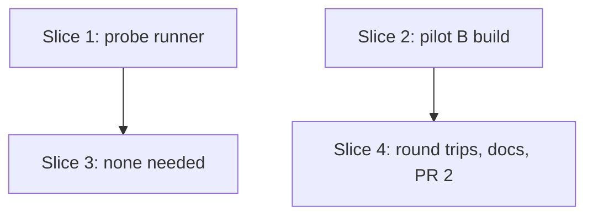

# Plan: S1b — VIPM installs an lvpm-built `.vip`

**Created**: 2026-10-27 · **Revised**: 2026-10-28 (plan review round 3, PR 2)
**Branch**: claude/s1b-vipm-roundtrip-spec (build continues on it)
**Status**: closed 2026-10-29. PR 1 merged (#80). PR 2's round trips failed: VIPM refuses lvpm's `.vip` at a new version, and the 2026-10-28 run had only installed VIPM's cached copy. See the spec's [Outcome](../docs/specs/lvpm-vip-roundtrip-s1b.md#outcome) and [ADR 6](../docs/adr/0006-lvpkg-only-vip-read-only.md). PR 2 ships the probe fixes and these docs only
**Gherkin persistence**: plan-file-only (steps write the feature file themselves, as S1 did)
**Spec**: [docs/specs/lvpm-vip-roundtrip-s1b.md](../docs/specs/lvpm-vip-roundtrip-s1b.md) · issue #60

## Goal

Find out, only through VIPM's documented CLI, what VIPM needs from a `.vip`;
change `lvpm build` so its output has exactly that; and show the round trip
on both pilots. The work ships as **two PRs** with a checkpoint between:

- **PR 1 (this plan, in detail):** slice 1, the probe runner, and slice 2,
  pilot B built from its pinned checkout. Ends with one probe run (step 1.6).
- **PR 2 (slices 3–4, re-planned after step 1.6):** planned as the probe
  fixes, the round trips and the docs. The round trips failed (see Status),
  so it ships the probe fixes and the closing docs.

## Acceptance Criteria

- [ ] AC1–AC9 of the spec, mapped below. PR 1 closes AC7 and AC1's table;
  AC1's PROVENANCE paragraph and the rest land in PR 2.

### AC → scenario → step

| AC | Scenarios | Step | PR |
|---|---|---|---|
| AC1 findings table, local | S1 "every variant gets a row", "a rejected variant records VIPM's message", "git status is unchanged by the run", "a vipm command that hangs is recorded", "a missing variable fails the run naming it" | 1.1–1.5, 1.6 | 1 |
| AC1 PROVENANCE paragraph | S4 PROVENANCE check | 4.3 | 2 |
| AC7 no residue | S1 "the tree is unchanged after the run", "a probe that leaves a file fails naming variant and file", "an installed package stops the run before any install", "an interrupted run is named at the next start" | 1.3, 1.4 | 1 |
| AC5 (build half) | S2 "pilot B builds from its pinned checkout" | 2.1 | 1 |
| AC2, AC3 | AC2 vacuous (empty `crates/` diff); AC3: S1 "building twice gives the same bytes" | 3 (none), PR 2 gate | 2 |
| AC4, AC5, AC6 | S4 manual round trips (AC6's file is `s1b-vip-in-vipm-roundtrip.feature`; deviation logged) | 4.2 | 2 |
| AC8 | gate run with `LVPM_TEST_LABVIEW=1 LVPM_TEST_PILOT_A=…` | PR 2 gate | 2 |
| AC9 | — (doc edit) | 4.3 | 2 |

## Approach stances (decision-defaults)

- Scope: the spec's. No `.lvpkg`, no extra `[Description]` fields, no lvpm
  feeds for VIPM.
- **Black-box boundary (Q1(b)).** The runner calls only `vipm install -y`,
  `uninstall`, `info`, `--version`, and reads only: their exit codes and
  output, the LabVIEW tree, and lvpm's own fixtures. It never reads VIPM's
  package cache or config. The spec's probe step 1 (key census from VIPM's
  cache) is dropped for that reason: the reference diff against the four
  VIPM-built archives in `tests/fixtures/pilots` takes its place.
- **Evidence stays out of the repo.** Findings go to `target/vipm-probes/`.
  Committed text (plan steps, tests, commit messages) names only the lvpm
  change and its test, never VIPM's messages, exit codes or the list of
  rejected variants.
- Format fidelity: lvpm adds only what a probe shows VIPM rejects without,
  plus `ID` if VIPM identifies packages by it.
- Integration: PRs against `main`, no auto-merge. PR 1 is test-only (no lvpm-core change): patch
  bump. PR 2 leaves `.vip` output as it is: patch bump (0.12.1).

## Slices

### Slice 1: the probe runner

**Depends-on:** none
**Files:** `tests/vipm_probe.rs`, `tests/vipm_probe/*.rs`, `tests/support/snapshot.rs`, `tests/support/mod.rs`, `tests/support/process.rs`, `docs/specs/lvpm-vip-roundtrip-s1b.md`

Uses `tests/support` (`mod support;` as `support_unit.rs` does; it changes only `process.rs`, whose timed-out commands now kill their whole process tree):
`global::claim`, `pilots::{pilots_dir, PILOT_A_ARCHIVE, copy_tree}`. Slice 2
keeps those names and signatures. `tests/support/tree.rs` is not reused (it
caps entries at 10,000 and normalises text).

Pure parts (variants, table, verdict, snapshot diff, preflight) are plain
`#[test]`s that run in `cargo test`. Only `probe_vipm` is `#[ignore]`.

**Behavior** (documentation; each scenario names the test that covers it):

```gherkin
Feature: VIPM probe runner (dev only)
  `cargo test --test vipm_probe -- --ignored --nocapture` with
  LVPM_TEST_VIPM (vipm.exe) and LVPM_TEST_PILOT_A (pilot A checkout).
  Writes target/vipm-probes/<date>T<time>-vipm-<version>/.

  Scenario: lvpm's build is diffed against the VIPM-built archive
    # Covered by: reference_diff_lists_one_sided_entries_and_keys
    Given pilot A built by lvpm and pilot A's published archive
    When the reference diff runs
    Then the table lists every zip entry and spec key present in only one of them, and each key whose value differs

  Scenario: a variant differs from the base in one thing only
    # Covered by: each_variant_differs_from_the_base_in_its_one_change
    Given pilot A built by lvpm
    When the variants are made
    Then the base row has no difference from the build
    And each other variant's entries and spec keys equal the base's except the one it names

  Scenario: every variant gets a row
    # Covered by: step 1.6 operator run; table_has_one_line_per_variant
    Given pilot A built by lvpm
    When the probe runner runs
    Then the table has one line per variant: name, accepted or rejected, exit code, first line of VIPM's output
    And VIPM's full output for each variant is in a file next to the table

  Scenario: a rejected variant records VIPM's message
    # Covered by: nonzero_exit_is_rejected_with_its_output; table_escapes_pipes_and_newlines
    Given vipm install exits non-zero for a variant
    When the probe runner records it
    Then its line says rejected with the exit code and the first line of the output, pipes and newlines escaped

  Scenario: vipm info must tell installed from not installed
    # Covered by: a_listing_that_does_not_change_with_the_install_stops_the_run
    Given the reference install of pilot A's published archive
    When vipm info is not "listed" after it, or still "listed" after its uninstall
    Then the run stops before any variant, saying vipm info cannot tell installed from not installed

  Scenario: the reference install is rejected
    # Covered by: a_rejected_reference_install_stops_the_run_as_environment
    Given vipm install of pilot A's published archive fails or times out
    When the probe runner runs it
    Then the run stops as "environment", naming VIPM's output file, and records no findings

  Scenario: exit 0 without a listing is not accepted
    # Covered by: exit_zero_not_listed_is_rejected
    Given the package is not installed before the install
    And vipm install exits 0 for a variant
    When the probe runner checks vipm info
    And vipm info does not list the package
    Then its line says rejected, reason "not listed by vipm info"

  Scenario: a vipm command that hangs is recorded
    # Covered by: a_timed_out_command_is_rejected; a_process_that_outlives_the_timeout_is_killed_and_reported; a_hung_install_is_rejected_then_cleaned_up_and_checked
    Given a vipm command that has not exited after its timeout
    When the probe runner runs the variant
    Then the command is killed, its line says rejected, reason "timed out after <n>s"
    And the uninstall and the tree check still run

  Scenario: an uninstall that hangs stops the run
    # Covered by: a_timed_out_uninstall_stops_the_run
    Given vipm uninstall has not exited after its timeout
    When the probe runner cleans up a variant
    Then the command is killed and the run stops naming the package and its uninstall command

  Scenario: an installed package stops the run before any install
    # Covered by: preflight_refuses_when_a_touched_package_is_installed
    Given vipm info lists pilot A, Data Manipulation or the palette as installed
    When the probe runner starts
    Then it stops before any install, naming the packages and the vipm uninstall command for each

  Scenario: an interrupted run is named at the next start
    # Covered by: a_leftover_state_file_is_cleared_or_stops_the_run
    Given target/vipm-probes/in-progress.json from a run that did not finish
    When the probe runner starts
    Then it checks those packages with vipm info
    And continues after removing the file when none is listed
    Or stops naming each listed package, its vipm uninstall command and "then re-run"

  Scenario: another test run holds the global LabVIEW
    # Covered by: a_held_claim_refuses_the_probe
    Given another run holds the global LabVIEW claim
    When the probe runner starts
    Then it stops naming the holder, before any install

  Scenario: a probe that leaves a file fails naming variant and file
    # Covered by: residue_names_extra_missing_and_changed_files
    Given a variant, accepted or rejected, after which the scoped tree differs from its snapshot
    When the probe runner checks the tree after that variant
    Then the run stops naming the variant, each file and how it differs, and the uninstall command to run

  Scenario: an uninstall that fails stops the run
    # Covered by: failed_uninstall_stops_the_run
    Given vipm uninstall exits non-zero
    When the probe runner cleans up a variant
    Then the run stops naming the package and VIPM's output

  Scenario: the tree is unchanged after the run
    # Covered by: a_final_tree_difference_fails_the_run; step 1.6 operator run
    When the probe runner finishes
    Then the scoped LabVIEW tree equals its snapshot from before the run

  Scenario: git status is unchanged by the run
    # Covered by: git_status_change_outside_claude_fails_the_run
    When the probe runner finishes
    Then git status --porcelain, without paths under .claude/, equals its output from before the run

  Scenario: a missing variable fails the run naming it
    # Covered by: missing_env_names_the_variable
    Given --ignored is passed and LVPM_TEST_VIPM is unset or names no file
    When the probe runner starts
    Then it fails naming the variable and what it must point to, and starts no VIPM command
```

**Steps:**

#### Step 1.1: `package_id`, probe-side

**Complexity**: standard
**IMPLEMENT**: `pub fn package_id(name, version, entries: &[(String, Vec<u8>)]) -> String`
in `tests/vipm_probe/variants.rs`: MD5 (the spec's choice; `md-5` is already a dependency)
over `name\0version\0` then, sorted by path with `/` separators,
`path\0md5(content)\n` for every entry except `spec`. PR 1 ships no lvpm-core change; if the probe shows VIPM needs `ID`, PR 2
moves this function into `ops/build.rs` unchanged, so the probe tested what
lvpm will ship.
**TEST**: unit tests: same input → same ID; one member's bytes changed →
different ID; entry order irrelevant; version changed → different ID;
`spec` entry changed → same ID; 32 lowercase hex digits.
**REFACTOR**: `shortcut:` none; doc comment says why `spec` is excluded (circular).
**Files**: `tests/vipm_probe/variants.rs`
**Commit**: `test(vipm): package_id, a content-derived package ID for the probe`

#### Step 1.2: variants, reference diff and the table

**Complexity**: standard
**IMPLEMENT**: from the base build of pilot A (bytes), variants as
`(name, bytes)`. Row 0 is `base`, the build as is (no `ID`, `Format Version`
2017, no icon, no license, `Requires` empty). Every other row makes one change
from it: `ID` = `package_id` / random / empty; `Format Version` absent or each
other value the four fixture specs carry, set to that value (none today, so
only `absent`); `icon.bmp` present
(bytes from pilot A's published archive); `license` + `License Agreement`
present; `Requires` =
`labview_open_source_lib_data_manipulation>=1.5.0.15` / same with `=`; and one
variant per key the reference diff finds in all four fixture specs that lvpm
does not write, set to the value pilot A's archive carries, **at most 5**
(others listed in the table, not varied).
Reference diff: lvpm's pilot A build against `hse_lib_hse_logger-2.2.2.114.vip`,
by entry, key and value (raw key scan of the spec text). Table: one line per
row, pipes and newlines escaped; full VIPM output in `<variant>.txt` beside it.
Random ID uses a fixed seed. The table header names the VIPM version
(`vipm --version`) and the LabVIEW version (the LabVIEW 2026 tree's
`LabVIEW.exe` file version).
**TEST**: `each_variant_differs_from_the_base_in_its_one_change` (`base`:
zero differences; every other row: exactly one, the license row's entry and the key naming it counting as one); `reference_diff_lists_one_sided_entries_and_keys`
on two tiny zips with known one-sided entry, key and changed value;
`table_has_one_line_per_variant`; `table_escapes_pipes_and_newlines`.
**REFACTOR**: one `Variant { name, apply: fn(&mut Pkg) }` list.
**Files**: `tests/vipm_probe.rs`, `tests/vipm_probe/variants.rs`, `tests/vipm_probe/table.rs`
**Commit**: `test(vipm): probe variants, reference diff and findings table`

#### Step 1.3: drive vipm.exe, with timeouts and preflight

**Complexity**: standard
**IMPLEMENT**: `Vipm` over a command closure: `install(file)`, `uninstall(name)`,
`info(name, version) -> listed`, `version()`. **Listed** means `vipm info
<name>` exits 0 and its output contains both `<name>` and `<version>`; the
preflight, with no version, needs only `<name>` (broad on purpose: a false
"listed" only stops the run). Every run calibrates it around the reference
install (step 1.4); unit tests use synthetic strings the runner owns, never
VIPM's output. Each command has a timeout (install 600 s,
others 120 s; the child is killed past it). Verdict: exit 0 and listed →
accepted; exit 0 and not listed → rejected "not listed by vipm info";
non-zero → rejected with output; timeout → rejected "timed out after <n>s". Preflight:
`info` for pilot A, Data Manipulation and the palette; any listed → stop
naming each with its `vipm uninstall` command. Env: with `--ignored`, a
missing or non-existent `LVPM_TEST_VIPM` / `LVPM_TEST_PILOT_A` fails naming
the variable. Progress to stderr: `[7/14] ID=random: installing...`, and a
start line with the variant count and "do not interrupt; if you must, the
next start tells you what to uninstall".
**TEST**: fake command: `listed_needs_exit_zero_name_and_version`,
`exit_zero_not_listed_is_rejected`,
`nonzero_exit_is_rejected_with_its_output`, `a_timed_out_command_is_rejected`
(fake sleeps; asserts the uninstall and tree check ran after the kill),
`a_timed_out_uninstall_stops_the_run`, `preflight_refuses_when_a_touched_package_is_installed`,
`missing_env_names_the_variable`.
**REFACTOR**: the command seam is a plain closure; no trait.
**Files**: `tests/vipm_probe.rs`, `tests/vipm_probe/vipm.rs`, `tests/support/process.rs`
**Commit**: `test(vipm): drive vipm install/uninstall/info with timeouts and a preflight`

#### Step 1.4: claim, state file, scoped snapshots

**Complexity**: standard
**IMPLEMENT**: take the claim with `support::global::{claim, claim_path}`
before the preflight; the probe's own small `Drop` guard (not `GlobalRun`,
which is tied to LabVIEW start-up) uninstalls and then removes the claim. Before each install, write
`target/vipm-probes/in-progress.json` (packages that may be installed);
delete it after the clean-up check. At start, a leftover file triggers the preflight for the packages it
names: none listed → remove the file and continue; any listed → stop with
the uninstall commands and "then re-run". The reference install below
goes through the same state file, guard and tree check as a variant. It is
the run's baseline and calibration: rejected or timed out → stop as
"environment" naming the output file, no findings; not listed after it, or
still listed after its uninstall → stop, "vipm info cannot tell installed
from not installed". Discovery: around the reference install, one full-tree snapshot of the
LabVIEW 2026 root shows where VIPM writes; any changed path outside the
scoped list stops the run naming it (the list then grows). Per-variant,
snapshot only the directories VIPM writes: `vi.lib`,
`user.lib`, `instr.lib`, `menus`, `resource`, `templates`, `examples`,
`project` under the LabVIEW 2026 tree; `(path, size, mtime)`, with SHA-256
only for files whose size or mtime differ; ignore `*.ini`, `*.aliases`
and LabVIEW's `*.cache`/`*.lvlps` files. Check the tree after **every**
variant, accepted or rejected; a difference stops the run naming variant,
file and kind (extra / missing / changed) and the uninstall to run. Clean-up uninstalls
every package `in-progress.json` names for that variant (pilot A, then Data
Manipulation and the palette for the `Requires` rows), and the tree check
runs after the whole clean-up. A failing uninstall stops the run. For accepted variants also diff the install
against VIPM's install of the published pilot A archive (installed once at
the start, uninstalled before the variants; preflight covers it). The diff
(files extra or missing against the reference install) goes to
`<variant>.install-diff.txt`, and the table gets a column "same files as
reference: yes/no". It is a finding, not a run failure.
**TEST**: `a_held_claim_refuses_the_probe`, `a_leftover_state_file_is_cleared_or_stops_the_run`,
`state_file_written_before_each_install_and_removed_after_a_clean_run`,
`a_rejected_variant_does_not_leave_the_state_file`,
`a_rejected_reference_install_stops_the_run_as_environment`,
`a_listing_that_does_not_change_with_the_install_stops_the_run`,
`a_write_outside_the_scope_stops_the_run`,
`residue_names_extra_missing_and_changed_files`, `ignored_paths_are_not_residue`,
`failed_uninstall_stops_the_run`, `cleanup_uninstalls_every_package_the_state_file_names`,
`install_diff_against_reference_lists_extra_and_missing`, `the_guard_uninstalls_when_a_probe_panics`
(fake command records the uninstall after a panicking closure).
**REFACTOR**: snapshot and diff are plain functions over `BTreeMap<PathBuf, Entry>` in `tests/support/snapshot.rs`, so slice 4's round trips can use them from the acceptance target.
**Files**: `tests/support/snapshot.rs`, `tests/support/mod.rs`, `tests/vipm_probe/run.rs`, `tests/vipm_probe.rs`
**Commit**: `test(vipm): every probe leaves the LabVIEW tree as it found it`

#### Step 1.5: the `#[ignore]` run

**Complexity**: standard
**IMPLEMENT**: `probe_vipm`: env → claim → state check → preflight →
`git status --porcelain` and tree snapshot → reference install (baseline,
calibration) → variants → final tree check → `git status` check (paths
under `.claude/` filtered out; hooks write there) → table. Before the
first install the start line says the machine must have none of pilot A,
Data Manipulation or the palette installed. Builds
pilot A with `lvpm_core::ops::build` from a copy of the checkout in a temp
dir (as S1's scenario copies `Source`), so the checkout is not touched.
Ends with a stderr line: `<n> variants: <a> accepted, <r> rejected; table: <abs path>`.
**TEST**: `a_final_tree_difference_fails_the_run`,
`git_status_change_outside_claude_fails_the_run` (fake snapshots);
`cargo test` lists `probe_vipm` as ignored and runs every pure test;
`cargo clippy --all-targets -- -D warnings`.
**REFACTOR**: the run reads top-down as the list above.
**Files**: `tests/vipm_probe.rs`, `tests/vipm_probe/run.rs`
**Commit**: `test(vipm): the probe run`

#### Step 1.6: run it (operator, nothing committed but the spec tick)

**Complexity**: trivial
**IMPLEMENT**: no acceptance run in progress; LabVIEW 2026 without the
pilots; VIPM 2026.3. Run the probe. Read the table. Confirm the glossary term
"accepted": the run's calibration passed (listed after the reference
install, not listed after its uninstall); mark the term `verified` in the
spec. If the calibration stopped the run, re-plan step 1.3's verdict (the
tree diff becomes the evidence). Log the spec deviations (Risks). If VIPM rejects the base build and every variant: stop and ask
the user (spec Q3). Otherwise: PR 1 is ready; PR 2 is re-planned from the
findings (slice 3 below), naming per step only the lvpm change, its test and
the variant name that justified it.
**TEST**: AC1's table and AC7 observed: table present with both versions,
`git status` check and final tree check passed.
**REFACTOR**: none needed beyond the spec tick.
**Files**: `docs/specs/lvpm-vip-roundtrip-s1b.md`
**Commit**: `docs(specs): S1b, "accepted" confirmed by the first probe run`

### Slice 2: pilot B builds from its pinned checkout

**Depends-on:** none
**Files:** `tests/support/selection.rs`, `tests/support/pilots.rs`, `tests/steps/pilots.rs`, `tests/acceptance.rs`, `tests/support_unit.rs`, `tests/features/build-slices/s1b-vip-in-vipm.feature`, `tests/features/build-slices/README.md`

**Behavior:**

```gherkin
Feature: lvpm builds pilot B
  Runs when LVPM_TEST_PILOT_B names a checkout of
  github.com/LabVIEW-Open-Source/Serializer at 723d7a67 (tag 1.2.1).

  @pilot-b-source
  Scenario: pilot B builds from its pinned checkout
    Given pilot B's repository at its pinned commit
    And an lvpm.toml for it written by the scenario
    When lvpm build runs
    Then dist holds "labview_open_source_lib_serializer-1.2.1.16.vip"
    And its Requires names the same packages as the published archive's
```

Not Gherkin, unit tests (a scenario cannot assert its own skip or its own
failing precondition):

- `pilot_b_scenario_needs_its_own_variable`,
  `pilot_a_checkout_does_not_stand_in_for_pilot_b`, `pilot_b_checkout_does_not_stand_in_for_pilot_a`,
  `the_not_run_line_text_names_the_variable_and_pilot`: `select()` with
  `@pilot-b-source` and no `LVPM_TEST_PILOT_B` returns "not run", with a
  report line naming the variable.
- `a_checkout_at_another_commit_names_both_and_the_fix`: the checkout check
  on a temp `git init` repo returns an error naming the pinned commit, the
  found commit and `git -C "<path>" checkout <pinned>`.
- `a_variable_nothing_sets_names_no_checkout`, `a_missing_path_is_refused`,
  `a_folder_that_is_not_a_repository_is_refused`, `a_modified_file_is_refused`,
  `an_untracked_file_is_refused`, `a_checkout_git_cannot_read_is_refused_not_accepted`:
  each error names the variable, the path and what is wrong. Only the copied
  folder (`Source` / `source`) must be clean:
  `changes_outside_the_copied_folder_are_accepted`.

**Steps:**

#### Step 2.1: `LVPM_TEST_PILOT_B`

**Complexity**: standard
**IMPLEMENT**: `pilot_checkout(env_var, commit, subtree) -> Result<PathBuf, String>`
in `tests/support/pilots.rs`, used by pilot A's step and pilot B's;
`PILOT_B_ENV_VAR`, `PILOT_B_COMMIT = 723d7a672b5f0eafa9f98ea63629ba5855d50227`
(README). `select()` gets a `@pilot-b-source` arm; its positional bools become
an `Env` struct so the ~15 existing tests stay readable. `acceptance.rs`
reads the variable, adds the not-run line, and lists
`s1b-vip-in-vipm.feature` in `FEATURE_FILES`. The scenario writes pilot B's
`lvpm.toml` (name, version, labview, `labview_open_source_lib_data_manipulation`
from the published spec, `[distribution]`); expected `Requires` names come
from `spec::parse` of the fixture archive.
**TEST**: the scenario (runs where the checkout is set); the two unit tests
above; existing selection tests pass with `Env`.
**REFACTOR**: pilot A's step calls `pilot_checkout`; keep `pilots_dir`,
`PILOT_A_ARCHIVE`, `copy_tree` unchanged (slice 1 uses them).
**Files**: `tests/support/selection.rs`, `tests/support/pilots.rs`, `tests/steps/pilots.rs`, `tests/acceptance.rs`, `tests/support_unit.rs`, `tests/features/build-slices/s1b-vip-in-vipm.feature`, `tests/features/build-slices/README.md`
**Commit**: `test(pilots): pilot B builds from its pinned checkout`

### Slice 3: lvpm writes what VIPM needs (none needed)

Refuted 2026-10-29 (spec Outcome, ADR 6): that run reused a version VIPM had
cached, so its "accepted" was VIPM's own copy. The original text follows.

Re-planned after step 1.6. The probe run accepted lvpm's base build and every
variant, each installing the reference's files. lvpm-core needs no change.
AC2 is vacuous: no change, so no requirement to test; the PR 2 gate checks
`git diff main -- crates/` is empty. AC3 is S1's scenario "building twice
gives the same bytes" (`s1-lvpm-build.feature`), unchanged; lvpm writes no
`ID`. The sketched `WriteExtras` and `write_zip` seams are dropped. Nothing to
build.

### Slice 4: round trips recorded, docs (PR 2)

**Depends-on:** 2
**Files:** `tests/vipm_probe.rs`, `tests/vipm_probe/vipm.rs`, `tests/features/build-slices/s1b-vip-in-vipm-roundtrip.feature`, `tests/features/build-slices/README.md`, `tests/acceptance.rs`, `PROVENANCE.md`, `docs/vision/README.md`, `docs/vision/build-slices.md`, `docs/specs/lvpm-vip-roundtrip-s1b.md`

PR 2 is this branch (the probe fixes from step 1.6 plus this slice). `.vip`
output does not change, so the bump is a patch: 0.12.1, already made.

#### Step 4.1: the probe refuses a `LVPM_TEST_VIPM` that is not the CLI

Hardening for AC1's run: the GUI exe sits next to the CLI and is easy to pick.
**Complexity**: trivial
**IMPLEMENT**: `Vipm::version` returns an error naming `LVPM_TEST_VIPM` and
`support\vipm.exe` unless the first line of `--version` starts with `vipm `
(the real CLI prints `vipm 26.3.0`); its other error arms (non-zero exit,
timeout, cannot start) name the variable too. In `tests/vipm_probe.rs` the
`vipm.version()` call moves to just after `Vipm::new`, before `Guard::take`,
so no `info` or `uninstall` runs against the wrong binary.
**TEST**: `version_that_is_not_vipms_names_the_variable` (fake prints other
text), `empty_version_output_names_the_variable`;
`version_is_the_first_line_of_vipm_version` still passes (its fake prints
`vipm synthetic 1.0`).
**Files**: `tests/vipm_probe.rs`, `tests/vipm_probe/vipm.rs`
**Commit**: `test(vipm): the probe names LVPM_TEST_VIPM when it is not the CLI`

#### Step 4.2: round trips on both pilots (operator)

**Complexity**: standard
**IMPLEMENT**: `s1b-vip-in-vipm-roundtrip.feature`, its scenarios tagged
`@unsafe`, registered in `FEATURE_FILES` like every feature file (the harness
counts `@unsafe` scenarios as never run and needs no step definitions for
them); not tagged `@labview`. The build-slices README's "VIPM probe" section
gets a paragraph on how the operator runs it and that the run lines are the
evidence.
Background: VIPM logged in and able to install Data Manipulation by name;
`vipm info` shows none of pilot A, pilot B, Data Manipulation or the palette
installed; VIPM's confirmation for a package that reuses a published name and
version is answered when it shows (unanswered, the install makes no progress
and VIPM gives up).
Scenario A (AC4): pilot A built by lvpm is installed with `vipm install -y`;
the install is accepted (glossary: exits 0 and `vipm info` shows the
version); VIPM's mass compile (S0 wording) lists zero broken VIs; the
installed files equal those of the published archive's install minus S1
criterion 4's six files, as the probe's base row shows.
Scenario B (AC5): pilot B built from its pinned checkout installs the same
way and is accepted; `vipm info` shows Data Manipulation and the palette
installed; mass compile lists zero broken VIs.
After both: everything is uninstalled and `vipm info` shows the four not
installed. Each scenario ends with a run line
`Run <date>, VIPM 26.3.0, LabVIEW <version>: pass|fail`; the operator fills it
in. A fail stops PR 2: a lvpm cause re-opens slice 3, anything else is logged
in Risks. The rejected path is the probe's (its rejected-variant tests); the
round trips add none.
**TEST**: AC4–AC6: `grep -c ": pass$"` on the file gives 2;
`cargo test --test acceptance` counts the two as `@unsafe`, never run.
**Files**: `tests/features/build-slices/s1b-vip-in-vipm-roundtrip.feature`, `tests/features/build-slices/README.md`, `tests/acceptance.rs`
**Commit**: `test(s1b): pilot A and B round trips in VIPM, recorded`

#### Step 4.3: PROVENANCE, milestone, spec deviations

**Complexity**: trivial
**IMPLEMENT**: after the PR 2 gate passes. PROVENANCE.md gets a ".vip
writing" paragraph: lvpm's `.vip` layout was checked only through documented
`vipm` commands (install, uninstall, info) against VIPM 26.3.0, with no VIPM
code or cache read (AC1). README milestone "`.vip` output, verified by a
round-trip install in VIPM" ticked (AC9), only once 4.2's run lines say pass;
S1b is closed on the board, not in build-slices.md (its convention). The
spec logs the deviations from Risks, AC6's file name among them.
**TEST**: PROVENANCE names "documented `vipm` commands" and "VIPM 26.3.0" and
no VIPM message or variant; the README line reads `- [x]`; no spec text
names `s1b-vip-in-vipm.feature` for the round trips.
**Files**: `PROVENANCE.md`, `docs/vision/README.md`, `docs/vision/build-slices.md`, `docs/specs/lvpm-vip-roundtrip-s1b.md`
**Commit**: `docs(s1b): .vip output verified in VIPM`

## Parallelization



| Wave | Slices (parallel) |
|------|-------------------|
| 1 | 1, 2 |
| 2 | 4 (slice 3 has no steps) |

Wave 1 slices share no file. `/build` (or the orchestrator) owns the Build
Progress ticks; slices do not edit this plan.

## Complexity Classification

As the template. No `complex` step: no shipped behaviour changes in PR 1, and
nothing security-sensitive.

## Pre-PR Quality Gate

PR 1:
- [ ] `cargo test` (all pure probe tests run, `probe_vipm` ignored), `cargo test --test acceptance`
- [ ] `cargo clippy --all-targets -- -D warnings`, `cargo fmt --check`
- [ ] step 1.6 run done: table present, tree and `git status` checks passed
- [ ] patch bump in `Cargo.toml`, then `cargo update -w`
- [ ] `/code-review` passes

PR 2 adds: `LVPM_TEST_LABVIEW=1 LVPM_TEST_PILOT_A=<checkout> cargo test --test acceptance`
with S1's pilot scenarios in the run count (AC8) and "building twice gives the
same bytes" passing (AC3); `git diff main -- crates/` empty (AC2); both run
lines in the round-trip file say pass (AC4–AC6).

## Skipped (low value)

| Finding | Rationale (one line) |
|---|---|
| CI job for the probe runner | Needs VIPM and LabVIEW; CI has neither, and its logic is unit-tested. |
| Key census over VIPM's package cache | Outside Q1(b)'s black-box boundary; the fixture reference diff covers the same question for the keys that matter. |

## Risks & Open Questions

- **VIPM rejects everything** (spec Q3, deferred): stop and ask the user.
- **Snapshot scope** may miss a directory VIPM writes to. The reference
  install at the start of the run shows where VIPM writes; if outside the
  list, the run stops and the list grows.
- **Requires variants install Data Manipulation and the palette** from
  vipm.io; network or login failure shows as a rejected row with VIPM's
  message, and the preflight and tree check cover their clean-up.
- **Backstop review items left for later:** the `ours`/`theirs`/`published` naming in the probe, splitting the remaining multi-behavior tests, whether `Guard::drop` should keep the global claim after a failed uninstall, `global.rs` findings (spawned LabVIEW not checked with `try_wait`, a partial claim file on write error), the hidden success check in the `dist holds` step, a negative pilot B scenario, and symlink handling in `copy_tree`/`snapshot`. The support unit tests run in both `support_unit` and `vipm_probe` (accepted).
- **Spec deviations to log** in the spec at step 4.3: probe step 1 (census)
  dropped; pilot B has one direct dependency, not two (spec AC5 wording);
  AC6's round trips live in `s1b-vip-in-vipm-roundtrip.feature`, `@unsafe`
  and unregistered, so AC4–6 rest on the recorded run lines, not the
  harness; AC1's PROVENANCE paragraph lands in PR 2.
- **The preflight trusts a broad "listed".** If `vipm info` prints a name
  for packages only on vipm.io, the preflight always stops; that shows at
  step 1.6 and re-plans step 1.3. The opposite (never listed) is caught by
  the calibration, but only after the reference install, so the start line
  asks the operator to make sure none of the 3 packages is installed.
- **Narrower than the spec's "tree unchanged" and "git status unchanged"**
  (deviation to log at 1.6): the tree check covers the scoped directories
  (after the full-tree discovery around the reference install) and excludes
  `*.ini`, `*.aliases`, `*.cache`, `*.lvlps`, which LabVIEW and VIPM rewrite
  on their own, and `*.vidb` (the compiled-object cache, found by the first
  run at 1.6), and VIPM's own `project/VI Package Manager.vi`, which VIPM
  rewrote during the second run at 1.6; the `git status` check excludes `.claude/`, which this
  repo's hooks write during any session. Any other change fails the run.
- **Content beyond S1's members.** The published pilot archives also carry
  examples, VI templates, palettes and install hooks that lvpm's build leaves
  out by S1's scope, not VIPM's. AC4 compares against S1 criterion 4's list;
  anything else missing at step 4.2 is a candidate slice, not S1b work.
- Tag names: pilot A is `@pilot-source`, pilot B `@pilot-b-source`;
  renaming pilot A's tag is out of scope.

## Plan Review Summary

Round 1 (plan tier: complex, 4 slices, 3 waves; reviewers: Acceptance,
Design, Strategic, Parallelization, UX). Verdicts: Parallelization approve;
the other four needs-revision. Blockers and their fixes:

| Blocker | Fix |
|---|---|
| No `@manual` tag; manual scenarios would fail `fail_on_skipped` (Acceptance, Design, Strategic) | `@unsafe` in an unregistered round-trip feature file (slice 4) |
| Pilot B skip / wrong-commit cannot be cucumber scenarios; selection keyed to pilot A (Acceptance, Design) | unit tests, `@pilot-b-source`, `Env` struct, `pilot_checkout` (2.1) |
| Slice 3 outline empty and non-binary (Acceptance, Strategic, Design) | PR split; slice 3 re-planned and re-reviewed after 1.6 with a binary key/entry outline and a negative scenario |
| Key census reads VIPM's cache and config (Strategic) | dropped; fixture reference diff instead |
| No preflight before installing into the global LabVIEW; no recovery after interruption (UX) | preflight (1.3), claim + state file (1.4) |

Warnings addressed: MD5 via existing `md-5` with a defined input shared by
probe and build (1.1); `Spec` read model untouched (slice 3); timeouts;
progress output; table escaping and per-variant output files; scoped,
mtime-first snapshots checked after every variant; `git status --porcelain`
before/after; pilot B facts (one dependency, commit from README); support
items slice 1 reads are kept stable by slice 2; Requires variants from an
empty base; findings never quoted in committed text.

Round 2 (re-review of the four that asked for revision): UX, Strategic and
Design approve. Acceptance: needs-revision with one new blocker, fixed after
the round; the two-round cap makes the human gate the next check.

| Blocker | Fix |
|---|---|
| "Listed by `vipm info`" undefined; a parse that always says "not listed" would let the run touch the user's packages (Acceptance) | predicate defined (exit 0, name and version in output), calibrated on every run around the reference install, synthetic-string unit tests (1.3, 1.4) |

Round 2 warnings folded in: `package_id` probe-side in PR 1; snapshot in
`tests/support/snapshot.rs`; the probe's own claim guard (Design). Leftover
state file auto-cleared or "then re-run"; reference install as baseline
through the same guard; summary line; "none installed" up front (UX).
Full-tree discovery snapshot; slices 3–4 marked "do not build until
re-planned" (Strategic). `base` as a zero-diff row; automated `git status`
and final tree checks; state-file lifecycle, timeout and hung-uninstall
tests; ID independent of `spec`; `pilot_checkout` error cases; LabVIEW
version in the table; patch bump in the gate; deviations in Risks
(Acceptance).

Round 3 (PR 2 re-plan; Acceptance, Design). Both needs-revision. Fixed: AC2
and AC3 given checks (empty `crates/` diff, S1's determinism scenario named);
the round trips name their evidence (glossary verdict, `vipm info` for the
dependencies and the clean-up, zero broken VIs, the run-line grep); the
version guard runs before `Guard::take` and every error arm names the
variable; the round-trip file is registered in `FEATURE_FILES`; README and
AC9 checks added. Not taken: negative manual scenarios (the probe covers the
rejected path); a stored file diff for scenario A (the probe's base row
already compares pilot A's install with the published archive's).

## Build Progress

### Slices (grouped by wave)

#### Wave 1
- [x] Slice 1: the probe runner
  - [x] Step 1.1: `package_id`, probe-side
  - [x] Step 1.2: variants, reference diff and the table
  - [x] Step 1.3: drive vipm.exe, with timeouts and preflight
  - [x] Step 1.4: claim, state file, scoped snapshots
  - [x] Step 1.5: the `#[ignore]` run
  - [x] Step 1.6: run it (operator, nothing committed but the spec tick)
- [x] Slice 2: pilot B builds from its pinned checkout
  - [x] Step 2.1: `LVPM_TEST_PILOT_B`

#### Wave 2
- [x] Slice 3: lvpm writes what VIPM needs (none needed)
- [x] Slice 4: round trips recorded, docs (closed by ADR 6)
  - [x] Step 4.1: the probe refuses a non-CLI `LVPM_TEST_VIPM`
  - [x] Step 4.2: dropped (ADR 6): VIPM refuses lvpm's `.vip`; no round-trip file is kept
  - [x] Step 4.3: PROVENANCE and spec done; the milestone was dropped instead of ticked (ADR 6)
